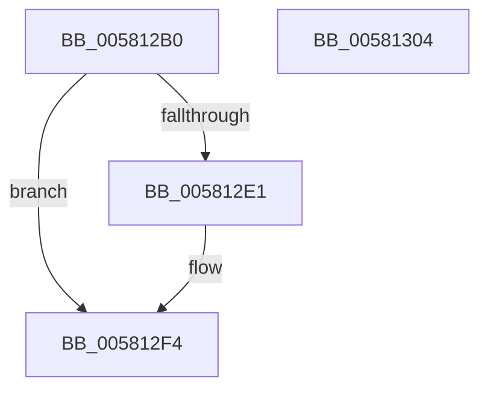

# FsRtlLookupLastMcbEntry

- RVA: `0x005812B0`–`0x00581305` (길이 `85` bytes)
- VA: `0x00000001405812B0`
- 실행 섹션: `.text`
- PDB 이름 있음: `예`; PDB Function 태그: `아니요`
- unwind 정보 RVA: `0x000733E4`
- 디코드: `27`개 명령, `85/85` bytes 표시
- 미해석 바이트: `0` (있으면 어셈블리에 `.byte`로 보존)

> 이 문서는 커널 이미지의 기계어와 PDB 기호를 분석해 생성했습니다. 4번과 5번은 함수 원형과 자료형을 바이너리 사용 방식에서 추정한 C 해석이며 원본 소스 복구 결과는 아닙니다.

## 1. Dependencies

- 직접 호출 지점: **1**; 고유 호출 대상: **1**
- 직접 호출자로 확인된 함수: **0**
- RIP 상대 이미지 참조: **0**

### Outgoing calls
- `0x005812D8` → [FsRtlLookupLastLargeMcbEntry](FsRtlLookupLastLargeMcbEntry_function_00581250.md) (function, `0x00581250`)

### Direct callers
- 이 함수 시작 RVA로 연결되는 직접 call은 확인되지 않았습니다. 간접 호출은 완전히 역산할 수 없습니다.

### Static image references
- 디코드된 RIP-relative 메모리 참조가 없습니다.

## 2. Other-region calls and transfers

- 다른 실행 섹션으로 향하는 call: **0**
- 별도 외부 분기/꼬리 이동을 확인하지 못했습니다.

## 3. Assembly (complete function range)

```asm
005812B0  48 8B C4                        mov rax, rsp
005812B3  48 89 58 08                     mov qword ptr [rax + 8], rbx
005812B7  48 89 70 10                     mov qword ptr [rax + 0x10], rsi
005812BB  57                              push rdi
005812BC  48 83 EC 30                     sub rsp, 0x30
005812C0  49 8B D8                        mov rbx, r8
005812C3  48 8B FA                        mov rdi, rdx
005812C6  33 F6                           xor esi, esi
005812C8  4C 8D 40 E8                     lea r8, [rax - 0x18]
005812CC  48 8D 50 20                     lea rdx, [rax + 0x20]
005812D0  48 89 70 20                     mov qword ptr [rax + 0x20], rsi
005812D4  48 89 70 E8                     mov qword ptr [rax - 0x18], rsi
005812D8  E8 73 FF FF FF                  call 0x140581250
005812DD  84 C0                           test al, al
005812DF  74 13                           je 0x1405812f4
005812E1  8B 4C 24 58                     mov ecx, dword ptr [rsp + 0x58]
005812E5  89 0F                           mov dword ptr [rdi], ecx
005812E7  48 8B 4C 24 20                  mov rcx, qword ptr [rsp + 0x20]
005812EC  83 F9 FF                        cmp ecx, -1
005812EF  0F 44 CE                        cmove ecx, esi
005812F2  89 0B                           mov dword ptr [rbx], ecx
005812F4  48 8B 5C 24 40                  mov rbx, qword ptr [rsp + 0x40]
005812F9  48 8B 74 24 48                  mov rsi, qword ptr [rsp + 0x48]
005812FE  48 83 C4 30                     add rsp, 0x30
00581302  5F                              pop rdi
00581303  C3                              ret
00581304  CC                              int3
```

## 4. C-style interpretation (structured pseudocode)

```c
__int64 __fastcall FsRtlLookupLastMcbEntry(__int64 a1, __int64 a2, __int64 a3)
{
    __int64 result;
    __int64 v_rsi;
    __int64 v_rsp;
    unsigned __int64 v_stack_m18;
    unsigned __int64 v_stack_p10;
    unsigned int v_stack_p20;
    unsigned __int64 v_stack_p8;

    *(unsigned __int64 *)(v_rsp + 8) = v_rbx;
    *(unsigned __int64 *)(v_rsp + 16) = v_rsi;
    v_rsp = (v_rsp) - (48);
    v_rsi = 0;
    *(unsigned __int64 *)(v_rsp + 32) = 0;
    *(unsigned __int64 *)(v_rsp - 24) = 0;
    result = FsRtlLookupLastLargeMcbEntry(a1, v_rsp + 32, v_rsp - 24, a4);
    if ((unsigned __int8)(result) != 0) {
        a1 = v_stack_p20;
        *(unsigned int *)(a2) = (unsigned int)(a1);
        a1 = v_stack_m18;
        if (((unsigned int)(a1)) == -1) { a1 = 0; }
        *(unsigned int *)(a3) = (unsigned int)(a1);
    }
    v_rsp = (v_rsp) + (48);
    return result;
}
```

## 5. (Beta) C Style

```c
int64_t FsRtlLookupLastMcbEntry(int64_t Arg1, void *Arg2, void *Arg3)
{
    uint8_t *arg2 = (uint8_t *)Arg2;
    uint8_t *arg3 = (uint8_t *)Arg3;

    int64_t result;
    int64_t local_rsi;
    int64_t local_rsp;
    uint64_t v_stack_m18;
    uint64_t v_stack_p10;
    uint32_t v_stack_p20;
    uint64_t v_stack_p8;

    *(uint64_t *)(local_rsp + 0x8) = local_rbx;
    *(uint64_t *)(local_rsp + 0x10) = local_rsi;
    local_rsp = (local_rsp) - (48);
    local_rsi = 0;
    *(uint64_t *)(local_rsp + 0x20) = 0;
    *(uint64_t *)(local_rsp - 0x18) = 0;
    result = FsRtlLookupLastLargeMcbEntry(Arg1, local_rsp + 32, local_rsp - 24, a4);
    if ((uint8_t)(result) != 0) {
        Arg1 = v_stack_p20;
        *(uint32_t *)(arg2) = (uint32_t)(Arg1);
        Arg1 = v_stack_m18;
        if (((uint32_t)(Arg1)) == -1) { Arg1 = 0; }
        *(uint32_t *)(arg3) = (uint32_t)(Arg1);
    }
    local_rsp = (local_rsp) + (48);
    return result;
}
```

### 관측된 메모리 오프셋

구조체 형식이 확인되지 않은 접근은 인자 기준의 오프셋으로만 기록했습니다.

| 기준 인자 | 오프셋 표현 | 폭 (bit) | 접근 |
|---|---:|---:|---|
| `Arg2` | `+ 0x0` | `32` | `W` |
| `Arg3` | `+ 0x0` | `32` | `W` |

## 6. Execution-region graph

[열기: 2D/3D 그래프와 함수 탐색 컨트롤 패널](../../../control-panel.html?section=text&rva=0x005812B0&view=graph)

- 2D 그래프는 위에서 아래로 흐르고, 3D 그래프는 빈 공간을 드래그해 회전합니다. Shift+드래그는 이동, 휠은 확대·축소, 함수 노드 선택은 대상 보고서 이동입니다.

### Static fallback


