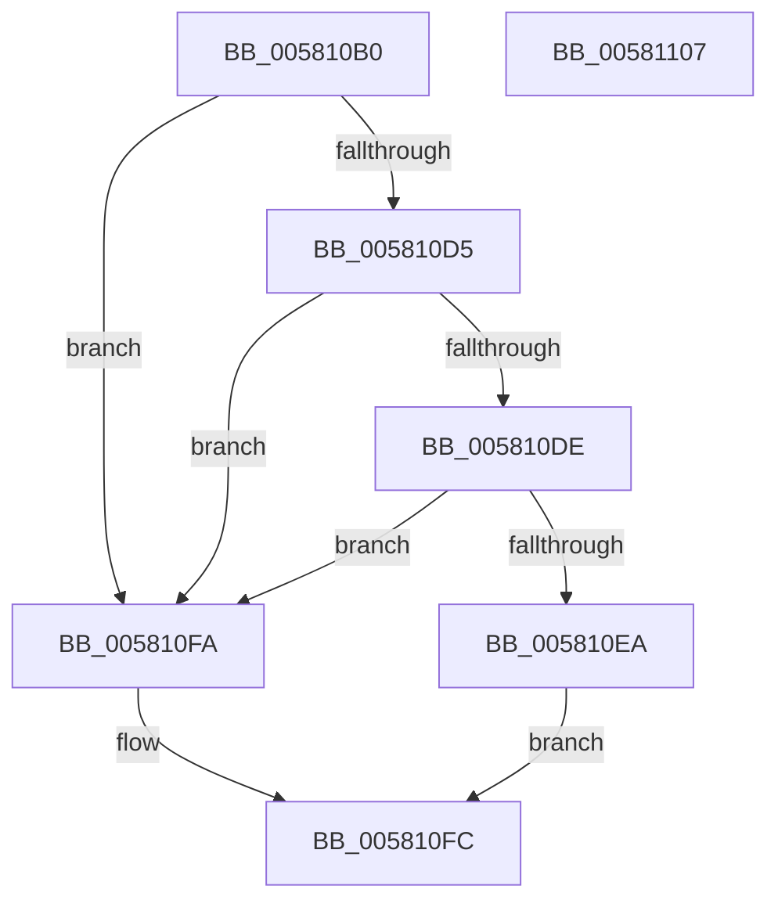

# FsRtlMdlReadComplete

- RVA: `0x005810B0`–`0x00581108` (길이 `88` bytes)
- VA: `0x00000001405810B0`
- 실행 섹션: `.text`
- PDB 이름 있음: `예`; PDB Function 태그: `아니요`
- unwind 정보 RVA: `0x0005CAAC`
- 디코드: `27`개 명령, `88/88` bytes 표시
- 미해석 바이트: `0` (있으면 어셈블리에 `.byte`로 보존)

> 이 문서는 커널 이미지의 기계어와 PDB 기호를 분석해 생성했습니다. 4번과 5번은 함수 원형과 자료형을 바이너리 사용 방식에서 추정한 C 해석이며 원본 소스 복구 결과는 아닙니다.

## 1. Dependencies

- 직접 호출 지점: **2**; 고유 호출 대상: **2**
- 직접 호출자로 확인된 함수: **0**
- RIP 상대 이미지 참조: **0**

### Outgoing calls
- `0x005810C0` → [IoGetRelatedDeviceObject](../29/IoGetRelatedDeviceObject_function_0029B120.md) (function, `0x0029B120`)
- `0x005810F3` → [guard_dispatch_icall](../6B/guard_dispatch_icall_function_006BAAD0.md) (function, `0x006BAAD0`)

### Direct callers
- 이 함수 시작 RVA로 연결되는 직접 call은 확인되지 않았습니다. 간접 호출은 완전히 역산할 수 없습니다.

### Static image references
- 디코드된 RIP-relative 메모리 참조가 없습니다.

## 2. Other-region calls and transfers

- 다른 실행 섹션으로 향하는 call: **0**
- 별도 외부 분기/꼬리 이동을 확인하지 못했습니다.

## 3. Assembly (complete function range)

```asm
005810B0  48 89 5C 24 08                  mov qword ptr [rsp + 8], rbx
005810B5  57                              push rdi
005810B6  48 83 EC 20                     sub rsp, 0x20
005810BA  48 8B FA                        mov rdi, rdx
005810BD  48 8B D9                        mov rbx, rcx
005810C0  E8 5B A0 D1 FF                  call 0x14029b120
005810C5  48 8B C8                        mov rcx, rax
005810C8  4C 8B 40 08                     mov r8, qword ptr [rax + 8]
005810CC  4D 8B 48 50                     mov r9, qword ptr [r8 + 0x50]
005810D0  4D 85 C9                        test r9, r9
005810D3  74 25                           je 0x1405810fa
005810D5  41 81 39 88 00 00 00            cmp dword ptr [r9], 0x88
005810DC  76 1C                           jbe 0x1405810fa
005810DE  49 8B 81 88 00 00 00            mov rax, qword ptr [r9 + 0x88]
005810E5  48 85 C0                        test rax, rax
005810E8  74 10                           je 0x1405810fa
005810EA  4C 8B C1                        mov r8, rcx
005810ED  48 8B D7                        mov rdx, rdi
005810F0  48 8B CB                        mov rcx, rbx
005810F3  E8 D8 99 13 00                  call 0x1406baad0
005810F8  EB 02                           jmp 0x1405810fc
005810FA  32 C0                           xor al, al
005810FC  48 8B 5C 24 30                  mov rbx, qword ptr [rsp + 0x30]
00581101  48 83 C4 20                     add rsp, 0x20
00581105  5F                              pop rdi
00581106  C3                              ret
00581107  CC                              int3
```

## 4. C-style interpretation (structured pseudocode)

```c
__int64 __fastcall FsRtlMdlReadComplete(__int64 a1, __int64 a2)
{
    __int64 result;
    __int64 v_rsp;
    unsigned __int64 v_stack_p8;

    v_stack_p8 = v_rbx;
    v_rsp = (v_rsp) - (32);
    result = IoGetRelatedDeviceObject(a1, a2, a3, a4);
    if (*(unsigned __int64 *)(*(unsigned __int64 *)(result + 8) + 80) == 0) goto loc_005810FA;
    if ((*(unsigned int *)(*(unsigned __int64 *)(*(unsigned __int64 *)(result + 8) + 80))) <= 136) goto loc_005810FA;
    if (*(unsigned __int64 *)(*(unsigned __int64 *)(*(unsigned __int64 *)(result + 8) + 80) + 136) == 0) goto loc_005810FA;
    result = guard_dispatch_icall(a1, a2, result, *(unsigned __int64 *)(*(unsigned __int64 *)(result + 8) + 80));
    goto loc_005810FC;
loc_005810FA:
    result = 0;
loc_005810FC:
    v_rsp = (v_rsp) + (32);
    return result;
}
```

## 5. (Beta) C Style

```c
int64_t FsRtlMdlReadComplete(int64_t Arg1, int64_t Arg2)
{
    int64_t result;
    int64_t local_rsp;
    uint64_t v_stack_p8;

    v_stack_p8 = local_rbx;
    local_rsp = (local_rsp) - (32);
    result = IoGetRelatedDeviceObject(Arg1, Arg2, a3, a4);
    if (*(uint64_t *)(*(uint64_t *)(result + 0x8) + 0x50) == 0) goto loc_005810FA;
    if ((*(uint32_t *)(*(uint64_t *)(*(uint64_t *)(result + 0x8) + 0x50))) <= 136) goto loc_005810FA;
    if (*(uint64_t *)(*(uint64_t *)(*(uint64_t *)(result + 0x8) + 0x50) + 0x88) == 0) goto loc_005810FA;
    result = guard_dispatch_icall(Arg1, Arg2, result, *(uint64_t *)(*(uint64_t *)(result + 0x8) + 0x50));
    goto loc_005810FC;
loc_005810FA:
    result = 0;
loc_005810FC:
    local_rsp = (local_rsp) + (32);
    return result;
}
```

## 6. Execution-region graph

[열기: 2D/3D 그래프와 함수 탐색 컨트롤 패널](../../../control-panel.html?section=text&rva=0x005810B0&view=graph)

- 2D 그래프는 위에서 아래로 흐르고, 3D 그래프는 빈 공간을 드래그해 회전합니다. Shift+드래그는 이동, 휠은 확대·축소, 함수 노드 선택은 대상 보고서 이동입니다.

### Static fallback


