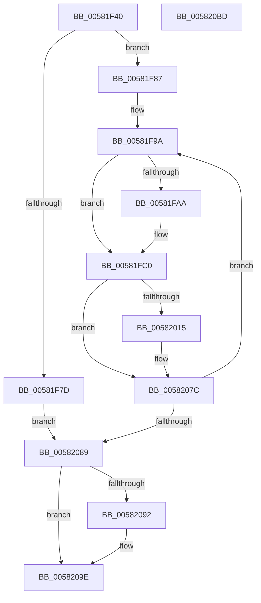

# FsRtlOplockBreakToNoneEx

- RVA: `0x00581F40`–`0x005820BE` (길이 `382` bytes)
- VA: `0x0000000140581F40`
- 실행 섹션: `.text`
- PDB 이름 있음: `예`; PDB Function 태그: `아니요`
- unwind 정보 RVA: `0x000C608C`
- 디코드: `89`개 명령, `382/382` bytes 표시
- 미해석 바이트: `0` (있으면 어셈블리에 `.byte`로 보존)

> 이 문서는 커널 이미지의 기계어와 PDB 기호를 분석해 생성했습니다. 4번과 5번은 함수 원형과 자료형을 바이너리 사용 방식에서 추정한 C 해석이며 원본 소스 복구 결과는 아닙니다.

## 1. Dependencies

- 직접 호출 지점: **4**; 고유 호출 대상: **4**
- 직접 호출자로 확인된 함수: **1**
- RIP 상대 이미지 참조: **0**

### Outgoing calls
- `0x00581FB1` → [ExAcquireFastMutexUnsafe](../3F/ExAcquireFastMutexUnsafe_function_003F3720.md) (function, `0x003F3720`)
- `0x00582008` → [FsRtlpOplockBreakToNone](../4F/FsRtlpOplockBreakToNone_function_004F8354.md) (function, `0x004F8354`)
- `0x00582073` → [FsRtlpOplockBreakByCacheFlags](../4E/FsRtlpOplockBreakByCacheFlags_function_004E4990.md) (function, `0x004E4990`)
- `0x00582099` → [ExReleaseFastMutexUnsafe](../25/ExReleaseFastMutexUnsafe_function_002503A0.md) (function, `0x002503A0`)

### Direct callers
- [FsRtlOplockBreakToNone](FsRtlOplockBreakToNone_function_00581EE0.md) at `0x00581F2B`

### Static image references
- 디코드된 RIP-relative 메모리 참조가 없습니다.

## 2. Other-region calls and transfers

- 다른 실행 섹션으로 향하는 call: **0**
- 별도 외부 분기/꼬리 이동을 확인하지 못했습니다.

## 3. Assembly (complete function range)

```asm
00581F40  48 8B C4                        mov rax, rsp
00581F43  48 89 58 10                     mov qword ptr [rax + 0x10], rbx
00581F47  48 89 70 18                     mov qword ptr [rax + 0x18], rsi
00581F4B  57                              push rdi
00581F4C  41 54                           push r12
00581F4E  41 55                           push r13
00581F50  41 56                           push r14
00581F52  41 57                           push r15
00581F54  48 81 EC 90 00 00 00            sub rsp, 0x90
00581F5B  4D 8B E9                        mov r13, r9
00581F5E  41 8B F8                        mov edi, r8d
00581F61  4C 8B F2                        mov r14, rdx
00581F64  48 8B 19                        mov rbx, qword ptr [rcx]
00581F67  48 89 9C 24 88 00 00 00         mov qword ptr [rsp + 0x88], rbx
00581F6F  33 C9                           xor ecx, ecx
00581F71  88 48 08                        mov byte ptr [rax + 8], cl
00581F74  88 48 C8                        mov byte ptr [rax - 0x38], cl
00581F77  40 F6 C7 10                     test dil, 0x10
00581F7B  74 0A                           je 0x140581f87
00581F7D  BE 0D 00 00 C0                  mov esi, 0xc000000d
00581F82  E9 02 01 00 00                  jmp 0x140582089
00581F87  83 CF 08                        or edi, 8
00581F8A  4C 8B BC 24 E8 00 00 00         mov r15, qword ptr [rsp + 0xe8]
00581F92  4C 8B A4 24 E0 00 00 00         mov r12, qword ptr [rsp + 0xe0]
00581F9A  88 8C 24 80 00 00 00            mov byte ptr [rsp + 0x80], cl
00581FA1  38 8C 24 C0 00 00 00            cmp byte ptr [rsp + 0xc0], cl
00581FA8  75 16                           jne 0x140581fc0
00581FAA  48 8B 8B 98 00 00 00            mov rcx, qword ptr [rbx + 0x98]
00581FB1  E8 6A 17 E7 FF                  call 0x1403f3720
00581FB6  C6 84 24 C0 00 00 00 01         mov byte ptr [rsp + 0xc0], 1
00581FBE  33 C9                           xor ecx, ecx
00581FC0  48 8D 84 24 80 00 00 00         lea rax, [rsp + 0x80]
00581FC8  48 89 44 24 60                  mov qword ptr [rsp + 0x60], rax
00581FCD  48 8D 84 24 C0 00 00 00         lea rax, [rsp + 0xc0]
00581FD5  48 89 44 24 58                  mov qword ptr [rsp + 0x58], rax
00581FDA  48 89 4C 24 50                  mov qword ptr [rsp + 0x50], rcx
00581FDF  48 89 4C 24 48                  mov qword ptr [rsp + 0x48], rcx
00581FE4  48 89 4C 24 40                  mov qword ptr [rsp + 0x40], rcx
00581FE9  4C 89 7C 24 38                  mov qword ptr [rsp + 0x38], r15
00581FEE  4C 89 64 24 30                  mov qword ptr [rsp + 0x30], r12
00581FF3  4C 89 6C 24 28                  mov qword ptr [rsp + 0x28], r13
00581FF8  44 8B CF                        mov r9d, edi
00581FFB  4D 8B C6                        mov r8, r14
00581FFE  49 8B 96 B8 00 00 00            mov rdx, qword ptr [r14 + 0xb8]
00582005  48 8B CB                        mov rcx, rbx
00582008  E8 47 63 F7 FF                  call 0x1404f8354
0058200D  8B F0                           mov esi, eax
0058200F  33 C9                           xor ecx, ecx
00582011  85 C0                           test eax, eax
00582013  75 67                           jne 0x14058207c
00582015  48 8D 84 24 80 00 00 00         lea rax, [rsp + 0x80]
0058201D  48 89 44 24 78                  mov qword ptr [rsp + 0x78], rax
00582022  48 8D 84 24 C0 00 00 00         lea rax, [rsp + 0xc0]
0058202A  48 89 44 24 70                  mov qword ptr [rsp + 0x70], rax
0058202F  48 89 4C 24 68                  mov qword ptr [rsp + 0x68], rcx
00582034  48 89 4C 24 60                  mov qword ptr [rsp + 0x60], rcx
00582039  48 89 4C 24 58                  mov qword ptr [rsp + 0x58], rcx
0058203E  4C 89 7C 24 50                  mov qword ptr [rsp + 0x50], r15
00582043  4C 89 64 24 48                  mov qword ptr [rsp + 0x48], r12
00582048  4C 89 6C 24 40                  mov qword ptr [rsp + 0x40], r13
0058204D  48 89 4C 24 38                  mov qword ptr [rsp + 0x38], rcx
00582052  48 89 4C 24 30                  mov qword ptr [rsp + 0x30], rcx
00582057  C7 44 24 28 00 70 00 00         mov dword ptr [rsp + 0x28], 0x7000
0058205F  89 4C 24 20                     mov dword ptr [rsp + 0x20], ecx
00582063  44 8B CF                        mov r9d, edi
00582066  4D 8B C6                        mov r8, r14
00582069  49 8B 96 B8 00 00 00            mov rdx, qword ptr [r14 + 0xb8]
00582070  48 8B CB                        mov rcx, rbx
00582073  E8 18 29 F6 FF                  call 0x1404e4990
00582078  8B F0                           mov esi, eax
0058207A  33 C9                           xor ecx, ecx
0058207C  38 8C 24 80 00 00 00            cmp byte ptr [rsp + 0x80], cl
00582083  0F 85 11 FF FF FF               jne 0x140581f9a
00582089  38 8C 24 C0 00 00 00            cmp byte ptr [rsp + 0xc0], cl
00582090  74 0C                           je 0x14058209e
00582092  48 8B 8B 98 00 00 00            mov rcx, qword ptr [rbx + 0x98]
00582099  E8 02 E3 CC FF                  call 0x1402503a0
0058209E  8B C6                           mov eax, esi
005820A0  4C 8D 9C 24 90 00 00 00         lea r11, [rsp + 0x90]
005820A8  49 8B 5B 38                     mov rbx, qword ptr [r11 + 0x38]
005820AC  49 8B 73 40                     mov rsi, qword ptr [r11 + 0x40]
005820B0  49 8B E3                        mov rsp, r11
005820B3  41 5F                           pop r15
005820B5  41 5E                           pop r14
005820B7  41 5D                           pop r13
005820B9  41 5C                           pop r12
005820BB  5F                              pop rdi
005820BC  C3                              ret
005820BD  CC                              int3
```

## 4. C-style interpretation (structured pseudocode)

```c
__int64 __fastcall FsRtlOplockBreakToNoneEx(__int64 a1, __int64 a2, int a3, __int64 a4, __int64 a5, __int64 a6)
{
    __int64 result;
    __int64 v_rdi;
    __int64 v_rsi;
    __int64 v_rsp;
    unsigned __int64 v_stack_m28;
    unsigned __int64 v_stack_m30;
    unsigned __int8 v_stack_m38;
    unsigned __int64 v_stack_m40;
    unsigned __int64 v_stack_m48;
    unsigned __int64 v_stack_m50;
    unsigned __int64 v_stack_m58;
    unsigned __int64 v_stack_m60;
    unsigned __int64 v_stack_m68;
    unsigned __int64 v_stack_m70;
    unsigned __int64 v_stack_m78;
    unsigned __int64 v_stack_m80;
    unsigned __int64 v_stack_m88;
    unsigned __int64 v_stack_m90;
    unsigned int v_stack_m98;
    unsigned __int8 v_stack_p8;

    *(unsigned __int64 *)(v_rsp + 16) = v_rbx;
    *(unsigned __int64 *)(v_rsp + 24) = v_rsi;
    v_rsp = (v_rsp) - (144);
    v_stack_m30 = *(unsigned __int64 *)(a1);
    a1 = 0;
    *(unsigned __int8 *)(v_rsp + 8) = 0;
    *(unsigned __int8 *)(v_rsp - 56) = 0;
    if ((((unsigned __int8)((unsigned int)(a3))) & (16)) == 0) goto loc_00581F87;
    goto loc_00582089;
loc_00581F87:
    v_rdi = (unsigned int)(((unsigned int)(a3)) | (8));
loc_00581F9A:
    v_stack_m38 = 0;
    result = v_rsp;
    if (v_stack_p8 == 0) {
        a1 = *(unsigned __int64 *)(*(unsigned __int64 *)(a1) + 152);
        result = ExAcquireFastMutexUnsafe(a1, a2, a3, a4);
        v_stack_p8 = 1;
        a1 = 0;
    }
    v_stack_m58 = v_stack_m38;
    v_stack_m60 = v_stack_p8;
    v_stack_m68 = 0;
    v_stack_m70 = 0;
    v_stack_m78 = 0;
    v_stack_m80 = a6;
    v_stack_m88 = a5;
    v_stack_m90 = a4;
    result = FsRtlpOplockBreakToNone(*(unsigned __int64 *)(a1), *(unsigned __int64 *)(a2 + 184), a2, (unsigned int)((unsigned int)(v_rdi)));
    a1 = 0;
    v_rsi = (unsigned int)((unsigned int)(result));
    if ((unsigned int)(result) == 0) {
        result = v_stack_m38;
        v_stack_m40 = result;
        result = v_stack_p8;
        v_stack_m48 = result;
        v_stack_m50 = 0;
        v_stack_m58 = 0;
        v_stack_m60 = 0;
        v_stack_m68 = a6;
        v_stack_m70 = a5;
        v_stack_m78 = a4;
        v_stack_m80 = 0;
        v_stack_m88 = 0;
        v_stack_m90 = 0x7000ULL;
        v_stack_m98 = 0;
        a4 = (unsigned int)(v_rdi);
        a3 = a2;
        a2 = *(unsigned __int64 *)(a2 + 184);
        a1 = *(unsigned __int64 *)(a1);
        result = FsRtlpOplockBreakByCacheFlags(a1, a2, a3, a4);
        v_rsi = (unsigned int)(result);
        a1 = 0;
    }
    if (v_stack_m38 != 0) goto loc_00581F9A;
loc_00582089:
    if (v_stack_p8 != 0) {
        a1 = *(unsigned __int64 *)(*(unsigned __int64 *)(a1) + 152);
        result = ExReleaseFastMutexUnsafe(a1, a2, a3, a4);
    }
    return (unsigned int)((unsigned int)(v_rsi));
}
```

## 5. (Beta) C Style

```c
int64_t FsRtlOplockBreakToNoneEx(void *Arg1, void *Arg2, int32_t Arg3, int64_t Arg4, int64_t Arg5, int64_t Arg6)
{
    uint8_t *arg1 = (uint8_t *)Arg1;
    uint8_t *arg2 = (uint8_t *)Arg2;

    int64_t result;
    int64_t local_rdi;
    int64_t local_rsi;
    int64_t local_rsp;
    uint64_t v_stack_m28;
    uint64_t v_stack_m30;
    uint8_t v_stack_m38;
    uint64_t v_stack_m40;
    uint64_t v_stack_m48;
    uint64_t v_stack_m50;
    uint64_t v_stack_m58;
    uint64_t v_stack_m60;
    uint64_t v_stack_m68;
    uint64_t v_stack_m70;
    uint64_t v_stack_m78;
    uint64_t v_stack_m80;
    uint64_t v_stack_m88;
    uint64_t v_stack_m90;
    uint32_t v_stack_m98;
    uint8_t v_stack_p8;

    *(uint64_t *)(local_rsp + 0x10) = local_rbx;
    *(uint64_t *)(local_rsp + 0x18) = local_rsi;
    local_rsp = (local_rsp) - (144);
    v_stack_m30 = *(uint64_t *)(arg1);
    Arg1 = 0;
    *(uint8_t *)(local_rsp + 0x8) = 0;
    *(uint8_t *)(local_rsp - 0x38) = 0;
    if ((((uint8_t)((uint32_t)(Arg3))) & (16)) == 0) goto loc_00581F87;
    goto loc_00582089;
loc_00581F87:
    local_rdi = (uint32_t)(((uint32_t)(Arg3)) | (8));
loc_00581F9A:
    v_stack_m38 = 0;
    result = local_rsp;
    if (v_stack_p8 == 0) {
        Arg1 = *(uint64_t *)(*(uint64_t *)(arg1) + 0x98);
        result = ExAcquireFastMutexUnsafe(Arg1, Arg2, Arg3, Arg4);
        v_stack_p8 = 1;
        Arg1 = 0;
    }
    v_stack_m58 = v_stack_m38;
    v_stack_m60 = v_stack_p8;
    v_stack_m68 = 0;
    v_stack_m70 = 0;
    v_stack_m78 = 0;
    v_stack_m80 = Arg6;
    v_stack_m88 = Arg5;
    v_stack_m90 = Arg4;
    result = FsRtlpOplockBreakToNone(*(uint64_t *)(arg1), *(uint64_t *)(arg2 + 0xB8), Arg2, (uint32_t)((uint32_t)(local_rdi)));
    Arg1 = 0;
    local_rsi = (uint32_t)((uint32_t)(result));
    if ((uint32_t)(result) == 0) {
        result = v_stack_m38;
        v_stack_m40 = result;
        result = v_stack_p8;
        v_stack_m48 = result;
        v_stack_m50 = 0;
        v_stack_m58 = 0;
        v_stack_m60 = 0;
        v_stack_m68 = Arg6;
        v_stack_m70 = Arg5;
        v_stack_m78 = Arg4;
        v_stack_m80 = 0;
        v_stack_m88 = 0;
        v_stack_m90 = 0x7000ULL;
        v_stack_m98 = 0;
        Arg4 = (uint32_t)(local_rdi);
        Arg3 = Arg2;
        Arg2 = *(uint64_t *)(arg2 + 0xB8);
        Arg1 = *(uint64_t *)(arg1);
        result = FsRtlpOplockBreakByCacheFlags(Arg1, Arg2, Arg3, Arg4);
        local_rsi = (uint32_t)(result);
        Arg1 = 0;
    }
    if (v_stack_m38 != 0) goto loc_00581F9A;
loc_00582089:
    if (v_stack_p8 != 0) {
        Arg1 = *(uint64_t *)(*(uint64_t *)(arg1) + 0x98);
        result = ExReleaseFastMutexUnsafe(Arg1, Arg2, Arg3, Arg4);
    }
    return (uint32_t)((uint32_t)(local_rsi));
}
```

### 관측된 메모리 오프셋

구조체 형식이 확인되지 않은 접근은 인자 기준의 오프셋으로만 기록했습니다.

| 기준 인자 | 오프셋 표현 | 폭 (bit) | 접근 |
|---|---:|---:|---|
| `Arg1` | `+ 0x0` | `64` | `R` |
| `Arg2` | `+ 0xB8` | `64` | `R` |

## 6. Execution-region graph

[열기: 2D/3D 그래프와 함수 탐색 컨트롤 패널](../../../control-panel.html?section=text&rva=0x00581F40&view=graph)

- 2D 그래프는 위에서 아래로 흐르고, 3D 그래프는 빈 공간을 드래그해 회전합니다. Shift+드래그는 이동, 휠은 확대·축소, 함수 노드 선택은 대상 보고서 이동입니다.

### Static fallback


