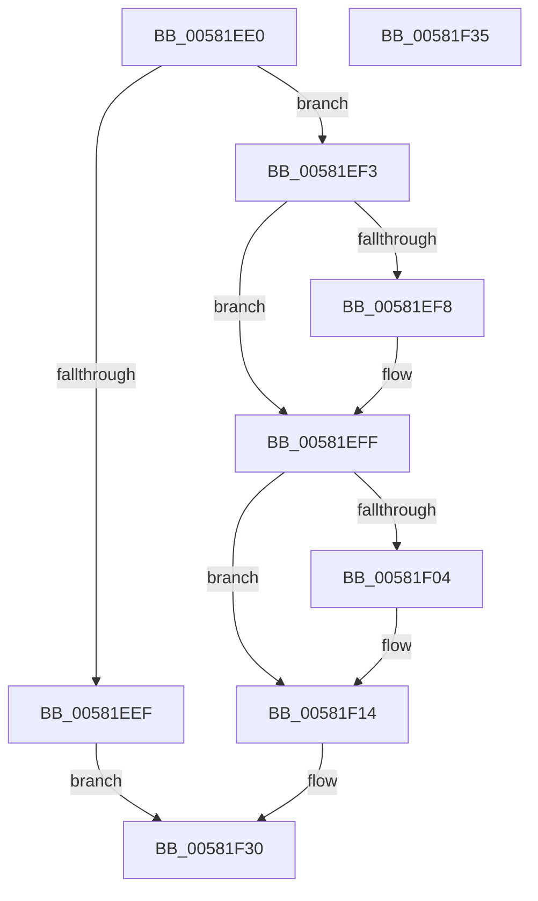

# FsRtlOplockBreakToNone

- RVA: `0x00581EE0`–`0x00581F36` (길이 `86` bytes)
- VA: `0x0000000140581EE0`
- 실행 섹션: `.text`
- PDB 이름 있음: `예`; PDB Function 태그: `아니요`
- unwind 정보 RVA: `0x0005D2F4`
- 디코드: `24`개 명령, `86/86` bytes 표시
- 미해석 바이트: `0` (있으면 어셈블리에 `.byte`로 보존)

> 이 문서는 커널 이미지의 기계어와 PDB 기호를 분석해 생성했습니다. 4번과 5번은 함수 원형과 자료형을 바이너리 사용 방식에서 추정한 C 해석이며 원본 소스 복구 결과는 아닙니다.

## 1. Dependencies

- 직접 호출 지점: **1**; 고유 호출 대상: **1**
- 직접 호출자로 확인된 함수: **0**
- RIP 상대 이미지 참조: **0**

### Outgoing calls
- `0x00581F2B` → [FsRtlOplockBreakToNoneEx](FsRtlOplockBreakToNoneEx_function_00581F40.md) (function, `0x00581F40`)

### Direct callers
- 이 함수 시작 RVA로 연결되는 직접 call은 확인되지 않았습니다. 간접 호출은 완전히 역산할 수 없습니다.

### Static image references
- 디코드된 RIP-relative 메모리 참조가 없습니다.

## 2. Other-region calls and transfers

- 다른 실행 섹션으로 향하는 call: **0**
- 별도 외부 분기/꼬리 이동을 확인하지 못했습니다.

## 3. Assembly (complete function range)

```asm
00581EE0  48 83 EC 38                     sub rsp, 0x38
00581EE4  4D 8B D0                        mov r10, r8
00581EE7  45 33 C0                        xor r8d, r8d
00581EEA  4C 39 01                        cmp qword ptr [rcx], r8
00581EED  75 04                           jne 0x140581ef3
00581EEF  33 C0                           xor eax, eax
00581EF1  EB 3D                           jmp 0x140581f30
00581EF3  48 85 D2                        test rdx, rdx
00581EF6  75 07                           jne 0x140581eff
00581EF8  49 8B 92 B8 00 00 00            mov rdx, qword ptr [r10 + 0xb8]
00581EFF  44 38 02                        cmp byte ptr [rdx], r8b
00581F02  75 10                           jne 0x140581f14
00581F04  F7 42 10 00 01 00 00            test dword ptr [rdx + 0x10], 0x100
00581F0B  B8 01 00 00 00                  mov eax, 1
00581F10  44 0F 45 C0                     cmovne r8d, eax
00581F14  48 8B 44 24 68                  mov rax, qword ptr [rsp + 0x68]
00581F19  49 8B D2                        mov rdx, r10
00581F1C  48 89 44 24 28                  mov qword ptr [rsp + 0x28], rax
00581F21  48 8B 44 24 60                  mov rax, qword ptr [rsp + 0x60]
00581F26  48 89 44 24 20                  mov qword ptr [rsp + 0x20], rax
00581F2B  E8 10 00 00 00                  call 0x140581f40
00581F30  48 83 C4 38                     add rsp, 0x38
00581F34  C3                              ret
00581F35  CC                              int3
```

## 4. C-style interpretation (structured pseudocode)

```c
__int64 __fastcall FsRtlOplockBreakToNone(__int64 a1, __int64 a2, __int64 a3, __int64 a4, __int64 a5, __int64 a6)
{
    __int64 result;
    __int64 v_rsp;
    unsigned __int64 v_stack_m10;
    unsigned __int64 v_stack_m18;

    v_rsp = (v_rsp) - (56);
    a3 = 0;
    if ((*(unsigned __int64 *)(a1)) != 0) goto loc_00581EF3;
    result = 0;
    goto loc_00581F30;
loc_00581EF3:
    if (a2 == 0) {
        a2 = *(unsigned __int64 *)(a3 + 184);
    }
    if ((*(unsigned __int8 *)(a2)) == 0) {
        result = 1;
        if (((*(unsigned int *)(a2 + 16)) & (256)) != 0) { a3 = (unsigned int)(result); }
    }
    v_stack_m10 = a6;
    v_stack_m18 = a5;
    result = FsRtlOplockBreakToNoneEx(a1, a3, a3, a4);
loc_00581F30:
    v_rsp = (v_rsp) + (56);
    return result;
}
```

## 5. (Beta) C Style

```c
int64_t FsRtlOplockBreakToNone(void *Arg1, int64_t Arg2, void *Arg3, int64_t Arg4, int64_t Arg5, int64_t Arg6)
{
    uint8_t *arg1 = (uint8_t *)Arg1;
    uint8_t *arg3 = (uint8_t *)Arg3;

    int64_t result;
    int64_t local_rsp;
    uint64_t v_stack_m10;
    uint64_t v_stack_m18;

    local_rsp = (local_rsp) - (56);
    Arg3 = 0;
    if ((*(uint64_t *)(arg1)) != 0) goto loc_00581EF3;
    result = 0;
    goto loc_00581F30;
loc_00581EF3:
    if (Arg2 == 0) {
        Arg2 = *(uint64_t *)(arg3 + 0xB8);
    }
    if ((*(uint8_t *)(Arg2)) == 0) {
        result = 1;
        if (((*(uint32_t *)(Arg2 + 0x10)) & (256)) != 0) { Arg3 = (uint32_t)(result); }
    }
    v_stack_m10 = Arg6;
    v_stack_m18 = Arg5;
    result = FsRtlOplockBreakToNoneEx(Arg1, Arg3, Arg3, Arg4);
loc_00581F30:
    local_rsp = (local_rsp) + (56);
    return result;
}
```

### 관측된 메모리 오프셋

구조체 형식이 확인되지 않은 접근은 인자 기준의 오프셋으로만 기록했습니다.

| 기준 인자 | 오프셋 표현 | 폭 (bit) | 접근 |
|---|---:|---:|---|
| `Arg1` | `+ 0x0` | `64` | `R` |
| `Arg3` | `+ 0xB8` | `64` | `R` |

## 6. Execution-region graph

[열기: 2D/3D 그래프와 함수 탐색 컨트롤 패널](../../../control-panel.html?section=text&rva=0x00581EE0&view=graph)

- 2D 그래프는 위에서 아래로 흐르고, 3D 그래프는 빈 공간을 드래그해 회전합니다. Shift+드래그는 이동, 휠은 확대·축소, 함수 노드 선택은 대상 보고서 이동입니다.

### Static fallback


