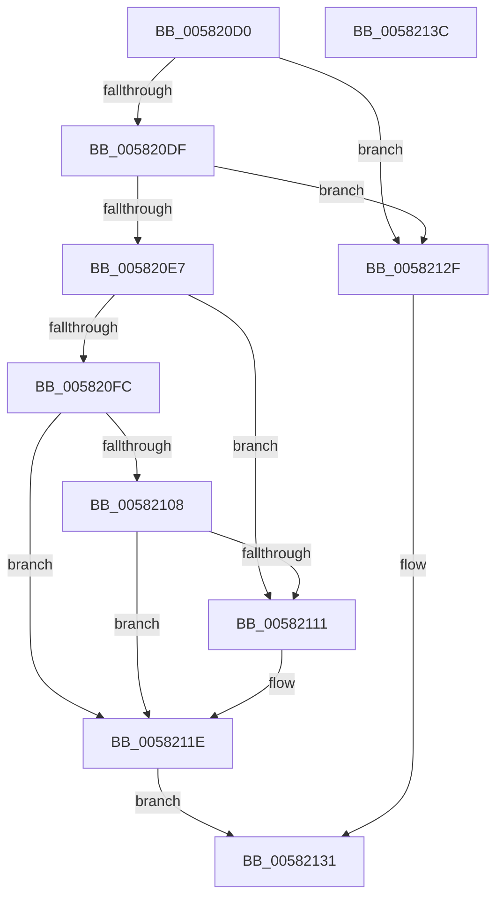

# FsRtlOplockGetAnyBreakOwnerProcess

- RVA: `0x005820D0`–`0x0058213D` (길이 `109` bytes)
- VA: `0x00000001405820D0`
- 실행 섹션: `.text`
- PDB 이름 있음: `예`; PDB Function 태그: `아니요`
- unwind 정보 RVA: `0x0005CAAC`
- 디코드: `33`개 명령, `109/109` bytes 표시
- 미해석 바이트: `0` (있으면 어셈블리에 `.byte`로 보존)

> 이 문서는 커널 이미지의 기계어와 PDB 기호를 분석해 생성했습니다. 4번과 5번은 함수 원형과 자료형을 바이너리 사용 방식에서 추정한 C 해석이며 원본 소스 복구 결과는 아닙니다.

## 1. Dependencies

- 직접 호출 지점: **3**; 고유 호출 대상: **3**
- 직접 호출자로 확인된 함수: **0**
- RIP 상대 이미지 참조: **0**

### Outgoing calls
- `0x005820EE` → [ExAcquireFastMutexUnsafe](../3F/ExAcquireFastMutexUnsafe_function_003F3720.md) (function, `0x003F3720`)
- `0x00582119` → [ObfReferenceObjectWithTag](../21/ObfReferenceObjectWithTag_function_00210710.md) (function, `0x00210710`)
- `0x00582125` → [ExReleaseFastMutexUnsafe](../25/ExReleaseFastMutexUnsafe_function_002503A0.md) (function, `0x002503A0`)

### Direct callers
- 이 함수 시작 RVA로 연결되는 직접 call은 확인되지 않았습니다. 간접 호출은 완전히 역산할 수 없습니다.

### Static image references
- 디코드된 RIP-relative 메모리 참조가 없습니다.

## 2. Other-region calls and transfers

- 다른 실행 섹션으로 향하는 call: **0**
- 별도 외부 분기/꼬리 이동을 확인하지 못했습니다.

## 3. Assembly (complete function range)

```asm
005820D0  48 89 5C 24 08                  mov qword ptr [rsp + 8], rbx
005820D5  57                              push rdi
005820D6  48 83 EC 20                     sub rsp, 0x20
005820DA  48 85 C9                        test rcx, rcx
005820DD  74 50                           je 0x14058212f
005820DF  48 8B 39                        mov rdi, qword ptr [rcx]
005820E2  48 85 FF                        test rdi, rdi
005820E5  74 48                           je 0x14058212f
005820E7  48 8B 8F 98 00 00 00            mov rcx, qword ptr [rdi + 0x98]
005820EE  E8 2D 16 E7 FF                  call 0x1403f3720
005820F3  48 8B 5F 10                     mov rbx, qword ptr [rdi + 0x10]
005820F7  48 85 DB                        test rbx, rbx
005820FA  75 15                           jne 0x140582111
005820FC  48 8D 47 48                     lea rax, [rdi + 0x48]
00582100  48 8B 08                        mov rcx, qword ptr [rax]
00582103  48 3B C8                        cmp rcx, rax
00582106  74 16                           je 0x14058211e
00582108  48 8B 59 20                     mov rbx, qword ptr [rcx + 0x20]
0058210C  48 85 DB                        test rbx, rbx
0058210F  74 0D                           je 0x14058211e
00582111  BA 44 66 6C 74                  mov edx, 0x746c6644
00582116  48 8B CB                        mov rcx, rbx
00582119  E8 F2 E5 C8 FF                  call 0x140210710
0058211E  48 8B 8F 98 00 00 00            mov rcx, qword ptr [rdi + 0x98]
00582125  E8 76 E2 CC FF                  call 0x1402503a0
0058212A  48 8B C3                        mov rax, rbx
0058212D  EB 02                           jmp 0x140582131
0058212F  33 C0                           xor eax, eax
00582131  48 8B 5C 24 30                  mov rbx, qword ptr [rsp + 0x30]
00582136  48 83 C4 20                     add rsp, 0x20
0058213A  5F                              pop rdi
0058213B  C3                              ret
0058213C  CC                              int3
```

## 4. C-style interpretation (structured pseudocode)

```c
__int64 __fastcall FsRtlOplockGetAnyBreakOwnerProcess(__int64 a1)
{
    __int64 result;
    __int64 v_rsp;
    unsigned __int64 v_stack_p8;

    v_stack_p8 = v_rbx;
    v_rsp = (v_rsp) - (32);
    if (a1 == 0) goto loc_0058212F;
    if (*(unsigned __int64 *)(a1) == 0) goto loc_0058212F;
    result = ExAcquireFastMutexUnsafe(*(unsigned __int64 *)(*(unsigned __int64 *)(a1) + 152), a2, a3, a4);
    if (*(unsigned __int64 *)(*(unsigned __int64 *)(a1) + 16) != 0) goto loc_00582111;
    if ((*(unsigned __int64 *)(*(unsigned __int64 *)(a1) + 72)) == (*(unsigned __int64 *)(a1) + 72)) goto loc_0058211E;
    result = *(unsigned __int64 *)(a1) + 72;
    if (*(unsigned __int64 *)(*(unsigned __int64 *)(*(unsigned __int64 *)(a1) + 72) + 32) != 0) {
        a2 = 0x746C6644ULL;
        a1 = *(unsigned __int64 *)(*(unsigned __int64 *)(*(unsigned __int64 *)(a1) + 72) + 32);
        result = ObfReferenceObjectWithTag(a1, a2, a3, a4);
    }
    result = ExReleaseFastMutexUnsafe(*(unsigned __int64 *)(*(unsigned __int64 *)(a1) + 152), a2, a3, a4);
    goto loc_00582131;
loc_0058212F:
    result = 0;
loc_00582131:
    v_rsp = (v_rsp) + (32);
    return result;
}
```

## 5. (Beta) C Style

```c
int64_t FsRtlOplockGetAnyBreakOwnerProcess(int64_t Arg1)
{
    int64_t result;
    int64_t local_rsp;
    uint64_t v_stack_p8;

    v_stack_p8 = local_rbx;
    local_rsp = (local_rsp) - (32);
    if (Arg1 == 0) goto loc_0058212F;
    if (*(uint64_t *)(Arg1) == 0) goto loc_0058212F;
    result = ExAcquireFastMutexUnsafe(*(uint64_t *)(*(uint64_t *)(Arg1) + 0x98), a2, a3, a4);
    if (*(uint64_t *)(*(uint64_t *)(Arg1) + 0x10) != 0) goto loc_00582111;
    if ((*(uint64_t *)(*(uint64_t *)(Arg1) + 0x48)) == (*(uint64_t *)(Arg1) + 72)) goto loc_0058211E;
    result = *(uint64_t *)(Arg1) + 72;
    if (*(uint64_t *)(*(uint64_t *)(*(uint64_t *)(Arg1) + 0x48) + 0x20) != 0) {
        a2 = 0x746C6644ULL;
        Arg1 = *(uint64_t *)(*(uint64_t *)(*(uint64_t *)(Arg1) + 0x48) + 0x20);
        result = ObfReferenceObjectWithTag(Arg1, a2, a3, a4);
    }
    result = ExReleaseFastMutexUnsafe(*(uint64_t *)(*(uint64_t *)(Arg1) + 0x98), a2, a3, a4);
    goto loc_00582131;
loc_0058212F:
    result = 0;
loc_00582131:
    local_rsp = (local_rsp) + (32);
    return result;
}
```

## 6. Execution-region graph

[열기: 2D/3D 그래프와 함수 탐색 컨트롤 패널](../../../control-panel.html?section=text&rva=0x005820D0&view=graph)

- 2D 그래프는 위에서 아래로 흐르고, 3D 그래프는 빈 공간을 드래그해 회전합니다. Shift+드래그는 이동, 휠은 확대·축소, 함수 노드 선택은 대상 보고서 이동입니다.

### Static fallback


