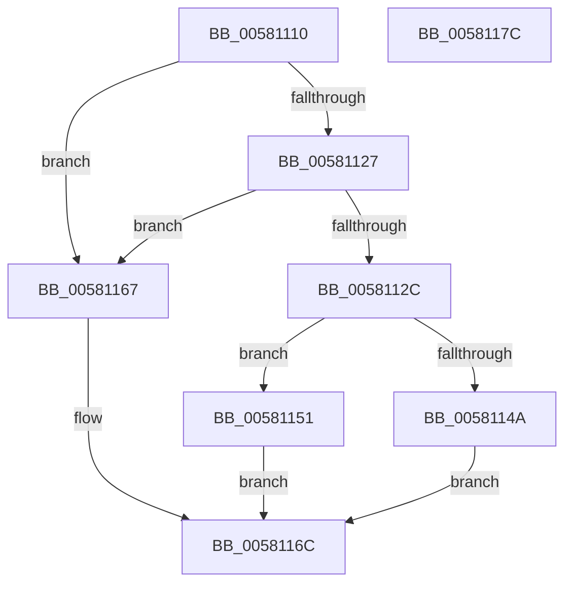

# FsRtlRegisterFileSystemFilterCallbacks

- RVA: `0x00581110`–`0x0058117D` (길이 `109` bytes)
- VA: `0x0000000140581110`
- 실행 섹션: `.text`
- PDB 이름 있음: `예`; PDB Function 태그: `아니요`
- unwind 정보 RVA: `0x00060BC4`
- 디코드: `33`개 명령, `109/109` bytes 표시
- 미해석 바이트: `0` (있으면 어셈블리에 `.byte`로 보존)

> 이 문서는 커널 이미지의 기계어와 PDB 기호를 분석해 생성했습니다. 4번과 5번은 함수 원형과 자료형을 바이너리 사용 방식에서 추정한 C 해석이며 원본 소스 복구 결과는 아닙니다.

## 1. Dependencies

- 직접 호출 지점: **2**; 고유 호출 대상: **2**
- 직접 호출자로 확인된 함수: **0**
- RIP 상대 이미지 참조: **0**

### Outgoing calls
- `0x0058113D` → [ExAllocatePool2](../../poolcode/B8/ExAllocatePool2_function_00B820F0.md) (function, `0x00B820F0`)
- `0x0058115A` → [memcpy](../6C/memcpy_function_006C6840.md) (function, `0x006C6840`)

### Direct callers
- 이 함수 시작 RVA로 연결되는 직접 call은 확인되지 않았습니다. 간접 호출은 완전히 역산할 수 없습니다.

### Static image references
- 디코드된 RIP-relative 메모리 참조가 없습니다.

## 2. Other-region calls and transfers

- 다른 실행 섹션으로 향하는 call: **1**
  - `0x0058113D` → [ExAllocatePool2](../../poolcode/B8/ExAllocatePool2_function_00B820F0.md) (`.text` → `POOLCODE`)
- 별도 외부 분기/꼬리 이동을 확인하지 못했습니다.

## 3. Assembly (complete function range)

```asm
00581110  48 89 5C 24 08                  mov qword ptr [rsp + 8], rbx
00581115  48 89 74 24 10                  mov qword ptr [rsp + 0x10], rsi
0058111A  57                              push rdi
0058111B  48 83 EC 20                     sub rsp, 0x20
0058111F  48 8B DA                        mov rbx, rdx
00581122  48 85 C9                        test rcx, rcx
00581125  74 40                           je 0x140581167
00581127  48 85 D2                        test rdx, rdx
0058112A  74 3B                           je 0x140581167
0058112C  48 8B 71 30                     mov rsi, qword ptr [rcx + 0x30]
00581130  41 B8 46 53 6D 67               mov r8d, 0x676d5346
00581136  8B 12                           mov edx, dword ptr [rdx]
00581138  B9 42 00 00 00                  mov ecx, 0x42
0058113D  E8 AE 0F 60 00                  call 0x140b820f0
00581142  48 8B F8                        mov rdi, rax
00581145  48 85 C0                        test rax, rax
00581148  75 07                           jne 0x140581151
0058114A  B8 9A 00 00 C0                  mov eax, 0xc000009a
0058114F  EB 1B                           jmp 0x14058116c
00581151  44 8B 03                        mov r8d, dword ptr [rbx]
00581154  48 8B D3                        mov rdx, rbx
00581157  48 8B CF                        mov rcx, rdi
0058115A  E8 E1 56 14 00                  call 0x1406c6840
0058115F  33 C0                           xor eax, eax
00581161  48 89 7E 30                     mov qword ptr [rsi + 0x30], rdi
00581165  EB 05                           jmp 0x14058116c
00581167  B8 0D 00 00 C0                  mov eax, 0xc000000d
0058116C  48 8B 5C 24 30                  mov rbx, qword ptr [rsp + 0x30]
00581171  48 8B 74 24 38                  mov rsi, qword ptr [rsp + 0x38]
00581176  48 83 C4 20                     add rsp, 0x20
0058117A  5F                              pop rdi
0058117B  C3                              ret
0058117C  CC                              int3
```

## 4. C-style interpretation (structured pseudocode)

```c
__int64 __fastcall FsRtlRegisterFileSystemFilterCallbacks(__int64 a1, __int64 a2)
{
    __int64 result;
    __int64 v_rsp;
    unsigned __int64 v_stack_p10;
    unsigned __int64 v_stack_p8;

    v_stack_p8 = v_rbx;
    v_stack_p10 = v_rsi;
    v_rsp = (v_rsp) - (32);
    if (a1 == 0) goto loc_00581167;
    if (a2 == 0) goto loc_00581167;
    result = ExAllocatePool2(66, (unsigned int)(*(unsigned int *)(a2)), (unsigned int)(0x676D5346ULL), a4);
    if (result != 0) goto loc_00581151;
    goto loc_0058116C;
loc_00581151:
    result = memcpy(result, a2, (unsigned int)(*(unsigned int *)(a2)), a4);
    result = 0;
    *(unsigned __int64 *)(*(unsigned __int64 *)(a1 + 48) + 48) = 0;
    goto loc_0058116C;
loc_00581167:
loc_0058116C:
    v_rsp = (v_rsp) + (32);
    return (unsigned int)(0xC000000DULL);
}
```

## 5. (Beta) C Style

```c
int64_t FsRtlRegisterFileSystemFilterCallbacks(int64_t Arg1, void *Arg2)
{
    uint8_t *arg2 = (uint8_t *)Arg2;

    int64_t result;
    int64_t local_rsp;
    uint64_t v_stack_p10;
    uint64_t v_stack_p8;

    v_stack_p8 = local_rbx;
    v_stack_p10 = local_rsi;
    local_rsp = (local_rsp) - (32);
    if (Arg1 == 0) goto loc_00581167;
    if (Arg2 == NULL) goto loc_00581167;
    result = ExAllocatePool2(66, (uint32_t)(*(uint32_t *)(arg2)), (uint32_t)(0x676D5346ULL), a4);
    if (result != 0) goto loc_00581151;
    goto loc_0058116C;
loc_00581151:
    result = memcpy(result, Arg2, (uint32_t)(*(uint32_t *)(arg2)), a4);
    result = 0;
    *(uint64_t *)(*(uint64_t *)(Arg1 + 0x30) + 0x30) = 0;
    goto loc_0058116C;
loc_00581167:
loc_0058116C:
    local_rsp = (local_rsp) + (32);
    return (uint32_t)(0xC000000DULL);
}
```

### 관측된 메모리 오프셋

구조체 형식이 확인되지 않은 접근은 인자 기준의 오프셋으로만 기록했습니다.

| 기준 인자 | 오프셋 표현 | 폭 (bit) | 접근 |
|---|---:|---:|---|
| `Arg2` | `+ 0x0` | `32` | `R` |

## 6. Execution-region graph

[열기: 2D/3D 그래프와 함수 탐색 컨트롤 패널](../../../control-panel.html?section=text&rva=0x00581110&view=graph)

- 2D 그래프는 위에서 아래로 흐르고, 3D 그래프는 빈 공간을 드래그해 회전합니다. Shift+드래그는 이동, 휠은 확대·축소, 함수 노드 선택은 대상 보고서 이동입니다.

### Static fallback


