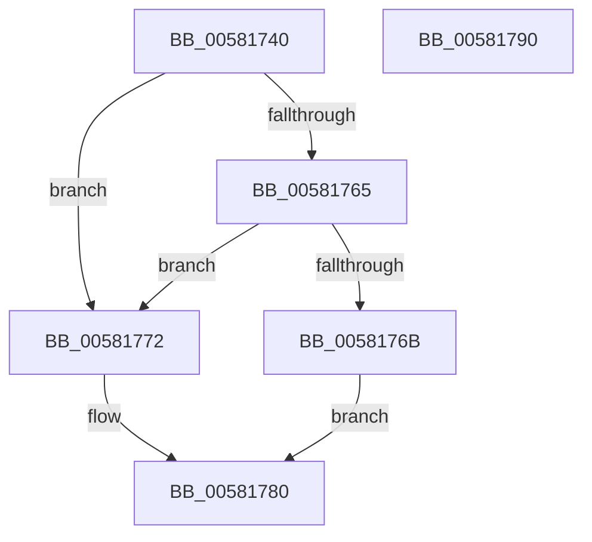

# FsRtlRemovePerFileContextWithReserve

- RVA: `0x00581740`–`0x00581791` (길이 `81` bytes)
- VA: `0x0000000140581740`
- 실행 섹션: `.text`
- PDB 이름 있음: `예`; PDB Function 태그: `아니요`
- unwind 정보 RVA: `0x00060BC4`
- 디코드: `25`개 명령, `81/81` bytes 표시
- 미해석 바이트: `0` (있으면 어셈블리에 `.byte`로 보존)

> 이 문서는 커널 이미지의 기계어와 PDB 기호를 분석해 생성했습니다. 4번과 5번은 함수 원형과 자료형을 바이너리 사용 방식에서 추정한 C 해석이며 원본 소스 복구 결과는 아닙니다.

## 1. Dependencies

- 직접 호출 지점: **2**; 고유 호출 대상: **2**
- 직접 호출자로 확인된 함수: **0**
- RIP 상대 이미지 참조: **0**

### Outgoing calls
- `0x00581758` → [FsRtlLookupPerFileContext](../41/FsRtlLookupPerFileContext_function_0041FAE0.md) (function, `0x0041FAE0`)
- `0x0058177B` → [FsRtlRemovePerFileContext](FsRtlRemovePerFileContext_function_00581670.md) (function, `0x00581670`)

### Direct callers
- 이 함수 시작 RVA로 연결되는 직접 call은 확인되지 않았습니다. 간접 호출은 완전히 역산할 수 없습니다.

### Static image references
- 디코드된 RIP-relative 메모리 참조가 없습니다.

## 2. Other-region calls and transfers

- 다른 실행 섹션으로 향하는 call: **0**
- 별도 외부 분기/꼬리 이동을 확인하지 못했습니다.

## 3. Assembly (complete function range)

```asm
00581740  48 89 5C 24 08                  mov qword ptr [rsp + 8], rbx
00581745  48 89 74 24 10                  mov qword ptr [rsp + 0x10], rsi
0058174A  57                              push rdi
0058174B  48 83 EC 20                     sub rsp, 0x20
0058174F  49 8B F8                        mov rdi, r8
00581752  48 8B F2                        mov rsi, rdx
00581755  48 8B D9                        mov rbx, rcx
00581758  E8 83 E3 E9 FF                  call 0x14041fae0
0058175D  4C 8B 0B                        mov r9, qword ptr [rbx]
00581760  48 85 C0                        test rax, rax
00581763  74 0D                           je 0x140581772
00581765  49 3B 41 20                     cmp rax, qword ptr [r9 + 0x20]
00581769  75 07                           jne 0x140581772
0058176B  49 83 61 20 00                  and qword ptr [r9 + 0x20], 0
00581770  EB 0E                           jmp 0x140581780
00581772  4C 8B C7                        mov r8, rdi
00581775  48 8B D6                        mov rdx, rsi
00581778  48 8B CB                        mov rcx, rbx
0058177B  E8 F0 FE FF FF                  call 0x140581670
00581780  48 8B 5C 24 30                  mov rbx, qword ptr [rsp + 0x30]
00581785  48 8B 74 24 38                  mov rsi, qword ptr [rsp + 0x38]
0058178A  48 83 C4 20                     add rsp, 0x20
0058178E  5F                              pop rdi
0058178F  C3                              ret
00581790  CC                              int3
```

## 4. C-style interpretation (structured pseudocode)

```c
__int64 __fastcall FsRtlRemovePerFileContextWithReserve(__int64 a1, __int64 a2, __int64 a3)
{
    __int64 result;
    __int64 v_rsp;
    unsigned __int64 v_stack_p10;
    unsigned __int64 v_stack_p8;

    v_stack_p8 = v_rbx;
    v_stack_p10 = v_rsi;
    v_rsp = (v_rsp) - (32);
    result = FsRtlLookupPerFileContext(a1, a2, a3, a4);
    if (result == 0) goto loc_00581772;
    if (result != (*(unsigned __int64 *)(*(unsigned __int64 *)(a1) + 32))) goto loc_00581772;
    goto loc_00581780;
loc_00581772:
    result = FsRtlRemovePerFileContext(a1, a2, a3, *(unsigned __int64 *)(a1));
loc_00581780:
    v_rsp = (v_rsp) + (32);
    return result;
}
```

## 5. (Beta) C Style

```c
int64_t FsRtlRemovePerFileContextWithReserve(void *Arg1, int64_t Arg2, int64_t Arg3)
{
    uint8_t *arg1 = (uint8_t *)Arg1;

    int64_t result;
    int64_t local_rsp;
    uint64_t v_stack_p10;
    uint64_t v_stack_p8;

    v_stack_p8 = local_rbx;
    v_stack_p10 = local_rsi;
    local_rsp = (local_rsp) - (32);
    result = FsRtlLookupPerFileContext(Arg1, Arg2, Arg3, a4);
    if (result == 0) goto loc_00581772;
    if (result != (*(uint64_t *)(*(uint64_t *)(arg1) + 0x20))) goto loc_00581772;
    goto loc_00581780;
loc_00581772:
    result = FsRtlRemovePerFileContext(Arg1, Arg2, Arg3, *(uint64_t *)(arg1));
loc_00581780:
    local_rsp = (local_rsp) + (32);
    return result;
}
```

### 관측된 메모리 오프셋

구조체 형식이 확인되지 않은 접근은 인자 기준의 오프셋으로만 기록했습니다.

| 기준 인자 | 오프셋 표현 | 폭 (bit) | 접근 |
|---|---:|---:|---|
| `Arg1` | `+ 0x0` | `64` | `R` |

## 6. Execution-region graph

[열기: 2D/3D 그래프와 함수 탐색 컨트롤 패널](../../../control-panel.html?section=text&rva=0x00581740&view=graph)

- 2D 그래프는 위에서 아래로 흐르고, 3D 그래프는 빈 공간을 드래그해 회전합니다. Shift+드래그는 이동, 휠은 확대·축소, 함수 노드 선택은 대상 보고서 이동입니다.

### Static fallback


