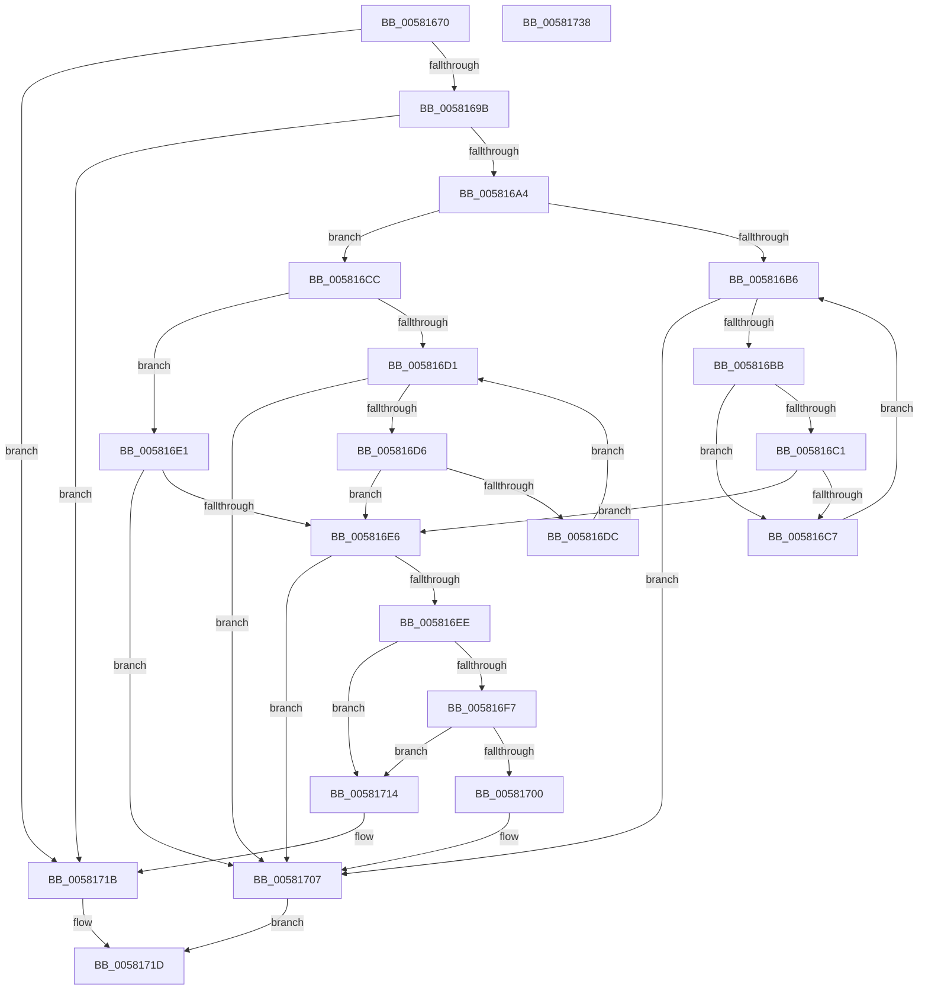

# FsRtlRemovePerFileContext

- RVA: `0x00581670`–`0x00581739` (길이 `201` bytes)
- VA: `0x0000000140581670`
- 실행 섹션: `.text`
- PDB 이름 있음: `예`; PDB Function 태그: `아니요`
- unwind 정보 RVA: `0x0005E6B4`
- 디코드: `65`개 명령, `201/201` bytes 표시
- 미해석 바이트: `0` (있으면 어셈블리에 `.byte`로 보존)

> 이 문서는 커널 이미지의 기계어와 PDB 기호를 분석해 생성했습니다. 4번과 5번은 함수 원형과 자료형을 바이너리 사용 방식에서 추정한 C 해석이며 원본 소스 복구 결과는 아닙니다.

## 1. Dependencies

- 직접 호출 지점: **2**; 고유 호출 대상: **2**
- 직접 호출자로 확인된 함수: **1**
- RIP 상대 이미지 참조: **0**

### Outgoing calls
- `0x005816A7` → [FsRtlAcquireAutoExpandPushLockExclusive](../26/FsRtlAcquireAutoExpandPushLockExclusive_function_0026539C.md) (function, `0x0026539C`)
- `0x0058170A` → [FsRtlReleaseAutoExpandPushLockExclusive](../26/FsRtlReleaseAutoExpandPushLockExclusive_function_00265B5C.md) (function, `0x00265B5C`)

### Direct callers
- [FsRtlRemovePerFileContextWithReserve](FsRtlRemovePerFileContextWithReserve_function_00581740.md) at `0x0058177B`

### Static image references
- 디코드된 RIP-relative 메모리 참조가 없습니다.

## 2. Other-region calls and transfers

- 다른 실행 섹션으로 향하는 call: **0**
- 별도 외부 분기/꼬리 이동을 확인하지 못했습니다.

## 3. Assembly (complete function range)

```asm
00581670  48 8B C4                        mov rax, rsp
00581673  48 89 58 08                     mov qword ptr [rax + 8], rbx
00581677  48 89 68 10                     mov qword ptr [rax + 0x10], rbp
0058167B  48 89 70 18                     mov qword ptr [rax + 0x18], rsi
0058167F  48 89 78 20                     mov qword ptr [rax + 0x20], rdi
00581683  41 56                           push r14
00581685  48 83 EC 20                     sub rsp, 0x20
00581689  48 8B 29                        mov rbp, qword ptr [rcx]
0058168C  4D 8B F0                        mov r14, r8
0058168F  48 8B F2                        mov rsi, rdx
00581692  48 85 ED                        test rbp, rbp
00581695  0F 84 80 00 00 00               je 0x14058171b
0058169B  48 8D 7D 10                     lea rdi, [rbp + 0x10]
0058169F  48 39 3F                        cmp qword ptr [rdi], rdi
005816A2  74 77                           je 0x14058171b
005816A4  48 8B CD                        mov rcx, rbp
005816A7  E8 F0 3C CE FF                  call 0x14026539c
005816AC  48 8B 07                        mov rax, qword ptr [rdi]
005816AF  33 DB                           xor ebx, ebx
005816B1  4D 85 F6                        test r14, r14
005816B4  74 16                           je 0x1405816cc
005816B6  48 3B C7                        cmp rax, rdi
005816B9  74 4C                           je 0x140581707
005816BB  48 39 70 10                     cmp qword ptr [rax + 0x10], rsi
005816BF  75 06                           jne 0x1405816c7
005816C1  4C 39 70 18                     cmp qword ptr [rax + 0x18], r14
005816C5  74 1F                           je 0x1405816e6
005816C7  48 8B 00                        mov rax, qword ptr [rax]
005816CA  EB EA                           jmp 0x1405816b6
005816CC  48 85 F6                        test rsi, rsi
005816CF  74 10                           je 0x1405816e1
005816D1  48 3B C7                        cmp rax, rdi
005816D4  74 31                           je 0x140581707
005816D6  48 39 70 10                     cmp qword ptr [rax + 0x10], rsi
005816DA  74 0A                           je 0x1405816e6
005816DC  48 8B 00                        mov rax, qword ptr [rax]
005816DF  EB F0                           jmp 0x1405816d1
005816E1  48 3B C7                        cmp rax, rdi
005816E4  74 21                           je 0x140581707
005816E6  48 8B D8                        mov rbx, rax
005816E9  48 85 C0                        test rax, rax
005816EC  74 19                           je 0x140581707
005816EE  48 8B 08                        mov rcx, qword ptr [rax]
005816F1  48 39 41 08                     cmp qword ptr [rcx + 8], rax
005816F5  75 1D                           jne 0x140581714
005816F7  48 8B 40 08                     mov rax, qword ptr [rax + 8]
005816FB  48 39 18                        cmp qword ptr [rax], rbx
005816FE  75 14                           jne 0x140581714
00581700  48 89 08                        mov qword ptr [rax], rcx
00581703  48 89 41 08                     mov qword ptr [rcx + 8], rax
00581707  48 8B CD                        mov rcx, rbp
0058170A  E8 4D 44 CE FF                  call 0x140265b5c
0058170F  48 8B C3                        mov rax, rbx
00581712  EB 09                           jmp 0x14058171d
00581714  B9 03 00 00 00                  mov ecx, 3
00581719  CD 29                           int 0x29
0058171B  33 C0                           xor eax, eax
0058171D  48 8B 5C 24 30                  mov rbx, qword ptr [rsp + 0x30]
00581722  48 8B 6C 24 38                  mov rbp, qword ptr [rsp + 0x38]
00581727  48 8B 74 24 40                  mov rsi, qword ptr [rsp + 0x40]
0058172C  48 8B 7C 24 48                  mov rdi, qword ptr [rsp + 0x48]
00581731  48 83 C4 20                     add rsp, 0x20
00581735  41 5E                           pop r14
00581737  C3                              ret
00581738  CC                              int3
```

## 4. C-style interpretation (structured pseudocode)

```c
__int64 __fastcall FsRtlRemovePerFileContext(__int64 a1, __int64 a2, __int64 a3)
{
    __int64 result;
    __int64 v_rbx;
    __int64 v_rsp;
    unsigned __int64 v_stack_p10;
    unsigned __int64 v_stack_p18;
    unsigned __int64 v_stack_p20;
    unsigned __int64 v_stack_p8;

    *(unsigned __int64 *)(v_rsp + 8) = v_rbx;
    *(unsigned __int64 *)(v_rsp + 16) = v_rbp;
    *(unsigned __int64 *)(v_rsp + 24) = v_rsi;
    *(unsigned __int64 *)(v_rsp + 32) = v_rdi;
    v_rsp = (v_rsp) - (32);
    if (*(unsigned __int64 *)(a1) == 0) goto loc_0058171B;
    if ((*(unsigned __int64 *)(*(unsigned __int64 *)(a1) + 16)) == (*(unsigned __int64 *)(a1) + 16)) goto loc_0058171B;
    result = FsRtlAcquireAutoExpandPushLockExclusive(*(unsigned __int64 *)(a1), a2, a3, a4);
    v_rbx = 0;
    if (a3 == 0) goto loc_005816CC;
loc_005816B6:
    if ((*(unsigned __int64 *)(*(unsigned __int64 *)(a1) + 16)) == (*(unsigned __int64 *)(a1) + 16)) goto loc_00581707;
    if ((*(unsigned __int64 *)(*(unsigned __int64 *)(*(unsigned __int64 *)(a1) + 16) + 16)) != a2) goto loc_005816C7;
    if ((*(unsigned __int64 *)(*(unsigned __int64 *)(*(unsigned __int64 *)(a1) + 16) + 24)) == a3) goto loc_005816E6;
loc_005816C7:
    goto loc_005816B6;
loc_005816CC:
    if (a2 == 0) goto loc_005816E1;
loc_005816D1:
    if ((*(unsigned __int64 *)(*(unsigned __int64 *)(*(unsigned __int64 *)(a1) + 16))) == (*(unsigned __int64 *)(a1) + 16)) goto loc_00581707;
    if ((*(unsigned __int64 *)(*(unsigned __int64 *)(*(unsigned __int64 *)(*(unsigned __int64 *)(a1) + 16)) + 16)) == a2) goto loc_005816E6;
    goto loc_005816D1;
loc_005816E1:
    if ((*(unsigned __int64 *)(*(unsigned __int64 *)(*(unsigned __int64 *)(*(unsigned __int64 *)(a1) + 16)))) == (*(unsigned __int64 *)(a1) + 16)) goto loc_00581707;
loc_005816E6:
    if (*(unsigned __int64 *)(*(unsigned __int64 *)(*(unsigned __int64 *)(*(unsigned __int64 *)(a1) + 16))) == 0) goto loc_00581707;
    if ((*(unsigned __int64 *)(*(unsigned __int64 *)(*(unsigned __int64 *)(*(unsigned __int64 *)(*(unsigned __int64 *)(*(unsigned __int64 *)(a1) + 16)))) + 8)) != (*(unsigned __int64 *)(*(unsigned __int64 *)(*(unsigned __int64 *)(*(unsigned __int64 *)(a1) + 16))))) goto loc_00581714;
    if ((*(unsigned __int64 *)(*(unsigned __int64 *)(*(unsigned __int64 *)(*(unsigned __int64 *)(*(unsigned __int64 *)(*(unsigned __int64 *)(a1) + 16))) + 8))) != (*(unsigned __int64 *)(*(unsigned __int64 *)(*(unsigned __int64 *)(*(unsigned __int64 *)(a1) + 16))))) goto loc_00581714;
    *(unsigned __int64 *)(*(unsigned __int64 *)(*(unsigned __int64 *)(*(unsigned __int64 *)(*(unsigned __int64 *)(*(unsigned __int64 *)(a1) + 16))) + 8)) = *(unsigned __int64 *)(*(unsigned __int64 *)(*(unsigned __int64 *)(*(unsigned __int64 *)(*(unsigned __int64 *)(a1) + 16))));
    *(unsigned __int64 *)(*(unsigned __int64 *)(*(unsigned __int64 *)(*(unsigned __int64 *)(*(unsigned __int64 *)(*(unsigned __int64 *)(a1) + 16)))) + 8) = *(unsigned __int64 *)(*(unsigned __int64 *)(*(unsigned __int64 *)(*(unsigned __int64 *)(*(unsigned __int64 *)(a1) + 16))) + 8);
loc_00581707:
    result = FsRtlReleaseAutoExpandPushLockExclusive(*(unsigned __int64 *)(a1), a2, a3, a4);
    goto loc_0058171D;
loc_00581714:
loc_0058171B:
    result = 0;
loc_0058171D:
    v_rsp = (v_rsp) + (32);
    return result;
}
```

## 5. (Beta) C Style

```c
int64_t FsRtlRemovePerFileContext(void *Arg1, int64_t Arg2, int64_t Arg3)
{
    uint8_t *arg1 = (uint8_t *)Arg1;

    int64_t result;
    int64_t local_rbx;
    int64_t local_rsp;
    uint64_t v_stack_p10;
    uint64_t v_stack_p18;
    uint64_t v_stack_p20;
    uint64_t v_stack_p8;

    *(uint64_t *)(local_rsp + 0x8) = local_rbx;
    *(uint64_t *)(local_rsp + 0x10) = local_rbp;
    *(uint64_t *)(local_rsp + 0x18) = local_rsi;
    *(uint64_t *)(local_rsp + 0x20) = local_rdi;
    local_rsp = (local_rsp) - (32);
    if (*(uint64_t *)(arg1) == 0) goto loc_0058171B;
    if ((*(uint64_t *)(*(uint64_t *)(arg1) + 0x10)) == (*(uint64_t *)(arg1) + 16)) goto loc_0058171B;
    result = FsRtlAcquireAutoExpandPushLockExclusive(*(uint64_t *)(arg1), Arg2, Arg3, a4);
    local_rbx = 0;
    if (Arg3 == 0) goto loc_005816CC;
loc_005816B6:
    if ((*(uint64_t *)(*(uint64_t *)(arg1) + 0x10)) == (*(uint64_t *)(arg1) + 16)) goto loc_00581707;
    if ((*(uint64_t *)(*(uint64_t *)(*(uint64_t *)(arg1) + 0x10) + 0x10)) != Arg2) goto loc_005816C7;
    if ((*(uint64_t *)(*(uint64_t *)(*(uint64_t *)(arg1) + 0x10) + 0x18)) == Arg3) goto loc_005816E6;
loc_005816C7:
    goto loc_005816B6;
loc_005816CC:
    if (Arg2 == 0) goto loc_005816E1;
loc_005816D1:
    if ((*(uint64_t *)(*(uint64_t *)(*(uint64_t *)(arg1) + 0x10))) == (*(uint64_t *)(arg1) + 16)) goto loc_00581707;
    if ((*(uint64_t *)(*(uint64_t *)(*(uint64_t *)(*(uint64_t *)(arg1) + 0x10)) + 0x10)) == Arg2) goto loc_005816E6;
    goto loc_005816D1;
loc_005816E1:
    if ((*(uint64_t *)(*(uint64_t *)(*(uint64_t *)(*(uint64_t *)(arg1) + 0x10)))) == (*(uint64_t *)(arg1) + 16)) goto loc_00581707;
loc_005816E6:
    if (*(uint64_t *)(*(uint64_t *)(*(uint64_t *)(*(uint64_t *)(arg1) + 0x10))) == 0) goto loc_00581707;
    if ((*(uint64_t *)(*(uint64_t *)(*(uint64_t *)(*(uint64_t *)(*(uint64_t *)(*(uint64_t *)(arg1) + 0x10)))) + 0x8)) != (*(uint64_t *)(*(uint64_t *)(*(uint64_t *)(*(uint64_t *)(arg1) + 0x10))))) goto loc_00581714;
    if ((*(uint64_t *)(*(uint64_t *)(*(uint64_t *)(*(uint64_t *)(*(uint64_t *)(*(uint64_t *)(arg1) + 0x10))) + 0x8))) != (*(uint64_t *)(*(uint64_t *)(*(uint64_t *)(*(uint64_t *)(arg1) + 0x10))))) goto loc_00581714;
    *(uint64_t *)(*(uint64_t *)(*(uint64_t *)(*(uint64_t *)(*(uint64_t *)(*(uint64_t *)(arg1) + 0x10))) + 0x8)) = *(uint64_t *)(*(uint64_t *)(*(uint64_t *)(*(uint64_t *)(*(uint64_t *)(arg1) + 0x10))));
    *(uint64_t *)(*(uint64_t *)(*(uint64_t *)(*(uint64_t *)(*(uint64_t *)(*(uint64_t *)(arg1) + 0x10)))) + 0x8) = *(uint64_t *)(*(uint64_t *)(*(uint64_t *)(*(uint64_t *)(*(uint64_t *)(arg1) + 0x10))) + 0x8);
loc_00581707:
    result = FsRtlReleaseAutoExpandPushLockExclusive(*(uint64_t *)(arg1), Arg2, Arg3, a4);
    goto loc_0058171D;
loc_00581714:
loc_0058171B:
    result = 0;
loc_0058171D:
    local_rsp = (local_rsp) + (32);
    return result;
}
```

### 관측된 메모리 오프셋

구조체 형식이 확인되지 않은 접근은 인자 기준의 오프셋으로만 기록했습니다.

| 기준 인자 | 오프셋 표현 | 폭 (bit) | 접근 |
|---|---:|---:|---|
| `Arg1` | `+ 0x0` | `64` | `R` |

## 6. Execution-region graph

[열기: 2D/3D 그래프와 함수 탐색 컨트롤 패널](../../../control-panel.html?section=text&rva=0x00581670&view=graph)

- 2D 그래프는 위에서 아래로 흐르고, 3D 그래프는 빈 공간을 드래그해 회전합니다. Shift+드래그는 이동, 휠은 확대·축소, 함수 노드 선택은 대상 보고서 이동입니다.

### Static fallback


