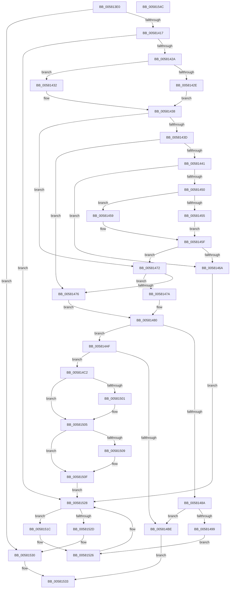

# FsRtlSplitBaseMcb

- RVA: `0x005813E0`–`0x0058154D` (길이 `365` bytes)
- VA: `0x00000001405813E0`
- 실행 섹션: `.text`
- PDB 이름 있음: `예`; PDB Function 태그: `아니요`
- unwind 정보 RVA: `0x0006B074`
- 디코드: `115`개 명령, `365/365` bytes 표시
- 미해석 바이트: `0` (있으면 어셈블리에 `.byte`로 보존)

> 이 문서는 커널 이미지의 기계어와 PDB 기호를 분석해 생성했습니다. 4번과 5번은 함수 원형과 자료형을 바이너리 사용 방식에서 추정한 C 해석이며 원본 소스 복구 결과는 아닙니다.

## 1. Dependencies

- 직접 호출 지점: **3**; 고유 호출 대상: **2**
- 직접 호출자로 확인된 함수: **1**
- RIP 상대 이미지 참조: **0**

### Outgoing calls
- `0x0058140A` → [FsRtlFindLargeIndex](../3F/FsRtlFindLargeIndex_function_003FB570.md) (function, `0x003FB570`)
- `0x00581490` → [FsRtlAddEntry](../38/FsRtlAddEntry_function_00387BE0.md) (function, `0x00387BE0`)
- `0x005814B5` → [FsRtlAddEntry](../38/FsRtlAddEntry_function_00387BE0.md) (function, `0x00387BE0`)

### Direct callers
- [FsRtlSplitLargeMcb](FsRtlSplitLargeMcb_function_00581560.md) at `0x00581590`

### Static image references
- 디코드된 RIP-relative 메모리 참조가 없습니다.

## 2. Other-region calls and transfers

- 다른 실행 섹션으로 향하는 call: **0**
- 별도 외부 분기/꼬리 이동을 확인하지 못했습니다.

## 3. Assembly (complete function range)

```asm
005813E0  48 8B C4                        mov rax, rsp
005813E3  48 89 58 10                     mov qword ptr [rax + 0x10], rbx
005813E7  48 89 68 18                     mov qword ptr [rax + 0x18], rbp
005813EB  48 89 70 20                     mov qword ptr [rax + 0x20], rsi
005813EF  57                              push rdi
005813F0  41 56                           push r14
005813F2  41 57                           push r15
005813F4  48 83 EC 20                     sub rsp, 0x20
005813F8  4D 8B F8                        mov r15, r8
005813FB  33 FF                           xor edi, edi
005813FD  4C 8D 40 08                     lea r8, [rax + 8]
00581401  89 78 08                        mov dword ptr [rax + 8], edi
00581404  4C 8B F2                        mov r14, rdx
00581407  48 8B F1                        mov rsi, rcx
0058140A  E8 61 A1 E7 FF                  call 0x1403fb570
0058140F  84 C0                           test al, al
00581411  0F 84 19 01 00 00               je 0x140581530
00581417  8B 5C 24 40                     mov ebx, dword ptr [rsp + 0x40]
0058141B  48 8B 56 10                     mov rdx, qword ptr [rsi + 0x10]
0058141F  83 7C DA 04 FF                  cmp dword ptr [rdx + rbx*8 + 4], -1
00581424  0F 84 FE 00 00 00               je 0x140581528
0058142A  85 DB                           test ebx, ebx
0058142C  75 04                           jne 0x140581432
0058142E  8B C7                           mov eax, edi
00581430  EB 06                           jmp 0x140581438
00581432  8D 43 FF                        lea eax, [rbx - 1]
00581435  8B 04 C2                        mov eax, dword ptr [rdx + rax*8]
00581438  41 3B C6                        cmp eax, r14d
0058143B  75 35                           jne 0x140581472
0058143D  85 DB                           test ebx, ebx
0058143F  74 35                           je 0x140581476
00581441  44 8D 43 FF                     lea r8d, [rbx - 1]
00581445  46 8B 54 C2 04                  mov r10d, dword ptr [rdx + r8*8 + 4]
0058144A  41 83 FA FF                     cmp r10d, -1
0058144E  74 1A                           je 0x14058146a
00581450  45 85 C0                        test r8d, r8d
00581453  75 04                           jne 0x140581459
00581455  8B CF                           mov ecx, edi
00581457  EB 06                           jmp 0x14058145f
00581459  8D 43 FE                        lea eax, [rbx - 2]
0058145C  8B 0C C2                        mov ecx, dword ptr [rdx + rax*8]
0058145F  42 8B 04 C2                     mov eax, dword ptr [rdx + r8*8]
00581463  2B C1                           sub eax, ecx
00581465  41 03 C2                        add eax, r10d
00581468  75 08                           jne 0x140581472
0058146A  41 8B D8                        mov ebx, r8d
0058146D  E9 B6 00 00 00                  jmp 0x140581528
00581472  85 DB                           test ebx, ebx
00581474  75 04                           jne 0x14058147a
00581476  8B C7                           mov eax, edi
00581478  EB 06                           jmp 0x140581480
0058147A  8D 43 FF                        lea eax, [rbx - 1]
0058147D  8B 04 C2                        mov eax, dword ptr [rdx + rax*8]
00581480  8B D3                           mov edx, ebx
00581482  48 8B CE                        mov rcx, rsi
00581485  41 3B C6                        cmp eax, r14d
00581488  75 25                           jne 0x1405814af
0058148A  41 B8 01 00 00 00               mov r8d, 1
00581490  E8 4B 67 E0 FF                  call 0x140387be0
00581495  84 C0                           test al, al
00581497  74 25                           je 0x1405814be
00581499  48 8B 46 10                     mov rax, qword ptr [rsi + 0x10]
0058149D  43 8D 0C 37                     lea ecx, [r15 + r14]
005814A1  83 4C D8 04 FF                  or dword ptr [rax + rbx*8 + 4], 0xffffffff
005814A6  48 8B 46 10                     mov rax, qword ptr [rsi + 0x10]
005814AA  89 0C D8                        mov dword ptr [rax + rbx*8], ecx
005814AD  EB 77                           jmp 0x140581526
005814AF  41 B8 02 00 00 00               mov r8d, 2
005814B5  E8 26 67 E0 FF                  call 0x140387be0
005814BA  84 C0                           test al, al
005814BC  75 04                           jne 0x1405814c2
005814BE  32 C0                           xor al, al
005814C0  EB 71                           jmp 0x140581533
005814C2  48 8B 4E 10                     mov rcx, qword ptr [rsi + 0x10]
005814C6  44 8D 43 01                     lea r8d, [rbx + 1]
005814CA  44 8D 53 02                     lea r10d, [rbx + 2]
005814CE  42 8B 44 D1 04                  mov eax, dword ptr [rcx + r10*8 + 4]
005814D3  89 44 D9 04                     mov dword ptr [rcx + rbx*8 + 4], eax
005814D7  43 8D 0C 37                     lea ecx, [r15 + r14]
005814DB  48 8B 46 10                     mov rax, qword ptr [rsi + 0x10]
005814DF  44 89 34 D8                     mov dword ptr [rax + rbx*8], r14d
005814E3  48 8B 46 10                     mov rax, qword ptr [rsi + 0x10]
005814E7  42 83 4C C0 04 FF               or dword ptr [rax + r8*8 + 4], 0xffffffff
005814ED  48 8B 46 10                     mov rax, qword ptr [rsi + 0x10]
005814F1  45 85 C0                        test r8d, r8d
005814F4  42 89 0C C0                     mov dword ptr [rax + r8*8], ecx
005814F8  44 8B C7                        mov r8d, edi
005814FB  48 8B 56 10                     mov rdx, qword ptr [rsi + 0x10]
005814FF  74 04                           je 0x140581505
00581501  44 8B 04 DA                     mov r8d, dword ptr [rdx + rbx*8]
00581505  85 DB                           test ebx, ebx
00581507  74 06                           je 0x14058150f
00581509  8D 43 FF                        lea eax, [rbx - 1]
0058150C  8B 3C C2                        mov edi, dword ptr [rdx + rax*8]
0058150F  44 2B C7                        sub r8d, edi
00581512  41 8B DA                        mov ebx, r10d
00581515  46 01 44 D2 04                  add dword ptr [rdx + r10*8 + 4], r8d
0058151A  EB 0C                           jmp 0x140581528
0058151C  48 8B 46 10                     mov rax, qword ptr [rsi + 0x10]
00581520  8B CB                           mov ecx, ebx
00581522  44 01 3C C8                     add dword ptr [rax + rcx*8], r15d
00581526  FF C3                           inc ebx
00581528  3B 5E 04                        cmp ebx, dword ptr [rsi + 4]
0058152B  72 EF                           jb 0x14058151c
0058152D  40 B7 01                        mov dil, 1
00581530  40 8A C7                        mov al, dil
00581533  48 8B 5C 24 48                  mov rbx, qword ptr [rsp + 0x48]
00581538  48 8B 6C 24 50                  mov rbp, qword ptr [rsp + 0x50]
0058153D  48 8B 74 24 58                  mov rsi, qword ptr [rsp + 0x58]
00581542  48 83 C4 20                     add rsp, 0x20
00581546  41 5F                           pop r15
00581548  41 5E                           pop r14
0058154A  5F                              pop rdi
0058154B  C3                              ret
0058154C  CC                              int3
```

## 4. C-style interpretation (structured pseudocode)

```c
__int64 __fastcall FsRtlSplitBaseMcb(__int64 a1, __int64 a2, __int64 a3)
{
    __int64 result;
    __int64 v_rbx;
    __int64 v_rdi;
    __int64 v_rsp;
    unsigned __int64 v_stack_p10;
    unsigned __int64 v_stack_p18;
    unsigned __int64 v_stack_p20;
    unsigned int v_stack_p8;

    *(unsigned __int64 *)(v_rsp + 16) = v_rbx;
    *(unsigned __int64 *)(v_rsp + 24) = v_rbp;
    *(unsigned __int64 *)(v_rsp + 32) = v_rsi;
    v_rsp = (v_rsp) - (32);
    v_rdi = 0;
    *(unsigned int *)(v_rsp + 8) = 0;
    result = FsRtlFindLargeIndex(a1, a2, v_rsp + 8, a4);
    if ((unsigned __int8)(result) == 0) goto loc_00581530;
    if ((*(unsigned int *)(*(unsigned __int64 *)(a1 + 16) + (unsigned int)(v_stack_p8) * 8 + 4)) == -1) goto loc_00581528;
    if ((unsigned int)((unsigned int)(v_stack_p8)) != 0) goto loc_00581432;
    goto loc_00581438;
loc_00581432:
loc_00581438:
    if (((unsigned int)((unsigned int)(*(unsigned int *)(*(unsigned __int64 *)(a1 + 16) + (unsigned int)(v_stack_p8) - 1 * 8)))) != ((unsigned int)(a2))) goto loc_00581472;
    if ((unsigned int)((unsigned int)(v_stack_p8)) == 0) goto loc_00581476;
    if (((unsigned int)((unsigned int)(*(unsigned int *)(*(unsigned __int64 *)(a1 + 16) + (unsigned int)(v_stack_p8) - 1 * 8 + 4)))) == -1) goto loc_0058146A;
    if ((unsigned int)((unsigned int)(v_stack_p8) - 1) != 0) goto loc_00581459;
    goto loc_0058145F;
loc_00581459:
loc_0058145F:
    result = (unsigned int)(((unsigned int)(*(unsigned int *)(*(unsigned __int64 *)(a1 + 16) + (unsigned int)(v_stack_p8) - 1 * 8))) - ((unsigned int)((unsigned int)(*(unsigned int *)(*(unsigned __int64 *)(a1 + 16) + (unsigned int)(v_stack_p8) - 2 * 8)))));
    result = (unsigned int)((result) + ((unsigned int)((unsigned int)(*(unsigned int *)(*(unsigned __int64 *)(a1 + 16) + (unsigned int)(v_stack_p8) - 1 * 8 + 4)))));
    if (condition_is_not_equal) goto loc_00581472;
loc_0058146A:
    goto loc_00581528;
loc_00581472:
    if ((unsigned int)((unsigned int)((unsigned int)((unsigned int)(v_stack_p8) - 1))) != 0) goto loc_0058147A;
loc_00581476:
    goto loc_00581480;
loc_0058147A:
loc_00581480:
    if (((unsigned int)((unsigned int)(*(unsigned int *)(*(unsigned __int64 *)(a1 + 16) + (unsigned int)((unsigned int)((unsigned int)(v_stack_p8) - 1)) - 1 * 8)))) != ((unsigned int)(a2))) goto loc_005814AF;
    result = FsRtlAddEntry(a1, (unsigned int)((unsigned int)((unsigned int)((unsigned int)((unsigned int)(v_stack_p8) - 1)))), 1, a4);
    if ((unsigned __int8)(result) == 0) goto loc_005814BE;
    *(unsigned int *)(*(unsigned __int64 *)(a1 + 16) + (unsigned int)((unsigned int)((unsigned int)(v_stack_p8) - 1)) * 8) = (unsigned int)(a3 + a2 * 1);
    goto loc_00581526;
loc_005814AF:
    result = FsRtlAddEntry(a3 + a2 * 1, (unsigned int)((unsigned int)((unsigned int)((unsigned int)((unsigned int)(v_stack_p8) - 1)))), 2, a4);
    if ((unsigned __int8)(result) != 0) goto loc_005814C2;
loc_005814BE:
    result = 0;
    goto loc_00581533;
loc_005814C2:
    *(unsigned int *)(*(unsigned __int64 *)(a1 + 16) + (unsigned int)((unsigned int)((unsigned int)(v_stack_p8) - 1)) * 8 + 4) = (unsigned int)((unsigned int)(*(unsigned int *)(*(unsigned __int64 *)(a1 + 16) + (unsigned int)((unsigned int)((unsigned int)(v_stack_p8) - 1)) + 2 * 8 + 4)));
    *(unsigned int *)(*(unsigned __int64 *)(a1 + 16) + (unsigned int)((unsigned int)((unsigned int)(v_stack_p8) - 1)) * 8) = (unsigned int)(a2);
    *(unsigned int *)(*(unsigned __int64 *)(a1 + 16) + (unsigned int)((unsigned int)((unsigned int)(v_stack_p8) - 1)) + 1 * 8) = (unsigned int)(a3 + a2 * 1);
    if ((unsigned int)((unsigned int)((unsigned int)((unsigned int)(v_stack_p8) - 1)) + 1) != 0) {
        a3 = *(unsigned int *)(*(unsigned __int64 *)(a1 + 16) + (unsigned int)((unsigned int)((unsigned int)(v_stack_p8) - 1)) * 8);
    }
    result = *(unsigned __int64 *)(a1 + 16);
    if ((unsigned int)((unsigned int)((unsigned int)((unsigned int)(v_stack_p8) - 1))) != 0) {
        result = (unsigned int)((unsigned int)((unsigned int)(v_stack_p8) - 1)) - 1;
        v_rdi = *(unsigned int *)(*(unsigned __int64 *)(a1 + 16) + result * 8);
    }
    a3 = (unsigned int)((a3) - ((unsigned int)(v_rdi)));
    goto loc_00581528;
loc_0058151C:
loc_00581526:
    v_rbx = (unsigned int)(((unsigned int)((unsigned int)((unsigned int)((unsigned int)((unsigned int)(v_stack_p8) - 1)) + 2))) + 1);
loc_00581528:
    if (((unsigned int)(v_rbx)) < (*(unsigned int *)(a1 + 4))) goto loc_0058151C;
loc_00581530:
loc_00581533:
    v_rsp = (v_rsp) + (32);
    return 1;
}
```

## 5. (Beta) C Style

```c
int64_t FsRtlSplitBaseMcb(void *Arg1, int64_t Arg2, void *Arg3)
{
    uint8_t *arg1 = (uint8_t *)Arg1;
    uint8_t *arg3 = (uint8_t *)Arg3;

    int64_t result;
    int64_t local_rbx;
    int64_t local_rdi;
    int64_t local_rsp;
    uint64_t v_stack_p10;
    uint64_t v_stack_p18;
    uint64_t v_stack_p20;
    uint32_t v_stack_p8;

    *(uint64_t *)(local_rsp + 0x10) = local_rbx;
    *(uint64_t *)(local_rsp + 0x18) = local_rbp;
    *(uint64_t *)(local_rsp + 0x20) = local_rsi;
    local_rsp = (local_rsp) - (32);
    local_rdi = 0;
    *(uint32_t *)(local_rsp + 0x8) = 0;
    result = FsRtlFindLargeIndex(Arg1, Arg2, local_rsp + 8, a4);
    if ((uint8_t)(result) == 0) goto loc_00581530;
    if ((*(uint32_t *)(*(uint64_t *)(arg1 + 0x10) + (uint32_t)(v_stack_p8) * 8 + 0x4)) == -1) goto loc_00581528;
    if ((uint32_t)((uint32_t)(v_stack_p8)) != 0) goto loc_00581432;
    goto loc_00581438;
loc_00581432:
loc_00581438:
    if (((uint32_t)((uint32_t)(*(uint32_t *)(*(uint64_t *)(arg1 + 0x10) + (uint32_t)(v_stack_p8) - 0x1 * 8)))) != ((uint32_t)(Arg2))) goto loc_00581472;
    if ((uint32_t)((uint32_t)(v_stack_p8)) == 0) goto loc_00581476;
    if (((uint32_t)((uint32_t)(*(uint32_t *)(*(uint64_t *)(arg1 + 0x10) + (uint32_t)(v_stack_p8) - 0x1 * 8 + 0x4)))) == -1) goto loc_0058146A;
    if ((uint32_t)((uint32_t)(v_stack_p8) - 1) != 0) goto loc_00581459;
    goto loc_0058145F;
loc_00581459:
loc_0058145F:
    result = (uint32_t)(((uint32_t)(*(uint32_t *)(*(uint64_t *)(arg1 + 0x10) + (uint32_t)(v_stack_p8) - 0x1 * 8))) - ((uint32_t)((uint32_t)(*(uint32_t *)(*(uint64_t *)(arg1 + 0x10) + (uint32_t)(v_stack_p8) - 0x2 * 8)))));
    result = (uint32_t)((result) + ((uint32_t)((uint32_t)(*(uint32_t *)(*(uint64_t *)(arg1 + 0x10) + (uint32_t)(v_stack_p8) - 0x1 * 8 + 0x4)))));
    if (condition_is_not_equal) goto loc_00581472;
loc_0058146A:
    goto loc_00581528;
loc_00581472:
    if ((uint32_t)((uint32_t)((uint32_t)((uint32_t)(v_stack_p8) - 1))) != 0) goto loc_0058147A;
loc_00581476:
    goto loc_00581480;
loc_0058147A:
loc_00581480:
    if (((uint32_t)((uint32_t)(*(uint32_t *)(*(uint64_t *)(arg1 + 0x10) + (uint32_t)((uint32_t)((uint32_t)(v_stack_p8) - 0x1)) - 0x1 * 8)))) != ((uint32_t)(Arg2))) goto loc_005814AF;
    result = FsRtlAddEntry(Arg1, (uint32_t)((uint32_t)((uint32_t)((uint32_t)((uint32_t)(v_stack_p8) - 1)))), 1, a4);
    if ((uint8_t)(result) == 0) goto loc_005814BE;
    *(uint32_t *)(*(uint64_t *)(arg1 + 0x10) + (uint32_t)((uint32_t)((uint32_t)(v_stack_p8) - 0x1)) * 8) = (uint32_t)(Arg3 + Arg2 * 1);
    goto loc_00581526;
loc_005814AF:
    result = FsRtlAddEntry(Arg3 + Arg2 * 1, (uint32_t)((uint32_t)((uint32_t)((uint32_t)((uint32_t)(v_stack_p8) - 1)))), 2, a4);
    if ((uint8_t)(result) != 0) goto loc_005814C2;
loc_005814BE:
    result = 0;
    goto loc_00581533;
loc_005814C2:
    *(uint32_t *)(*(uint64_t *)(arg1 + 0x10) + (uint32_t)((uint32_t)((uint32_t)(v_stack_p8) - 0x1)) * 8 + 0x4) = (uint32_t)((uint32_t)(*(uint32_t *)(*(uint64_t *)(arg1 + 0x10) + (uint32_t)((uint32_t)((uint32_t)(v_stack_p8) - 0x1)) + 0x2 * 8 + 0x4)));
    *(uint32_t *)(*(uint64_t *)(arg1 + 0x10) + (uint32_t)((uint32_t)((uint32_t)(v_stack_p8) - 0x1)) * 8) = (uint32_t)(Arg2);
    *(uint32_t *)(*(uint64_t *)(arg1 + 0x10) + (uint32_t)((uint32_t)((uint32_t)(v_stack_p8) - 0x1)) + 0x1 * 8) = (uint32_t)(Arg3 + Arg2 * 1);
    if ((uint32_t)((uint32_t)((uint32_t)((uint32_t)(v_stack_p8) - 1)) + 1) != 0) {
        Arg3 = *(uint32_t *)(*(uint64_t *)(arg1 + 0x10) + (uint32_t)((uint32_t)((uint32_t)(v_stack_p8) - 0x1)) * 8);
    }
    result = *(uint64_t *)(arg1 + 0x10);
    if ((uint32_t)((uint32_t)((uint32_t)((uint32_t)(v_stack_p8) - 1))) != 0) {
        result = (uint32_t)((uint32_t)((uint32_t)(v_stack_p8) - 1)) - 1;
        local_rdi = *(uint32_t *)(*(uint64_t *)(arg1 + 0x10) + result * 8);
    }
    Arg3 = (uint32_t)((Arg3) - ((uint32_t)(local_rdi)));
    goto loc_00581528;
loc_0058151C:
loc_00581526:
    local_rbx = (uint32_t)(((uint32_t)((uint32_t)((uint32_t)((uint32_t)((uint32_t)(v_stack_p8) - 1)) + 2))) + 1);
loc_00581528:
    if (((uint32_t)(local_rbx)) < (*(uint32_t *)(arg1 + 0x4))) goto loc_0058151C;
loc_00581530:
loc_00581533:
    local_rsp = (local_rsp) + (32);
    return 1;
}
```

### 관측된 메모리 오프셋

구조체 형식이 확인되지 않은 접근은 인자 기준의 오프셋으로만 기록했습니다.

| 기준 인자 | 오프셋 표현 | 폭 (bit) | 접근 |
|---|---:|---:|---|
| `Arg1` | `+ 0x4` | `32` | `R` |
| `Arg1` | `+ 0x10` | `64` | `R` |
| `Arg3` | `+ 0x0 + r14*1` | `32` | `R` |

## 6. Execution-region graph

[열기: 2D/3D 그래프와 함수 탐색 컨트롤 패널](../../../control-panel.html?section=text&rva=0x005813E0&view=graph)

- 2D 그래프는 위에서 아래로 흐르고, 3D 그래프는 빈 공간을 드래그해 회전합니다. Shift+드래그는 이동, 휠은 확대·축소, 함수 노드 선택은 대상 보고서 이동입니다.

### Static fallback


