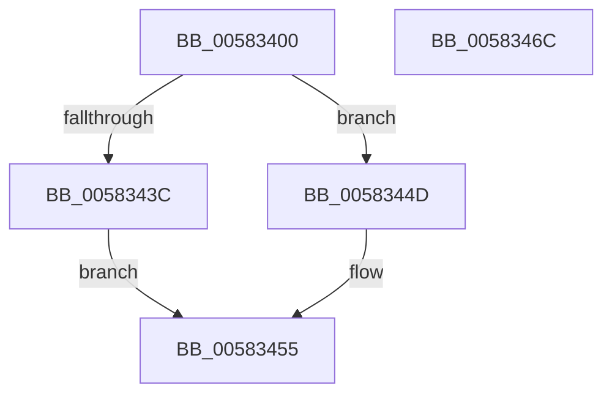

# FsRtlStackOverflowRead

- RVA: `0x00583400`–`0x0058346D` (길이 `109` bytes)
- VA: `0x0000000140583400`
- 실행 섹션: `.text`
- PDB 이름 있음: `예`; PDB Function 태그: `아니요`
- unwind 정보 RVA: `0x0005CF00`
- 디코드: `25`개 명령, `109/109` bytes 표시
- 미해석 바이트: `0` (있으면 어셈블리에 `.byte`로 보존)

> 이 문서는 커널 이미지의 기계어와 PDB 기호를 분석해 생성했습니다. 4번과 5번은 함수 원형과 자료형을 바이너리 사용 방식에서 추정한 C 해석이며 원본 소스 복구 결과는 아닙니다.

## 1. Dependencies

- 직접 호출 지점: **3**; 고유 호출 대상: **3**
- 직접 호출자로 확인된 함수: **0**
- RIP 상대 이미지 참조: **2**

### Outgoing calls
- `0x00583429` → [guard_dispatch_icall](../6B/guard_dispatch_icall_function_006BAAD0.md) (function, `0x006BAAD0`)
- `0x00583446` → [KeSetEvent](../33/KeSetEvent_function_0033F310.md) (function, `0x0033F310`)
- `0x00583450` → [ExFreePoolWithTag](../../poolcode/B8/ExFreePoolWithTag_function_00B82870.md) (function, `0x00B82870`)

### Direct callers
- 이 함수 시작 RVA로 연결되는 직접 call은 확인되지 않았습니다. 간접 호출은 완전히 역산할 수 없습니다.

### Static image references
- `0x0058342E` → RVA `0x00F8EEE0` (`.data`; read)
- `0x0058343F` → RVA `0x00F8EEC0` (`.data`; read)

## 2. Other-region calls and transfers

- 다른 실행 섹션으로 향하는 call: **1**
  - `0x00583450` → [ExFreePoolWithTag](../../poolcode/B8/ExFreePoolWithTag_function_00B82870.md) (`.text` → `POOLCODE`)
- 별도 외부 분기/꼬리 이동을 확인하지 못했습니다.

## 3. Assembly (complete function range)

```asm
00583400  40 53                           push rbx
00583402  48 83 EC 20                     sub rsp, 0x20
00583406  65 48 8B 04 25 88 01 00 00      mov rax, qword ptr gs:[0x188]
0058340F  48 8B D9                        mov rbx, rcx
00583412  48 C7 80 50 05 00 00 01 00 00 00  mov qword ptr [rax + 0x550], 1
0058341D  48 8B 41 20                     mov rax, qword ptr [rcx + 0x20]
00583421  48 8B 51 30                     mov rdx, qword ptr [rcx + 0x30]
00583425  48 8B 49 28                     mov rcx, qword ptr [rcx + 0x28]
00583429  E8 A2 76 13 00                  call 0x1406baad0
0058342E  48 8D 05 AB BA A0 00            lea rax, [rip + 0xa0baab]
00583435  33 D2                           xor edx, edx
00583437  48 3B D8                        cmp rbx, rax
0058343A  75 11                           jne 0x14058344d
0058343C  45 33 C0                        xor r8d, r8d
0058343F  48 8D 0D 7A BA A0 00            lea rcx, [rip + 0xa0ba7a]
00583446  E8 C5 BE DB FF                  call 0x14033f310
0058344B  EB 08                           jmp 0x140583455
0058344D  48 8B CB                        mov rcx, rbx
00583450  E8 1B F4 5F 00                  call 0x140b82870
00583455  65 48 8B 04 25 88 01 00 00      mov rax, qword ptr gs:[0x188]
0058345E  48 83 A0 50 05 00 00 00         and qword ptr [rax + 0x550], 0
00583466  48 83 C4 20                     add rsp, 0x20
0058346A  5B                              pop rbx
0058346B  C3                              ret
0058346C  CC                              int3
```

## 4. C-style interpretation (structured pseudocode)

```c
__int64 __fastcall FsRtlStackOverflowRead(__int64 a1, __int64 a2, int a3)
{
    __int64 result;
    __int64 v_rsp;

    v_rsp = (v_rsp) - (32);
    *(unsigned __int64 *)(*(unsigned __int64 *)(gs_base + (0 + 392)) + 1360) = 1;
    result = guard_dispatch_icall(*(unsigned __int64 *)(a1 + 40), *(unsigned __int64 *)(a1 + 48), a3, a4);
    a2 = 0;
    if (a1 != (v_rip + 10533547)) goto loc_0058344D;
    a3 = 0;
    result = KeSetEvent(v_rip + 10533498, a2, a3, a4);
    goto loc_00583455;
loc_0058344D:
    result = ExFreePoolWithTag(a1, a2, a3, a4);
loc_00583455:
    v_rsp = (v_rsp) + (32);
    return *(unsigned __int64 *)(gs_base + (0 + 392));
}
```

## 5. (Beta) C Style

```c
int64_t FsRtlStackOverflowRead(void *Arg1, int64_t Arg2, int32_t Arg3)
{
    uint8_t *arg1 = (uint8_t *)Arg1;

    int64_t result;
    int64_t local_rsp;

    local_rsp = (local_rsp) - (32);
    *(uint64_t *)(*(uint64_t *)(gs_base + (0 + 0x188)) + 0x550) = 1;
    result = guard_dispatch_icall(*(uint64_t *)(arg1 + 0x28), *(uint64_t *)(arg1 + 0x30), Arg3, a4);
    Arg2 = 0;
    if (Arg1 != (v_rip + 10533547)) goto loc_0058344D;
    Arg3 = 0;
    result = KeSetEvent(v_rip + 10533498, Arg2, Arg3, a4);
    goto loc_00583455;
loc_0058344D:
    result = ExFreePoolWithTag(Arg1, Arg2, Arg3, a4);
loc_00583455:
    local_rsp = (local_rsp) + (32);
    return *(uint64_t *)(gs_base + (0 + 0x188));
}
```

### 관측된 메모리 오프셋

구조체 형식이 확인되지 않은 접근은 인자 기준의 오프셋으로만 기록했습니다.

| 기준 인자 | 오프셋 표현 | 폭 (bit) | 접근 |
|---|---:|---:|---|
| `Arg1` | `+ 0x20` | `64` | `R` |
| `Arg1` | `+ 0x28` | `64` | `R` |
| `Arg1` | `+ 0x30` | `64` | `R` |

## 6. Execution-region graph

[열기: 2D/3D 그래프와 함수 탐색 컨트롤 패널](../../../control-panel.html?section=text&rva=0x00583400&view=graph)

- 2D 그래프는 위에서 아래로 흐르고, 3D 그래프는 빈 공간을 드래그해 회전합니다. Shift+드래그는 이동, 휠은 확대·축소, 함수 노드 선택은 대상 보고서 이동입니다.

### Static fallback


