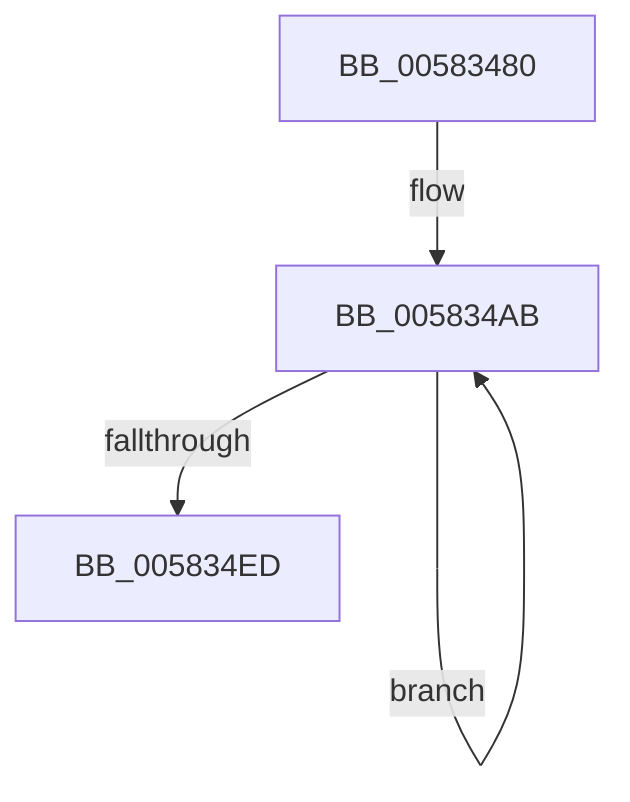

# FsRtlWorkerThread

- RVA: `0x00583480`–`0x00583514` (길이 `148` bytes)
- VA: `0x0000000140583480`
- 실행 섹션: `.text`
- PDB 이름 있음: `예`; PDB Function 태그: `아니요`
- unwind 정보 RVA: `0x000C3D3C`
- 디코드: `36`개 명령, `148/148` bytes 표시
- 미해석 바이트: `0` (있으면 어셈블리에 `.byte`로 보존)

> 이 문서는 커널 이미지의 기계어와 PDB 기호를 분석해 생성했습니다. 4번과 5번은 함수 원형과 자료형을 바이너리 사용 방식에서 추정한 C 해석이며 원본 소스 복구 결과는 아닙니다.

## 1. Dependencies

- 직접 호출 지점: **4**; 고유 호출 대상: **4**
- 직접 호출자로 확인된 함수: **0**
- RIP 상대 이미지 참조: **1**

### Outgoing calls
- `0x00583498` → [KeSetPriorityThread](../2C/KeSetPriorityThread_function_002C76E0.md) (function, `0x002C76E0`)
- `0x005834CE` → [KeRemoveQueueEx](../20/KeRemoveQueueEx_function_0020BD30.md) (function, `0x0020BD30`)
- `0x005834E0` → [guard_dispatch_icall](../6B/guard_dispatch_icall_function_006BAAD0.md) (function, `0x006BAAD0`)
- `0x0058350E` → [KeBugCheckEx](../4F/KeBugCheckEx_function_004FD660.md) (function, `0x004FD660`)

### Direct callers
- 이 함수 시작 RVA로 연결되는 직접 call은 확인되지 않았습니다. 간접 호출은 완전히 역산할 수 없습니다.

### Static image references
- `0x0058349D` → RVA `0x00F8EE40` (`.data`; read)

## 2. Other-region calls and transfers

- 다른 실행 섹션으로 향하는 call: **0**
- 별도 외부 분기/꼬리 이동을 확인하지 못했습니다.

## 3. Assembly (complete function range)

```asm
00583480  48 89 5C 24 10                  mov qword ptr [rsp + 0x10], rbx
00583485  57                              push rdi
00583486  48 83 EC 30                     sub rsp, 0x30
0058348A  8B F9                           mov edi, ecx
0058348C  8D 51 10                        lea edx, [rcx + 0x10]
0058348F  65 48 8B 0C 25 88 01 00 00      mov rcx, qword ptr gs:[0x188]
00583498  E8 43 42 D4 FF                  call 0x1402c76e0
0058349D  48 8D 0D 9C B9 A0 00            lea rcx, [rip + 0xa0b99c]
005834A4  48 C1 E7 06                     shl rdi, 6
005834A8  48 03 F9                        add rdi, rcx
005834AB  48 83 64 24 40 00               and qword ptr [rsp + 0x40], 0
005834B1  48 8D 44 24 40                  lea rax, [rsp + 0x40]
005834B6  C7 44 24 28 01 00 00 00         mov dword ptr [rsp + 0x28], 1
005834BE  45 33 C9                        xor r9d, r9d
005834C1  45 33 C0                        xor r8d, r8d
005834C4  48 89 44 24 20                  mov qword ptr [rsp + 0x20], rax
005834C9  33 D2                           xor edx, edx
005834CB  48 8B CF                        mov rcx, rdi
005834CE  E8 5D 88 C8 FF                  call 0x14020bd30
005834D3  48 8B 5C 24 40                  mov rbx, qword ptr [rsp + 0x40]
005834D8  48 8B 43 10                     mov rax, qword ptr [rbx + 0x10]
005834DC  48 8B 4B 18                     mov rcx, qword ptr [rbx + 0x18]
005834E0  E8 EB 75 13 00                  call 0x1406baad0
005834E5  44 0F 20 C0                     mov rax, cr8
005834E9  84 C0                           test al, al
005834EB  74 BE                           je 0x1405834ab
005834ED  44 0F 20 C0                     mov rax, cr8
005834F1  4C 8B 4B 18                     mov r9, qword ptr [rbx + 0x18]
005834F5  B9 C8 00 00 00                  mov ecx, 0xc8
005834FA  4C 8B 43 10                     mov r8, qword ptr [rbx + 0x10]
005834FE  0F B6 D0                        movzx edx, al
00583501  48 C1 E2 10                     shl rdx, 0x10
00583505  48 83 CA 02                     or rdx, 2
00583509  48 89 5C 24 20                  mov qword ptr [rsp + 0x20], rbx
0058350E  E8 4D A1 F7 FF                  call 0x1404fd660
00583513  CC                              int3
```

## 4. C-style interpretation (structured pseudocode)

```c
__int64 __fastcall FsRtlWorkerThread(__int64 a1, __int64 a2, int a3, int a4)
{
    __int64 result;
    __int64 v_rdi;
    __int64 v_rsp;
    unsigned int v_stack_m10;
    unsigned __int64 v_stack_m18;
    unsigned __int64 v_stack_p10;
    unsigned __int64 v_stack_p8;

    v_stack_p10 = v_rbx;
    v_rsp = (v_rsp) - (48);
    result = KeSetPriorityThread(*(unsigned __int64 *)(gs_base + (0 + 392)), a1 + 16, a3, a4);
    v_rdi = ((unsigned int)((unsigned int)(a1))) << (6);
    v_rdi = (v_rdi) + (v_rip + 10533276);
loc_005834AB:
    v_stack_m10 = 1;
    a4 = 0;
    a3 = 0;
    v_stack_m18 = v_stack_p8;
    a2 = 0;
    result = KeRemoveQueueEx(v_rdi, a2, a3, a4);
    result = guard_dispatch_icall(*(unsigned __int64 *)(v_stack_p8 + 24), a2, a3, a4);
    if ((unsigned __int8)(v_cr8) == 0) goto loc_005834AB;
    a2 = ((unsigned __int8)(v_cr8)) << (16);
    a2 = (a2) | (2);
    v_stack_m18 = v_stack_p8;
    result = KeBugCheckEx(200, a2, *(unsigned __int64 *)(v_stack_p8 + 16), *(unsigned __int64 *)(v_stack_p8 + 24));
    return result;
}
```

## 5. (Beta) C Style

```c
int64_t FsRtlWorkerThread(void *Arg1, int64_t Arg2, int32_t Arg3, int32_t Arg4)
{
    uint8_t *arg1 = (uint8_t *)Arg1;

    int64_t result;
    int64_t local_rdi;
    int64_t local_rsp;
    uint32_t v_stack_m10;
    uint64_t v_stack_m18;
    uint64_t v_stack_p10;
    uint64_t v_stack_p8;

    v_stack_p10 = local_rbx;
    local_rsp = (local_rsp) - (48);
    result = KeSetPriorityThread(*(uint64_t *)(gs_base + (0 + 0x188)), Arg1 + 16, Arg3, Arg4);
    local_rdi = ((uint32_t)((uint32_t)(Arg1))) << (6);
    local_rdi = (local_rdi) + (v_rip + 10533276);
loc_005834AB:
    v_stack_m10 = 1;
    Arg4 = 0;
    Arg3 = 0;
    v_stack_m18 = v_stack_p8;
    Arg2 = 0;
    result = KeRemoveQueueEx(local_rdi, Arg2, Arg3, Arg4);
    result = guard_dispatch_icall(*(uint64_t *)(v_stack_p8 + 0x18), Arg2, Arg3, Arg4);
    if ((uint8_t)(v_cr8) == 0) goto loc_005834AB;
    Arg2 = ((uint8_t)(v_cr8)) << (16);
    Arg2 = (Arg2) | (2);
    v_stack_m18 = v_stack_p8;
    result = KeBugCheckEx(200, Arg2, *(uint64_t *)(v_stack_p8 + 0x10), *(uint64_t *)(v_stack_p8 + 0x18));
    return result;
}
```

### 관측된 메모리 오프셋

구조체 형식이 확인되지 않은 접근은 인자 기준의 오프셋으로만 기록했습니다.

| 기준 인자 | 오프셋 표현 | 폭 (bit) | 접근 |
|---|---:|---:|---|
| `Arg1` | `+ 0x10` | `32` | `R` |

## 6. Execution-region graph

[열기: 2D/3D 그래프와 함수 탐색 컨트롤 패널](../../../control-panel.html?section=text&rva=0x00583480&view=graph)

- 2D 그래프는 위에서 아래로 흐르고, 3D 그래프는 빈 공간을 드래그해 회전합니다. Shift+드래그는 이동, 휠은 확대·축소, 함수 노드 선택은 대상 보고서 이동입니다.

### Static fallback


