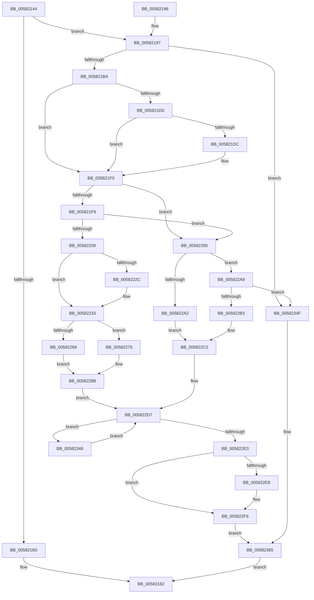

# FsRtlpAcknowledgeOplockBreak

- RVA: `0x00582144`–`0x00582379` (길이 `565` bytes)
- VA: `0x0000000140582144`
- 실행 섹션: `.text`
- PDB 이름 있음: `예`; PDB Function 태그: `아니요`
- unwind 정보 RVA: `0x000C5FB8`
- 디코드: `142`개 명령, `565/565` bytes 표시
- 미해석 바이트: `0` (있으면 어셈블리에 `.byte`로 보존)

> 이 문서는 커널 이미지의 기계어와 PDB 기호를 분석해 생성했습니다. 4번과 5번은 함수 원형과 자료형을 바이너리 사용 방식에서 추정한 C 해석이며 원본 소스 복구 결과는 아닙니다.

## 1. Dependencies

- 직접 호출 지점: **15**; 고유 호출 대상: **13**
- 직접 호출자로 확인된 함수: **1**
- RIP 상대 이미지 참조: **1**

### Outgoing calls
- `0x0058217B` → [IofCompleteRequest](../29/IofCompleteRequest_function_0029B5C0.md) (function, `0x0029B5C0`)
- `0x0058219E` → [ExAcquireFastMutexUnsafe](../3F/ExAcquireFastMutexUnsafe_function_003F3720.md) (function, `0x003F3720`)
- `0x005821C7` → [FsRtlpOplockUpperLowerCompatible](../../page/A2/FsRtlpOplockUpperLowerCompatible_function_00A21E04.md) (function, `0x00A21E04`)
- `0x0058225B` → [KeAcquireQueuedSpinLock](../27/KeAcquireQueuedSpinLock_function_00273D80.md) (function, `0x00273D80`)
- `0x0058226E` → [FsRtlpCancelReadOnlyOplockIrp](FsRtlpCancelReadOnlyOplockIrp_function_00582380.md) (function, `0x00582380`)
- `0x00582286` → [KeReleaseQueuedSpinLock](../27/KeReleaseQueuedSpinLock_function_00272540.md) (function, `0x00272540`)
- `0x005822CA` → [IofCompleteRequest](../29/IofCompleteRequest_function_0029B5C0.md) (function, `0x0029B5C0`)
- `0x005822F1` → [ObfDereferenceObjectWithTag](../2F/ObfDereferenceObjectWithTag_function_002F78E0.md) (function, `0x002F78E0`)
- `0x00582303` → [FsRtlpModifyThreadPriorities](../48/FsRtlpModifyThreadPriorities_function_0048B098.md) (function, `0x0048B098`)
- `0x0058230D` → [FsRtlpClearOwner](../26/FsRtlpClearOwner_function_00265BE8.md) (function, `0x00265BE8`)
- `0x00582330` → [FsRtlpSyncWithAckTimeout](../4F/FsRtlpSyncWithAckTimeout_function_004F23C4.md) (function, `0x004F23C4`)
- `0x0058233C` → [FsRtlpOplockPerfSendData](../../page/6F/FsRtlpOplockPerfSendData_function_006FDB80.md) (function, `0x006FDB80`)
- `0x00582348` → [FsRtlpRemoveAndCompleteWaitingIrp](../42/FsRtlpRemoveAndCompleteWaitingIrp_function_00425FC0.md) (function, `0x00425FC0`)
- `0x0058235F` → [IofCompleteRequest](../29/IofCompleteRequest_function_0029B5C0.md) (function, `0x0029B5C0`)
- `0x0058236C` → [ExReleaseFastMutexUnsafe](../25/ExReleaseFastMutexUnsafe_function_002503A0.md) (function, `0x002503A0`)

### Direct callers
- [FsRtlpOplockFsctrlInternal](../../page/9F/FsRtlpOplockFsctrlInternal_function_009F1640.md) at `0x009F1B3D`

### Static image references
- `0x00582275` → RVA `0x00582AF0` (`FsRtlpReadOnlyOplockIrpCancelRoutine`; read)

## 2. Other-region calls and transfers

- 다른 실행 섹션으로 향하는 call: **2**
  - `0x005821C7` → [FsRtlpOplockUpperLowerCompatible](../../page/A2/FsRtlpOplockUpperLowerCompatible_function_00A21E04.md) (`.text` → `PAGE`)
  - `0x0058233C` → [FsRtlpOplockPerfSendData](../../page/6F/FsRtlpOplockPerfSendData_function_006FDB80.md) (`.text` → `PAGE`)
- 별도 외부 분기/꼬리 이동을 확인하지 못했습니다.

## 3. Assembly (complete function range)

```asm
00582144  48 89 5C 24 10                  mov qword ptr [rsp + 0x10], rbx
00582149  48 89 74 24 18                  mov qword ptr [rsp + 0x18], rsi
0058214E  48 89 4C 24 08                  mov qword ptr [rsp + 8], rcx
00582153  57                              push rdi
00582154  41 56                           push r14
00582156  41 57                           push r15
00582158  48 83 EC 30                     sub rsp, 0x30
0058215C  45 8A F9                        mov r15b, r9b
0058215F  49 8B D8                        mov rbx, r8
00582162  4C 8B F2                        mov r14, rdx
00582165  48 8B F9                        mov rdi, rcx
00582168  48 85 C9                        test rcx, rcx
0058216B  75 2A                           jne 0x140582197
0058216D  BE E3 00 00 C0                  mov esi, 0xc00000e3
00582172  41 89 70 30                     mov dword ptr [r8 + 0x30], esi
00582176  B2 01                           mov dl, 1
00582178  48 8B CB                        mov rcx, rbx
0058217B  E8 40 94 D1 FF                  call 0x14029b5c0
00582180  8B C6                           mov eax, esi
00582182  48 8B 5C 24 58                  mov rbx, qword ptr [rsp + 0x58]
00582187  48 8B 74 24 60                  mov rsi, qword ptr [rsp + 0x60]
0058218C  48 83 C4 30                     add rsp, 0x30
00582190  41 5F                           pop r15
00582192  41 5E                           pop r14
00582194  5F                              pop rdi
00582195  C3                              ret
00582196  CC                              int3
00582197  48 8B 89 98 00 00 00            mov rcx, qword ptr [rcx + 0x98]
0058219E  E8 7D 15 E7 FF                  call 0x1403f3720
005821A3  90                              nop
005821A4  40 B6 01                        mov sil, 1
005821A7  40 88 74 24 20                  mov byte ptr [rsp + 0x20], sil
005821AC  49 8B 46 30                     mov rax, qword ptr [r14 + 0x30]
005821B0  48 39 47 08                     cmp qword ptr [rdi + 8], rax
005821B4  0F 85 95 01 00 00               jne 0x14058234f
005821BA  8B 54 24 70                     mov edx, dword ptr [rsp + 0x70]
005821BE  41 BA 10 00 00 00               mov r10d, 0x10
005821C4  41 8B CA                        mov ecx, r10d
005821C7  E8 38 FC 49 00                  call 0x140a21e04
005821CC  84 C0                           test al, al
005821CE  75 20                           jne 0x1405821f0
005821D0  8B 87 90 00 00 00               mov eax, dword ptr [rdi + 0x90]
005821D6  0F BA E0 08                     bt eax, 8
005821DA  73 14                           jae 0x1405821f0
005821DC  0F BA F0 08                     btr eax, 8
005821E0  89 87 90 00 00 00               mov dword ptr [rdi + 0x90], eax
005821E6  0F BA E8 0A                     bts eax, 0xa
005821EA  89 87 90 00 00 00               mov dword ptr [rdi + 0x90], eax
005821F0  45 84 FF                        test r15b, r15b
005821F3  0F 84 9C 00 00 00               je 0x140582295
005821F9  F7 87 90 00 00 00 00 01 00 00   test dword ptr [rdi + 0x90], 0x100
00582203  0F 84 8C 00 00 00               je 0x140582295
00582209  48 8B 83 B8 00 00 00            mov rax, qword ptr [rbx + 0xb8]
00582210  40 08 70 03                     or byte ptr [rax + 3], sil
00582214  83 63 30 00                     and dword ptr [rbx + 0x30], 0
00582218  48 8D 8B A8 00 00 00            lea rcx, [rbx + 0xa8]
0058221F  48 8D 47 28                     lea rax, [rdi + 0x28]
00582223  48 8B 10                        mov rdx, qword ptr [rax]
00582226  48 39 42 08                     cmp qword ptr [rdx + 8], rax
0058222A  74 07                           je 0x140582233
0058222C  B9 03 00 00 00                  mov ecx, 3
00582231  CD 29                           int 0x29
00582233  48 89 11                        mov qword ptr [rcx], rdx
00582236  48 89 41 08                     mov qword ptr [rcx + 8], rax
0058223A  48 89 4A 08                     mov qword ptr [rdx + 8], rcx
0058223E  48 89 08                        mov qword ptr [rax], rcx
00582241  48 89 7B 38                     mov qword ptr [rbx + 0x38], rdi
00582245  40 32 F6                        xor sil, sil
00582248  40 88 74 24 20                  mov byte ptr [rsp + 0x20], sil
0058224D  44 89 54 24 24                  mov dword ptr [rsp + 0x24], r10d
00582252  41 BE 07 00 00 00               mov r14d, 7
00582258  41 8B CE                        mov ecx, r14d
0058225B  E8 20 1B CF FF                  call 0x140273d80
00582260  88 43 45                        mov byte ptr [rbx + 0x45], al
00582263  40 38 73 44                     cmp byte ptr [rbx + 0x44], sil
00582267  74 0C                           je 0x140582275
00582269  B2 01                           mov dl, 1
0058226B  48 8B CB                        mov rcx, rbx
0058226E  E8 0D 01 00 00                  call 0x140582380
00582273  EB 16                           jmp 0x14058228b
00582275  48 8D 05 74 08 00 00            lea rax, [rip + 0x874]
0058227C  48 87 43 68                     xchg qword ptr [rbx + 0x68], rax
00582280  8A 53 45                        mov dl, byte ptr [rbx + 0x45]
00582283  49 8B CE                        mov rcx, r14
00582286  E8 B5 02 CF FF                  call 0x140272540
0058228B  C7 44 24 28 03 01 00 00         mov dword ptr [rsp + 0x28], 0x103
00582293  EB 42                           jmp 0x1405822d7
00582295  8B 87 90 00 00 00               mov eax, dword ptr [rdi + 0x90]
0058229B  A9 00 03 00 00                  test eax, 0x300
005822A0  74 07                           je 0x1405822a9
005822A2  83 64 24 28 00                  and dword ptr [rsp + 0x28], 0
005822A7  EB 17                           jmp 0x1405822c0
005822A9  0F BA E0 0A                     bt eax, 0xa
005822AD  0F 83 9C 00 00 00               jae 0x14058234f
005822B3  83 64 24 28 00                  and dword ptr [rsp + 0x28], 0
005822B8  48 C7 43 38 08 00 00 00         mov qword ptr [rbx + 0x38], 8
005822C0  83 63 30 00                     and dword ptr [rbx + 0x30], 0
005822C4  40 8A D6                        mov dl, sil
005822C7  48 8B CB                        mov rcx, rbx
005822CA  E8 F1 92 D1 FF                  call 0x14029b5c0
005822CF  C7 44 24 24 01 00 00 00         mov dword ptr [rsp + 0x24], 1
005822D7  48 8D 47 58                     lea rax, [rdi + 0x58]
005822DB  48 8B 08                        mov rcx, qword ptr [rax]
005822DE  48 3B C8                        cmp rcx, rax
005822E1  75 65                           jne 0x140582348
005822E3  40 84 F6                        test sil, sil
005822E6  74 0E                           je 0x1405822f6
005822E8  48 8B 4F 08                     mov rcx, qword ptr [rdi + 8]
005822EC  BA 44 66 6C 74                  mov edx, 0x746c6644
005822F1  E8 EA 55 D7 FF                  call 0x1402f78e0
005822F6  48 83 67 08 00                  and qword ptr [rdi + 8], 0
005822FB  45 33 C0                        xor r8d, r8d
005822FE  33 D2                           xor edx, edx
00582300  48 8B CF                        mov rcx, rdi
00582303  E8 90 8D F0 FF                  call 0x14048b098
00582308  33 D2                           xor edx, edx
0058230A  48 8B CF                        mov rcx, rdi
0058230D  E8 D6 38 CE FF                  call 0x140265be8
00582312  C6 47 20 00                     mov byte ptr [rdi + 0x20], 0
00582316  8B 87 90 00 00 00               mov eax, dword ptr [rdi + 0x90]
0058231C  83 E0 20                        and eax, 0x20
0058231F  0B 44 24 24                     or eax, dword ptr [rsp + 0x24]
00582323  89 87 90 00 00 00               mov dword ptr [rdi + 0x90], eax
00582329  48 8D 8F B8 00 00 00            lea rcx, [rdi + 0xb8]
00582330  E8 8F 00 F7 FF                  call 0x1404f23c4
00582335  48 8D 8F A8 00 00 00            lea rcx, [rdi + 0xa8]
0058233C  E8 3F B8 17 00                  call 0x1406fdb80
00582341  44 8B 74 24 28                  mov r14d, dword ptr [rsp + 0x28]
00582346  EB 1D                           jmp 0x140582365
00582348  E8 73 3C EA FF                  call 0x140425fc0
0058234D  EB 88                           jmp 0x1405822d7
0058234F  BE E3 00 00 C0                  mov esi, 0xc00000e3
00582354  44 8B F6                        mov r14d, esi
00582357  89 73 30                        mov dword ptr [rbx + 0x30], esi
0058235A  B2 01                           mov dl, 1
0058235C  48 8B CB                        mov rcx, rbx
0058235F  E8 5C 92 D1 FF                  call 0x14029b5c0
00582364  90                              nop
00582365  48 8B 8F 98 00 00 00            mov rcx, qword ptr [rdi + 0x98]
0058236C  E8 2F E0 CC FF                  call 0x1402503a0
00582371  41 8B C6                        mov eax, r14d
00582374  E9 09 FE FF FF                  jmp 0x140582182
```

## 4. C-style interpretation (structured pseudocode)

```c
__int64 __fastcall FsRtlpAcknowledgeOplockBreak(__int64 a1, __int64 a2, __int64 a3, unsigned __int8 a4, unsigned int a5)
{
    __int64 result;
    __int64 v_rsi;
    __int64 v_rsp;
    unsigned __int64 v_stack_p10;
    unsigned __int64 v_stack_p18;
    unsigned __int8 v_stack_p20;
    unsigned int v_stack_p24;
    unsigned int v_stack_p28;
    unsigned __int64 v_stack_p8;

    v_stack_p10 = v_rbx;
    v_stack_p18 = v_rsi;
    v_stack_p8 = a1;
    v_rsp = (v_rsp) - (48);
    if (a1 != 0) goto loc_00582197;
    *(unsigned int *)(a3 + 48) = (unsigned int)((unsigned int)(0xC00000E3ULL));
    result = IofCompleteRequest(a3, 1, a3, a4);
loc_00582182:
    v_rsp = (v_rsp) + (48);
    return (unsigned int)((unsigned int)((unsigned int)(0xC00000E3ULL)));
loc_00582197:
    result = ExAcquireFastMutexUnsafe(*(unsigned __int64 *)(a3 + 152), 1, a3, a4);
    v_stack_p20 = 1;
    if ((*(unsigned __int64 *)(a1 + 8)) != (*(unsigned __int64 *)(a2 + 48))) goto loc_0058234F;
    result = FsRtlpOplockUpperLowerCompatible(16, (unsigned int)(a5), a3, a4);
    if ((unsigned __int8)(result) != 0) goto loc_005821F0;
    if (!(condition_is_above_or_equal)) {
        *(unsigned int *)(a1 + 144) = (unsigned int)((unsigned int)(*(unsigned int *)(a1 + 144)));
        *(unsigned int *)(a1 + 144) = (unsigned int)((unsigned int)(*(unsigned int *)(a1 + 144)));
    }
    if (a4 == 0) goto loc_00582295;
    if (((*(unsigned int *)(a1 + 144)) & (256)) == 0) goto loc_00582295;
    if ((*(unsigned __int64 *)(*(unsigned __int64 *)(a1 + 40) + 8)) != (a1 + 40)) {
        a1 = 3;
    }
    *(unsigned __int64 *)(a1) = *(unsigned __int64 *)(a1 + 40);
    *(unsigned __int64 *)(a1 + 8) = a1 + 40;
    *(unsigned __int64 *)(*(unsigned __int64 *)(a1 + 40) + 8) = a1;
    *(unsigned __int64 *)(a1 + 40) = a1;
    *(unsigned __int64 *)(v_stack_p10 + 56) = a1;
    v_rsi = 0;
    v_stack_p20 = 0;
    v_stack_p24 = 16;
    result = KeAcquireQueuedSpinLock(7, *(unsigned __int64 *)(a1 + 40), a3, a4);
    *(unsigned __int8 *)(v_stack_p10 + 69) = (unsigned __int8)(result);
    if ((*(unsigned __int8 *)(v_stack_p10 + 68)) == 0) goto loc_00582275;
    result = FsRtlpCancelReadOnlyOplockIrp(v_stack_p10, 1, a3, a4);
    goto loc_0058228B;
loc_00582275:
    result = KeReleaseQueuedSpinLock(7, *(unsigned __int8 *)(v_stack_p10 + 69), a3, a4);
loc_0058228B:
    v_stack_p28 = 259;
    goto loc_005822D7;
loc_00582295:
    if ((((unsigned int)((unsigned int)(*(unsigned int *)(a1 + 144)))) & (768)) == 0) goto loc_005822A9;
    goto loc_005822C0;
loc_005822A9:
    if (condition_is_above_or_equal) goto loc_0058234F;
    *(unsigned __int64 *)(v_stack_p10 + 56) = 8;
loc_005822C0:
    result = IofCompleteRequest(v_stack_p10, 0, a3, a4);
    v_stack_p24 = 1;
loc_005822D7:
    if ((*(unsigned __int64 *)(a1 + 88)) != (a1 + 88)) goto loc_00582348;
    result = a1 + 88;
    if (0 != 0) {
        a1 = *(unsigned __int64 *)(a1 + 8);
        a2 = 0x746C6644ULL;
        result = ObfDereferenceObjectWithTag(a1, a2, a3, a4);
    }
    a3 = 0;
    a2 = 0;
    result = FsRtlpModifyThreadPriorities(a1, a2, a3, a4);
    a2 = 0;
    result = FsRtlpClearOwner(a1, a2, a3, a4);
    *(unsigned __int8 *)(a1 + 32) = 0;
    result = (unsigned int)(((unsigned int)(*(unsigned int *)(a1 + 144))) & (32));
    result = (unsigned int)((result) | (v_stack_p24));
    *(unsigned int *)(a1 + 144) = (unsigned int)(result);
    result = FsRtlpSyncWithAckTimeout(a1 + 184, a2, a3, a4);
    result = FsRtlpOplockPerfSendData(a1 + 168, a2, a3, a4);
    goto loc_00582365;
loc_00582348:
    result = FsRtlpRemoveAndCompleteWaitingIrp(a1 + 168, a2, a3, a4);
    goto loc_005822D7;
loc_0058234F:
    *(unsigned int *)(v_stack_p10 + 48) = (unsigned int)((unsigned int)(0xC00000E3ULL));
    result = IofCompleteRequest(v_stack_p10, 1, a3, a4);
loc_00582365:
    result = ExReleaseFastMutexUnsafe(*(unsigned __int64 *)(a1 + 152), 1, a3, a4);
    goto loc_00582182;
}
```

## 5. (Beta) C Style

```c
int64_t FsRtlpAcknowledgeOplockBreak(void *Arg1, void *Arg2, void *Arg3, uint8_t Arg4, uint32_t Arg5)
{
    uint8_t *arg1 = (uint8_t *)Arg1;
    uint8_t *arg2 = (uint8_t *)Arg2;
    uint8_t *arg3 = (uint8_t *)Arg3;

    int64_t result;
    int64_t local_rsi;
    int64_t local_rsp;
    uint64_t v_stack_p10;
    uint64_t v_stack_p18;
    uint8_t v_stack_p20;
    uint32_t v_stack_p24;
    uint32_t v_stack_p28;
    uint64_t v_stack_p8;

    v_stack_p10 = local_rbx;
    v_stack_p18 = local_rsi;
    v_stack_p8 = Arg1;
    local_rsp = (local_rsp) - (48);
    if (Arg1 != NULL) goto loc_00582197;
    *(uint32_t *)(arg3 + 0x30) = (uint32_t)((uint32_t)(0xC00000E3ULL));
    result = IofCompleteRequest(Arg3, 1, Arg3, Arg4);
loc_00582182:
    local_rsp = (local_rsp) + (48);
    return (uint32_t)((uint32_t)((uint32_t)(0xC00000E3ULL)));
loc_00582197:
    result = ExAcquireFastMutexUnsafe(*(uint64_t *)(arg3 + 0x98), 1, Arg3, Arg4);
    v_stack_p20 = 1;
    if ((*(uint64_t *)(arg1 + 0x8)) != (*(uint64_t *)(arg2 + 0x30))) goto loc_0058234F;
    result = FsRtlpOplockUpperLowerCompatible(16, (uint32_t)(Arg5), Arg3, Arg4);
    if ((uint8_t)(result) != 0) goto loc_005821F0;
    if (!(condition_is_above_or_equal)) {
        *(uint32_t *)(arg1 + 0x90) = (uint32_t)((uint32_t)(*(uint32_t *)(arg1 + 0x90)));
        *(uint32_t *)(arg1 + 0x90) = (uint32_t)((uint32_t)(*(uint32_t *)(arg1 + 0x90)));
    }
    if (Arg4 == 0) goto loc_00582295;
    if (((*(uint32_t *)(arg1 + 0x90)) & (256)) == 0) goto loc_00582295;
    if ((*(uint64_t *)(*(uint64_t *)(arg1 + 0x28) + 0x8)) != (Arg1 + 40)) {
        Arg1 = 3;
    }
    *(uint64_t *)(arg1) = *(uint64_t *)(arg1 + 0x28);
    *(void **)(arg1 + 0x8) = Arg1 + 40;
    *(void **)(*(uint64_t *)(arg1 + 0x28) + 0x8) = Arg1;
    *(void **)(arg1 + 0x28) = Arg1;
    *(void **)(v_stack_p10 + 0x38) = Arg1;
    local_rsi = 0;
    v_stack_p20 = 0;
    v_stack_p24 = 16;
    result = KeAcquireQueuedSpinLock(7, *(uint64_t *)(arg1 + 0x28), Arg3, Arg4);
    *(uint8_t *)(v_stack_p10 + 0x45) = (uint8_t)(result);
    if ((*(uint8_t *)(v_stack_p10 + 0x44)) == 0) goto loc_00582275;
    result = FsRtlpCancelReadOnlyOplockIrp(v_stack_p10, 1, Arg3, Arg4);
    goto loc_0058228B;
loc_00582275:
    result = KeReleaseQueuedSpinLock(7, *(uint8_t *)(v_stack_p10 + 0x45), Arg3, Arg4);
loc_0058228B:
    v_stack_p28 = 259;
    goto loc_005822D7;
loc_00582295:
    if ((((uint32_t)((uint32_t)(*(uint32_t *)(arg1 + 0x90)))) & (768)) == 0) goto loc_005822A9;
    goto loc_005822C0;
loc_005822A9:
    if (condition_is_above_or_equal) goto loc_0058234F;
    *(uint64_t *)(v_stack_p10 + 0x38) = 8;
loc_005822C0:
    result = IofCompleteRequest(v_stack_p10, 0, Arg3, Arg4);
    v_stack_p24 = 1;
loc_005822D7:
    if ((*(uint64_t *)(arg1 + 0x58)) != (Arg1 + 88)) goto loc_00582348;
    result = Arg1 + 88;
    if (0 != 0) {
        Arg1 = *(uint64_t *)(arg1 + 0x8);
        Arg2 = 0x746C6644ULL;
        result = ObfDereferenceObjectWithTag(Arg1, Arg2, Arg3, Arg4);
    }
    Arg3 = 0;
    Arg2 = 0;
    result = FsRtlpModifyThreadPriorities(Arg1, Arg2, Arg3, Arg4);
    Arg2 = 0;
    result = FsRtlpClearOwner(Arg1, Arg2, Arg3, Arg4);
    *(uint8_t *)(arg1 + 0x20) = 0;
    result = (uint32_t)(((uint32_t)(*(uint32_t *)(arg1 + 0x90))) & (32));
    result = (uint32_t)((result) | (v_stack_p24));
    *(uint32_t *)(arg1 + 0x90) = (uint32_t)(result);
    result = FsRtlpSyncWithAckTimeout(Arg1 + 184, Arg2, Arg3, Arg4);
    result = FsRtlpOplockPerfSendData(Arg1 + 168, Arg2, Arg3, Arg4);
    goto loc_00582365;
loc_00582348:
    result = FsRtlpRemoveAndCompleteWaitingIrp(Arg1 + 168, Arg2, Arg3, Arg4);
    goto loc_005822D7;
loc_0058234F:
    *(uint32_t *)(v_stack_p10 + 0x30) = (uint32_t)((uint32_t)(0xC00000E3ULL));
    result = IofCompleteRequest(v_stack_p10, 1, Arg3, Arg4);
loc_00582365:
    result = ExReleaseFastMutexUnsafe(*(uint64_t *)(arg1 + 0x98), 1, Arg3, Arg4);
    goto loc_00582182;
}
```

### 관측된 메모리 오프셋

구조체 형식이 확인되지 않은 접근은 인자 기준의 오프셋으로만 기록했습니다.

| 기준 인자 | 오프셋 표현 | 폭 (bit) | 접근 |
|---|---:|---:|---|
| `Arg1` | `+ 0x0` | `64` | `R` |
| `Arg1` | `+ 0x0` | `64` | `W` |
| `Arg1` | `+ 0x8` | `64` | `R` |
| `Arg1` | `+ 0x8` | `64` | `R/W` |
| `Arg1` | `+ 0x20` | `8` | `W` |
| `Arg1` | `+ 0x28` | `64` | `R` |
| `Arg1` | `+ 0x58` | `64` | `R` |
| `Arg1` | `+ 0x90` | `32` | `R` |
| `Arg1` | `+ 0x90` | `32` | `W` |
| `Arg1` | `+ 0x98` | `64` | `R` |
| `Arg1` | `+ 0xA8` | `64` | `R` |
| `Arg1` | `+ 0xB8` | `64` | `R` |
| `Arg2` | `+ 0x30` | `64` | `R` |
| `Arg3` | `+ 0x30` | `32` | `R/W` |
| `Arg3` | `+ 0x30` | `32` | `W` |
| `Arg3` | `+ 0x38` | `64` | `W` |
| `Arg3` | `+ 0x44` | `8` | `R` |
| `Arg3` | `+ 0x45` | `8` | `R` |
| `Arg3` | `+ 0x45` | `8` | `W` |
| `Arg3` | `+ 0x68` | `64` | `R/W` |
| `Arg3` | `+ 0xA8` | `64` | `R` |
| `Arg3` | `+ 0xB8` | `64` | `R` |

## 6. Execution-region graph

[열기: 2D/3D 그래프와 함수 탐색 컨트롤 패널](../../../control-panel.html?section=text&rva=0x00582144&view=graph)

- 2D 그래프는 위에서 아래로 흐르고, 3D 그래프는 빈 공간을 드래그해 회전합니다. Shift+드래그는 이동, 휠은 확대·축소, 함수 노드 선택은 대상 보고서 이동입니다.

### Static fallback


