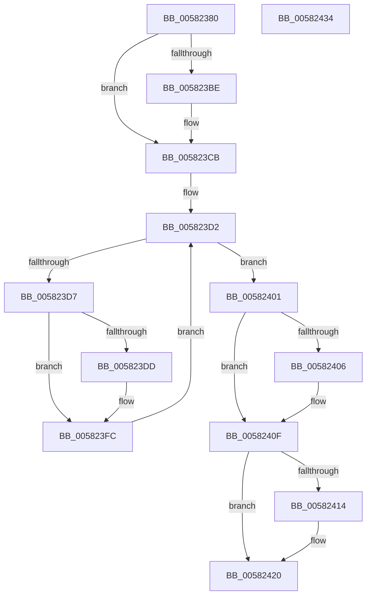

# FsRtlpCancelReadOnlyOplockIrp

- RVA: `0x00582380`–`0x00582435` (길이 `181` bytes)
- VA: `0x0000000140582380`
- 실행 섹션: `.text`
- PDB 이름 있음: `예`; PDB Function 태그: `아니요`
- unwind 정보 RVA: `0x000C5E38`
- 디코드: `54`개 명령, `181/181` bytes 표시
- 미해석 바이트: `0` (있으면 어셈블리에 `.byte`로 보존)

> 이 문서는 커널 이미지의 기계어와 PDB 기호를 분석해 생성했습니다. 4번과 5번은 함수 원형과 자료형을 바이너리 사용 방식에서 추정한 C 해석이며 원본 소스 복구 결과는 아닙니다.

## 1. Dependencies

- 직접 호출 지점: **5**; 고유 호출 대상: **5**
- 직접 호출자로 확인된 함수: **3**
- RIP 상대 이미지 참조: **0**

### Outgoing calls
- `0x005823B1` → [KeReleaseQueuedSpinLock](../27/KeReleaseQueuedSpinLock_function_00272540.md) (function, `0x00272540`)
- `0x005823C5` → [ExAcquireFastMutex](../20/ExAcquireFastMutex_function_0020E5A0.md) (function, `0x0020E5A0`)
- `0x005823EF` → [FsRtlpRemoveAndCompleteReadOnlyIrp](../4B/FsRtlpRemoveAndCompleteReadOnlyIrp_function_004B495C.md) (function, `0x004B495C`)
- `0x00582409` → [FsRtlpComputeShareableOplockState](../42/FsRtlpComputeShareableOplockState_function_004256EC.md) (function, `0x004256EC`)
- `0x0058241B` → [ExReleaseFastMutex](../25/ExReleaseFastMutex_function_002519C0.md) (function, `0x002519C0`)

### Direct callers
- [FsRtlpRequestShareableOplock](../4E/FsRtlpRequestShareableOplock_function_004E6EC8.md) at `0x004E790B`
- [FsRtlpAcknowledgeOplockBreak](FsRtlpAcknowledgeOplockBreak_function_00582144.md) at `0x0058226E`
- [FsRtlpReadOnlyOplockIrpCancelRoutine](FsRtlpReadOnlyOplockIrpCancelRoutine_function_00582AF0.md) at `0x00582AF9`

### Static image references
- 디코드된 RIP-relative 메모리 참조가 없습니다.

## 2. Other-region calls and transfers

- 다른 실행 섹션으로 향하는 call: **0**
- 별도 외부 분기/꼬리 이동을 확인하지 못했습니다.

## 3. Assembly (complete function range)

```asm
00582380  48 89 5C 24 18                  mov qword ptr [rsp + 0x18], rbx
00582385  48 89 74 24 20                  mov qword ptr [rsp + 0x20], rsi
0058238A  88 54 24 10                     mov byte ptr [rsp + 0x10], dl
0058238E  57                              push rdi
0058238F  41 56                           push r14
00582391  41 57                           push r15
00582393  48 83 EC 30                     sub rsp, 0x30
00582397  44 8A FA                        mov r15b, dl
0058239A  48 8B 79 38                     mov rdi, qword ptr [rcx + 0x38]
0058239E  48 89 7C 24 50                  mov qword ptr [rsp + 0x50], rdi
005823A3  33 C0                           xor eax, eax
005823A5  48 87 41 68                     xchg qword ptr [rcx + 0x68], rax
005823A9  8A 51 45                        mov dl, byte ptr [rcx + 0x45]
005823AC  B9 07 00 00 00                  mov ecx, 7
005823B1  E8 8A 01 CF FF                  call 0x140272540
005823B6  45 32 F6                        xor r14b, r14b
005823B9  45 84 FF                        test r15b, r15b
005823BC  75 0D                           jne 0x1405823cb
005823BE  48 8B 8F 98 00 00 00            mov rcx, qword ptr [rdi + 0x98]
005823C5  E8 D6 C1 C8 FF                  call 0x14020e5a0
005823CA  90                              nop
005823CB  48 8D 77 28                     lea rsi, [rdi + 0x28]
005823CF  48 8B 1E                        mov rbx, qword ptr [rsi]
005823D2  48 3B DE                        cmp rbx, rsi
005823D5  74 2A                           je 0x140582401
005823D7  80 7B 9C 00                     cmp byte ptr [rbx - 0x64], 0
005823DB  74 1F                           je 0x1405823fc
005823DD  48 8B 5B 08                     mov rbx, qword ptr [rbx + 8]
005823E1  4C 8B CF                        mov r9, rdi
005823E4  45 33 C0                        xor r8d, r8d
005823E7  BA 20 01 00 C0                  mov edx, 0xc0000120
005823EC  48 8B 0B                        mov rcx, qword ptr [rbx]
005823EF  E8 68 25 F3 FF                  call 0x1404b495c
005823F4  41 B6 01                        mov r14b, 1
005823F7  44 88 74 24 20                  mov byte ptr [rsp + 0x20], r14b
005823FC  48 8B 1B                        mov rbx, qword ptr [rbx]
005823FF  EB D1                           jmp 0x1405823d2
00582401  45 84 F6                        test r14b, r14b
00582404  74 09                           je 0x14058240f
00582406  48 8B CF                        mov rcx, rdi
00582409  E8 DE 32 EA FF                  call 0x1404256ec
0058240E  90                              nop
0058240F  45 84 FF                        test r15b, r15b
00582412  75 0C                           jne 0x140582420
00582414  48 8B 8F 98 00 00 00            mov rcx, qword ptr [rdi + 0x98]
0058241B  E8 A0 F5 CC FF                  call 0x1402519c0
00582420  48 8B 5C 24 60                  mov rbx, qword ptr [rsp + 0x60]
00582425  48 8B 74 24 68                  mov rsi, qword ptr [rsp + 0x68]
0058242A  48 83 C4 30                     add rsp, 0x30
0058242E  41 5F                           pop r15
00582430  41 5E                           pop r14
00582432  5F                              pop rdi
00582433  C3                              ret
00582434  CC                              int3
```

## 4. C-style interpretation (structured pseudocode)

```c
__int64 __fastcall FsRtlpCancelReadOnlyOplockIrp(__int64 a1, unsigned __int8 a2, int a3)
{
    __int64 result;
    __int64 v_r14;
    __int64 v_rbx;
    __int64 v_rsp;
    unsigned __int8 v_stack_m28;
    unsigned __int8 v_stack_p10;
    unsigned __int64 v_stack_p18;
    unsigned __int64 v_stack_p20;
    unsigned __int64 v_stack_p8;

    v_stack_p18 = v_rbx;
    v_stack_p20 = v_rsi;
    v_stack_p10 = a2;
    v_rsp = (v_rsp) - (48);
    v_stack_p8 = *(unsigned __int64 *)(a1 + 56);
    result = 0;
    result = KeReleaseQueuedSpinLock(7, *(unsigned __int8 *)(a1 + 69), a3, a4);
    v_r14 = 0;
    if (a2 == 0) {
        a1 = *(unsigned __int64 *)(*(unsigned __int64 *)(a1 + 56) + 152);
        result = ExAcquireFastMutex(a1, *(unsigned __int8 *)(a1 + 69), a3, a4);
    }
loc_005823D2:
    if ((*(unsigned __int64 *)(*(unsigned __int64 *)(a1 + 56) + 40)) == (*(unsigned __int64 *)(a1 + 56) + 40)) goto loc_00582401;
    v_rbx = *(unsigned __int64 *)(*(unsigned __int64 *)(a1 + 56) + 40);
    if ((*(unsigned __int8 *)(*(unsigned __int64 *)(*(unsigned __int64 *)(a1 + 56) + 40) - 100)) != 0) {
        v_rbx = *(unsigned __int64 *)(*(unsigned __int64 *)(*(unsigned __int64 *)(a1 + 56) + 40) + 8);
        a4 = *(unsigned __int64 *)(a1 + 56);
        a3 = 0;
        a2 = 0xC0000120ULL;
        a1 = *(unsigned __int64 *)(v_rbx);
        result = FsRtlpRemoveAndCompleteReadOnlyIrp(a1, a2, a3, a4);
        v_r14 = 1;
        v_stack_m28 = (unsigned __int8)(v_r14);
    }
    goto loc_005823D2;
loc_00582401:
    if ((unsigned __int8)(v_r14) != 0) {
        a1 = *(unsigned __int64 *)(a1 + 56);
        result = FsRtlpComputeShareableOplockState(a1, a2, a3, a4);
    }
    if (a2 == 0) {
        a1 = *(unsigned __int64 *)(*(unsigned __int64 *)(a1 + 56) + 152);
        result = ExReleaseFastMutex(a1, a2, a3, a4);
    }
    v_rsp = (v_rsp) + (48);
    return result;
}
```

## 5. (Beta) C Style

```c
int64_t FsRtlpCancelReadOnlyOplockIrp(void *Arg1, uint8_t Arg2, int32_t Arg3)
{
    uint8_t *arg1 = (uint8_t *)Arg1;

    int64_t result;
    int64_t local_r14;
    int64_t local_rbx;
    int64_t local_rsp;
    uint8_t v_stack_m28;
    uint8_t v_stack_p10;
    uint64_t v_stack_p18;
    uint64_t v_stack_p20;
    uint64_t v_stack_p8;

    v_stack_p18 = local_rbx;
    v_stack_p20 = local_rsi;
    v_stack_p10 = Arg2;
    local_rsp = (local_rsp) - (48);
    v_stack_p8 = *(uint64_t *)(arg1 + 0x38);
    result = 0;
    result = KeReleaseQueuedSpinLock(7, *(uint8_t *)(arg1 + 0x45), Arg3, a4);
    local_r14 = 0;
    if (Arg2 == 0) {
        Arg1 = *(uint64_t *)(*(uint64_t *)(arg1 + 0x38) + 0x98);
        result = ExAcquireFastMutex(Arg1, *(uint8_t *)(arg1 + 0x45), Arg3, a4);
    }
loc_005823D2:
    if ((*(uint64_t *)(*(uint64_t *)(arg1 + 0x38) + 0x28)) == (*(uint64_t *)(arg1 + 0x38) + 40)) goto loc_00582401;
    local_rbx = *(uint64_t *)(*(uint64_t *)(arg1 + 0x38) + 0x28);
    if ((*(uint8_t *)(*(uint64_t *)(*(uint64_t *)(arg1 + 0x38) + 0x28) - 0x64)) != 0) {
        local_rbx = *(uint64_t *)(*(uint64_t *)(*(uint64_t *)(arg1 + 0x38) + 0x28) + 0x8);
        a4 = *(uint64_t *)(arg1 + 0x38);
        Arg3 = 0;
        Arg2 = 0xC0000120ULL;
        Arg1 = *(uint64_t *)(local_rbx);
        result = FsRtlpRemoveAndCompleteReadOnlyIrp(Arg1, Arg2, Arg3, a4);
        local_r14 = 1;
        v_stack_m28 = (uint8_t)(local_r14);
    }
    goto loc_005823D2;
loc_00582401:
    if ((uint8_t)(local_r14) != 0) {
        Arg1 = *(uint64_t *)(arg1 + 0x38);
        result = FsRtlpComputeShareableOplockState(Arg1, Arg2, Arg3, a4);
    }
    if (Arg2 == 0) {
        Arg1 = *(uint64_t *)(*(uint64_t *)(arg1 + 0x38) + 0x98);
        result = ExReleaseFastMutex(Arg1, Arg2, Arg3, a4);
    }
    local_rsp = (local_rsp) + (48);
    return result;
}
```

### 관측된 메모리 오프셋

구조체 형식이 확인되지 않은 접근은 인자 기준의 오프셋으로만 기록했습니다.

| 기준 인자 | 오프셋 표현 | 폭 (bit) | 접근 |
|---|---:|---:|---|
| `Arg1` | `+ 0x38` | `64` | `R` |
| `Arg1` | `+ 0x45` | `8` | `R` |
| `Arg1` | `+ 0x68` | `64` | `R/W` |

## 6. Execution-region graph

[열기: 2D/3D 그래프와 함수 탐색 컨트롤 패널](../../../control-panel.html?section=text&rva=0x00582380&view=graph)

- 2D 그래프는 위에서 아래로 흐르고, 3D 그래프는 빈 공간을 드래그해 회전합니다. Shift+드래그는 이동, 휠은 확대·축소, 함수 노드 선택은 대상 보고서 이동입니다.

### Static fallback


