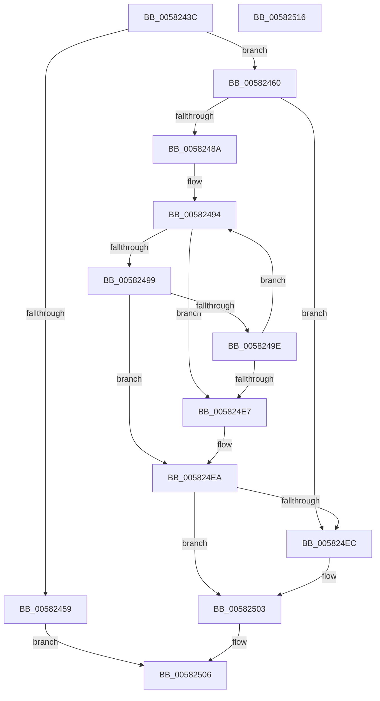

# FsRtlpComputeLargeRatio

- RVA: `0x0058243C`–`0x00582517` (길이 `219` bytes)
- VA: `0x000000014058243C`
- 실행 섹션: `.text`
- PDB 이름 있음: `예`; PDB Function 태그: `아니요`
- unwind 정보 RVA: `0x00069588`
- 디코드: `67`개 명령, `219/219` bytes 표시
- 미해석 바이트: `0` (있으면 어셈블리에 `.byte`로 보존)

> 이 문서는 커널 이미지의 기계어와 PDB 기호를 분석해 생성했습니다. 4번과 5번은 함수 원형과 자료형을 바이너리 사용 방식에서 추정한 C 해석이며 원본 소스 복구 결과는 아닙니다.

## 1. Dependencies

- 직접 호출 지점: **0**; 고유 호출 대상: **0**
- 직접 호출자로 확인된 함수: **2**
- RIP 상대 이미지 참조: **0**

### Outgoing calls
- 직접 디코드된 call 명령이 없습니다.

### Direct callers
- [FsRtlpOplockPerfInitializeLatencyInfo](../../page/71/FsRtlpOplockPerfInitializeLatencyInfo_function_0071525C.md) at `0x007152CD`
- [FsRtlpOplockPerfSummarizeData](../../page/71/FsRtlpOplockPerfSummarizeData_function_007153DC.md) at `0x0071549C`
- [FsRtlpOplockPerfSummarizeData](../../page/71/FsRtlpOplockPerfSummarizeData_function_007153DC.md) at `0x00715558`

### Static image references
- 디코드된 RIP-relative 메모리 참조가 없습니다.

## 2. Other-region calls and transfers

- 다른 실행 섹션으로 향하는 call: **0**
- 별도 외부 분기/꼬리 이동을 확인하지 못했습니다.

## 3. Assembly (complete function range)

```asm
0058243C  48 89 5C 24 08                  mov qword ptr [rsp + 8], rbx
00582441  48 89 74 24 10                  mov qword ptr [rsp + 0x10], rsi
00582446  48 89 7C 24 18                  mov qword ptr [rsp + 0x18], rdi
0058244B  45 33 C9                        xor r9d, r9d
0058244E  4C 8B DA                        mov r11, rdx
00582451  4C 8B D1                        mov r10, rcx
00582454  4D 85 C0                        test r8, r8
00582457  75 07                           jne 0x140582460
00582459  33 C0                           xor eax, eax
0058245B  E9 A6 00 00 00                  jmp 0x140582506
00582460  49 8B C0                        mov rax, r8
00582463  BB 02 00 00 00                  mov ebx, 2
00582468  48 99                           cqo
0058246A  48 BF FF FF FF FF FF FF FF 7F   movabs rdi, 0x7fffffffffffffff
00582474  48 F7 FB                        idiv rbx
00582477  48 8B C8                        mov rcx, rax
0058247A  48 8B C7                        mov rax, rdi
0058247D  48 2B C1                        sub rax, rcx
00582480  48 99                           cqo
00582482  49 F7 FB                        idiv r11
00582485  4C 3B D0                        cmp r10, rax
00582488  7E 62                           jle 0x1405824ec
0058248A  48 BE 67 66 66 66 66 66 66 66   movabs rsi, 0x6666666666666667
00582494  4D 85 DB                        test r11, r11
00582497  7E 4E                           jle 0x1405824e7
00582499  4D 85 C0                        test r8, r8
0058249C  7E 4C                           jle 0x1405824ea
0058249E  48 8B C6                        mov rax, rsi
005824A1  48 8B CF                        mov rcx, rdi
005824A4  49 F7 EB                        imul r11
005824A7  4C 8B DA                        mov r11, rdx
005824AA  49 C1 FB 02                     sar r11, 2
005824AE  49 8B C3                        mov rax, r11
005824B1  48 C1 E8 3F                     shr rax, 0x3f
005824B5  4C 03 D8                        add r11, rax
005824B8  48 8B C6                        mov rax, rsi
005824BB  49 F7 E8                        imul r8
005824BE  4C 8B C2                        mov r8, rdx
005824C1  49 C1 F8 02                     sar r8, 2
005824C5  49 8B C0                        mov rax, r8
005824C8  48 C1 E8 3F                     shr rax, 0x3f
005824CC  4C 03 C0                        add r8, rax
005824CF  49 8B C0                        mov rax, r8
005824D2  48 99                           cqo
005824D4  48 F7 FB                        idiv rbx
005824D7  48 2B C8                        sub rcx, rax
005824DA  48 8B C1                        mov rax, rcx
005824DD  48 99                           cqo
005824DF  49 F7 FB                        idiv r11
005824E2  4C 3B D0                        cmp r10, rax
005824E5  7F AD                           jg 0x140582494
005824E7  4D 85 C0                        test r8, r8
005824EA  74 17                           je 0x140582503
005824EC  49 8B C0                        mov rax, r8
005824EF  48 99                           cqo
005824F1  48 F7 FB                        idiv rbx
005824F4  4D 0F AF D3                     imul r10, r11
005824F8  49 03 C2                        add rax, r10
005824FB  48 99                           cqo
005824FD  49 F7 F8                        idiv r8
00582500  4C 8B C8                        mov r9, rax
00582503  49 8B C1                        mov rax, r9
00582506  48 8B 5C 24 08                  mov rbx, qword ptr [rsp + 8]
0058250B  48 8B 74 24 10                  mov rsi, qword ptr [rsp + 0x10]
00582510  48 8B 7C 24 18                  mov rdi, qword ptr [rsp + 0x18]
00582515  C3                              ret
00582516  CC                              int3
```

## 4. C-style interpretation (structured pseudocode)

```c
__int64 __fastcall FsRtlpComputeLargeRatio(__int64 a1, __int64 a2, __int64 a3, int a4)
{
    __int64 result;
    __int64 v_r10;
    __int64 v_r11;
    unsigned __int64 v_stack_p10;
    unsigned __int64 v_stack_p18;
    unsigned __int64 v_stack_p8;

    v_stack_p8 = v_rbx;
    v_stack_p10 = v_rsi;
    v_stack_p18 = v_rdi;
    a4 = 0;
    if (a3 != 0) goto loc_00582460;
    result = 0;
    goto loc_00582506;
loc_00582460:
    result = (v_rdi) - (a3);
    if (a1 <= result) goto loc_005824EC;
loc_00582494:
    if (condition_is_less_or_equal) goto loc_005824E7;
    if (condition_is_less_or_equal) goto loc_005824EA;
    v_r11 = (a2) >> (2);
    result = (v_r11) >> (63);
    v_r11 = (v_r11) + (result);
    a3 = (a2) >> (2);
    result = (a3) >> (63);
    a3 = (a3) + (result);
    a1 = (v_rdi) - (a3);
    if (a1 > a1) goto loc_00582494;
loc_005824E7:
loc_005824EA:
    result = a1;
    v_r10 = a1;
    if (a3 != 0) {
        result = a3;
        v_r10 = (a1) * (v_r11);
        result = (result) + (v_r10);
        a4 = result;
    }
loc_00582506:
    return a4;
}
```

## 5. (Beta) C Style

```c
int64_t FsRtlpComputeLargeRatio(int64_t Arg1, int64_t Arg2, int64_t Arg3, int32_t Arg4)
{
    int64_t result;
    int64_t local_r10;
    int64_t local_r11;
    uint64_t v_stack_p10;
    uint64_t v_stack_p18;
    uint64_t v_stack_p8;

    v_stack_p8 = local_rbx;
    v_stack_p10 = local_rsi;
    v_stack_p18 = local_rdi;
    Arg4 = 0;
    if (Arg3 != 0) goto loc_00582460;
    result = 0;
    goto loc_00582506;
loc_00582460:
    result = (local_rdi) - (Arg3);
    if (Arg1 <= result) goto loc_005824EC;
loc_00582494:
    if (condition_is_less_or_equal) goto loc_005824E7;
    if (condition_is_less_or_equal) goto loc_005824EA;
    local_r11 = (Arg2) >> (2);
    result = (local_r11) >> (63);
    local_r11 = (local_r11) + (result);
    Arg3 = (Arg2) >> (2);
    result = (Arg3) >> (63);
    Arg3 = (Arg3) + (result);
    Arg1 = (local_rdi) - (Arg3);
    if (Arg1 > Arg1) goto loc_00582494;
loc_005824E7:
loc_005824EA:
    result = Arg1;
    local_r10 = Arg1;
    if (Arg3 != 0) {
        result = Arg3;
        local_r10 = (Arg1) * (local_r11);
        result = (result) + (local_r10);
        Arg4 = result;
    }
loc_00582506:
    return Arg4;
}
```

## 6. Execution-region graph

[열기: 2D/3D 그래프와 함수 탐색 컨트롤 패널](../../../control-panel.html?section=text&rva=0x0058243C&view=graph)

- 2D 그래프는 위에서 아래로 흐르고, 3D 그래프는 빈 공간을 드래그해 회전합니다. Shift+드래그는 이동, 휠은 확대·축소, 함수 노드 선택은 대상 보고서 이동입니다.

### Static fallback


