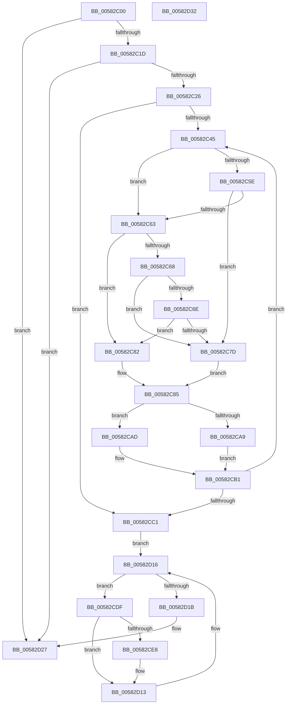

# FsRtlpDedupChangeEventsControlCallbackV2

- RVA: `0x00582C00`–`0x00582D33` (길이 `307` bytes)
- VA: `0x0000000140582C00`
- 실행 섹션: `.text`
- PDB 이름 있음: `예`; PDB Function 태그: `아니요`
- unwind 정보 RVA: `0x000BCEBC`
- 디코드: `86`개 명령, `307/307` bytes 표시
- 미해석 바이트: `0` (있으면 어셈블리에 `.byte`로 보존)

> 이 문서는 커널 이미지의 기계어와 PDB 기호를 분석해 생성했습니다. 4번과 5번은 함수 원형과 자료형을 바이너리 사용 방식에서 추정한 C 해석이며 원본 소스 복구 결과는 아닙니다.

## 1. Dependencies

- 직접 호출 지점: **3**; 고유 호출 대상: **3**
- 직접 호출자로 확인된 함수: **0**
- RIP 상대 이미지 참조: **4**

### Outgoing calls
- `0x00582CCA` → [ExAcquireResourceSharedLite](../21/ExAcquireResourceSharedLite_function_00211BC0.md) (function, `0x00211BC0`)
- `0x00582D0E` → [McTemplateK0jjtq_EtwWriteTransfer](McTemplateK0jjtq_EtwWriteTransfer_function_00582DC4.md) (function, `0x00582DC4`)
- `0x00582D22` → [ExReleaseResourceLite](../25/ExReleaseResourceLite_function_0025FA10.md) (function, `0x0025FA10`)

### Direct callers
- 이 함수 시작 RVA로 연결되는 직접 call은 확인되지 않았습니다. 간접 호출은 완전히 역산할 수 없습니다.

### Static image references
- `0x00582CC3` → RVA `0x00F8EFB0` (`.data`; read)
- `0x00582CCF` → RVA `0x00F8EFA0` (`.data`; read)
- `0x00582CDF` → RVA `0x00F8EF98` (`.data`; read)
- `0x00582CFB` → RVA `0x00E06C90` (`.data`; read)

## 2. Other-region calls and transfers

- 다른 실행 섹션으로 향하는 call: **0**
- 별도 외부 분기/꼬리 이동을 확인하지 못했습니다.

## 3. Assembly (complete function range)

```asm
00582C00  48 89 5C 24 08                  mov qword ptr [rsp + 8], rbx
00582C05  56                              push rsi
00582C06  48 83 EC 40                     sub rsp, 0x40
00582C0A  4C 8B 94 24 80 00 00 00         mov r10, qword ptr [rsp + 0x80]
00582C12  33 DB                           xor ebx, ebx
00582C14  4D 85 D2                        test r10, r10
00582C17  0F 84 0A 01 00 00               je 0x140582d27
00582C1D  83 FA 01                        cmp edx, 1
00582C20  0F 85 01 01 00 00               jne 0x140582d27
00582C26  48 8B 44 24 70                  mov rax, qword ptr [rsp + 0x70]
00582C2B  45 88 42 28                     mov byte ptr [r10 + 0x28], r8b
00582C2F  44 8B C3                        mov r8d, ebx
00582C32  49 89 42 18                     mov qword ptr [r10 + 0x18], rax
00582C36  4D 89 4A 10                     mov qword ptr [r10 + 0x10], r9
00582C3A  41 89 52 24                     mov dword ptr [r10 + 0x24], edx
00582C3E  66 41 3B 5A 2A                  cmp bx, word ptr [r10 + 0x2a]
00582C43  73 7C                           jae 0x140582cc1
00582C45  49 8B 42 38                     mov rax, qword ptr [r10 + 0x38]
00582C49  45 8A 4A 28                     mov r9b, byte ptr [r10 + 0x28]
00582C4D  41 8B C8                        mov ecx, r8d
00582C50  48 8B 14 C8                     mov rdx, qword ptr [rax + rcx*8]
00582C54  49 8B 42 40                     mov rax, qword ptr [r10 + 0x40]
00582C58  44 38 0C 01                     cmp byte ptr [rcx + rax], r9b
00582C5C  76 05                           jbe 0x140582c63
00582C5E  45 84 C9                        test r9b, r9b
00582C61  75 1A                           jne 0x140582c7d
00582C63  48 85 D2                        test rdx, rdx
00582C66  74 1A                           je 0x140582c82
00582C68  49 85 52 10                     test qword ptr [r10 + 0x10], rdx
00582C6C  74 0F                           je 0x140582c7d
00582C6E  49 8B 4A 18                     mov rcx, qword ptr [r10 + 0x18]
00582C72  48 8B C1                        mov rax, rcx
00582C75  48 23 C2                        and rax, rdx
00582C78  48 3B C1                        cmp rax, rcx
00582C7B  74 05                           je 0x140582c82
00582C7D  44 8A CB                        mov r9b, bl
00582C80  EB 03                           jmp 0x140582c85
00582C82  41 B1 01                        mov r9b, 1
00582C85  49 8B 42 30                     mov rax, qword ptr [r10 + 0x30]
00582C89  41 8B C8                        mov ecx, r8d
00582C8C  83 E1 1F                        and ecx, 0x1f
00582C8F  BA 01 00 00 00                  mov edx, 1
00582C94  D3 E2                           shl edx, cl
00582C96  41 8B C8                        mov ecx, r8d
00582C99  48 C1 E9 05                     shr rcx, 5
00582C9D  4C 8D 1C 88                     lea r11, [rax + rcx*4]
00582CA1  41 8B 03                        mov eax, dword ptr [r11]
00582CA4  45 84 C9                        test r9b, r9b
00582CA7  74 04                           je 0x140582cad
00582CA9  0B D0                           or edx, eax
00582CAB  EB 04                           jmp 0x140582cb1
00582CAD  F7 D2                           not edx
00582CAF  23 D0                           and edx, eax
00582CB1  41 89 13                        mov dword ptr [r11], edx
00582CB4  41 FF C0                        inc r8d
00582CB7  41 0F B7 42 2A                  movzx eax, word ptr [r10 + 0x2a]
00582CBC  44 3B C0                        cmp r8d, eax
00582CBF  72 84                           jb 0x140582c45
00582CC1  B2 01                           mov dl, 1
00582CC3  48 8D 0D E6 C2 A0 00            lea rcx, [rip + 0xa0c2e6]
00582CCA  E8 F1 EE C8 FF                  call 0x140211bc0
00582CCF  48 8B 1D CA C2 A0 00            mov rbx, qword ptr [rip + 0xa0c2ca]
00582CD6  48 8D 35 C3 C2 A0 00            lea rsi, [rip + 0xa0c2c3]
00582CDD  EB 37                           jmp 0x140582d16
00582CDF  F6 05 B2 C2 A0 00 01            test byte ptr [rip + 0xa0c2b2], 1
00582CE6  74 2B                           je 0x140582d13
00582CE8  0F B6 53 34                     movzx edx, byte ptr [rbx + 0x34]
00582CEC  4C 8D 43 20                     lea r8, [rbx + 0x20]
00582CF0  8B 43 30                        mov eax, dword ptr [rbx + 0x30]
00582CF3  4C 8D 4B 10                     lea r9, [rbx + 0x10]
00582CF7  89 44 24 30                     mov dword ptr [rsp + 0x30], eax
00582CFB  48 8D 0D 8E 3F 88 00            lea rcx, [rip + 0x883f8e]
00582D02  89 54 24 28                     mov dword ptr [rsp + 0x28], edx
00582D06  4C 89 44 24 20                  mov qword ptr [rsp + 0x20], r8
00582D0B  45 33 C0                        xor r8d, r8d
00582D0E  E8 B1 00 00 00                  call 0x140582dc4
00582D13  48 8B 1B                        mov rbx, qword ptr [rbx]
00582D16  48 3B DE                        cmp rbx, rsi
00582D19  75 C4                           jne 0x140582cdf
00582D1B  48 8D 0D 8E C2 A0 00            lea rcx, [rip + 0xa0c28e]
00582D22  E8 E9 CC CD FF                  call 0x14025fa10
00582D27  48 8B 5C 24 50                  mov rbx, qword ptr [rsp + 0x50]
00582D2C  48 83 C4 40                     add rsp, 0x40
00582D30  5E                              pop rsi
00582D31  C3                              ret
00582D32  CC                              int3
```

## 4. C-style interpretation (structured pseudocode)

```c
__int64 __fastcall FsRtlpDedupChangeEventsControlCallbackV2(__int64 a1, int a2, unsigned __int8 a3, __int64 a4, __int64 a5, __int64 a6, __int64 a7)
{
    __int64 result;
    __int64 v_rbx;
    __int64 v_rsp;
    unsigned int v_stack_m18;
    unsigned int v_stack_m20;
    unsigned __int64 v_stack_m28;
    unsigned __int64 v_stack_p8;

    v_stack_p8 = v_rbx;
    v_rsp = (v_rsp) - (64);
    v_rbx = 0;
    if (a7 == 0) goto loc_00582D27;
    if (a2 != 1) goto loc_00582D27;
    *(unsigned __int8 *)(a7 + 40) = a3;
    *(unsigned __int64 *)(a7 + 24) = a5;
    *(unsigned __int64 *)(a7 + 16) = a4;
    *(unsigned int *)(a7 + 36) = a2;
    if (0 >= (*(unsigned __int16 *)(a7 + 42))) goto loc_00582CC1;
loc_00582C45:
    if ((*(unsigned __int8 *)(0 + *(unsigned __int64 *)(a7 + 64) * 1)) <= ((unsigned __int8)(*(unsigned __int8 *)(a7 + 40)))) goto loc_00582C63;
    if ((unsigned __int8)(*(unsigned __int8 *)(a7 + 40)) != 0) goto loc_00582C7D;
loc_00582C63:
    if (*(unsigned __int64 *)(*(unsigned __int64 *)(a7 + 56) + 0 * 8) == 0) goto loc_00582C82;
    if (((*(unsigned __int64 *)(a7 + 16)) & (*(unsigned __int64 *)(*(unsigned __int64 *)(a7 + 56) + 0 * 8))) == 0) goto loc_00582C7D;
    result = (*(unsigned __int64 *)(a7 + 24)) & (*(unsigned __int64 *)(*(unsigned __int64 *)(a7 + 56) + 0 * 8));
    if (result == (*(unsigned __int64 *)(a7 + 24))) goto loc_00582C82;
loc_00582C7D:
    goto loc_00582C85;
loc_00582C82:
loc_00582C85:
    a1 = (unsigned int)((0) & (31));
    a2 = (unsigned int)((1) << ((unsigned __int8)(a1)));
    a1 = (0) >> (5);
    if (1 == 0) goto loc_00582CAD;
    a2 = (unsigned int)((a2) | ((unsigned int)((unsigned int)(*(unsigned int *)(*(unsigned __int64 *)(a7 + 48) + a1 * 4)))));
    goto loc_00582CB1;
loc_00582CAD:
    a2 = (unsigned int)(~(a2));
    a2 = (unsigned int)((a2) & ((unsigned int)((unsigned int)(*(unsigned int *)(*(unsigned __int64 *)(a7 + 48) + a1 * 4)))));
loc_00582CB1:
    *(unsigned int *)(*(unsigned __int64 *)(a7 + 48) + a1 * 4) = a2;
    a3 = (unsigned int)((0) + 1);
    if (a3 < ((unsigned int)(*(unsigned __int16 *)(a7 + 42)))) goto loc_00582C45;
loc_00582CC1:
    result = ExAcquireResourceSharedLite(v_rip + 10535654, 1, a3, 1);
    goto loc_00582D16;
loc_00582CDF:
    if (((*(unsigned __int8 *)(v_rip + 10535602)) & (1)) != 0) {
        a2 = *(unsigned __int8 *)(*(unsigned __int64 *)(v_rip + 10535626) + 52);
        a3 = *(unsigned __int64 *)(v_rip + 10535626) + 32;
        result = *(unsigned int *)(*(unsigned __int64 *)(v_rip + 10535626) + 48);
        a4 = *(unsigned __int64 *)(v_rip + 10535626) + 16;
        v_stack_m18 = (unsigned int)(result);
        a1 = v_rip + 8929166;
        v_stack_m20 = a2;
        v_stack_m28 = a3;
        a3 = 0;
        result = McTemplateK0jjtq_EtwWriteTransfer(a1, a2, a3, a4);
    }
loc_00582D16:
    if ((*(unsigned __int64 *)(*(unsigned __int64 *)(v_rip + 10535626))) != (v_rip + 10535619)) goto loc_00582CDF;
    result = ExReleaseResourceLite(v_rip + 10535566, a2, a3, a4);
loc_00582D27:
    v_rsp = (v_rsp) + (64);
    return result;
}
```

## 5. (Beta) C Style

```c
int64_t FsRtlpDedupChangeEventsControlCallbackV2(int64_t Arg1, int32_t Arg2, uint8_t Arg3, int64_t Arg4, int64_t Arg5, uint64_t Arg6, int64_t Arg7)
{
    int64_t result;
    int64_t local_rbx;
    int64_t local_rsp;
    uint32_t v_stack_m18;
    uint32_t v_stack_m20;
    uint64_t v_stack_m28;
    uint64_t v_stack_p8;

    v_stack_p8 = local_rbx;
    local_rsp = (local_rsp) - (64);
    local_rbx = 0;
    if (Arg7 == 0) goto loc_00582D27;
    if (Arg2 != 1) goto loc_00582D27;
    *(uint8_t *)(Arg7 + 0x28) = Arg3;
    *(uint64_t *)(Arg7 + 0x18) = Arg5;
    *(uint64_t *)(Arg7 + 0x10) = Arg4;
    *(uint32_t *)(Arg7 + 0x24) = Arg2;
    if (0 >= (*(uint16_t *)(Arg7 + 0x2A))) goto loc_00582CC1;
loc_00582C45:
    if ((*(uint8_t *)(0 + *(uint64_t *)(Arg7 + 0x40) * 1)) <= ((uint8_t)(*(uint8_t *)(Arg7 + 0x28)))) goto loc_00582C63;
    if ((uint8_t)(*(uint8_t *)(Arg7 + 0x28)) != 0) goto loc_00582C7D;
loc_00582C63:
    if (*(uint64_t *)(*(uint64_t *)(Arg7 + 0x38) + 0x0 * 8) == 0) goto loc_00582C82;
    if (((*(uint64_t *)(Arg7 + 0x10)) & (*(uint64_t *)(*(uint64_t *)(Arg7 + 0x38) + 0x0 * 8))) == 0) goto loc_00582C7D;
    result = (*(uint64_t *)(Arg7 + 0x18)) & (*(uint64_t *)(*(uint64_t *)(Arg7 + 0x38) + 0x0 * 8));
    if (result == (*(uint64_t *)(Arg7 + 0x18))) goto loc_00582C82;
loc_00582C7D:
    goto loc_00582C85;
loc_00582C82:
loc_00582C85:
    Arg1 = (uint32_t)((0) & (31));
    Arg2 = (uint32_t)((1) << ((uint8_t)(Arg1)));
    Arg1 = (0) >> (5);
    if (1 == 0) goto loc_00582CAD;
    Arg2 = (uint32_t)((Arg2) | ((uint32_t)((uint32_t)(*(uint32_t *)(*(uint64_t *)(Arg7 + 0x30) + Arg1 * 4)))));
    goto loc_00582CB1;
loc_00582CAD:
    Arg2 = (uint32_t)(~(Arg2));
    Arg2 = (uint32_t)((Arg2) & ((uint32_t)((uint32_t)(*(uint32_t *)(*(uint64_t *)(Arg7 + 0x30) + Arg1 * 4)))));
loc_00582CB1:
    *(uint32_t *)(*(uint64_t *)(Arg7 + 0x30) + Arg1 * 4) = Arg2;
    Arg3 = (uint32_t)((0) + 1);
    if (Arg3 < ((uint32_t)(*(uint16_t *)(Arg7 + 0x2A)))) goto loc_00582C45;
loc_00582CC1:
    result = ExAcquireResourceSharedLite(v_rip + 10535654, 1, Arg3, 1);
    goto loc_00582D16;
loc_00582CDF:
    if (((*(uint8_t *)(v_rip + 0xA0C2B2)) & (1)) != 0) {
        Arg2 = *(uint8_t *)(*(uint64_t *)(v_rip + 0xA0C2CA) + 0x34);
        Arg3 = *(uint64_t *)(v_rip + 0xA0C2CA) + 32;
        result = *(uint32_t *)(*(uint64_t *)(v_rip + 0xA0C2CA) + 0x30);
        Arg4 = *(uint64_t *)(v_rip + 0xA0C2CA) + 16;
        v_stack_m18 = (uint32_t)(result);
        Arg1 = v_rip + 8929166;
        v_stack_m20 = Arg2;
        v_stack_m28 = Arg3;
        Arg3 = 0;
        result = McTemplateK0jjtq_EtwWriteTransfer(Arg1, Arg2, Arg3, Arg4);
    }
loc_00582D16:
    if ((*(uint64_t *)(*(uint64_t *)(v_rip + 0xA0C2CA))) != (v_rip + 10535619)) goto loc_00582CDF;
    result = ExReleaseResourceLite(v_rip + 10535566, Arg2, Arg3, Arg4);
loc_00582D27:
    local_rsp = (local_rsp) + (64);
    return result;
}
```

## 6. Execution-region graph

[열기: 2D/3D 그래프와 함수 탐색 컨트롤 패널](../../../control-panel.html?section=text&rva=0x00582C00&view=graph)

- 2D 그래프는 위에서 아래로 흐르고, 3D 그래프는 빈 공간을 드래그해 회전합니다. Shift+드래그는 이동, 휠은 확대·축소, 함수 노드 선택은 대상 보고서 이동입니다.

### Static fallback


