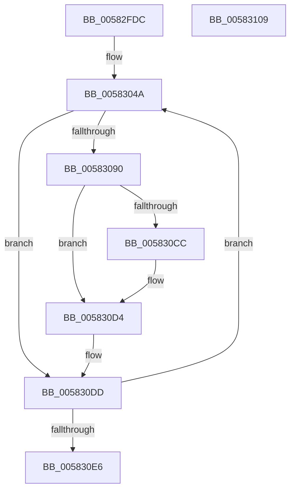

# FsRtlpGetMaxVirtualDiskNestingLevel

- RVA: `0x00582FDC`–`0x0058310A` (길이 `302` bytes)
- VA: `0x0000000140582FDC`
- 실행 섹션: `.text`
- PDB 이름 있음: `예`; PDB Function 태그: `아니요`
- unwind 정보 RVA: `0x000C61E0`
- 디코드: `74`개 명령, `302/302` bytes 표시
- 미해석 바이트: `0` (있으면 어셈블리에 `.byte`로 보존)

> 이 문서는 커널 이미지의 기계어와 PDB 기호를 분석해 생성했습니다. 4번과 5번은 함수 원형과 자료형을 바이너리 사용 방식에서 추정한 C 해석이며 원본 소스 복구 결과는 아닙니다.

## 1. Dependencies

- 직접 호출 지점: **7**; 고유 호출 대상: **5**
- 직접 호출자로 확인된 함수: **1**
- RIP 상대 이미지 참조: **4**

### Outgoing calls
- `0x00583033` → [RtlInitUnicodeString](../42/RtlInitUnicodeString_function_0042A780.md) (function, `0x0042A780`)
- `0x00583043` → [RtlInitUnicodeString](../42/RtlInitUnicodeString_function_0042A780.md) (function, `0x0042A780`)
- `0x00583087` → [ZwOpenKey](../6A/ZwOpenKey_function_006AD310.md) (function, `0x006AD310`)
- `0x0058309B` → [RtlInitUnicodeString](../42/RtlInitUnicodeString_function_0042A780.md) (function, `0x0042A780`)
- `0x005830C3` → [ZwQueryValueKey](../6A/ZwQueryValueKey_function_006AD3B0.md) (function, `0x006AD3B0`)
- `0x005830D8` → [ZwClose](../6A/ZwClose_function_006AD2B0.md) (function, `0x006AD2B0`)
- `0x005830EF` → [_security_check_cookie](../6A/_security_check_cookie_function_006AC640.md) (function, `0x006AC640`)

### Direct callers
- [FsRtlQueryMaximumVirtualDiskNestingLevel](../4A/FsRtlQueryMaximumVirtualDiskNestingLevel_function_004A4710.md) at `0x004A4725`

### Static image references
- `0x00582FF3` → RVA `0x00E0A740` (`.data`; read)
- `0x00583003` → RVA `0x006C95E0` (` ?? ::FNODOBFM::`string'`; read)
- `0x00583038` → RVA `0x006C9680` (` ?? ::FNODOBFM::`string'`; read)
- `0x00583090` → RVA `0x006C9720` (` ?? ::FNODOBFM::`string'`; read)

## 2. Other-region calls and transfers

- 다른 실행 섹션으로 향하는 call: **0**
- 별도 외부 분기/꼬리 이동을 확인하지 못했습니다.

## 3. Assembly (complete function range)

```asm
00582FDC  48 89 5C 24 08                  mov qword ptr [rsp + 8], rbx
00582FE1  48 89 7C 24 10                  mov qword ptr [rsp + 0x10], rdi
00582FE6  55                              push rbp
00582FE7  48 8D 6C 24 A9                  lea rbp, [rsp - 0x57]
00582FEC  48 81 EC C0 00 00 00            sub rsp, 0xc0
00582FF3  48 8B 05 46 77 88 00            mov rax, qword ptr [rip + 0x887746]
00582FFA  48 33 C4                        xor rax, rsp
00582FFD  48 89 45 4F                     mov qword ptr [rbp + 0x4f], rax
00583001  33 C0                           xor eax, eax
00583003  48 8D 15 D6 65 14 00            lea rdx, [rip + 0x1465d6]
0058300A  21 45 23                        and dword ptr [rbp + 0x23], eax
0058300D  48 8D 4D E7                     lea rcx, [rbp - 0x19]
00583011  48 21 45 CF                     and qword ptr [rbp - 0x31], rax
00583015  0F 57 C0                        xorps xmm0, xmm0
00583018  21 45 C7                        and dword ptr [rbp - 0x39], eax
0058301B  0F 57 C9                        xorps xmm1, xmm1
0058301E  89 45 0B                        mov dword ptr [rbp + 0xb], eax
00583021  8D 58 02                        lea ebx, [rax + 2]
00583024  21 45 0B                        and dword ptr [rbp + 0xb], eax
00583027  0F 11 45 F7                     movups xmmword ptr [rbp - 9], xmm0
0058302B  0F 11 4D E7                     movups xmmword ptr [rbp - 0x19], xmm1
0058302F  0F 11 45 D7                     movups xmmword ptr [rbp - 0x29], xmm0
00583033  E8 48 77 EA FF                  call 0x14042a780
00583038  48 8D 15 41 66 14 00            lea rdx, [rip + 0x146641]
0058303F  48 8D 4D D7                     lea rcx, [rbp - 0x29]
00583043  E8 38 77 EA FF                  call 0x14042a780
00583048  33 FF                           xor edi, edi
0058304A  48 83 65 0F 00                  and qword ptr [rbp + 0xf], 0
0058304F  48 8D 4D E7                     lea rcx, [rbp - 0x19]
00583053  0F 57 C0                        xorps xmm0, xmm0
00583056  C7 45 07 30 00 00 00            mov dword ptr [rbp + 7], 0x30
0058305D  FF C7                           inc edi
0058305F  C7 45 1F 40 02 00 00            mov dword ptr [rbp + 0x1f], 0x240
00583066  83 FF 01                        cmp edi, 1
00583069  48 8D 45 D7                     lea rax, [rbp - 0x29]
0058306D  4C 8D 45 07                     lea r8, [rbp + 7]
00583071  BA 19 00 02 00                  mov edx, 0x20019
00583076  48 0F 45 C1                     cmovne rax, rcx
0058307A  48 8D 4D CF                     lea rcx, [rbp - 0x31]
0058307E  48 89 45 17                     mov qword ptr [rbp + 0x17], rax
00583082  F3 0F 7F 45 27                  movdqu xmmword ptr [rbp + 0x27], xmm0
00583087  E8 84 A2 12 00                  call 0x1406ad310
0058308C  85 C0                           test eax, eax
0058308E  78 4D                           js 0x1405830dd
00583090  48 8D 15 89 66 14 00            lea rdx, [rip + 0x146689]
00583097  48 8D 4D F7                     lea rcx, [rbp - 9]
0058309B  E8 E0 76 EA FF                  call 0x14042a780
005830A0  48 8B 4D CF                     mov rcx, qword ptr [rbp - 0x31]
005830A4  48 8D 45 C7                     lea rax, [rbp - 0x39]
005830A8  48 89 44 24 28                  mov qword ptr [rsp + 0x28], rax
005830AD  4C 8D 4D 37                     lea r9, [rbp + 0x37]
005830B1  41 B8 02 00 00 00               mov r8d, 2
005830B7  C7 44 24 20 14 00 00 00         mov dword ptr [rsp + 0x20], 0x14
005830BF  48 8D 55 F7                     lea rdx, [rbp - 9]
005830C3  E8 E8 A2 12 00                  call 0x1406ad3b0
005830C8  85 C0                           test eax, eax
005830CA  78 08                           js 0x1405830d4
005830CC  83 7D 43 02                     cmp dword ptr [rbp + 0x43], 2
005830D0  0F 46 5D 43                     cmovbe ebx, dword ptr [rbp + 0x43]
005830D4  48 8B 4D CF                     mov rcx, qword ptr [rbp - 0x31]
005830D8  E8 D3 A1 12 00                  call 0x1406ad2b0
005830DD  83 FF 02                        cmp edi, 2
005830E0  0F 82 64 FF FF FF               jb 0x14058304a
005830E6  8B C3                           mov eax, ebx
005830E8  48 8B 4D 4F                     mov rcx, qword ptr [rbp + 0x4f]
005830EC  48 33 CC                        xor rcx, rsp
005830EF  E8 4C 95 12 00                  call 0x1406ac640
005830F4  4C 8D 9C 24 C0 00 00 00         lea r11, [rsp + 0xc0]
005830FC  49 8B 5B 10                     mov rbx, qword ptr [r11 + 0x10]
00583100  49 8B 7B 18                     mov rdi, qword ptr [r11 + 0x18]
00583104  49 8B E3                        mov rsp, r11
00583107  5D                              pop rbp
00583108  C3                              ret
00583109  CC                              int3
```

## 4. C-style interpretation (structured pseudocode)

```c
__int64 __fastcall FsRtlpGetMaxVirtualDiskNestingLevel(void)
{
    __int64 result;
    __int64 v_rbx;
    __int64 v_rdi;
    __int64 v_rsp;
    unsigned __int64 v_stack_m10;
    unsigned int v_stack_m1C;
    unsigned __int64 v_stack_m28;
    unsigned __int64 v_stack_m38;
    unsigned int v_stack_m3C;
    unsigned int v_stack_m40;
    unsigned __int64 v_stack_m48;
    unsigned __int64 v_stack_m50;
    unsigned int v_stack_m54;
    unsigned int v_stack_m58;
    unsigned __int64 v_stack_m5F;
    unsigned __int64 v_stack_m68;
    unsigned __int64 v_stack_m78;
    unsigned __int64 v_stack_m8;
    unsigned __int64 v_stack_m88;
    unsigned __int64 v_stack_m90;
    unsigned int v_stack_m98;
    unsigned __int64 v_stack_mA0;
    unsigned int v_stack_mA8;
    unsigned __int64 v_stack_p10;
    unsigned __int64 v_stack_p8;

    v_stack_p8 = v_rbx;
    v_stack_p10 = v_rdi;
    v_rsp = (v_rsp) - (192);
    result = (*(unsigned __int64 *)(v_rip + 8943430)) ^ (v_rsp);
    v_stack_m10 = result;
    result = 0;
    v_stack_m54 = 0;
    v_stack_m68 = v_xmm0;
    v_stack_m78 = v_xmm1;
    v_stack_m88 = v_xmm0;
    result = RtlInitUnicodeString(v_stack_m78, v_rip + 1336790, a3, a4);
    result = RtlInitUnicodeString(v_stack_m88, v_rip + 1336897, a3, a4);
    v_rdi = 0;
loc_0058304A:
    v_stack_m58 = 48;
    v_rdi = (unsigned int)((v_rdi) + 1);
    v_stack_m40 = 576;
    result = v_stack_m88;
    if (((unsigned int)(v_rdi)) != 1) { result = v_stack_m78; }
    v_stack_m48 = result;
    v_stack_m38 = v_xmm0;
    result = ZwOpenKey(v_stack_m90, (unsigned int)(0x20019ULL), v_stack_m58, a4);
    if (sign_flag) goto loc_005830DD;
    result = RtlInitUnicodeString(v_stack_m68, v_rip + 1336969, v_stack_m58, a4);
    v_stack_mA0 = v_stack_m98;
    v_stack_mA8 = 20;
    result = ZwQueryValueKey(v_stack_m90, v_stack_m68, 2, v_stack_m28);
    v_rbx = result + 2;
    if (!(sign_flag)) {
        v_rbx = result + 2;
        if (v_stack_m1C <= 2) { v_rbx = v_stack_m1C; }
    }
    result = ZwClose(v_stack_m90, v_stack_m68, 2, v_stack_m28);
loc_005830DD:
    if (((unsigned int)(v_rdi)) < 2) goto loc_0058304A;
    a1 = (v_stack_m10) ^ (v_rsp);
    result = _security_check_cookie(a1, v_stack_m68, 2, v_stack_m28);
    return result;
}
```

## 5. (Beta) C Style

```c
void FsRtlpGetMaxVirtualDiskNestingLevel(void)
{
    int64_t result;
    int64_t local_rbx;
    int64_t local_rdi;
    int64_t local_rsp;
    uint64_t v_stack_m10;
    uint32_t v_stack_m1C;
    uint64_t v_stack_m28;
    uint64_t v_stack_m38;
    uint32_t v_stack_m3C;
    uint32_t v_stack_m40;
    uint64_t v_stack_m48;
    uint64_t v_stack_m50;
    uint32_t v_stack_m54;
    uint32_t v_stack_m58;
    uint64_t v_stack_m5F;
    uint64_t v_stack_m68;
    uint64_t v_stack_m78;
    uint64_t v_stack_m8;
    uint64_t v_stack_m88;
    uint64_t v_stack_m90;
    uint32_t v_stack_m98;
    uint64_t v_stack_mA0;
    uint32_t v_stack_mA8;
    uint64_t v_stack_p10;
    uint64_t v_stack_p8;

    v_stack_p8 = local_rbx;
    v_stack_p10 = local_rdi;
    local_rsp = (local_rsp) - (192);
    result = (*(uint64_t *)(v_rip + 0x887746)) ^ (local_rsp);
    v_stack_m10 = result;
    result = 0;
    v_stack_m54 = 0;
    v_stack_m68 = v_xmm0;
    v_stack_m78 = v_xmm1;
    v_stack_m88 = v_xmm0;
    result = RtlInitUnicodeString(v_stack_m78, v_rip + 1336790, a3, a4);
    result = RtlInitUnicodeString(v_stack_m88, v_rip + 1336897, a3, a4);
    local_rdi = 0;
loc_0058304A:
    v_stack_m58 = 48;
    local_rdi = (uint32_t)((local_rdi) + 1);
    v_stack_m40 = 576;
    result = v_stack_m88;
    if (((uint32_t)(local_rdi)) != 1) { result = v_stack_m78; }
    v_stack_m48 = result;
    v_stack_m38 = v_xmm0;
    result = ZwOpenKey(v_stack_m90, (uint32_t)(0x20019ULL), v_stack_m58, a4);
    if (sign_flag) goto loc_005830DD;
    result = RtlInitUnicodeString(v_stack_m68, v_rip + 1336969, v_stack_m58, a4);
    v_stack_mA0 = v_stack_m98;
    v_stack_mA8 = 20;
    result = ZwQueryValueKey(v_stack_m90, v_stack_m68, 2, v_stack_m28);
    local_rbx = result + 2;
    if (!(sign_flag)) {
        local_rbx = result + 2;
        if (v_stack_m1C <= 2) { local_rbx = v_stack_m1C; }
    }
    result = ZwClose(v_stack_m90, v_stack_m68, 2, v_stack_m28);
loc_005830DD:
    if (((uint32_t)(local_rdi)) < 2) goto loc_0058304A;
    a1 = (v_stack_m10) ^ (local_rsp);
    result = _security_check_cookie(a1, v_stack_m68, 2, v_stack_m28);
    return result;
}
```

## 6. Execution-region graph

[열기: 2D/3D 그래프와 함수 탐색 컨트롤 패널](../../../control-panel.html?section=text&rva=0x00582FDC&view=graph)

- 2D 그래프는 위에서 아래로 흐르고, 3D 그래프는 빈 공간을 드래그해 회전합니다. Shift+드래그는 이동, 휠은 확대·축소, 함수 노드 선택은 대상 보고서 이동입니다.

### Static fallback


