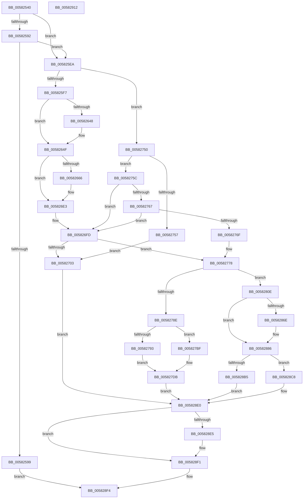

# FsRtlpGrantAnyOplockFromExclusive

- RVA: `0x00582540`–`0x00582913` (길이 `979` bytes)
- VA: `0x0000000140582540`
- 실행 섹션: `.text`
- PDB 이름 있음: `예`; PDB Function 태그: `아니요`
- unwind 정보 RVA: `0x000C5F94`
- 디코드: `247`개 명령, `979/979` bytes 표시
- 미해석 바이트: `0` (있으면 어셈블리에 `.byte`로 보존)

> 이 문서는 커널 이미지의 기계어와 PDB 기호를 분석해 생성했습니다. 4번과 5번은 함수 원형과 자료형을 바이너리 사용 방식에서 추정한 C 해석이며 원본 소스 복구 결과는 아닙니다.

## 1. Dependencies

- 직접 호출 지점: **18**; 고유 호출 대상: **12**
- 직접 호출자로 확인된 함수: **1**
- RIP 상대 이미지 참조: **4**

### Outgoing calls
- `0x005825DE` → [IofCompleteRequest](../29/IofCompleteRequest_function_0029B5C0.md) (function, `0x0029B5C0`)
- `0x00582616` → [FsRtlpOplockPerfMoveData](../../page/71/FsRtlpOplockPerfMoveData_function_00715308.md) (function, `0x00715308`)
- `0x0058262E` → [FsRtlpOplockMoveAckTimeout](../../page/71/FsRtlpOplockMoveAckTimeout_function_00715108.md) (function, `0x00715108`)
- `0x005826DE` → [tlgWriteTransfer_EtwWriteTransfer](../42/tlgWriteTransfer_EtwWriteTransfer_function_004260E0.md) (function, `0x004260E0`)
- `0x00582726` → [IofCompleteRequest](../29/IofCompleteRequest_function_0029B5C0.md) (function, `0x0029B5C0`)
- `0x00582736` → [FsRtlpSyncWithAckTimeout](../4F/FsRtlpSyncWithAckTimeout_function_004F23C4.md) (function, `0x004F23C4`)
- `0x00582746` → [FsRtlpOplockPerfSendData](../../page/6F/FsRtlpOplockPerfSendData_function_006FDB80.md) (function, `0x006FDB80`)
- `0x005827A1` → [FsRtlpOplockPerfMoveData](../../page/71/FsRtlpOplockPerfMoveData_function_00715308.md) (function, `0x00715308`)
- `0x005827B8` → [FsRtlpOplockMoveAckTimeout](../../page/71/FsRtlpOplockMoveAckTimeout_function_00715108.md) (function, `0x00715108`)
- `0x005827C6` → [FsRtlpSyncWithAckTimeout](../4F/FsRtlpSyncWithAckTimeout_function_004F23C4.md) (function, `0x004F23C4`)
- `0x005827D6` → [FsRtlpOplockPerfSendData](../../page/6F/FsRtlpOplockPerfSendData_function_006FDB80.md) (function, `0x006FDB80`)
- `0x00582801` → [FsRtlpRequestShareableOplock](../4E/FsRtlpRequestShareableOplock_function_004E6EC8.md) (function, `0x004E6EC8`)
- `0x0058285C` → [ObfReferenceObjectWithTag](../21/ObfReferenceObjectWithTag_function_00210710.md) (function, `0x00210710`)
- `0x00582875` → [ObfReferenceObjectWithTag](../21/ObfReferenceObjectWithTag_function_00210710.md) (function, `0x00210710`)
- `0x005828A7` → [KeAcquireQueuedSpinLock](../27/KeAcquireQueuedSpinLock_function_00273D80.md) (function, `0x00273D80`)
- `0x005828C1` → [FsRtlpCancelExclusiveIrp](../4F/FsRtlpCancelExclusiveIrp_function_004F96CC.md) (function, `0x004F96CC`)
- `0x005828DB` → [KeReleaseQueuedSpinLock](../27/KeReleaseQueuedSpinLock_function_00272540.md) (function, `0x00272540`)
- `0x005828FB` → [_security_check_cookie](../6A/_security_check_cookie_function_006AC640.md) (function, `0x006AC640`)

### Direct callers
- [FsRtlpAcknowledgeOplockBreakByCacheFlags](../3F/FsRtlpAcknowledgeOplockBreakByCacheFlags_function_003F1988.md) at `0x003F255B`

### Static image references
- `0x00582557` → RVA `0x00E0A740` (`.data`; read)
- `0x0058265D` → RVA `0x00E06C50` (`.data`; read)
- `0x005826AA` → RVA `0x000454AD` (`.rdata`; read)
- `0x005828C8` → RVA `0x00582520` (`FsRtlpExclusiveIrpCancelRoutine`; read)

## 2. Other-region calls and transfers

- 다른 실행 섹션으로 향하는 call: **6**
  - `0x00582616` → [FsRtlpOplockPerfMoveData](../../page/71/FsRtlpOplockPerfMoveData_function_00715308.md) (`.text` → `PAGE`)
  - `0x0058262E` → [FsRtlpOplockMoveAckTimeout](../../page/71/FsRtlpOplockMoveAckTimeout_function_00715108.md) (`.text` → `PAGE`)
  - `0x00582746` → [FsRtlpOplockPerfSendData](../../page/6F/FsRtlpOplockPerfSendData_function_006FDB80.md) (`.text` → `PAGE`)
  - `0x005827A1` → [FsRtlpOplockPerfMoveData](../../page/71/FsRtlpOplockPerfMoveData_function_00715308.md) (`.text` → `PAGE`)
  - `0x005827B8` → [FsRtlpOplockMoveAckTimeout](../../page/71/FsRtlpOplockMoveAckTimeout_function_00715108.md) (`.text` → `PAGE`)
  - `0x005827D6` → [FsRtlpOplockPerfSendData](../../page/6F/FsRtlpOplockPerfSendData_function_006FDB80.md) (`.text` → `PAGE`)
- 별도 외부 분기/꼬리 이동을 확인하지 못했습니다.

## 3. Assembly (complete function range)

```asm
00582540  40 55                           push rbp
00582542  53                              push rbx
00582543  56                              push rsi
00582544  57                              push rdi
00582545  41 54                           push r12
00582547  41 56                           push r14
00582549  41 57                           push r15
0058254B  48 8D 6C 24 F9                  lea rbp, [rsp - 7]
00582550  48 81 EC C0 00 00 00            sub rsp, 0xc0
00582557  48 8B 05 E2 81 88 00            mov rax, qword ptr [rip + 0x8881e2]
0058255E  48 33 C4                        xor rax, rsp
00582561  48 89 45 F7                     mov qword ptr [rbp - 9], rax
00582565  4C 8B 75 67                     mov r14, qword ptr [rbp + 0x67]
00582569  4D 8B F8                        mov r15, r8
0058256C  4C 8B 65 77                     mov r12, qword ptr [rbp + 0x77]
00582570  48 8B DA                        mov rbx, rdx
00582573  48 8B 55 7F                     mov rdx, qword ptr [rbp + 0x7f]
00582577  4C 8B C1                        mov r8, rcx
0058257A  48 89 4D 87                     mov qword ptr [rbp - 0x79], rcx
0058257E  41 8B F9                        mov edi, r9d
00582581  49 8B 47 30                     mov rax, qword ptr [r15 + 0x30]
00582585  48 8B 8D 87 00 00 00            mov rcx, qword ptr [rbp + 0x87]
0058258C  80 78 49 00                     cmp byte ptr [rax + 0x49], 0
00582590  74 58                           je 0x1405825ea
00582592  41 0F BA E1 0D                  bt r9d, 0xd
00582597  73 51                           jae 0x1405825ea
00582599  48 8B 53 18                     mov rdx, qword ptr [rbx + 0x18]
0058259D  33 C0                           xor eax, eax
0058259F  C1 EF 0C                        shr edi, 0xc
005825A2  0F 57 C0                        xorps xmm0, xmm0
005825A5  83 E7 05                        and edi, 5
005825A8  0F 11 02                        movups xmmword ptr [rdx], xmm0
005825AB  48 89 42 10                     mov qword ptr [rdx + 0x10], rax
005825AF  48 8B 45 87                     mov rax, qword ptr [rbp - 0x79]
005825B3  8B 88 90 00 00 00               mov ecx, dword ptr [rax + 0x90]
005825B9  83 4A 0C 01                     or dword ptr [rdx + 0xc], 1
005825BD  89 7A 08                        mov dword ptr [rdx + 8], edi
005825C0  BF 2E 00 00 80                  mov edi, 0x8000002e
005825C5  C1 E9 0C                        shr ecx, 0xc
005825C8  83 E1 07                        and ecx, 7
005825CB  89 4A 04                        mov dword ptr [rdx + 4], ecx
005825CE  B2 01                           mov dl, 1
005825D0  48 8B CB                        mov rcx, rbx
005825D3  48 C7 43 38 18 00 00 00         mov qword ptr [rbx + 0x38], 0x18
005825DB  89 7B 30                        mov dword ptr [rbx + 0x30], edi
005825DE  E8 DD 8F D1 FF                  call 0x14029b5c0
005825E3  8B C7                           mov eax, edi
005825E5  E9 0A 03 00 00                  jmp 0x1405828f4
005825EA  40 8A 75 6F                     mov sil, byte ptr [rbp + 0x6f]
005825EE  40 84 F6                        test sil, sil
005825F1  0F 84 59 01 00 00               je 0x140582750
005825F7  49 8B 0C 24                     mov rcx, qword ptr [r12]
005825FB  49 8B 40 08                     mov rax, qword ptr [r8 + 8]
005825FF  48 89 41 10                     mov qword ptr [rcx + 0x10], rax
00582603  49 8B 14 24                     mov rdx, qword ptr [r12]
00582607  48 8B 4D 87                     mov rcx, qword ptr [rbp - 0x79]
0058260B  48 83 C2 18                     add rdx, 0x18
0058260F  48 81 C1 A8 00 00 00            add rcx, 0xa8
00582616  E8 ED 2C 19 00                  call 0x140715308
0058261B  49 8B 14 24                     mov rdx, qword ptr [r12]
0058261F  48 8B 4D 87                     mov rcx, qword ptr [rbp - 0x79]
00582623  48 83 C2 28                     add rdx, 0x28
00582627  48 81 C1 B8 00 00 00            add rcx, 0xb8
0058262E  E8 D5 2A 19 00                  call 0x140715108
00582633  48 8B 45 87                     mov rax, qword ptr [rbp - 0x79]
00582637  49 8B 0C 24                     mov rcx, qword ptr [r12]
0058263B  48 83 C0 68                     add rax, 0x68
0058263F  48 8B 10                        mov rdx, qword ptr [rax]
00582642  48 39 42 08                     cmp qword ptr [rdx + 8], rax
00582646  74 07                           je 0x14058264f
00582648  B9 03 00 00 00                  mov ecx, 3
0058264D  CD 29                           int 0x29
0058264F  48 89 11                        mov qword ptr [rcx], rdx
00582652  48 89 41 08                     mov qword ptr [rcx + 8], rax
00582656  48 89 4A 08                     mov qword ptr [rdx + 8], rcx
0058265A  48 89 08                        mov qword ptr [rax], rcx
0058265D  83 3D EC 45 88 00 05            cmp dword ptr [rip + 0x8845ec], 5
00582664  76 7D                           jbe 0x1405826e3
00582666  49 8B 04 24                     mov rax, qword ptr [r12]
0058266A  BA 08 00 00 00                  mov edx, 8
0058266F  45 33 C9                        xor r9d, r9d
00582672  45 33 C0                        xor r8d, r8d
00582675  48 8B 48 10                     mov rcx, qword ptr [rax + 0x10]
00582679  48 8D 45 97                     lea rax, [rbp - 0x69]
0058267D  83 65 D3 00                     and dword ptr [rbp - 0x2d], 0
00582681  83 65 E3 00                     and dword ptr [rbp - 0x1d], 0
00582685  48 89 45 C7                     mov qword ptr [rbp - 0x39], rax
00582689  48 8B 45 87                     mov rax, qword ptr [rbp - 0x79]
0058268D  48 89 4D 97                     mov qword ptr [rbp - 0x69], rcx
00582691  48 8D 4D 9F                     lea rcx, [rbp - 0x61]
00582695  48 89 45 9F                     mov qword ptr [rbp - 0x61], rax
00582699  89 55 CF                        mov dword ptr [rbp - 0x31], edx
0058269C  48 89 4D D7                     mov qword ptr [rbp - 0x29], rcx
005826A0  48 8D 0D A9 45 88 00            lea rcx, [rip + 0x8845a9]
005826A7  89 55 DF                        mov dword ptr [rbp - 0x21], edx
005826AA  48 8D 15 FC 2D AC FF            lea rdx, [rip - 0x53d204]
005826B1  8B 80 90 00 00 00               mov eax, dword ptr [rax + 0x90]
005826B7  83 65 F3 00                     and dword ptr [rbp - 0xd], 0
005826BB  89 45 8F                        mov dword ptr [rbp - 0x71], eax
005826BE  48 8D 45 8F                     lea rax, [rbp - 0x71]
005826C2  48 89 45 E7                     mov qword ptr [rbp - 0x19], rax
005826C6  48 8D 45 A7                     lea rax, [rbp - 0x59]
005826CA  48 89 44 24 28                  mov qword ptr [rsp + 0x28], rax
005826CF  C7 44 24 20 05 00 00 00         mov dword ptr [rsp + 0x20], 5
005826D7  C7 45 EF 04 00 00 00            mov dword ptr [rbp - 0x11], 4
005826DE  E8 FD 39 EA FF                  call 0x1404260e0
005826E3  49 83 24 24 00                  and qword ptr [r12], 0
005826E8  8B CF                           mov ecx, edi
005826EA  48 8B 45 87                     mov rax, qword ptr [rbp - 0x79]
005826EE  48 83 60 08 00                  and qword ptr [rax + 8], 0
005826F3  4C 8B 45 87                     mov r8, qword ptr [rbp - 0x79]
005826F7  81 E1 10 30 00 00               and ecx, 0x3010
005826FD  8B C1                           mov eax, ecx
005826FF  85 FF                           test edi, edi
00582701  75 75                           jne 0x140582778
00582703  41 8B 88 90 00 00 00            mov ecx, dword ptr [r8 + 0x90]
0058270A  45 33 F6                        xor r14d, r14d
0058270D  48 8B 45 87                     mov rax, qword ptr [rbp - 0x79]
00582711  83 E1 20                        and ecx, 0x20
00582714  83 C9 01                        or ecx, 1
00582717  B2 01                           mov dl, 1
00582719  89 88 90 00 00 00               mov dword ptr [rax + 0x90], ecx
0058271F  48 8B CB                        mov rcx, rbx
00582722  44 21 73 30                     and dword ptr [rbx + 0x30], r14d
00582726  E8 95 8E D1 FF                  call 0x14029b5c0
0058272B  48 8B 4D 87                     mov rcx, qword ptr [rbp - 0x79]
0058272F  48 81 C1 B8 00 00 00            add rcx, 0xb8
00582736  E8 89 FC F6 FF                  call 0x1404f23c4
0058273B  48 8B 4D 87                     mov rcx, qword ptr [rbp - 0x79]
0058273F  48 81 C1 A8 00 00 00            add rcx, 0xa8
00582746  E8 35 B4 17 00                  call 0x1406fdb80
0058274B  E9 90 01 00 00                  jmp 0x1405828e0
00582750  C6 02 01                        mov byte ptr [rdx], 1
00582753  85 FF                           test edi, edi
00582755  75 05                           jne 0x14058275c
00582757  C6 01 01                        mov byte ptr [rcx], 1
0058275A  EB A7                           jmp 0x140582703
0058275C  8B C7                           mov eax, edi
0058275E  25 10 30 00 00                  and eax, 0x3010
00582763  8B C8                           mov ecx, eax
00582765  74 96                           je 0x1405826fd
00582767  F7 C7 40 40 00 00               test edi, 0x4040
0058276D  75 8E                           jne 0x1405826fd
0058276F  49 83 60 08 00                  and qword ptr [r8 + 8], 0
00582774  4C 8B 45 87                     mov r8, qword ptr [rbp - 0x79]
00582778  F7 C7 40 40 00 00               test edi, 0x4040
0058277E  0F 94 C1                        sete cl
00582781  85 C0                           test eax, eax
00582783  0F 95 C0                        setne al
00582786  84 C8                           test al, cl
00582788  0F 84 80 00 00 00               je 0x14058280e
0058278E  4D 85 F6                        test r14, r14
00582791  74 2C                           je 0x1405827bf
00582793  49 8B 16                        mov rdx, qword ptr [r14]
00582796  49 8D 88 A8 00 00 00            lea rcx, [r8 + 0xa8]
0058279D  48 83 C2 48                     add rdx, 0x48
005827A1  E8 62 2B 19 00                  call 0x140715308
005827A6  49 8B 16                        mov rdx, qword ptr [r14]
005827A9  48 8B 4D 87                     mov rcx, qword ptr [rbp - 0x79]
005827AD  48 83 C2 58                     add rdx, 0x58
005827B1  48 81 C1 B8 00 00 00            add rcx, 0xb8
005827B8  E8 4B 29 19 00                  call 0x140715108
005827BD  EB 1C                           jmp 0x1405827db
005827BF  49 8D 88 B8 00 00 00            lea rcx, [r8 + 0xb8]
005827C6  E8 F9 FB F6 FF                  call 0x1404f23c4
005827CB  48 8B 4D 87                     mov rcx, qword ptr [rbp - 0x79]
005827CF  48 81 C1 A8 00 00 00            add rcx, 0xa8
005827D6  E8 A5 B3 17 00                  call 0x1406fdb80
005827DB  8B 85 8F 00 00 00               mov eax, dword ptr [rbp + 0x8f]
005827E1  48 8D 4D 87                     lea rcx, [rbp - 0x79]
005827E5  89 44 24 38                     mov dword ptr [rsp + 0x38], eax
005827E9  44 8B CF                        mov r9d, edi
005827EC  C6 44 24 30 01                  mov byte ptr [rsp + 0x30], 1
005827F1  4C 8B C3                        mov r8, rbx
005827F4  40 88 74 24 28                  mov byte ptr [rsp + 0x28], sil
005827F9  49 8B D7                        mov rdx, r15
005827FC  4C 89 74 24 20                  mov qword ptr [rsp + 0x20], r14
00582801  E8 C2 46 F6 FF                  call 0x1404e6ec8
00582806  44 8B F0                        mov r14d, eax
00582809  E9 D2 00 00 00                  jmp 0x1405828e0
0058280E  49 89 18                        mov qword ptr [r8], rbx
00582811  41 BC 44 66 6C 74               mov r12d, 0x746c6644
00582817  48 8B 83 B8 00 00 00            mov rax, qword ptr [rbx + 0xb8]
0058281E  41 8B D4                        mov edx, r12d
00582821  41 BE 03 01 00 00               mov r14d, 0x103
00582827  80 48 03 01                     or byte ptr [rax + 3], 1
0058282B  48 8B 45 87                     mov rax, qword ptr [rbp - 0x79]
0058282F  48 89 43 38                     mov qword ptr [rbx + 0x38], rax
00582833  65 48 8B 04 25 88 01 00 00      mov rax, qword ptr gs:[0x188]
0058283C  48 8B 88 B8 00 00 00            mov rcx, qword ptr [rax + 0xb8]
00582843  48 8B 45 87                     mov rax, qword ptr [rbp - 0x79]
00582847  48 89 48 10                     mov qword ptr [rax + 0x10], rcx
0058284B  65 48 8B 0C 25 88 01 00 00      mov rcx, qword ptr gs:[0x188]
00582854  48 8B 45 87                     mov rax, qword ptr [rbp - 0x79]
00582858  48 89 48 18                     mov qword ptr [rax + 0x18], rcx
0058285C  E8 AF DE C8 FF                  call 0x140210710
00582861  48 8B 45 87                     mov rax, qword ptr [rbp - 0x79]
00582865  C6 40 20 00                     mov byte ptr [rax + 0x20], 0
00582869  40 84 F6                        test sil, sil
0058286C  74 18                           je 0x140582886
0058286E  49 8B 4F 30                     mov rcx, qword ptr [r15 + 0x30]
00582872  41 8B D4                        mov edx, r12d
00582875  E8 96 DE C8 FF                  call 0x140210710
0058287A  48 8B 45 87                     mov rax, qword ptr [rbp - 0x79]
0058287E  49 8B 4F 30                     mov rcx, qword ptr [r15 + 0x30]
00582882  48 89 48 08                     mov qword ptr [rax + 8], rcx
00582886  48 8B 45 87                     mov rax, qword ptr [rbp - 0x79]
0058288A  8B 88 90 00 00 00               mov ecx, dword ptr [rax + 0x90]
00582890  48 8B 45 87                     mov rax, qword ptr [rbp - 0x79]
00582894  83 E1 20                        and ecx, 0x20
00582897  0B CF                           or ecx, edi
00582899  83 C9 40                        or ecx, 0x40
0058289C  89 88 90 00 00 00               mov dword ptr [rax + 0x90], ecx
005828A2  B9 07 00 00 00                  mov ecx, 7
005828A7  E8 D4 14 CF FF                  call 0x140273d80
005828AC  80 7B 44 00                     cmp byte ptr [rbx + 0x44], 0
005828B0  88 43 45                        mov byte ptr [rbx + 0x45], al
005828B3  74 13                           je 0x1405828c8
005828B5  40 84 F6                        test sil, sil
005828B8  B2 01                           mov dl, 1
005828BA  48 8B CB                        mov rcx, rbx
005828BD  41 0F 94 C0                     sete r8b
005828C1  E8 06 6E F7 FF                  call 0x1404f96cc
005828C6  EB 18                           jmp 0x1405828e0
005828C8  48 8D 05 51 FC FF FF            lea rax, [rip - 0x3af]
005828CF  B9 07 00 00 00                  mov ecx, 7
005828D4  48 87 43 68                     xchg qword ptr [rbx + 0x68], rax
005828D8  8A 53 45                        mov dl, byte ptr [rbx + 0x45]
005828DB  E8 60 FC CE FF                  call 0x140272540
005828E0  40 84 F6                        test sil, sil
005828E3  74 0C                           je 0x1405828f1
005828E5  48 8B 45 87                     mov rax, qword ptr [rbp - 0x79]
005828E9  0F BA A8 90 00 00 00 18         bts dword ptr [rax + 0x90], 0x18
005828F1  41 8B C6                        mov eax, r14d
005828F4  48 8B 4D F7                     mov rcx, qword ptr [rbp - 9]
005828F8  48 33 CC                        xor rcx, rsp
005828FB  E8 40 9D 12 00                  call 0x1406ac640
00582900  48 81 C4 C0 00 00 00            add rsp, 0xc0
00582907  41 5F                           pop r15
00582909  41 5E                           pop r14
0058290B  41 5C                           pop r12
0058290D  5F                              pop rdi
0058290E  5E                              pop rsi
0058290F  5B                              pop rbx
00582910  5D                              pop rbp
00582911  C3                              ret
00582912  CC                              int3
```

## 4. C-style interpretation (structured pseudocode)

```c
__int64 __fastcall FsRtlpGrantAnyOplockFromExclusive(__int64 a1, __int64 a2, __int64 a3, int a4, __int64 a5, unsigned __int8 a6, __int64 a7, __int64 a8, __int64 a9, unsigned int a10)
{
    __int64 result;
    __int64 v_r14;
    __int64 v_rdi;
    __int64 v_rsp;
    unsigned __int64 v_stack_m3F;
    unsigned __int64 v_stack_m48;
    unsigned int v_stack_m4C;
    unsigned int v_stack_m50;
    unsigned __int64 v_stack_m58;
    unsigned int v_stack_m5C;
    unsigned int v_stack_m60;
    unsigned __int64 v_stack_m68;
    unsigned int v_stack_m6C;
    unsigned int v_stack_m70;
    unsigned __int64 v_stack_m78;
    unsigned __int64 v_stack_m98;
    unsigned __int64 v_stack_mA0;
    unsigned __int64 v_stack_mA8;
    unsigned int v_stack_mB0;
    unsigned __int64 v_stack_mB8;
    unsigned int v_stack_mC0;
    unsigned __int8 v_stack_mC8;
    unsigned __int64 v_stack_mD0;
    unsigned int v_stack_mD8;

    v_rsp = (v_rsp) - (192);
    result = (*(unsigned __int64 *)(v_rip + 8946146)) ^ (v_rsp);
    v_stack_m48 = result;
    v_stack_mB8 = a1;
    if ((*(unsigned __int8 *)(*(unsigned __int64 *)(a3 + 48) + 73)) == 0) goto loc_005825EA;
    if ((*(unsigned __int8 *)(*(unsigned __int64 *)(a3 + 48) + 73)) >= 0) goto loc_005825EA;
    result = 0;
    v_rdi = (unsigned int)(((unsigned int)(a4)) >> (12));
    v_rdi = (unsigned int)((v_rdi) & (5));
    *(unsigned __int64 *)(*(unsigned __int64 *)(a2 + 24)) = v_xmm0;
    *(unsigned __int64 *)(*(unsigned __int64 *)(a2 + 24) + 16) = 0;
    *(unsigned int *)(*(unsigned __int64 *)(a2 + 24) + 8) = (unsigned int)(v_rdi);
    a1 = (unsigned int)(((unsigned int)(*(unsigned int *)(v_stack_mB8 + 144))) >> (12));
    a1 = (unsigned int)((a1) & (7));
    *(unsigned int *)(*(unsigned __int64 *)(a2 + 24) + 4) = (unsigned int)(a1);
    *(unsigned __int64 *)(a2 + 56) = 24;
    *(unsigned int *)(a2 + 48) = (unsigned int)((unsigned int)(0x8000002EULL));
    result = IofCompleteRequest(a2, 1, a1, a4);
    goto loc_005828F4;
loc_005825EA:
    if (a6 == 0) goto loc_00582750;
    *(unsigned __int64 *)(*(unsigned __int64 *)(a7) + 16) = *(unsigned __int64 *)(a1 + 8);
    a2 = (*(unsigned __int64 *)(a7)) + (24);
    a1 = (v_stack_mB8) + (168);
    result = FsRtlpOplockPerfMoveData(a1, a2, a1, a4);
    a2 = (*(unsigned __int64 *)(a7)) + (40);
    a1 = (v_stack_mB8) + (184);
    result = FsRtlpOplockMoveAckTimeout(a1, a2, a1, a4);
    result = (v_stack_mB8) + (104);
    if ((*(unsigned __int64 *)(*(unsigned __int64 *)(result) + 8)) != result) {
        a1 = 3;
    }
    *(unsigned __int64 *)(a1) = *(unsigned __int64 *)(result);
    *(unsigned __int64 *)(a1 + 8) = result;
    *(unsigned __int64 *)(*(unsigned __int64 *)(result) + 8) = a1;
    *(unsigned __int64 *)(result) = a1;
    if ((*(unsigned int *)(v_rip + 8930796)) >= = 5) {
        result = *(unsigned __int64 *)(a7);
        a2 = 8;
        a4 = 0;
        a3 = 0;
        a1 = *(unsigned __int64 *)(result + 16);
        result = v_stack_mA8;
        v_stack_m78 = result;
        result = v_stack_mB8;
        v_stack_mA8 = a1;
        a1 = v_stack_mA0;
        v_stack_mA0 = result;
        v_stack_m70 = (unsigned int)(a2);
        v_stack_m68 = a1;
        a1 = v_rip + 8930729;
        v_stack_m60 = (unsigned int)(a2);
        a2 = v_rip - 5493252;
        result = *(unsigned int *)(result + 144);
        v_stack_mB0 = (unsigned int)(result);
        result = v_stack_mB0;
        v_stack_m58 = result;
        result = v_stack_m98;
        v_stack_mD0 = result;
        v_stack_mD8 = 5;
        v_stack_m50 = 4;
        result = tlgWriteTransfer_EtwWriteTransfer(a1, a2, a3, a4);
    }
    a1 = (unsigned int)(((unsigned int)((unsigned int)((unsigned int)(0x8000002EULL)))) & (0x3010ULL));
loc_005826FD:
    if ((unsigned int)((unsigned int)(0x8000002EULL)) != 0) goto loc_00582778;
loc_00582703:
    v_r14 = 0;
    a1 = (unsigned int)(((unsigned int)(*(unsigned int *)(v_stack_mB8 + 144))) & (32));
    a1 = (unsigned int)((a1) | (1));
    *(unsigned int *)(v_stack_mB8 + 144) = (unsigned int)(a1);
    result = IofCompleteRequest(a2, 1, v_stack_mB8, a4);
    a1 = (v_stack_mB8) + (184);
    result = FsRtlpSyncWithAckTimeout(a1, 1, v_stack_mB8, a4);
    a1 = (v_stack_mB8) + (168);
    result = FsRtlpOplockPerfSendData(a1, 1, v_stack_mB8, a4);
    goto loc_005828E0;
loc_00582750:
    *(unsigned __int8 *)(1) = 1;
    if ((unsigned int)((unsigned int)(0x8000002EULL)) != 0) goto loc_0058275C;
    *(unsigned __int8 *)(a1) = 1;
    goto loc_00582703;
loc_0058275C:
    result = (unsigned int)(((unsigned int)((unsigned int)((unsigned int)(0x8000002EULL)))) & (0x3010ULL));
    if (condition_is_equal) goto loc_005826FD;
    if ((((unsigned int)((unsigned int)(0x8000002EULL))) & (0x4040ULL)) != 0) goto loc_005826FD;
loc_00582778:
    a1 = ((((unsigned int)((unsigned int)(0x8000002EULL))) & (0x4040ULL)) == 0) ? 1 : 0;
    result = ((unsigned int)(result) != 0) ? 1 : 0;
    if ((((unsigned __int8)(result)) & ((unsigned __int8)(a1))) == 0) goto loc_0058280E;
    if (0 == 0) goto loc_005827BF;
    a2 = (*(unsigned __int64 *)(v_r14)) + (72);
    result = FsRtlpOplockPerfMoveData(v_stack_mB8 + 168, a2, v_stack_mB8, a4);
    a2 = (*(unsigned __int64 *)(v_r14)) + (88);
    a1 = (v_stack_mB8) + (184);
    result = FsRtlpOplockMoveAckTimeout(a1, a2, v_stack_mB8, a4);
    goto loc_005827DB;
loc_005827BF:
    result = FsRtlpSyncWithAckTimeout(v_stack_mB8 + 184, a2, v_stack_mB8, a4);
    a1 = (v_stack_mB8) + (168);
    result = FsRtlpOplockPerfSendData(a1, a2, v_stack_mB8, a4);
loc_005827DB:
    v_stack_mC0 = (unsigned int)((unsigned int)(a10));
    v_stack_mC8 = 1;
    v_stack_mD0 = a6;
    v_stack_mD8 = 0;
    result = FsRtlpRequestShareableOplock(v_stack_mB8, 0, a2, (unsigned int)((unsigned int)((unsigned int)(0x8000002EULL))));
    goto loc_005828E0;
loc_0058280E:
    *(unsigned __int64 *)(a2) = a2;
    *(unsigned __int64 *)(a2 + 56) = v_stack_mB8;
    *(unsigned __int64 *)(v_stack_mB8 + 16) = *(unsigned __int64 *)(*(unsigned __int64 *)(gs_base + (0 + 392)) + 184);
    *(unsigned __int64 *)(v_stack_mB8 + 24) = *(unsigned __int64 *)(gs_base + (0 + 392));
    result = ObfReferenceObjectWithTag(*(unsigned __int64 *)(gs_base + (0 + 392)), (unsigned int)((unsigned int)((unsigned int)(0x746C6644ULL))), a2, (unsigned int)((unsigned int)((unsigned int)(0x8000002EULL))));
    *(unsigned __int8 *)(v_stack_mB8 + 32) = 0;
    result = v_stack_mB8;
    if (a6 != 0) {
        a1 = *(unsigned __int64 *)(a3 + 48);
        a2 = (unsigned int)((unsigned int)(0x746C6644ULL));
        result = ObfReferenceObjectWithTag(a1, a2, a2, (unsigned int)((unsigned int)((unsigned int)(0x8000002EULL))));
        result = v_stack_mB8;
        a1 = *(unsigned __int64 *)(a3 + 48);
        *(unsigned __int64 *)(result + 8) = a1;
    }
    a1 = (unsigned int)(((unsigned int)(*(unsigned int *)(v_stack_mB8 + 144))) & (32));
    a1 = (unsigned int)((a1) | ((unsigned int)((unsigned int)(0x8000002EULL))));
    a1 = (unsigned int)((a1) | (64));
    *(unsigned int *)(v_stack_mB8 + 144) = (unsigned int)(a1);
    result = KeAcquireQueuedSpinLock(7, a2, a2, (unsigned int)((unsigned int)((unsigned int)(0x8000002EULL))));
    *(unsigned __int8 *)(a2 + 69) = (unsigned __int8)(result);
    if ((*(unsigned __int8 *)(a2 + 68)) == 0) goto loc_005828C8;
    a3 = (a6 == 0) ? 1 : 0;
    result = FsRtlpCancelExclusiveIrp(a2, 1, a3, (unsigned int)((unsigned int)((unsigned int)(0x8000002EULL))));
    goto loc_005828E0;
loc_005828C8:
    result = KeReleaseQueuedSpinLock(7, *(unsigned __int8 *)(a2 + 69), a3, (unsigned int)((unsigned int)((unsigned int)(0x8000002EULL))));
loc_005828E0:
    if (a6 != 0) {
        result = v_stack_mB8;
    }
loc_005828F4:
    a1 = (v_stack_m48) ^ (v_rsp);
    result = _security_check_cookie(a1, *(unsigned __int8 *)(a2 + 69), a3, (unsigned int)((unsigned int)((unsigned int)(0x8000002EULL))));
    v_rsp = (v_rsp) + (192);
    return result;
}
```

## 5. (Beta) C Style

```c
int64_t FsRtlpGrantAnyOplockFromExclusive(void *Arg1, void *Arg2, void *Arg3, int32_t Arg4, int64_t Arg5, uint8_t Arg6, void *Arg7, void *Arg8, void *Arg9, uint32_t Arg10)
{
    uint8_t *arg1 = (uint8_t *)Arg1;
    uint8_t *arg2 = (uint8_t *)Arg2;
    uint8_t *arg3 = (uint8_t *)Arg3;
    uint8_t *arg7 = (uint8_t *)Arg7;
    uint8_t *arg8 = (uint8_t *)Arg8;
    uint8_t *arg9 = (uint8_t *)Arg9;

    int64_t result;
    int64_t local_r14;
    int64_t local_rdi;
    int64_t local_rsp;
    uint64_t v_stack_m3F;
    uint64_t v_stack_m48;
    uint32_t v_stack_m4C;
    uint32_t v_stack_m50;
    uint64_t v_stack_m58;
    uint32_t v_stack_m5C;
    uint32_t v_stack_m60;
    uint64_t v_stack_m68;
    uint32_t v_stack_m6C;
    uint32_t v_stack_m70;
    uint64_t v_stack_m78;
    uint64_t v_stack_m98;
    uint64_t v_stack_mA0;
    uint64_t v_stack_mA8;
    uint32_t v_stack_mB0;
    uint64_t v_stack_mB8;
    uint32_t v_stack_mC0;
    uint8_t v_stack_mC8;
    uint64_t v_stack_mD0;
    uint32_t v_stack_mD8;

    local_rsp = (local_rsp) - (192);
    result = (*(uint64_t *)(v_rip + 0x8881E2)) ^ (local_rsp);
    v_stack_m48 = result;
    v_stack_mB8 = Arg1;
    if ((*(uint8_t *)(*(uint64_t *)(arg3 + 0x30) + 0x49)) == 0) goto loc_005825EA;
    if ((*(uint8_t *)(*(uint64_t *)(arg3 + 0x30) + 0x49)) >= 0) goto loc_005825EA;
    result = 0;
    local_rdi = (uint32_t)(((uint32_t)(Arg4)) >> (12));
    local_rdi = (uint32_t)((local_rdi) & (5));
    *(uint64_t *)(*(uint64_t *)(arg2 + 0x18)) = v_xmm0;
    *(uint64_t *)(*(uint64_t *)(arg2 + 0x18) + 0x10) = 0;
    *(uint32_t *)(*(uint64_t *)(arg2 + 0x18) + 0x8) = (uint32_t)(local_rdi);
    Arg1 = (uint32_t)(((uint32_t)(*(uint32_t *)(v_stack_mB8 + 0x90))) >> (12));
    Arg1 = (uint32_t)((Arg1) & (7));
    *(uint32_t *)(*(uint64_t *)(arg2 + 0x18) + 0x4) = (uint32_t)(Arg1);
    *(uint64_t *)(arg2 + 0x38) = 24;
    *(uint32_t *)(arg2 + 0x30) = (uint32_t)((uint32_t)(0x8000002EULL));
    result = IofCompleteRequest(Arg2, 1, Arg1, Arg4);
    goto loc_005828F4;
loc_005825EA:
    if (Arg6 == 0) goto loc_00582750;
    *(uint64_t *)(*(uint64_t *)(arg7) + 0x10) = *(uint64_t *)(arg1 + 0x8);
    Arg2 = (*(uint64_t *)(arg7)) + (24);
    Arg1 = (v_stack_mB8) + (168);
    result = FsRtlpOplockPerfMoveData(Arg1, Arg2, Arg1, Arg4);
    Arg2 = (*(uint64_t *)(arg7)) + (40);
    Arg1 = (v_stack_mB8) + (184);
    result = FsRtlpOplockMoveAckTimeout(Arg1, Arg2, Arg1, Arg4);
    result = (v_stack_mB8) + (104);
    if ((*(uint64_t *)(*(uint64_t *)(result) + 0x8)) != result) {
        Arg1 = 3;
    }
    *(uint64_t *)(arg1) = *(uint64_t *)(result);
    *(uint64_t *)(arg1 + 0x8) = result;
    *(void **)(*(uint64_t *)(result) + 0x8) = Arg1;
    *(void **)(result) = Arg1;
    if ((*(uint32_t *)(v_rip + 0x8845EC)) >= = 5) {
        result = *(uint64_t *)(arg7);
        Arg2 = 8;
        Arg4 = 0;
        Arg3 = 0;
        Arg1 = *(uint64_t *)(result + 0x10);
        result = v_stack_mA8;
        v_stack_m78 = result;
        result = v_stack_mB8;
        v_stack_mA8 = Arg1;
        Arg1 = v_stack_mA0;
        v_stack_mA0 = result;
        v_stack_m70 = (uint32_t)(Arg2);
        v_stack_m68 = Arg1;
        Arg1 = v_rip + 8930729;
        v_stack_m60 = (uint32_t)(Arg2);
        Arg2 = v_rip - 5493252;
        result = *(uint32_t *)(result + 0x90);
        v_stack_mB0 = (uint32_t)(result);
        result = v_stack_mB0;
        v_stack_m58 = result;
        result = v_stack_m98;
        v_stack_mD0 = result;
        v_stack_mD8 = 5;
        v_stack_m50 = 4;
        result = tlgWriteTransfer_EtwWriteTransfer(Arg1, Arg2, Arg3, Arg4);
    }
    Arg1 = (uint32_t)(((uint32_t)((uint32_t)((uint32_t)(0x8000002EULL)))) & (0x3010ULL));
loc_005826FD:
    if ((uint32_t)((uint32_t)(0x8000002EULL)) != 0) goto loc_00582778;
loc_00582703:
    local_r14 = 0;
    Arg1 = (uint32_t)(((uint32_t)(*(uint32_t *)(v_stack_mB8 + 0x90))) & (32));
    Arg1 = (uint32_t)((Arg1) | (1));
    *(uint32_t *)(v_stack_mB8 + 0x90) = (uint32_t)(Arg1);
    result = IofCompleteRequest(Arg2, 1, v_stack_mB8, Arg4);
    Arg1 = (v_stack_mB8) + (184);
    result = FsRtlpSyncWithAckTimeout(Arg1, 1, v_stack_mB8, Arg4);
    Arg1 = (v_stack_mB8) + (168);
    result = FsRtlpOplockPerfSendData(Arg1, 1, v_stack_mB8, Arg4);
    goto loc_005828E0;
loc_00582750:
    *(uint8_t *)(1) = 1;
    if ((uint32_t)((uint32_t)(0x8000002EULL)) != 0) goto loc_0058275C;
    *(uint8_t *)(arg1) = 1;
    goto loc_00582703;
loc_0058275C:
    result = (uint32_t)(((uint32_t)((uint32_t)((uint32_t)(0x8000002EULL)))) & (0x3010ULL));
    if (condition_is_equal) goto loc_005826FD;
    if ((((uint32_t)((uint32_t)(0x8000002EULL))) & (0x4040ULL)) != 0) goto loc_005826FD;
loc_00582778:
    Arg1 = ((((uint32_t)((uint32_t)(0x8000002EULL))) & (0x4040ULL)) == 0) ? 1 : 0;
    result = ((uint32_t)(result) != 0) ? 1 : 0;
    if ((((uint8_t)(result)) & ((uint8_t)(Arg1))) == 0) goto loc_0058280E;
    if (0 == 0) goto loc_005827BF;
    Arg2 = (*(uint64_t *)(local_r14)) + (72);
    result = FsRtlpOplockPerfMoveData(v_stack_mB8 + 168, Arg2, v_stack_mB8, Arg4);
    Arg2 = (*(uint64_t *)(local_r14)) + (88);
    Arg1 = (v_stack_mB8) + (184);
    result = FsRtlpOplockMoveAckTimeout(Arg1, Arg2, v_stack_mB8, Arg4);
    goto loc_005827DB;
loc_005827BF:
    result = FsRtlpSyncWithAckTimeout(v_stack_mB8 + 184, Arg2, v_stack_mB8, Arg4);
    Arg1 = (v_stack_mB8) + (168);
    result = FsRtlpOplockPerfSendData(Arg1, Arg2, v_stack_mB8, Arg4);
loc_005827DB:
    v_stack_mC0 = (uint32_t)((uint32_t)(Arg10));
    v_stack_mC8 = 1;
    v_stack_mD0 = Arg6;
    v_stack_mD8 = 0;
    result = FsRtlpRequestShareableOplock(v_stack_mB8, 0, Arg2, (uint32_t)((uint32_t)((uint32_t)(0x8000002EULL))));
    goto loc_005828E0;
loc_0058280E:
    *(void **)(arg2) = Arg2;
    *(uint64_t *)(arg2 + 0x38) = v_stack_mB8;
    *(uint64_t *)(v_stack_mB8 + 0x10) = *(uint64_t *)(*(uint64_t *)(gs_base + (0 + 0x188)) + 0xB8);
    *(uint64_t *)(v_stack_mB8 + 0x18) = *(uint64_t *)(gs_base + (0 + 0x188));
    result = ObfReferenceObjectWithTag(*(uint64_t *)(gs_base + (0 + 0x188)), (uint32_t)((uint32_t)((uint32_t)(0x746C6644ULL))), Arg2, (uint32_t)((uint32_t)((uint32_t)(0x8000002EULL))));
    *(uint8_t *)(v_stack_mB8 + 0x20) = 0;
    result = v_stack_mB8;
    if (Arg6 != 0) {
        Arg1 = *(uint64_t *)(arg3 + 0x30);
        Arg2 = (uint32_t)((uint32_t)(0x746C6644ULL));
        result = ObfReferenceObjectWithTag(Arg1, Arg2, Arg2, (uint32_t)((uint32_t)((uint32_t)(0x8000002EULL))));
        result = v_stack_mB8;
        Arg1 = *(uint64_t *)(arg3 + 0x30);
        *(void **)(result + 0x8) = Arg1;
    }
    Arg1 = (uint32_t)(((uint32_t)(*(uint32_t *)(v_stack_mB8 + 0x90))) & (32));
    Arg1 = (uint32_t)((Arg1) | ((uint32_t)((uint32_t)(0x8000002EULL))));
    Arg1 = (uint32_t)((Arg1) | (64));
    *(uint32_t *)(v_stack_mB8 + 0x90) = (uint32_t)(Arg1);
    result = KeAcquireQueuedSpinLock(7, Arg2, Arg2, (uint32_t)((uint32_t)((uint32_t)(0x8000002EULL))));
    *(uint8_t *)(arg2 + 0x45) = (uint8_t)(result);
    if ((*(uint8_t *)(arg2 + 0x44)) == 0) goto loc_005828C8;
    Arg3 = (Arg6 == 0) ? 1 : 0;
    result = FsRtlpCancelExclusiveIrp(Arg2, 1, Arg3, (uint32_t)((uint32_t)((uint32_t)(0x8000002EULL))));
    goto loc_005828E0;
loc_005828C8:
    result = KeReleaseQueuedSpinLock(7, *(uint8_t *)(arg2 + 0x45), Arg3, (uint32_t)((uint32_t)((uint32_t)(0x8000002EULL))));
loc_005828E0:
    if (Arg6 != 0) {
        result = v_stack_mB8;
    }
loc_005828F4:
    Arg1 = (v_stack_m48) ^ (local_rsp);
    result = _security_check_cookie(Arg1, *(uint8_t *)(arg2 + 0x45), Arg3, (uint32_t)((uint32_t)((uint32_t)(0x8000002EULL))));
    local_rsp = (local_rsp) + (192);
    return result;
}
```

### 관측된 메모리 오프셋

구조체 형식이 확인되지 않은 접근은 인자 기준의 오프셋으로만 기록했습니다.

| 기준 인자 | 오프셋 표현 | 폭 (bit) | 접근 |
|---|---:|---:|---|
| `Arg1` | `+ 0x8` | `64` | `R` |
| `Arg1` | `+ 0x8` | `64` | `R/W` |
| `Arg2` | `+ 0x18` | `64` | `R` |
| `Arg2` | `+ 0x30` | `32` | `R/W` |
| `Arg2` | `+ 0x30` | `32` | `W` |
| `Arg2` | `+ 0x38` | `64` | `W` |
| `Arg2` | `+ 0x44` | `8` | `R` |
| `Arg2` | `+ 0x45` | `8` | `R` |
| `Arg2` | `+ 0x45` | `8` | `W` |
| `Arg2` | `+ 0x68` | `64` | `R/W` |
| `Arg2` | `+ 0xB8` | `64` | `R` |
| `Arg3` | `+ 0x30` | `64` | `R` |
| `Arg7` | `+ 0x0` | `64` | `R` |
| `Arg7` | `+ 0x0` | `64` | `R/W` |
| `Arg8` | `+ 0x0` | `8` | `W` |
| `Arg9` | `+ 0x0` | `8` | `W` |

## 6. Execution-region graph

[열기: 2D/3D 그래프와 함수 탐색 컨트롤 패널](../../../control-panel.html?section=text&rva=0x00582540&view=graph)

- 2D 그래프는 위에서 아래로 흐르고, 3D 그래프는 빈 공간을 드래그해 회전합니다. Shift+드래그는 이동, 휠은 확대·축소, 함수 노드 선택은 대상 보고서 이동입니다.

### Static fallback


