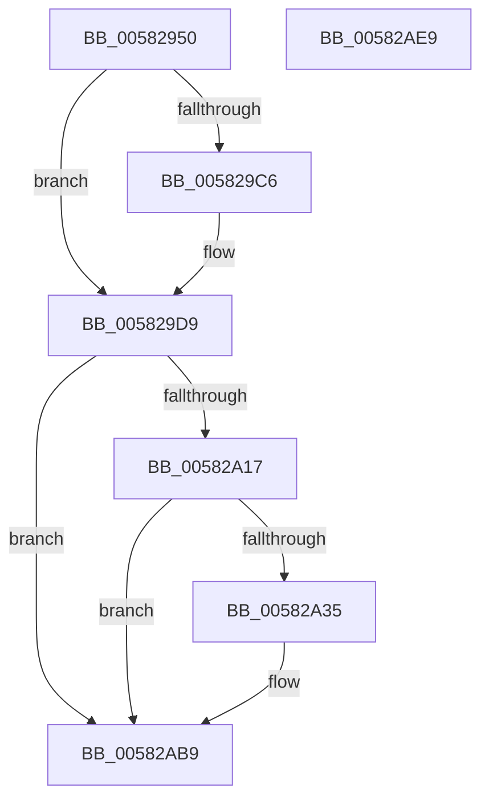

# FsRtlpOplockAckTimeoutWorker

- RVA: `0x00582950`–`0x00582AEA` (길이 `410` bytes)
- VA: `0x0000000140582950`
- 실행 섹션: `.text`
- PDB 이름 있음: `예`; PDB Function 태그: `아니요`
- unwind 정보 RVA: `0x000C5DF4`
- 디코드: `85`개 명령, `410/410` bytes 표시
- 미해석 바이트: `0` (있으면 어셈블리에 `.byte`로 보존)

> 이 문서는 커널 이미지의 기계어와 PDB 기호를 분석해 생성했습니다. 4번과 5번은 함수 원형과 자료형을 바이너리 사용 방식에서 추정한 C 해석이며 원본 소스 복구 결과는 아닙니다.

## 1. Dependencies

- 직접 호출 지점: **10**; 고유 호출 대상: **10**
- 직접 호출자로 확인된 함수: **0**
- RIP 상대 이미지 참조: **5**

### Outgoing calls
- `0x00582982` → [memset](../6C/memset_function_006C6C40.md) (function, `0x006C6C40`)
- `0x005829B5` → [ExAcquireFastMutexUnsafe](../3F/ExAcquireFastMutexUnsafe_function_003F3720.md) (function, `0x003F3720`)
- `0x005829D4` → [FsRtlpOplockCleanup](../42/FsRtlpOplockCleanup_function_00425030.md) (function, `0x00425030`)
- `0x005829E5` → [ObfDereferenceObjectWithTag](../2F/ObfDereferenceObjectWithTag_function_002F78E0.md) (function, `0x002F78E0`)
- `0x00582A00` → [ExReleaseFastMutexUnsafe](../25/ExReleaseFastMutexUnsafe_function_002503A0.md) (function, `0x002503A0`)
- `0x00582A05` → [KeLeaveCriticalRegion](../25/KeLeaveCriticalRegion_function_0025D8B0.md) (function, `0x0025D8B0`)
- `0x00582A28` → [tlgKeywordOn](../42/tlgKeywordOn_function_0042EAA0.md) (function, `0x0042EAA0`)
- `0x00582AB4` → [tlgWriteAgg](../2F/tlgWriteAgg_function_002F0F7C.md) (function, `0x002F0F7C`)
- `0x00582AC3` → [ExFreeToNPagedLookasideList](../38/ExFreeToNPagedLookasideList_function_0038D9D0.md) (function, `0x0038D9D0`)
- `0x00582ACF` → [_security_check_cookie](../6A/_security_check_cookie_function_006AC640.md) (function, `0x006AC640`)

### Direct callers
- 이 함수 시작 RVA로 연결되는 직접 call은 확인되지 않았습니다. 간접 호출은 완전히 역산할 수 없습니다.

### Static image references
- `0x00582967` → RVA `0x00E0A740` (`.data`; read)
- `0x00582A0A` → RVA `0x00E06C50` (`.data`; read)
- `0x00582A61` → RVA `0x00E0A8B0` (`.data`; read)
- `0x00582A8D` → RVA `0x00044093` (`.rdata`; read)
- `0x00582ABC` → RVA `0x00E12280` (`.data`; read)

## 2. Other-region calls and transfers

- 다른 실행 섹션으로 향하는 call: **0**
- 별도 외부 분기/꼬리 이동을 확인하지 못했습니다.

## 3. Assembly (complete function range)

```asm
00582950  48 89 5C 24 10                  mov qword ptr [rsp + 0x10], rbx
00582955  48 89 7C 24 18                  mov qword ptr [rsp + 0x18], rdi
0058295A  55                              push rbp
0058295B  48 8D 6C 24 A9                  lea rbp, [rsp - 0x57]
00582960  48 81 EC C0 00 00 00            sub rsp, 0xc0
00582967  48 8B 05 D2 7D 88 00            mov rax, qword ptr [rip + 0x887dd2]
0058296E  48 33 C4                        xor rax, rsp
00582971  48 89 45 47                     mov qword ptr [rbp + 0x47], rax
00582975  33 D2                           xor edx, edx
00582977  48 8B D9                        mov rbx, rcx
0058297A  48 8D 4D E7                     lea rcx, [rbp - 0x19]
0058297E  44 8D 42 48                     lea r8d, [rdx + 0x48]
00582982  E8 B9 42 14 00                  call 0x1406c6c40
00582987  48 8B 83 A8 00 00 00            mov rax, qword ptr [rbx + 0xa8]
0058298E  48 89 45 17                     mov qword ptr [rbp + 0x17], rax
00582992  65 48 8B 04 25 88 01 00 00      mov rax, qword ptr gs:[0x188]
0058299B  C6 45 E7 12                     mov byte ptr [rbp - 0x19], 0x12
0058299F  66 FF 88 E4 01 00 00            dec word ptr [rax + 0x1e4]
005829A6  90                              nop
005829A7  48 8B 8B A0 00 00 00            mov rcx, qword ptr [rbx + 0xa0]
005829AE  48 8B 89 98 00 00 00            mov rcx, qword ptr [rcx + 0x98]
005829B5  E8 66 0D E7 FF                  call 0x1403f3720
005829BA  40 8A BB B5 00 00 00            mov dil, byte ptr [rbx + 0xb5]
005829C1  40 84 FF                        test dil, dil
005829C4  75 13                           jne 0x1405829d9
005829C6  48 8B 8B A0 00 00 00            mov rcx, qword ptr [rbx + 0xa0]
005829CD  48 8D 55 E7                     lea rdx, [rbp - 0x19]
005829D1  41 B0 01                        mov r8b, 1
005829D4  E8 57 26 EA FF                  call 0x140425030
005829D9  48 8B 8B A8 00 00 00            mov rcx, qword ptr [rbx + 0xa8]
005829E0  BA 44 66 6C 74                  mov edx, 0x746c6644
005829E5  E8 F6 4E D7 FF                  call 0x1402f78e0
005829EA  48 8B 8B A0 00 00 00            mov rcx, qword ptr [rbx + 0xa0]
005829F1  48 83 A3 A8 00 00 00 00         and qword ptr [rbx + 0xa8], 0
005829F9  48 8B 89 98 00 00 00            mov rcx, qword ptr [rcx + 0x98]
00582A00  E8 9B D9 CC FF                  call 0x1402503a0
00582A05  E8 A6 AE CD FF                  call 0x14025d8b0
00582A0A  83 3D 3F 42 88 00 05            cmp dword ptr [rip + 0x88423f], 5
00582A11  0F 86 A2 00 00 00               jbe 0x140582ab9
00582A17  48 BA 00 00 00 00 00 40 00 00   movabs rdx, 0x400000000000
00582A21  48 8D 0D 28 42 88 00            lea rcx, [rip + 0x884228]
00582A28  E8 73 C0 EA FF                  call 0x14042eaa0
00582A2D  84 C0                           test al, al
00582A2F  0F 84 84 00 00 00               je 0x140582ab9
00582A35  83 65 13 00                     and dword ptr [rbp + 0x13], 0
00582A39  48 8D 45 CF                     lea rax, [rbp - 0x31]
00582A3D  83 65 23 00                     and dword ptr [rbp + 0x23], 0
00582A41  48 8D 0D 08 42 88 00            lea rcx, [rip + 0x884208]
00582A48  83 65 33 00                     and dword ptr [rbp + 0x33], 0
00582A4C  BA 08 00 00 00                  mov edx, 8
00582A51  83 65 43 00                     and dword ptr [rbp + 0x43], 0
00582A55  48 89 45 07                     mov qword ptr [rbp + 7], rax
00582A59  48 8D 45 C7                     lea rax, [rbp - 0x39]
00582A5D  48 89 45 17                     mov qword ptr [rbp + 0x17], rax
00582A61  48 8B 05 48 7E 88 00            mov rax, qword ptr [rip + 0x887e48]
00582A68  44 8D 4A FE                     lea r9d, [rdx - 2]
00582A6C  48 89 45 D7                     mov qword ptr [rbp - 0x29], rax
00582A70  48 8D 45 D7                     lea rax, [rbp - 0x29]
00582A74  48 89 45 27                     mov qword ptr [rbp + 0x27], rax
00582A78  48 8D 45 DF                     lea rax, [rbp - 0x21]
00582A7C  48 89 45 37                     mov qword ptr [rbp + 0x37], rax
00582A80  48 8D 45 E7                     lea rax, [rbp - 0x19]
00582A84  89 55 0F                        mov dword ptr [rbp + 0xf], edx
00582A87  89 55 2F                        mov dword ptr [rbp + 0x2f], edx
00582A8A  89 55 3F                        mov dword ptr [rbp + 0x3f], edx
00582A8D  48 8D 15 FF 15 AC FF            lea rdx, [rip - 0x53ea01]
00582A94  48 89 44 24 20                  mov qword ptr [rsp + 0x20], rax
00582A99  48 C7 45 CF 01 00 00 00         mov qword ptr [rbp - 0x31], 1
00582AA1  40 88 7D C7                     mov byte ptr [rbp - 0x39], dil
00582AA5  C7 45 1F 01 00 00 00            mov dword ptr [rbp + 0x1f], 1
00582AAC  48 C7 45 DF 00 00 00 01         mov qword ptr [rbp - 0x21], 0x1000000
00582AB4  E8 C3 E4 D6 FF                  call 0x1402f0f7c
00582AB9  48 8B D3                        mov rdx, rbx
00582ABC  48 8D 0D BD F7 88 00            lea rcx, [rip + 0x88f7bd]
00582AC3  E8 08 AF E0 FF                  call 0x14038d9d0
00582AC8  48 8B 4D 47                     mov rcx, qword ptr [rbp + 0x47]
00582ACC  48 33 CC                        xor rcx, rsp
00582ACF  E8 6C 9B 12 00                  call 0x1406ac640
00582AD4  4C 8D 9C 24 C0 00 00 00         lea r11, [rsp + 0xc0]
00582ADC  49 8B 5B 18                     mov rbx, qword ptr [r11 + 0x18]
00582AE0  49 8B 7B 20                     mov rdi, qword ptr [r11 + 0x20]
00582AE4  49 8B E3                        mov rsp, r11
00582AE7  5D                              pop rbp
00582AE8  C3                              ret
00582AE9  CC                              int3
```

## 4. C-style interpretation (structured pseudocode)

```c
__int64 __fastcall FsRtlpOplockAckTimeoutWorker(__int64 a1, int a2)
{
    __int64 result;
    __int64 v_rsp;
    unsigned __int64 v_stack_m18;
    unsigned int v_stack_m1C;
    unsigned int v_stack_m20;
    unsigned __int64 v_stack_m28;
    unsigned int v_stack_m2C;
    unsigned int v_stack_m30;
    unsigned __int64 v_stack_m38;
    unsigned int v_stack_m3C;
    unsigned int v_stack_m40;
    unsigned __int64 v_stack_m48;
    unsigned int v_stack_m4C;
    unsigned int v_stack_m50;
    unsigned __int64 v_stack_m58;
    unsigned __int64 v_stack_m5F;
    unsigned __int64 v_stack_m78;
    unsigned __int64 v_stack_m8;
    unsigned __int64 v_stack_m80;
    unsigned __int64 v_stack_m88;
    unsigned __int64 v_stack_m90;
    unsigned __int64 v_stack_m98;
    unsigned __int64 v_stack_mA8;
    unsigned __int64 v_stack_p10;
    unsigned __int64 v_stack_p18;

    v_stack_p10 = v_rbx;
    v_stack_p18 = v_rdi;
    v_rsp = (v_rsp) - (192);
    result = (*(unsigned __int64 *)(v_rip + 8945106)) ^ (v_rsp);
    v_stack_m18 = result;
    a2 = 0;
    result = memset(v_stack_m78, a2, a2 + 72, a4);
    v_stack_m48 = *(unsigned __int64 *)(a1 + 168);
    v_stack_m78 = 18;
    result = ExAcquireFastMutexUnsafe(*(unsigned __int64 *)(*(unsigned __int64 *)(a1 + 160) + 152), a2, a2 + 72, a4);
    if ((unsigned __int8)(*(unsigned __int8 *)(a1 + 181)) == 0) {
        a1 = *(unsigned __int64 *)(a1 + 160);
        a2 = v_stack_m78;
        a3 = 1;
        result = FsRtlpOplockCleanup(a1, a2, a3, a4);
    }
    result = ObfDereferenceObjectWithTag(*(unsigned __int64 *)(a1 + 168), (unsigned int)(0x746C6644ULL), a3, a4);
    result = ExReleaseFastMutexUnsafe(*(unsigned __int64 *)(*(unsigned __int64 *)(a1 + 160) + 152), (unsigned int)(0x746C6644ULL), a3, a4);
    result = KeLeaveCriticalRegion(*(unsigned __int64 *)(*(unsigned __int64 *)(a1 + 160) + 152), (unsigned int)(0x746C6644ULL), a3, a4);
    if ((*(unsigned int *)(v_rip + 8929855)) <= 5) goto loc_00582AB9;
    result = tlgKeywordOn(v_rip + 8929832, (unsigned int)(0x746C6644ULL), a3, a4);
    if ((unsigned __int8)(result) != 0) {
        result = v_stack_m90;
        a1 = v_rip + 8929800;
        a2 = 8;
        v_stack_m58 = result;
        result = v_stack_m98;
        v_stack_m48 = result;
        result = *(unsigned __int64 *)(v_rip + 8945224);
        a4 = a2 - 2;
        v_stack_m88 = result;
        result = v_stack_m88;
        v_stack_m38 = result;
        result = v_stack_m80;
        v_stack_m28 = result;
        result = v_stack_m78;
        v_stack_m50 = a2;
        v_stack_m30 = a2;
        v_stack_m20 = a2;
        a2 = v_rip - 5499393;
        v_stack_mA8 = result;
        v_stack_m90 = 1;
        v_stack_m98 = (unsigned __int8)(*(unsigned __int8 *)(a1 + 181));
        v_stack_m40 = 1;
        v_stack_m80 = 0x1000000ULL;
        result = tlgWriteAgg(a1, a2, a3, a4);
    }
    result = ExFreeToNPagedLookasideList(v_rip + 8976317, a1, a3, a4);
    a1 = (v_stack_m18) ^ (v_rsp);
    result = _security_check_cookie(a1, a1, a3, a4);
    return result;
}
```

## 5. (Beta) C Style

```c
int64_t FsRtlpOplockAckTimeoutWorker(void *Arg1, int32_t Arg2)
{
    uint8_t *arg1 = (uint8_t *)Arg1;

    int64_t result;
    int64_t local_rsp;
    uint64_t v_stack_m18;
    uint32_t v_stack_m1C;
    uint32_t v_stack_m20;
    uint64_t v_stack_m28;
    uint32_t v_stack_m2C;
    uint32_t v_stack_m30;
    uint64_t v_stack_m38;
    uint32_t v_stack_m3C;
    uint32_t v_stack_m40;
    uint64_t v_stack_m48;
    uint32_t v_stack_m4C;
    uint32_t v_stack_m50;
    uint64_t v_stack_m58;
    uint64_t v_stack_m5F;
    uint64_t v_stack_m78;
    uint64_t v_stack_m8;
    uint64_t v_stack_m80;
    uint64_t v_stack_m88;
    uint64_t v_stack_m90;
    uint64_t v_stack_m98;
    uint64_t v_stack_mA8;
    uint64_t v_stack_p10;
    uint64_t v_stack_p18;

    v_stack_p10 = local_rbx;
    v_stack_p18 = local_rdi;
    local_rsp = (local_rsp) - (192);
    result = (*(uint64_t *)(v_rip + 0x887DD2)) ^ (local_rsp);
    v_stack_m18 = result;
    Arg2 = 0;
    result = memset(v_stack_m78, Arg2, Arg2 + 72, a4);
    v_stack_m48 = *(uint64_t *)(arg1 + 0xA8);
    v_stack_m78 = 18;
    result = ExAcquireFastMutexUnsafe(*(uint64_t *)(*(uint64_t *)(arg1 + 0xA0) + 0x98), Arg2, Arg2 + 72, a4);
    if ((uint8_t)(*(uint8_t *)(arg1 + 0xB5)) == 0) {
        Arg1 = *(uint64_t *)(arg1 + 0xA0);
        Arg2 = v_stack_m78;
        a3 = 1;
        result = FsRtlpOplockCleanup(Arg1, Arg2, a3, a4);
    }
    result = ObfDereferenceObjectWithTag(*(uint64_t *)(arg1 + 0xA8), (uint32_t)(0x746C6644ULL), a3, a4);
    result = ExReleaseFastMutexUnsafe(*(uint64_t *)(*(uint64_t *)(arg1 + 0xA0) + 0x98), (uint32_t)(0x746C6644ULL), a3, a4);
    result = KeLeaveCriticalRegion(*(uint64_t *)(*(uint64_t *)(arg1 + 0xA0) + 0x98), (uint32_t)(0x746C6644ULL), a3, a4);
    if ((*(uint32_t *)(v_rip + 0x88423F)) <= 5) goto loc_00582AB9;
    result = tlgKeywordOn(v_rip + 8929832, (uint32_t)(0x746C6644ULL), a3, a4);
    if ((uint8_t)(result) != 0) {
        result = v_stack_m90;
        Arg1 = v_rip + 8929800;
        Arg2 = 8;
        v_stack_m58 = result;
        result = v_stack_m98;
        v_stack_m48 = result;
        result = *(uint64_t *)(v_rip + 0x887E48);
        a4 = Arg2 - 2;
        v_stack_m88 = result;
        result = v_stack_m88;
        v_stack_m38 = result;
        result = v_stack_m80;
        v_stack_m28 = result;
        result = v_stack_m78;
        v_stack_m50 = Arg2;
        v_stack_m30 = Arg2;
        v_stack_m20 = Arg2;
        Arg2 = v_rip - 5499393;
        v_stack_mA8 = result;
        v_stack_m90 = 1;
        v_stack_m98 = (uint8_t)(*(uint8_t *)(arg1 + 0xB5));
        v_stack_m40 = 1;
        v_stack_m80 = 0x1000000ULL;
        result = tlgWriteAgg(Arg1, Arg2, a3, a4);
    }
    result = ExFreeToNPagedLookasideList(v_rip + 8976317, Arg1, a3, a4);
    Arg1 = (v_stack_m18) ^ (local_rsp);
    result = _security_check_cookie(Arg1, Arg1, a3, a4);
    return result;
}
```

### 관측된 메모리 오프셋

구조체 형식이 확인되지 않은 접근은 인자 기준의 오프셋으로만 기록했습니다.

| 기준 인자 | 오프셋 표현 | 폭 (bit) | 접근 |
|---|---:|---:|---|
| `Arg1` | `+ 0xA0` | `64` | `R` |
| `Arg1` | `+ 0xA8` | `64` | `R` |
| `Arg1` | `+ 0xA8` | `64` | `R/W` |
| `Arg1` | `+ 0xB5` | `8` | `R` |

## 6. Execution-region graph

[열기: 2D/3D 그래프와 함수 탐색 컨트롤 패널](../../../control-panel.html?section=text&rva=0x00582950&view=graph)

- 2D 그래프는 위에서 아래로 흐르고, 3D 그래프는 빈 공간을 드래그해 회전합니다. Shift+드래그는 이동, 휠은 확대·축소, 함수 노드 선택은 대상 보고서 이동입니다.

### Static fallback


