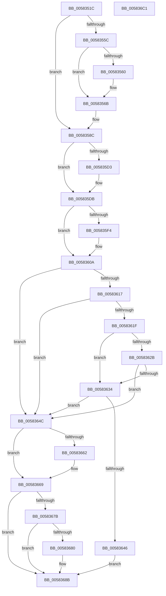

# FsRtlpPostStackOverflow

- RVA: `0x0058351C`–`0x005836C2` (길이 `422` bytes)
- VA: `0x000000014058351C`
- 실행 섹션: `.text`
- PDB 이름 있음: `예`; PDB Function 태그: `아니요`
- unwind 정보 RVA: `0x00084C9C`
- 디코드: `114`개 명령, `422/422` bytes 표시
- 미해석 바이트: `0` (있으면 어셈블리에 `.byte`로 보존)

> 이 문서는 커널 이미지의 기계어와 PDB 기호를 분석해 생성했습니다. 4번과 5번은 함수 원형과 자료형을 바이너리 사용 방식에서 추정한 C 해석이며 원본 소스 복구 결과는 아닙니다.

## 1. Dependencies

- 직접 호출 지점: **10**; 고유 호출 대상: **10**
- 직접 호출자로 확인된 함수: **2**
- RIP 상대 이미지 참조: **6**

### Outgoing calls
- `0x0058354F` → [ExAllocatePool2](../../poolcode/B8/ExAllocatePool2_function_00B820F0.md) (function, `0x00B820F0`)
- `0x00583565` → [RtlRaiseStatus](../2F/RtlRaiseStatus_function_002F6A50.md) (function, `0x002F6A50`)
- `0x00583580` → [KeWaitForSingleObject](../20/KeWaitForSingleObject_function_0020E6B0.md) (function, `0x0020E6B0`)
- `0x005835D6` → [KiRaiseIrqlProcessIrqlFlags](../4F/KiRaiseIrqlProcessIrqlFlags_function_004F56FC.md) (function, `0x004F56FC`)
- `0x005835F7` → [KeIsThreadRunning](../39/KeIsThreadRunning_function_00396720.md) (function, `0x00396720`)
- `0x00583605` → [EtwTraceEnqueueWork](../39/EtwTraceEnqueueWork_function_0039674C.md) (function, `0x0039674C`)
- `0x0058360D` → [KiAcquireKobjectLockSafe](../25/KiAcquireKobjectLockSafe_function_00251C90.md) (function, `0x00251C90`)
- `0x0058363D` → [KiWakeQueueWaiter](../34/KiWakeQueueWaiter_function_00344C10.md) (function, `0x00344C10`)
- `0x00583686` → [KiWakeOtherQueueWaiters](../39/KiWakeOtherQueueWaiters_function_003964D0.md) (function, `0x003964D0`)
- `0x005836A3` → [KiExitDispatcher](../25/KiExitDispatcher_function_00251CF0.md) (function, `0x00251CF0`)

### Direct callers
- [FsRtlPostPagingFileStackOverflow](FsRtlPostPagingFileStackOverflow_function_005833C0.md) at `0x005833C7`
- [FsRtlPostStackOverflow](FsRtlPostStackOverflow_function_005833E0.md) at `0x005833E7`

### Static image references
- `0x00583571` → RVA `0x00F8EEC0` (`.data`; read)
- `0x00583585` → RVA `0x00F8EEE0` (`.data`; read)
- `0x00583590` → RVA `0x00583400` (`FsRtlStackOverflowRead`; read)
- `0x005835A7` → RVA `0x00F8EE40` (`.data`; read)
- `0x005835CA` → RVA `0x00FC6D20` (`ALMOSTRO`; read)
- `0x005835E4` → RVA `0x00FC6B04` (`ALMOSTRO`; read)

## 2. Other-region calls and transfers

- 다른 실행 섹션으로 향하는 call: **1**
  - `0x0058354F` → [ExAllocatePool2](../../poolcode/B8/ExAllocatePool2_function_00B820F0.md) (`.text` → `POOLCODE`)
- 별도 외부 분기/꼬리 이동을 확인하지 못했습니다.

## 3. Assembly (complete function range)

```asm
0058351C  48 89 5C 24 08                  mov qword ptr [rsp + 8], rbx
00583521  48 89 6C 24 10                  mov qword ptr [rsp + 0x10], rbp
00583526  48 89 74 24 18                  mov qword ptr [rsp + 0x18], rsi
0058352B  57                              push rdi
0058352C  41 56                           push r14
0058352E  41 57                           push r15
00583530  48 83 EC 30                     sub rsp, 0x30
00583534  48 8B EA                        mov rbp, rdx
00583537  41 0F B6 D9                     movzx ebx, r9b
0058353B  BA 38 00 00 00                  mov edx, 0x38
00583540  49 8B F0                        mov rsi, r8
00583543  4C 8B F1                        mov r14, rcx
00583546  41 B8 46 53 72 73               mov r8d, 0x73725346
0058354C  8D 4A 0A                        lea ecx, [rdx + 0xa]
0058354F  E8 9C EB 5F 00                  call 0x140b820f0
00583554  48 8B F8                        mov rdi, rax
00583557  48 85 C0                        test rax, rax
0058355A  75 30                           jne 0x14058358c
0058355C  84 DB                           test bl, bl
0058355E  75 0B                           jne 0x14058356b
00583560  B9 9A 00 00 C0                  mov ecx, 0xc000009a
00583565  E8 E6 34 D7 FF                  call 0x1402f6a50
0058356A  CC                              int3
0058356B  48 83 64 24 20 00               and qword ptr [rsp + 0x20], 0
00583571  48 8D 0D 48 B9 A0 00            lea rcx, [rip + 0xa0b948]
00583578  45 33 C9                        xor r9d, r9d
0058357B  45 33 C0                        xor r8d, r8d
0058357E  33 D2                           xor edx, edx
00583580  E8 2B B1 C8 FF                  call 0x14020e6b0
00583585  48 8D 3D 54 B9 A0 00            lea rdi, [rip + 0xa0b954]
0058358C  4C 89 77 28                     mov qword ptr [rdi + 0x28], r14
00583590  48 8D 05 69 FE FF FF            lea rax, [rip - 0x197]
00583597  48 89 6F 30                     mov qword ptr [rdi + 0x30], rbp
0058359B  48 89 77 20                     mov qword ptr [rdi + 0x20], rsi
0058359F  48 83 27 00                     and qword ptr [rdi], 0
005835A3  48 89 47 10                     mov qword ptr [rdi + 0x10], rax
005835A7  48 8D 05 92 B8 A0 00            lea rax, [rip + 0xa0b892]
005835AE  48 C1 E3 06                     shl rbx, 6
005835B2  48 03 D8                        add rbx, rax
005835B5  48 89 7F 18                     mov qword ptr [rdi + 0x18], rdi
005835B9  4C 8D 73 08                     lea r14, [rbx + 8]
005835BD  45 0F 20 C7                     mov r15, cr8
005835C1  BA 02 00 00 00                  mov edx, 2
005835C6  44 0F 22 C2                     mov cr8, rdx
005835CA  83 3D 4F 37 A4 00 00            cmp dword ptr [rip + 0xa4374f], 0
005835D1  74 08                           je 0x1405835db
005835D3  41 8A CF                        mov cl, r15b
005835D6  E8 21 21 F7 FF                  call 0x1404f56fc
005835DB  65 48 8B 34 25 20 00 00 00      mov rsi, qword ptr gs:[0x20]
005835E4  F7 05 16 35 A4 00 00 00 00 01   test dword ptr [rip + 0xa43516], 0x1000000
005835EE  48 8B 6E 08                     mov rbp, qword ptr [rsi + 8]
005835F2  74 16                           je 0x14058360a
005835F4  48 8B CD                        mov rcx, rbp
005835F7  E8 24 31 E1 FF                  call 0x140396720
005835FC  44 8A C0                        mov r8b, al
005835FF  48 8B CD                        mov rcx, rbp
00583602  48 8B D7                        mov rdx, rdi
00583605  E8 42 31 E1 FF                  call 0x14039674c
0058360A  48 8B CB                        mov rcx, rbx
0058360D  E8 7E E6 CC FF                  call 0x140251c90
00583612  4D 39 36                        cmp qword ptr [r14], r14
00583615  74 35                           je 0x14058364c
00583617  8B 43 28                        mov eax, dword ptr [rbx + 0x28]
0058361A  3B 43 2C                        cmp eax, dword ptr [rbx + 0x2c]
0058361D  73 2D                           jae 0x14058364c
0058361F  48 8B 85 E8 00 00 00            mov rax, qword ptr [rbp + 0xe8]
00583626  48 3B C3                        cmp rax, rbx
00583629  75 09                           jne 0x140583634
0058362B  80 BD 83 02 00 00 0F            cmp byte ptr [rbp + 0x283], 0xf
00583632  74 18                           je 0x14058364c
00583634  4C 8B C7                        mov r8, rdi
00583637  48 8B D3                        mov rdx, rbx
0058363A  48 8B CE                        mov rcx, rsi
0058363D  E8 CE 15 DC FF                  call 0x140344c10
00583642  84 C0                           test al, al
00583644  74 06                           je 0x14058364c
00583646  48 83 27 00                     and qword ptr [rdi], 0
0058364A  EB 3F                           jmp 0x14058368b
0058364C  8B 53 04                        mov edx, dword ptr [rbx + 4]
0058364F  8D 42 01                        lea eax, [rdx + 1]
00583652  89 43 04                        mov dword ptr [rbx + 4], eax
00583655  48 8D 43 18                     lea rax, [rbx + 0x18]
00583659  48 8B 48 08                     mov rcx, qword ptr [rax + 8]
0058365D  48 39 01                        cmp qword ptr [rcx], rax
00583660  74 07                           je 0x140583669
00583662  B9 03 00 00 00                  mov ecx, 3
00583667  CD 29                           int 0x29
00583669  48 89 07                        mov qword ptr [rdi], rax
0058366C  48 89 4F 08                     mov qword ptr [rdi + 8], rcx
00583670  48 89 39                        mov qword ptr [rcx], rdi
00583673  48 89 78 08                     mov qword ptr [rax + 8], rdi
00583677  85 D2                           test edx, edx
00583679  75 10                           jne 0x14058368b
0058367B  4D 39 36                        cmp qword ptr [r14], r14
0058367E  74 0B                           je 0x14058368b
00583680  48 8B D3                        mov rdx, rbx
00583683  48 8B CE                        mov rcx, rsi
00583686  E8 45 2E E1 FF                  call 0x1403964d0
0058368B  F0 81 23 7F FF FF FF            lock and dword ptr [rbx], 0xffffff7f
00583692  45 33 C9                        xor r9d, r9d
00583695  44 88 7C 24 20                  mov byte ptr [rsp + 0x20], r15b
0058369A  33 D2                           xor edx, edx
0058369C  48 8B CE                        mov rcx, rsi
0058369F  45 8D 41 01                     lea r8d, [r9 + 1]
005836A3  E8 48 E6 CC FF                  call 0x140251cf0
005836A8  48 8B 5C 24 50                  mov rbx, qword ptr [rsp + 0x50]
005836AD  48 8B 6C 24 58                  mov rbp, qword ptr [rsp + 0x58]
005836B2  48 8B 74 24 60                  mov rsi, qword ptr [rsp + 0x60]
005836B7  48 83 C4 30                     add rsp, 0x30
005836BB  41 5F                           pop r15
005836BD  41 5E                           pop r14
005836BF  5F                              pop rdi
005836C0  C3                              ret
005836C1  CC                              int3
```

## 4. C-style interpretation (structured pseudocode)

```c
__int64 __fastcall FsRtlpPostStackOverflow(__int64 a1, __int64 a2, __int64 a3, int a4)
{
    __int64 result;
    __int64 v_rbx;
    __int64 v_rsp;
    unsigned __int64 v_stack_m28;
    unsigned __int64 v_stack_p10;
    unsigned __int64 v_stack_p18;
    unsigned __int64 v_stack_p8;

    v_stack_p8 = v_rbx;
    v_stack_p10 = v_rbp;
    v_stack_p18 = v_rsi;
    v_rsp = (v_rsp) - (48);
    result = ExAllocatePool2(56 + 10, 56, (unsigned int)(0x73725346ULL), a4);
    if (result != 0) goto loc_0058358C;
    if ((unsigned __int8)((unsigned __int8)(a4)) == 0) {
        a1 = 0xC000009AULL;
        result = RtlRaiseStatus(a1, 56, (unsigned int)(0x73725346ULL), a4);
    }
    a4 = 0;
    a3 = 0;
    a2 = 0;
    result = KeWaitForSingleObject(v_rip + 10533192, a2, a3, a4);
loc_0058358C:
    *(unsigned __int64 *)(v_rip + 10533204 + 40) = a1;
    *(unsigned __int64 *)(v_rip + 10533204 + 48) = 0;
    *(unsigned __int64 *)(v_rip + 10533204 + 32) = 0;
    *(unsigned __int64 *)(v_rip + 10533204 + 16) = v_rip - 407;
    v_rbx = ((unsigned __int8)(a4)) << (6);
    v_rbx = (v_rbx) + (v_rip + 10533010);
    *(unsigned __int64 *)(v_rip + 10533204 + 24) = v_rip + 10533204;
    result = v_rip + 10533010;
    if ((*(unsigned int *)(v_rip + 10762063)) != 0) {
        a1 = (unsigned __int8)(v_cr8);
        result = KiRaiseIrqlProcessIrqlFlags(a1, 2, a3, a4);
    }
    if (((*(unsigned int *)(v_rip + 10761494)) & (0x1000000ULL)) != 0) {
        a1 = *(unsigned __int64 *)(*(unsigned __int64 *)(gs_base + (0 + 32)) + 8);
        result = KeIsThreadRunning(a1, 2, a3, a4);
        a3 = (unsigned __int8)(result);
        a1 = *(unsigned __int64 *)(*(unsigned __int64 *)(gs_base + (0 + 32)) + 8);
        a2 = v_rip + 10533204;
        result = EtwTraceEnqueueWork(a1, a2, a3, a4);
    }
    result = KiAcquireKobjectLockSafe(v_rbx, a2, a3, a4);
    if ((*(unsigned __int64 *)(v_rbx + 8)) == (v_rbx + 8)) goto loc_0058364C;
    if (((unsigned int)((unsigned int)(*(unsigned int *)(v_rbx + 40)))) >= (*(unsigned int *)(v_rbx + 44))) goto loc_0058364C;
    if ((*(unsigned __int64 *)(*(unsigned __int64 *)(*(unsigned __int64 *)(gs_base + (0 + 32)) + 8) + 232)) != v_rbx) goto loc_00583634;
    if ((*(unsigned __int8 *)(*(unsigned __int64 *)(*(unsigned __int64 *)(gs_base + (0 + 32)) + 8) + 643)) == 15) goto loc_0058364C;
loc_00583634:
    result = KiWakeQueueWaiter(*(unsigned __int64 *)(gs_base + (0 + 32)), v_rbx, v_rip + 10533204, a4);
    if ((unsigned __int8)(result) == 0) goto loc_0058364C;
    goto loc_0058368B;
loc_0058364C:
    *(unsigned int *)(v_rbx + 4) = (unsigned int)((unsigned int)(*(unsigned int *)(v_rbx + 4)) + 1);
    if ((*(unsigned __int64 *)(*(unsigned __int64 *)(v_rbx + 24 + 8))) != (v_rbx + 24)) {
        a1 = 3;
    }
    *(unsigned __int64 *)(v_rip + 10533204) = v_rbx + 24;
    *(unsigned __int64 *)(v_rip + 10533204 + 8) = a1;
    *(unsigned __int64 *)(a1) = v_rip + 10533204;
    *(unsigned __int64 *)(v_rbx + 24 + 8) = v_rip + 10533204;
    if ((unsigned int)((unsigned int)(*(unsigned int *)(v_rbx + 4))) != 0) goto loc_0058368B;
    result = v_rbx + 24;
    if ((*(unsigned __int64 *)(v_rbx + 8)) != (v_rbx + 8)) {
        a2 = v_rbx;
        a1 = *(unsigned __int64 *)(gs_base + (0 + 32));
        result = KiWakeOtherQueueWaiters(a1, a2, v_rip + 10533204, a4);
    }
    a4 = 0;
    v_stack_m28 = (unsigned __int8)(v_cr8);
    a2 = 0;
    result = KiExitDispatcher(*(unsigned __int64 *)(gs_base + (0 + 32)), a2, a4 + 1, a4);
    v_rsp = (v_rsp) + (48);
    return result;
}
```

## 5. (Beta) C Style

```c
int64_t FsRtlpPostStackOverflow(int64_t Arg1, int64_t Arg2, int64_t Arg3, int32_t Arg4)
{
    int64_t result;
    int64_t local_rbx;
    int64_t local_rsp;
    uint64_t v_stack_m28;
    uint64_t v_stack_p10;
    uint64_t v_stack_p18;
    uint64_t v_stack_p8;

    v_stack_p8 = local_rbx;
    v_stack_p10 = local_rbp;
    v_stack_p18 = local_rsi;
    local_rsp = (local_rsp) - (48);
    result = ExAllocatePool2(56 + 10, 56, (uint32_t)(0x73725346ULL), Arg4);
    if (result != 0) goto loc_0058358C;
    if ((uint8_t)((uint8_t)(Arg4)) == 0) {
        Arg1 = 0xC000009AULL;
        result = RtlRaiseStatus(Arg1, 56, (uint32_t)(0x73725346ULL), Arg4);
    }
    Arg4 = 0;
    Arg3 = 0;
    Arg2 = 0;
    result = KeWaitForSingleObject(v_rip + 10533192, Arg2, Arg3, Arg4);
loc_0058358C:
    *(uint64_t *)(v_rip + 0xA0B954 + 0x28) = Arg1;
    *(uint64_t *)(v_rip + 0xA0B954 + 0x30) = 0;
    *(uint64_t *)(v_rip + 0xA0B954 + 0x20) = 0;
    *(uint64_t *)(v_rip + 0xA0B954 + 0x10) = v_rip - 407;
    local_rbx = ((uint8_t)(Arg4)) << (6);
    local_rbx = (local_rbx) + (v_rip + 10533010);
    *(uint64_t *)(v_rip + 0xA0B954 + 0x18) = v_rip + 10533204;
    result = v_rip + 10533010;
    if ((*(uint32_t *)(v_rip + 0xA4374F)) != 0) {
        Arg1 = (uint8_t)(v_cr8);
        result = KiRaiseIrqlProcessIrqlFlags(Arg1, 2, Arg3, Arg4);
    }
    if (((*(uint32_t *)(v_rip + 0xA43516)) & (0x1000000ULL)) != 0) {
        Arg1 = *(uint64_t *)(*(uint64_t *)(gs_base + (0 + 0x20)) + 0x8);
        result = KeIsThreadRunning(Arg1, 2, Arg3, Arg4);
        Arg3 = (uint8_t)(result);
        Arg1 = *(uint64_t *)(*(uint64_t *)(gs_base + (0 + 0x20)) + 0x8);
        Arg2 = v_rip + 10533204;
        result = EtwTraceEnqueueWork(Arg1, Arg2, Arg3, Arg4);
    }
    result = KiAcquireKobjectLockSafe(local_rbx, Arg2, Arg3, Arg4);
    if ((*(uint64_t *)(local_rbx + 0x8)) == (local_rbx + 8)) goto loc_0058364C;
    if (((uint32_t)((uint32_t)(*(uint32_t *)(local_rbx + 0x28)))) >= (*(uint32_t *)(local_rbx + 0x2C))) goto loc_0058364C;
    if ((*(uint64_t *)(*(uint64_t *)(*(uint64_t *)(gs_base + (0 + 0x20)) + 0x8) + 0xE8)) != local_rbx) goto loc_00583634;
    if ((*(uint8_t *)(*(uint64_t *)(*(uint64_t *)(gs_base + (0 + 0x20)) + 0x8) + 0x283)) == 15) goto loc_0058364C;
loc_00583634:
    result = KiWakeQueueWaiter(*(uint64_t *)(gs_base + (0 + 0x20)), local_rbx, v_rip + 10533204, Arg4);
    if ((uint8_t)(result) == 0) goto loc_0058364C;
    goto loc_0058368B;
loc_0058364C:
    *(uint32_t *)(local_rbx + 0x4) = (uint32_t)((uint32_t)(*(uint32_t *)(local_rbx + 0x4)) + 1);
    if ((*(uint64_t *)(*(uint64_t *)(local_rbx + 0x18 + 0x8))) != (local_rbx + 24)) {
        Arg1 = 3;
    }
    *(uint64_t *)(v_rip + 0xA0B954) = local_rbx + 24;
    *(uint64_t *)(v_rip + 0xA0B954 + 0x8) = Arg1;
    *(uint64_t *)(Arg1) = v_rip + 10533204;
    *(uint64_t *)(local_rbx + 0x18 + 0x8) = v_rip + 10533204;
    if ((uint32_t)((uint32_t)(*(uint32_t *)(local_rbx + 0x4))) != 0) goto loc_0058368B;
    result = local_rbx + 24;
    if ((*(uint64_t *)(local_rbx + 0x8)) != (local_rbx + 8)) {
        Arg2 = local_rbx;
        Arg1 = *(uint64_t *)(gs_base + (0 + 0x20));
        result = KiWakeOtherQueueWaiters(Arg1, Arg2, v_rip + 10533204, Arg4);
    }
    Arg4 = 0;
    v_stack_m28 = (uint8_t)(v_cr8);
    Arg2 = 0;
    result = KiExitDispatcher(*(uint64_t *)(gs_base + (0 + 0x20)), Arg2, Arg4 + 1, Arg4);
    local_rsp = (local_rsp) + (48);
    return result;
}
```

## 6. Execution-region graph

[열기: 2D/3D 그래프와 함수 탐색 컨트롤 패널](../../../control-panel.html?section=text&rva=0x0058351C&view=graph)

- 2D 그래프는 위에서 아래로 흐르고, 3D 그래프는 빈 공간을 드래그해 회전합니다. Shift+드래그는 이동, 휠은 확대·축소, 함수 노드 선택은 대상 보고서 이동입니다.

### Static fallback


