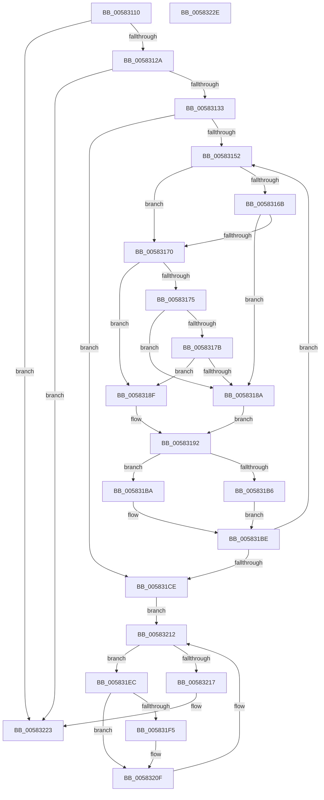

# FsRtlpTieringHeatEventsControlCallbackV2

- RVA: `0x00583110`–`0x0058322F` (길이 `287` bytes)
- VA: `0x0000000140583110`
- 실행 섹션: `.text`
- PDB 이름 있음: `예`; PDB Function 태그: `아니요`
- unwind 정보 RVA: `0x000C6200`
- 디코드: `82`개 명령, `287/287` bytes 표시
- 미해석 바이트: `0` (있으면 어셈블리에 `.byte`로 보존)

> 이 문서는 커널 이미지의 기계어와 PDB 기호를 분석해 생성했습니다. 4번과 5번은 함수 원형과 자료형을 바이너리 사용 방식에서 추정한 C 해석이며 원본 소스 복구 결과는 아닙니다.

## 1. Dependencies

- 직접 호출 지점: **3**; 고유 호출 대상: **3**
- 직접 호출자로 확인된 함수: **0**
- RIP 상대 이미지 참조: **4**

### Outgoing calls
- `0x005831D7` → [ExAcquireResourceSharedLite](../21/ExAcquireResourceSharedLite_function_00211BC0.md) (function, `0x00211BC0`)
- `0x0058320A` → [McTemplateK0jq_EtwWriteTransfer](McTemplateK0jq_EtwWriteTransfer_function_00583238.md) (function, `0x00583238`)
- `0x0058321E` → [ExReleaseResourceLite](../25/ExReleaseResourceLite_function_0025FA10.md) (function, `0x0025FA10`)

### Direct callers
- 이 함수 시작 RVA로 연결되는 직접 call은 확인되지 않았습니다. 간접 호출은 완전히 역산할 수 없습니다.

### Static image references
- `0x005831D0` → RVA `0x00F8EF30` (`.data`; read)
- `0x005831DC` → RVA `0x00F8EF20` (`.data`; read)
- `0x005831EC` → RVA `0x00F8EF18` (`.data`; read)
- `0x00583203` → RVA `0x00E06CE0` (`.data`; read)

## 2. Other-region calls and transfers

- 다른 실행 섹션으로 향하는 call: **0**
- 별도 외부 분기/꼬리 이동을 확인하지 못했습니다.

## 3. Assembly (complete function range)

```asm
00583110  48 89 5C 24 08                  mov qword ptr [rsp + 8], rbx
00583115  56                              push rsi
00583116  48 83 EC 30                     sub rsp, 0x30
0058311A  4C 8B 54 24 70                  mov r10, qword ptr [rsp + 0x70]
0058311F  33 DB                           xor ebx, ebx
00583121  4D 85 D2                        test r10, r10
00583124  0F 84 F9 00 00 00               je 0x140583223
0058312A  83 FA 01                        cmp edx, 1
0058312D  0F 85 F0 00 00 00               jne 0x140583223
00583133  48 8B 44 24 60                  mov rax, qword ptr [rsp + 0x60]
00583138  45 88 42 28                     mov byte ptr [r10 + 0x28], r8b
0058313C  44 8B C3                        mov r8d, ebx
0058313F  49 89 42 18                     mov qword ptr [r10 + 0x18], rax
00583143  4D 89 4A 10                     mov qword ptr [r10 + 0x10], r9
00583147  41 89 52 24                     mov dword ptr [r10 + 0x24], edx
0058314B  66 41 3B 5A 2A                  cmp bx, word ptr [r10 + 0x2a]
00583150  73 7C                           jae 0x1405831ce
00583152  49 8B 42 38                     mov rax, qword ptr [r10 + 0x38]
00583156  45 8A 4A 28                     mov r9b, byte ptr [r10 + 0x28]
0058315A  41 8B C8                        mov ecx, r8d
0058315D  48 8B 14 C8                     mov rdx, qword ptr [rax + rcx*8]
00583161  49 8B 42 40                     mov rax, qword ptr [r10 + 0x40]
00583165  44 38 0C 01                     cmp byte ptr [rcx + rax], r9b
00583169  76 05                           jbe 0x140583170
0058316B  45 84 C9                        test r9b, r9b
0058316E  75 1A                           jne 0x14058318a
00583170  48 85 D2                        test rdx, rdx
00583173  74 1A                           je 0x14058318f
00583175  49 85 52 10                     test qword ptr [r10 + 0x10], rdx
00583179  74 0F                           je 0x14058318a
0058317B  49 8B 4A 18                     mov rcx, qword ptr [r10 + 0x18]
0058317F  48 8B C1                        mov rax, rcx
00583182  48 23 C2                        and rax, rdx
00583185  48 3B C1                        cmp rax, rcx
00583188  74 05                           je 0x14058318f
0058318A  44 8A CB                        mov r9b, bl
0058318D  EB 03                           jmp 0x140583192
0058318F  41 B1 01                        mov r9b, 1
00583192  49 8B 42 30                     mov rax, qword ptr [r10 + 0x30]
00583196  41 8B C8                        mov ecx, r8d
00583199  83 E1 1F                        and ecx, 0x1f
0058319C  BA 01 00 00 00                  mov edx, 1
005831A1  D3 E2                           shl edx, cl
005831A3  41 8B C8                        mov ecx, r8d
005831A6  48 C1 E9 05                     shr rcx, 5
005831AA  4C 8D 1C 88                     lea r11, [rax + rcx*4]
005831AE  41 8B 03                        mov eax, dword ptr [r11]
005831B1  45 84 C9                        test r9b, r9b
005831B4  74 04                           je 0x1405831ba
005831B6  0B D0                           or edx, eax
005831B8  EB 04                           jmp 0x1405831be
005831BA  F7 D2                           not edx
005831BC  23 D0                           and edx, eax
005831BE  41 89 13                        mov dword ptr [r11], edx
005831C1  41 FF C0                        inc r8d
005831C4  41 0F B7 42 2A                  movzx eax, word ptr [r10 + 0x2a]
005831C9  44 3B C0                        cmp r8d, eax
005831CC  72 84                           jb 0x140583152
005831CE  B2 01                           mov dl, 1
005831D0  48 8D 0D 59 BD A0 00            lea rcx, [rip + 0xa0bd59]
005831D7  E8 E4 E9 C8 FF                  call 0x140211bc0
005831DC  48 8B 1D 3D BD A0 00            mov rbx, qword ptr [rip + 0xa0bd3d]
005831E3  48 8D 35 36 BD A0 00            lea rsi, [rip + 0xa0bd36]
005831EA  EB 26                           jmp 0x140583212
005831EC  F6 05 25 BD A0 00 01            test byte ptr [rip + 0xa0bd25], 1
005831F3  74 1A                           je 0x14058320f
005831F5  8B 43 24                        mov eax, dword ptr [rbx + 0x24]
005831F8  4C 8D 4B 14                     lea r9, [rbx + 0x14]
005831FC  45 33 C0                        xor r8d, r8d
005831FF  89 44 24 20                     mov dword ptr [rsp + 0x20], eax
00583203  48 8D 0D D6 3A 88 00            lea rcx, [rip + 0x883ad6]
0058320A  E8 29 00 00 00                  call 0x140583238
0058320F  48 8B 1B                        mov rbx, qword ptr [rbx]
00583212  48 3B DE                        cmp rbx, rsi
00583215  75 D5                           jne 0x1405831ec
00583217  48 8D 0D 12 BD A0 00            lea rcx, [rip + 0xa0bd12]
0058321E  E8 ED C7 CD FF                  call 0x14025fa10
00583223  48 8B 5C 24 40                  mov rbx, qword ptr [rsp + 0x40]
00583228  48 83 C4 30                     add rsp, 0x30
0058322C  5E                              pop rsi
0058322D  C3                              ret
0058322E  CC                              int3
```

## 4. C-style interpretation (structured pseudocode)

```c
__int64 __fastcall FsRtlpTieringHeatEventsControlCallbackV2(__int64 a1, int a2, unsigned __int8 a3, __int64 a4, __int64 a5, __int64 a6, __int64 a7)
{
    __int64 result;
    __int64 v_rbx;
    __int64 v_rsp;
    unsigned int v_stack_m18;
    unsigned __int64 v_stack_p8;

    v_stack_p8 = v_rbx;
    v_rsp = (v_rsp) - (48);
    v_rbx = 0;
    if (a7 == 0) goto loc_00583223;
    if (a2 != 1) goto loc_00583223;
    *(unsigned __int8 *)(a7 + 40) = a3;
    *(unsigned __int64 *)(a7 + 24) = a5;
    *(unsigned __int64 *)(a7 + 16) = a4;
    *(unsigned int *)(a7 + 36) = a2;
    if (0 >= (*(unsigned __int16 *)(a7 + 42))) goto loc_005831CE;
loc_00583152:
    if ((*(unsigned __int8 *)(0 + *(unsigned __int64 *)(a7 + 64) * 1)) <= ((unsigned __int8)(*(unsigned __int8 *)(a7 + 40)))) goto loc_00583170;
    if ((unsigned __int8)(*(unsigned __int8 *)(a7 + 40)) != 0) goto loc_0058318A;
loc_00583170:
    if (*(unsigned __int64 *)(*(unsigned __int64 *)(a7 + 56) + 0 * 8) == 0) goto loc_0058318F;
    if (((*(unsigned __int64 *)(a7 + 16)) & (*(unsigned __int64 *)(*(unsigned __int64 *)(a7 + 56) + 0 * 8))) == 0) goto loc_0058318A;
    result = (*(unsigned __int64 *)(a7 + 24)) & (*(unsigned __int64 *)(*(unsigned __int64 *)(a7 + 56) + 0 * 8));
    if (result == (*(unsigned __int64 *)(a7 + 24))) goto loc_0058318F;
loc_0058318A:
    goto loc_00583192;
loc_0058318F:
loc_00583192:
    a1 = (unsigned int)((0) & (31));
    a2 = (unsigned int)((1) << ((unsigned __int8)(a1)));
    a1 = (0) >> (5);
    if (1 == 0) goto loc_005831BA;
    a2 = (unsigned int)((a2) | ((unsigned int)((unsigned int)(*(unsigned int *)(*(unsigned __int64 *)(a7 + 48) + a1 * 4)))));
    goto loc_005831BE;
loc_005831BA:
    a2 = (unsigned int)(~(a2));
    a2 = (unsigned int)((a2) & ((unsigned int)((unsigned int)(*(unsigned int *)(*(unsigned __int64 *)(a7 + 48) + a1 * 4)))));
loc_005831BE:
    *(unsigned int *)(*(unsigned __int64 *)(a7 + 48) + a1 * 4) = a2;
    a3 = (unsigned int)((0) + 1);
    if (a3 < ((unsigned int)(*(unsigned __int16 *)(a7 + 42)))) goto loc_00583152;
loc_005831CE:
    result = ExAcquireResourceSharedLite(v_rip + 10534233, 1, a3, 1);
    goto loc_00583212;
loc_005831EC:
    if (((*(unsigned __int8 *)(v_rip + 10534181)) & (1)) != 0) {
        result = *(unsigned int *)(*(unsigned __int64 *)(v_rip + 10534205) + 36);
        a4 = *(unsigned __int64 *)(v_rip + 10534205) + 20;
        a3 = 0;
        v_stack_m18 = (unsigned int)(result);
        a1 = v_rip + 8927958;
        result = McTemplateK0jq_EtwWriteTransfer(a1, 1, a3, a4);
    }
loc_00583212:
    if ((*(unsigned __int64 *)(*(unsigned __int64 *)(v_rip + 10534205))) != (v_rip + 10534198)) goto loc_005831EC;
    result = ExReleaseResourceLite(v_rip + 10534162, 1, a3, a4);
loc_00583223:
    v_rsp = (v_rsp) + (48);
    return result;
}
```

## 5. (Beta) C Style

```c
int64_t FsRtlpTieringHeatEventsControlCallbackV2(int64_t Arg1, int32_t Arg2, uint8_t Arg3, int64_t Arg4, int64_t Arg5, uint64_t Arg6, int64_t Arg7)
{
    int64_t result;
    int64_t local_rbx;
    int64_t local_rsp;
    uint32_t v_stack_m18;
    uint64_t v_stack_p8;

    v_stack_p8 = local_rbx;
    local_rsp = (local_rsp) - (48);
    local_rbx = 0;
    if (Arg7 == 0) goto loc_00583223;
    if (Arg2 != 1) goto loc_00583223;
    *(uint8_t *)(Arg7 + 0x28) = Arg3;
    *(uint64_t *)(Arg7 + 0x18) = Arg5;
    *(uint64_t *)(Arg7 + 0x10) = Arg4;
    *(uint32_t *)(Arg7 + 0x24) = Arg2;
    if (0 >= (*(uint16_t *)(Arg7 + 0x2A))) goto loc_005831CE;
loc_00583152:
    if ((*(uint8_t *)(0 + *(uint64_t *)(Arg7 + 0x40) * 1)) <= ((uint8_t)(*(uint8_t *)(Arg7 + 0x28)))) goto loc_00583170;
    if ((uint8_t)(*(uint8_t *)(Arg7 + 0x28)) != 0) goto loc_0058318A;
loc_00583170:
    if (*(uint64_t *)(*(uint64_t *)(Arg7 + 0x38) + 0x0 * 8) == 0) goto loc_0058318F;
    if (((*(uint64_t *)(Arg7 + 0x10)) & (*(uint64_t *)(*(uint64_t *)(Arg7 + 0x38) + 0x0 * 8))) == 0) goto loc_0058318A;
    result = (*(uint64_t *)(Arg7 + 0x18)) & (*(uint64_t *)(*(uint64_t *)(Arg7 + 0x38) + 0x0 * 8));
    if (result == (*(uint64_t *)(Arg7 + 0x18))) goto loc_0058318F;
loc_0058318A:
    goto loc_00583192;
loc_0058318F:
loc_00583192:
    Arg1 = (uint32_t)((0) & (31));
    Arg2 = (uint32_t)((1) << ((uint8_t)(Arg1)));
    Arg1 = (0) >> (5);
    if (1 == 0) goto loc_005831BA;
    Arg2 = (uint32_t)((Arg2) | ((uint32_t)((uint32_t)(*(uint32_t *)(*(uint64_t *)(Arg7 + 0x30) + Arg1 * 4)))));
    goto loc_005831BE;
loc_005831BA:
    Arg2 = (uint32_t)(~(Arg2));
    Arg2 = (uint32_t)((Arg2) & ((uint32_t)((uint32_t)(*(uint32_t *)(*(uint64_t *)(Arg7 + 0x30) + Arg1 * 4)))));
loc_005831BE:
    *(uint32_t *)(*(uint64_t *)(Arg7 + 0x30) + Arg1 * 4) = Arg2;
    Arg3 = (uint32_t)((0) + 1);
    if (Arg3 < ((uint32_t)(*(uint16_t *)(Arg7 + 0x2A)))) goto loc_00583152;
loc_005831CE:
    result = ExAcquireResourceSharedLite(v_rip + 10534233, 1, Arg3, 1);
    goto loc_00583212;
loc_005831EC:
    if (((*(uint8_t *)(v_rip + 0xA0BD25)) & (1)) != 0) {
        result = *(uint32_t *)(*(uint64_t *)(v_rip + 0xA0BD3D) + 0x24);
        Arg4 = *(uint64_t *)(v_rip + 0xA0BD3D) + 20;
        Arg3 = 0;
        v_stack_m18 = (uint32_t)(result);
        Arg1 = v_rip + 8927958;
        result = McTemplateK0jq_EtwWriteTransfer(Arg1, 1, Arg3, Arg4);
    }
loc_00583212:
    if ((*(uint64_t *)(*(uint64_t *)(v_rip + 0xA0BD3D))) != (v_rip + 10534198)) goto loc_005831EC;
    result = ExReleaseResourceLite(v_rip + 10534162, 1, Arg3, Arg4);
loc_00583223:
    local_rsp = (local_rsp) + (48);
    return result;
}
```

## 6. Execution-region graph

[열기: 2D/3D 그래프와 함수 탐색 컨트롤 패널](../../../control-panel.html?section=text&rva=0x00583110&view=graph)

- 2D 그래프는 위에서 아래로 흐르고, 3D 그래프는 빈 공간을 드래그해 회전합니다. Shift+드래그는 이동, 휠은 확대·축소, 함수 노드 선택은 대상 보고서 이동입니다.

### Static fallback


