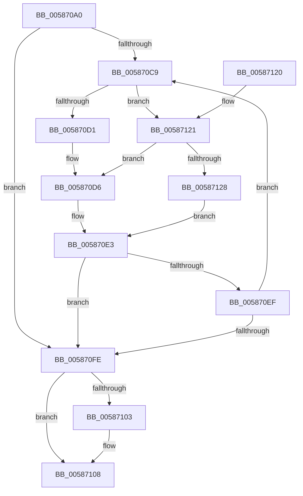

# HvlAcknowledgePageRequest

- RVA: `0x005870A0`–`0x00587137` (길이 `151` bytes)
- VA: `0x00000001405870A0`
- 실행 섹션: `.text`
- PDB 이름 있음: `예`; PDB Function 태그: `아니요`
- unwind 정보 RVA: `0x000C66A4`
- 디코드: `50`개 명령, `151/151` bytes 표시
- 미해석 바이트: `0` (있으면 어셈블리에 `.byte`로 보존)

> 이 문서는 커널 이미지의 기계어와 PDB 기호를 분석해 생성했습니다. 4번과 5번은 함수 원형과 자료형을 바이너리 사용 방식에서 추정한 C 해석이며 원본 소스 복구 결과는 아닙니다.

## 1. Dependencies

- 직접 호출 지점: **3**; 고유 호출 대상: **3**
- 직접 호출자로 확인된 함수: **0**
- RIP 상대 이미지 참조: **0**

### Outgoing calls
- `0x005870DE` → [HvlpSlowAcknowledgePageRequest](HvlpSlowAcknowledgePageRequest_function_00589E20.md) (function, `0x00589E20`)
- `0x00587108` → [HvlpHvToNtStatus](../30/HvlpHvToNtStatus_function_00307BD8.md) (function, `0x00307BD8`)
- `0x00587130` → [HvlpFastAcknowledgePageRequest](HvlpFastAcknowledgePageRequest_function_00589DC8.md) (function, `0x00589DC8`)

### Direct callers
- 이 함수 시작 RVA로 연결되는 직접 call은 확인되지 않았습니다. 간접 호출은 완전히 역산할 수 없습니다.

### Static image references
- 디코드된 RIP-relative 메모리 참조가 없습니다.

## 2. Other-region calls and transfers

- 다른 실행 섹션으로 향하는 call: **0**
- 별도 외부 분기/꼬리 이동을 확인하지 못했습니다.

## 3. Assembly (complete function range)

```asm
005870A0  48 89 5C 24 10                  mov qword ptr [rsp + 0x10], rbx
005870A5  48 89 6C 24 18                  mov qword ptr [rsp + 0x18], rbp
005870AA  56                              push rsi
005870AB  57                              push rdi
005870AC  41 56                           push r14
005870AE  48 83 EC 20                     sub rsp, 0x20
005870B2  8B F9                           mov edi, ecx
005870B4  33 ED                           xor ebp, ebp
005870B6  89 6C 24 40                     mov dword ptr [rsp + 0x40], ebp
005870BA  4D 8B F0                        mov r14, r8
005870BD  48 8B F2                        mov rsi, rdx
005870C0  0F B7 CD                        movzx ecx, bp
005870C3  8B DF                           mov ebx, edi
005870C5  85 FF                           test edi, edi
005870C7  74 35                           je 0x1405870fe
005870C9  81 FB 80 00 00 00               cmp ebx, 0x80
005870CF  72 50                           jb 0x140587121
005870D1  B9 80 00 00 00                  mov ecx, 0x80
005870D6  4C 8D 44 24 40                  lea r8, [rsp + 0x40]
005870DB  48 8B D6                        mov rdx, rsi
005870DE  E8 3D 2D 00 00                  call 0x140589e20
005870E3  2B 5C 24 40                     sub ebx, dword ptr [rsp + 0x40]
005870E7  0F B7 C8                        movzx ecx, ax
005870EA  66 85 C0                        test ax, ax
005870ED  75 0F                           jne 0x1405870fe
005870EF  8B 44 24 40                     mov eax, dword ptr [rsp + 0x40]
005870F3  48 C1 E0 05                     shl rax, 5
005870F7  48 03 F0                        add rsi, rax
005870FA  85 DB                           test ebx, ebx
005870FC  75 CB                           jne 0x1405870c9
005870FE  4D 85 F6                        test r14, r14
00587101  74 05                           je 0x140587108
00587103  2B FB                           sub edi, ebx
00587105  41 89 3E                        mov dword ptr [r14], edi
00587108  E8 CB 0A D8 FF                  call 0x140307bd8
0058710D  48 8B 5C 24 48                  mov rbx, qword ptr [rsp + 0x48]
00587112  48 8B 6C 24 50                  mov rbp, qword ptr [rsp + 0x50]
00587117  48 83 C4 20                     add rsp, 0x20
0058711B  41 5E                           pop r14
0058711D  5F                              pop rdi
0058711E  5E                              pop rsi
0058711F  C3                              ret
00587120  CC                              int3
00587121  8B CB                           mov ecx, ebx
00587123  83 FB 03                        cmp ebx, 3
00587126  77 AE                           ja 0x1405870d6
00587128  4C 8D 44 24 40                  lea r8, [rsp + 0x40]
0058712D  48 8B D6                        mov rdx, rsi
00587130  E8 93 2C 00 00                  call 0x140589dc8
00587135  EB AC                           jmp 0x1405870e3
```

## 4. C-style interpretation (structured pseudocode)

```c
__int64 __fastcall HvlAcknowledgePageRequest(int a1, __int64 a2, __int64 a3)
{
    __int64 result;
    __int64 v_rbp;
    __int64 v_rbx;
    __int64 v_rdi;
    __int64 v_rsi;
    __int64 v_rsp;
    unsigned __int64 v_stack_p10;
    unsigned __int64 v_stack_p18;
    unsigned __int64 v_stack_p40;
    unsigned int v_stack_p8;

    v_stack_p10 = v_rbx;
    v_stack_p18 = v_rbp;
    v_rsp = (v_rsp) - (32);
    v_rbp = 0;
    v_stack_p8 = 0;
    if ((unsigned int)((unsigned int)(a1)) == 0) goto loc_005870FE;
loc_005870C9:
    if (((unsigned int)((unsigned int)((unsigned int)((unsigned int)(a1))))) < 128) goto loc_00587121;
loc_005870D6:
    result = HvlpSlowAcknowledgePageRequest(128, a2, v_stack_p8, a4);
loc_005870E3:
    v_rbx = (unsigned int)(((unsigned int)((unsigned int)((unsigned int)(a1)))) - (v_stack_p8));
    if ((unsigned __int16)(result) != 0) goto loc_005870FE;
    result = ((unsigned int)(v_stack_p8)) << (5);
    v_rsi = (a2) + (result);
    if ((unsigned int)(v_rbx) != 0) goto loc_005870C9;
loc_005870FE:
    v_rdi = (unsigned int)(a1);
    if (a3 != 0) {
        v_rdi = (unsigned int)(((unsigned int)(a1)) - ((unsigned int)(v_rbx)));
        *(unsigned int *)(a3) = (unsigned int)(v_rdi);
    }
    result = HvlpHvToNtStatus((unsigned __int16)(result), a2, v_stack_p8, a4);
    v_rsp = (v_rsp) + (32);
    return result;
loc_00587121:
    if (((unsigned int)(v_stack_p10)) > 3) goto loc_005870D6;
    result = HvlpFastAcknowledgePageRequest((unsigned int)((unsigned int)(v_stack_p10)), v_rsi, v_stack_p40, a4);
    goto loc_005870E3;
}
```

## 5. (Beta) C Style

```c
int64_t HvlAcknowledgePageRequest(int32_t Arg1, int64_t Arg2, int64_t Arg3)
{
    int64_t result;
    int64_t local_rbp;
    int64_t local_rbx;
    int64_t local_rdi;
    int64_t local_rsi;
    int64_t local_rsp;
    uint64_t v_stack_p10;
    uint64_t v_stack_p18;
    uint64_t v_stack_p40;
    uint32_t v_stack_p8;

    v_stack_p10 = local_rbx;
    v_stack_p18 = local_rbp;
    local_rsp = (local_rsp) - (32);
    local_rbp = 0;
    v_stack_p8 = 0;
    if ((uint32_t)((uint32_t)(Arg1)) == 0) goto loc_005870FE;
loc_005870C9:
    if (((uint32_t)((uint32_t)((uint32_t)((uint32_t)(Arg1))))) < 128) goto loc_00587121;
loc_005870D6:
    result = HvlpSlowAcknowledgePageRequest(128, Arg2, v_stack_p8, a4);
loc_005870E3:
    local_rbx = (uint32_t)(((uint32_t)((uint32_t)((uint32_t)(Arg1)))) - (v_stack_p8));
    if ((uint16_t)(result) != 0) goto loc_005870FE;
    result = ((uint32_t)(v_stack_p8)) << (5);
    local_rsi = (Arg2) + (result);
    if ((uint32_t)(local_rbx) != 0) goto loc_005870C9;
loc_005870FE:
    local_rdi = (uint32_t)(Arg1);
    if (Arg3 != 0) {
        local_rdi = (uint32_t)(((uint32_t)(Arg1)) - ((uint32_t)(local_rbx)));
        *(uint32_t *)(Arg3) = (uint32_t)(local_rdi);
    }
    result = HvlpHvToNtStatus((uint16_t)(result), Arg2, v_stack_p8, a4);
    local_rsp = (local_rsp) + (32);
    return result;
loc_00587121:
    if (((uint32_t)(v_stack_p10)) > 3) goto loc_005870D6;
    result = HvlpFastAcknowledgePageRequest((uint32_t)((uint32_t)(v_stack_p10)), local_rsi, v_stack_p40, a4);
    goto loc_005870E3;
}
```

## 6. Execution-region graph

[열기: 2D/3D 그래프와 함수 탐색 컨트롤 패널](../../../control-panel.html?section=text&rva=0x005870A0&view=graph)

- 2D 그래프는 위에서 아래로 흐르고, 3D 그래프는 빈 공간을 드래그해 회전합니다. Shift+드래그는 이동, 휠은 확대·축소, 함수 노드 선택은 대상 보고서 이동입니다.

### Static fallback


