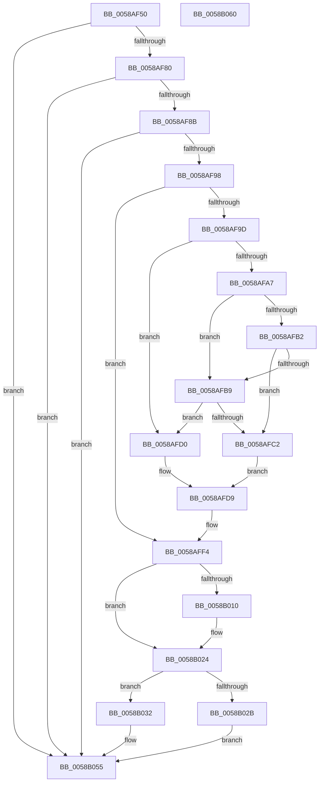

# HvlAddPagesCallbackRoutine

- RVA: `0x0058AF50`–`0x0058B061` (길이 `273` bytes)
- VA: `0x000000014058AF50`
- 실행 섹션: `.text`
- PDB 이름 있음: `예`; PDB Function 태그: `아니요`
- unwind 정보 RVA: `0x0006E5F8`
- 디코드: `68`개 명령, `273/273` bytes 표시
- 미해석 바이트: `0` (있으면 어셈블리에 `.byte`로 보존)

> 이 문서는 커널 이미지의 기계어와 PDB 기호를 분석해 생성했습니다. 4번과 5번은 함수 원형과 자료형을 바이너리 사용 방식에서 추정한 C 해석이며 원본 소스 복구 결과는 아닙니다.

## 1. Dependencies

- 직접 호출 지점: **4**; 고유 호출 대상: **4**
- 직접 호출자로 확인된 함수: **0**
- RIP 상대 이미지 참조: **6**

### Outgoing calls
- `0x0058AFB9` → [IoIsPartialDumpRetry](../59/IoIsPartialDumpRetry_function_00592AA0.md) (function, `0x00592AA0`)
- `0x0058AFEF` → [HvlpStartPageListIteration](HvlpStartPageListIteration_function_0058D8E4.md) (function, `0x0058D8E4`)
- `0x0058B003` → [HvlpGetPageList](HvlpGetPageList_function_0058D6D8.md) (function, `0x0058D6D8`)
- `0x0058B037` → [HvlpGetPageListIterator](HvlpGetPageListIterator_function_0058D790.md) (function, `0x0058D790`)

### Direct callers
- 이 함수 시작 RVA로 연결되는 직접 call은 확인되지 않았습니다. 간접 호출은 완전히 역산할 수 없습니다.

### Static image references
- `0x0058AF67` → RVA `0x00F8ED88` (`.data`; read)
- `0x0058AF8B` → RVA `0x00F8ECA0` (`.data`; read)
- `0x0058AF9D` → RVA `0x00F8ECA8` (`.data`; read)
- `0x0058AFC2` → RVA `0x00F8ECAD` (`.data`; write)
- `0x0058AFD9` → RVA `0x00F8EDC0` (`.data`; read)
- `0x0058AFE8` → RVA `0x00F8EDC0` (`.data`; write)

## 2. Other-region calls and transfers

- 다른 실행 섹션으로 향하는 call: **0**
- 별도 외부 분기/꼬리 이동을 확인하지 못했습니다.

## 3. Assembly (complete function range)

```asm
0058AF50  48 89 5C 24 08                  mov qword ptr [rsp + 8], rbx
0058AF55  57                              push rdi
0058AF56  48 83 EC 30                     sub rsp, 0x30
0058AF5A  33 FF                           xor edi, edi
0058AF5C  49 8B D8                        mov rbx, r8
0058AF5F  49 89 78 18                     mov qword ptr [r8 + 0x18], rdi
0058AF63  41 89 78 08                     mov dword ptr [r8 + 8], edi
0058AF67  48 8B 05 1A 3E A0 00            mov rax, qword ptr [rip + 0xa03e1a]
0058AF6E  48 89 7C 24 20                  mov qword ptr [rsp + 0x20], rdi
0058AF73  89 7C 24 50                     mov dword ptr [rsp + 0x50], edi
0058AF77  48 85 C0                        test rax, rax
0058AF7A  0F 84 D5 00 00 00               je 0x14058b055
0058AF80  8B 40 04                        mov eax, dword ptr [rax + 4]
0058AF83  A8 01                           test al, 1
0058AF85  0F 84 CA 00 00 00               je 0x14058b055
0058AF8B  48 39 3D 0E 3D A0 00            cmp qword ptr [rip + 0xa03d0e], rdi
0058AF92  0F 84 BD 00 00 00               je 0x14058b055
0058AF98  49 39 38                        cmp qword ptr [r8], rdi
0058AF9B  75 57                           jne 0x14058aff4
0058AF9D  8B 05 05 3D A0 00               mov eax, dword ptr [rip + 0xa03d05]
0058AFA3  A8 01                           test al, 1
0058AFA5  75 29                           jne 0x14058afd0
0058AFA7  41 8B 40 0C                     mov eax, dword ptr [r8 + 0xc]
0058AFAB  3D 01 00 02 00                  cmp eax, 0x20001
0058AFB0  74 07                           je 0x14058afb9
0058AFB2  3D 8B 01 00 00                  cmp eax, 0x18b
0058AFB7  75 09                           jne 0x14058afc2
0058AFB9  E8 E2 7A 00 00                  call 0x140592aa0
0058AFBE  84 C0                           test al, al
0058AFC0  74 0E                           je 0x14058afd0
0058AFC2  40 88 3D E4 3C A0 00            mov byte ptr [rip + 0xa03ce4], dil
0058AFC9  BA 02 00 00 00                  mov edx, 2
0058AFCE  EB 09                           jmp 0x14058afd9
0058AFD0  C6 05 D6 3C A0 00 01            mov byte ptr [rip + 0xa03cd6], 1
0058AFD7  8B D7                           mov edx, edi
0058AFD9  48 8D 05 E0 3D A0 00            lea rax, [rip + 0xa03de0]
0058AFE0  B9 01 00 00 00                  mov ecx, 1
0058AFE5  49 89 00                        mov qword ptr [r8], rax
0058AFE8  C6 05 D1 3D A0 00 01            mov byte ptr [rip + 0xa03dd1], 1
0058AFEF  E8 F0 28 00 00                  call 0x14058d8e4
0058AFF4  4C 8D 44 24 50                  lea r8, [rsp + 0x50]
0058AFF9  B9 01 00 00 00                  mov ecx, 1
0058AFFE  48 8D 54 24 20                  lea rdx, [rsp + 0x20]
0058B003  E8 D0 26 00 00                  call 0x14058d6d8
0058B008  8B 4C 24 50                     mov ecx, dword ptr [rsp + 0x50]
0058B00C  85 C9                           test ecx, ecx
0058B00E  74 14                           je 0x14058b024
0058B010  48 89 4B 18                     mov qword ptr [rbx + 0x18], rcx
0058B014  48 8B 4C 24 20                  mov rcx, qword ptr [rsp + 0x20]
0058B019  48 89 4B 10                     mov qword ptr [rbx + 0x10], rcx
0058B01D  C7 43 08 02 00 00 00            mov dword ptr [rbx + 8], 2
0058B024  3D 05 01 00 00                  cmp eax, 0x105
0058B029  75 07                           jne 0x14058b032
0058B02B  0F BA 6B 08 1F                  bts dword ptr [rbx + 8], 0x1f
0058B030  EB 23                           jmp 0x14058b055
0058B032  B9 01 00 00 00                  mov ecx, 1
0058B037  E8 54 27 00 00                  call 0x14058d790
0058B03C  48 89 78 08                     mov qword ptr [rax + 8], rdi
0058B040  66 89 38                        mov word ptr [rax], di
0058B043  66 89 78 03                     mov word ptr [rax + 3], di
0058B047  40 88 78 02                     mov byte ptr [rax + 2], dil
0058B04B  40 88 3D 6E 3D A0 00            mov byte ptr [rip + 0xa03d6e], dil
0058B052  48 89 3B                        mov qword ptr [rbx], rdi
0058B055  48 8B 5C 24 40                  mov rbx, qword ptr [rsp + 0x40]
0058B05A  48 83 C4 30                     add rsp, 0x30
0058B05E  5F                              pop rdi
0058B05F  C3                              ret
0058B060  CC                              int3
```

## 4. C-style interpretation (structured pseudocode)

```c
__int64 __fastcall HvlAddPagesCallbackRoutine(__int64 a1, __int64 a2, __int64 a3)
{
    __int64 result;
    __int64 v_rdi;
    __int64 v_rsp;
    unsigned __int64 v_stack_m18;
    unsigned int v_stack_p18;
    unsigned __int64 v_stack_p8;

    v_stack_p8 = v_rbx;
    v_rsp = (v_rsp) - (48);
    v_rdi = 0;
    *(unsigned __int64 *)(a3 + 24) = 0;
    *(unsigned int *)(a3 + 8) = 0;
    v_stack_m18 = 0;
    v_stack_p18 = 0;
    if (*(unsigned __int64 *)(v_rip + 10501658) == 0) goto loc_0058B055;
    if ((((unsigned __int8)((unsigned int)(*(unsigned int *)(*(unsigned __int64 *)(v_rip + 10501658) + 4)))) & (1)) == 0) goto loc_0058B055;
    if ((*(unsigned __int64 *)(v_rip + 10501390)) == 0) goto loc_0058B055;
    if ((*(unsigned __int64 *)(a3)) != 0) goto loc_0058AFF4;
    if ((((unsigned __int8)((unsigned int)(*(unsigned int *)(v_rip + 10501381)))) & (1)) != 0) goto loc_0058AFD0;
    if (((unsigned int)((unsigned int)(*(unsigned int *)(a3 + 12)))) == 0x20001ULL) goto loc_0058AFB9;
    if (((unsigned int)((unsigned int)(*(unsigned int *)(a3 + 12)))) != 395) goto loc_0058AFC2;
loc_0058AFB9:
    result = IoIsPartialDumpRetry(a1, a2, a3, a4);
    if ((unsigned __int8)(result) == 0) goto loc_0058AFD0;
loc_0058AFC2:
    *(unsigned __int8 *)(v_rip + 10501348) = 0;
    goto loc_0058AFD9;
loc_0058AFD0:
    *(unsigned __int8 *)(v_rip + 10501334) = 1;
loc_0058AFD9:
    *(unsigned __int64 *)(a3) = v_rip + 10501600;
    *(unsigned __int8 *)(v_rip + 10501585) = 1;
    result = HvlpStartPageListIteration(1, 0, a3, a4);
loc_0058AFF4:
    result = HvlpGetPageList(1, v_stack_m18, v_stack_p18, a4);
    if ((unsigned int)((unsigned int)(v_stack_p18)) != 0) {
        *(unsigned __int64 *)(a3 + 24) = (unsigned int)(v_stack_p18);
        a1 = v_stack_m18;
        *(unsigned __int64 *)(a3 + 16) = a1;
        *(unsigned int *)(a3 + 8) = 2;
    }
    if (((unsigned int)(result)) != 261) goto loc_0058B032;
    goto loc_0058B055;
loc_0058B032:
    result = HvlpGetPageListIterator(1, v_stack_m18, v_stack_p18, a4);
    *(unsigned __int64 *)(result + 8) = 0;
    *(unsigned __int16 *)(result) = 0;
    *(unsigned __int16 *)(result + 3) = 0;
    *(unsigned __int8 *)(result + 2) = 0;
    *(unsigned __int8 *)(v_rip + 10501486) = 0;
    *(unsigned __int64 *)(a3) = 0;
loc_0058B055:
    v_rsp = (v_rsp) + (48);
    return result;
}
```

## 5. (Beta) C Style

```c
int64_t HvlAddPagesCallbackRoutine(int64_t Arg1, int64_t Arg2, void *Arg3)
{
    uint8_t *arg3 = (uint8_t *)Arg3;

    int64_t result;
    int64_t local_rdi;
    int64_t local_rsp;
    uint64_t v_stack_m18;
    uint32_t v_stack_p18;
    uint64_t v_stack_p8;

    v_stack_p8 = local_rbx;
    local_rsp = (local_rsp) - (48);
    local_rdi = 0;
    *(uint64_t *)(arg3 + 0x18) = 0;
    *(uint32_t *)(arg3 + 0x8) = 0;
    v_stack_m18 = 0;
    v_stack_p18 = 0;
    if (*(uint64_t *)(v_rip + 0xA03E1A) == 0) goto loc_0058B055;
    if ((((uint8_t)((uint32_t)(*(uint32_t *)(*(uint64_t *)(v_rip + 0xA03E1A) + 0x4)))) & (1)) == 0) goto loc_0058B055;
    if ((*(uint64_t *)(v_rip + 0xA03D0E)) == 0) goto loc_0058B055;
    if ((*(uint64_t *)(arg3)) != 0) goto loc_0058AFF4;
    if ((((uint8_t)((uint32_t)(*(uint32_t *)(v_rip + 0xA03D05)))) & (1)) != 0) goto loc_0058AFD0;
    if (((uint32_t)((uint32_t)(*(uint32_t *)(arg3 + 0xC)))) == 0x20001ULL) goto loc_0058AFB9;
    if (((uint32_t)((uint32_t)(*(uint32_t *)(arg3 + 0xC)))) != 395) goto loc_0058AFC2;
loc_0058AFB9:
    result = IoIsPartialDumpRetry(Arg1, Arg2, Arg3, a4);
    if ((uint8_t)(result) == 0) goto loc_0058AFD0;
loc_0058AFC2:
    *(uint8_t *)(v_rip + 0xA03CE4) = 0;
    goto loc_0058AFD9;
loc_0058AFD0:
    *(uint8_t *)(v_rip + 0xA03CD6) = 1;
loc_0058AFD9:
    *(uint64_t *)(arg3) = v_rip + 10501600;
    *(uint8_t *)(v_rip + 0xA03DD1) = 1;
    result = HvlpStartPageListIteration(1, 0, Arg3, a4);
loc_0058AFF4:
    result = HvlpGetPageList(1, v_stack_m18, v_stack_p18, a4);
    if ((uint32_t)((uint32_t)(v_stack_p18)) != 0) {
        *(uint64_t *)(arg3 + 0x18) = (uint32_t)(v_stack_p18);
        Arg1 = v_stack_m18;
        *(uint64_t *)(arg3 + 0x10) = Arg1;
        *(uint32_t *)(arg3 + 0x8) = 2;
    }
    if (((uint32_t)(result)) != 261) goto loc_0058B032;
    goto loc_0058B055;
loc_0058B032:
    result = HvlpGetPageListIterator(1, v_stack_m18, v_stack_p18, a4);
    *(uint64_t *)(result + 0x8) = 0;
    *(uint16_t *)(result) = 0;
    *(uint16_t *)(result + 0x3) = 0;
    *(uint8_t *)(result + 0x2) = 0;
    *(uint8_t *)(v_rip + 0xA03D6E) = 0;
    *(uint64_t *)(arg3) = 0;
loc_0058B055:
    local_rsp = (local_rsp) + (48);
    return result;
}
```

### 관측된 메모리 오프셋

구조체 형식이 확인되지 않은 접근은 인자 기준의 오프셋으로만 기록했습니다.

| 기준 인자 | 오프셋 표현 | 폭 (bit) | 접근 |
|---|---:|---:|---|
| `Arg3` | `+ 0x0` | `64` | `R` |
| `Arg3` | `+ 0x0` | `64` | `W` |
| `Arg3` | `+ 0x8` | `32` | `R/W` |
| `Arg3` | `+ 0x8` | `32` | `W` |
| `Arg3` | `+ 0xC` | `32` | `R` |
| `Arg3` | `+ 0x10` | `64` | `W` |
| `Arg3` | `+ 0x18` | `64` | `W` |

## 6. Execution-region graph

[열기: 2D/3D 그래프와 함수 탐색 컨트롤 패널](../../../control-panel.html?section=text&rva=0x0058AF50&view=graph)

- 2D 그래프는 위에서 아래로 흐르고, 3D 그래프는 빈 공간을 드래그해 회전합니다. Shift+드래그는 이동, 휠은 확대·축소, 함수 노드 선택은 대상 보고서 이동입니다.

### Static fallback


