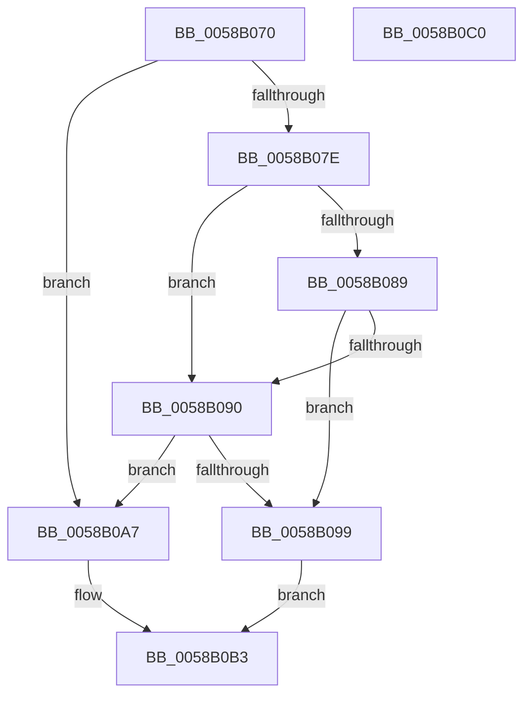

# HvlAddSecureHvPagesCallbackRoutine

- RVA: `0x0058B070`–`0x0058B0C1` (길이 `81` bytes)
- VA: `0x000000014058B070`
- 실행 섹션: `.text`
- PDB 이름 있음: `예`; PDB Function 태그: `아니요`
- unwind 정보 RVA: `0x0005D2F4`
- 디코드: `22`개 명령, `81/81` bytes 표시
- 미해석 바이트: `0` (있으면 어셈블리에 `.byte`로 보존)

> 이 문서는 커널 이미지의 기계어와 PDB 기호를 분석해 생성했습니다. 4번과 5번은 함수 원형과 자료형을 바이너리 사용 방식에서 추정한 C 해석이며 원본 소스 복구 결과는 아닙니다.

## 1. Dependencies

- 직접 호출 지점: **2**; 고유 호출 대상: **2**
- 직접 호출자로 확인된 함수: **0**
- RIP 상대 이미지 참조: **2**

### Outgoing calls
- `0x0058B090` → [IoIsPartialDumpRetry](../59/IoIsPartialDumpRetry_function_00592AA0.md) (function, `0x00592AA0`)
- `0x0058B0B6` → [HvlAddSecurePagesCallbackRoutine](HvlAddSecurePagesCallbackRoutine_function_0058B0C8.md) (function, `0x0058B0C8`)

### Direct callers
- 이 함수 시작 RVA로 연결되는 직접 call은 확인되지 않았습니다. 간접 호출은 완전히 역산할 수 없습니다.

### Static image references
- `0x0058B074` → RVA `0x00F8ECA8` (`.data`; read)
- `0x0058B099` → RVA `0x00F8ECAD` (`.data`; write)

## 2. Other-region calls and transfers

- 다른 실행 섹션으로 향하는 call: **0**
- 별도 외부 분기/꼬리 이동을 확인하지 못했습니다.

## 3. Assembly (complete function range)

```asm
0058B070  48 83 EC 38                     sub rsp, 0x38
0058B074  8B 05 2E 3C A0 00               mov eax, dword ptr [rip + 0xa03c2e]
0058B07A  A8 01                           test al, 1
0058B07C  75 29                           jne 0x14058b0a7
0058B07E  41 8B 40 0C                     mov eax, dword ptr [r8 + 0xc]
0058B082  3D 01 00 02 00                  cmp eax, 0x20001
0058B087  74 07                           je 0x14058b090
0058B089  3D 8B 01 00 00                  cmp eax, 0x18b
0058B08E  75 09                           jne 0x14058b099
0058B090  E8 0B 7A 00 00                  call 0x140592aa0
0058B095  84 C0                           test al, al
0058B097  74 0E                           je 0x14058b0a7
0058B099  C6 05 0D 3C A0 00 00            mov byte ptr [rip + 0xa03c0d], 0
0058B0A0  B9 08 00 00 00                  mov ecx, 8
0058B0A5  EB 0C                           jmp 0x14058b0b3
0058B0A7  C6 05 FF 3B A0 00 01            mov byte ptr [rip + 0xa03bff], 1
0058B0AE  B9 02 00 00 00                  mov ecx, 2
0058B0B3  4D 8B C8                        mov r9, r8
0058B0B6  E8 0D 00 00 00                  call 0x14058b0c8
0058B0BB  48 83 C4 38                     add rsp, 0x38
0058B0BF  C3                              ret
0058B0C0  CC                              int3
```

## 4. C-style interpretation (structured pseudocode)

```c
__int64 __fastcall HvlAddSecureHvPagesCallbackRoutine(__int64 a1, __int64 a2, __int64 a3)
{
    __int64 result;
    __int64 v_rsp;

    v_rsp = (v_rsp) - (56);
    if ((((unsigned __int8)((unsigned int)(*(unsigned int *)(v_rip + 10501166)))) & (1)) != 0) goto loc_0058B0A7;
    if (((unsigned int)((unsigned int)(*(unsigned int *)(a3 + 12)))) == 0x20001ULL) goto loc_0058B090;
    if (((unsigned int)((unsigned int)(*(unsigned int *)(a3 + 12)))) != 395) goto loc_0058B099;
loc_0058B090:
    result = IoIsPartialDumpRetry(a1, a2, a3, a4);
    if ((unsigned __int8)(result) == 0) goto loc_0058B0A7;
loc_0058B099:
    *(unsigned __int8 *)(v_rip + 10501133) = 0;
    goto loc_0058B0B3;
loc_0058B0A7:
    *(unsigned __int8 *)(v_rip + 10501119) = 1;
loc_0058B0B3:
    result = HvlAddSecurePagesCallbackRoutine(2, a2, a3, a3);
    v_rsp = (v_rsp) + (56);
    return result;
}
```

## 5. (Beta) C Style

```c
int64_t HvlAddSecureHvPagesCallbackRoutine(int64_t Arg1, int64_t Arg2, void *Arg3)
{
    uint8_t *arg3 = (uint8_t *)Arg3;

    int64_t result;
    int64_t local_rsp;

    local_rsp = (local_rsp) - (56);
    if ((((uint8_t)((uint32_t)(*(uint32_t *)(v_rip + 0xA03C2E)))) & (1)) != 0) goto loc_0058B0A7;
    if (((uint32_t)((uint32_t)(*(uint32_t *)(arg3 + 0xC)))) == 0x20001ULL) goto loc_0058B090;
    if (((uint32_t)((uint32_t)(*(uint32_t *)(arg3 + 0xC)))) != 395) goto loc_0058B099;
loc_0058B090:
    result = IoIsPartialDumpRetry(Arg1, Arg2, Arg3, a4);
    if ((uint8_t)(result) == 0) goto loc_0058B0A7;
loc_0058B099:
    *(uint8_t *)(v_rip + 0xA03C0D) = 0;
    goto loc_0058B0B3;
loc_0058B0A7:
    *(uint8_t *)(v_rip + 0xA03BFF) = 1;
loc_0058B0B3:
    result = HvlAddSecurePagesCallbackRoutine(2, Arg2, Arg3, Arg3);
    local_rsp = (local_rsp) + (56);
    return result;
}
```

### 관측된 메모리 오프셋

구조체 형식이 확인되지 않은 접근은 인자 기준의 오프셋으로만 기록했습니다.

| 기준 인자 | 오프셋 표현 | 폭 (bit) | 접근 |
|---|---:|---:|---|
| `Arg3` | `+ 0xC` | `32` | `R` |

## 6. Execution-region graph

[열기: 2D/3D 그래프와 함수 탐색 컨트롤 패널](../../../control-panel.html?section=text&rva=0x0058B070&view=graph)

- 2D 그래프는 위에서 아래로 흐르고, 3D 그래프는 빈 공간을 드래그해 회전합니다. Shift+드래그는 이동, 휠은 확대·축소, 함수 노드 선택은 대상 보고서 이동입니다.

### Static fallback


