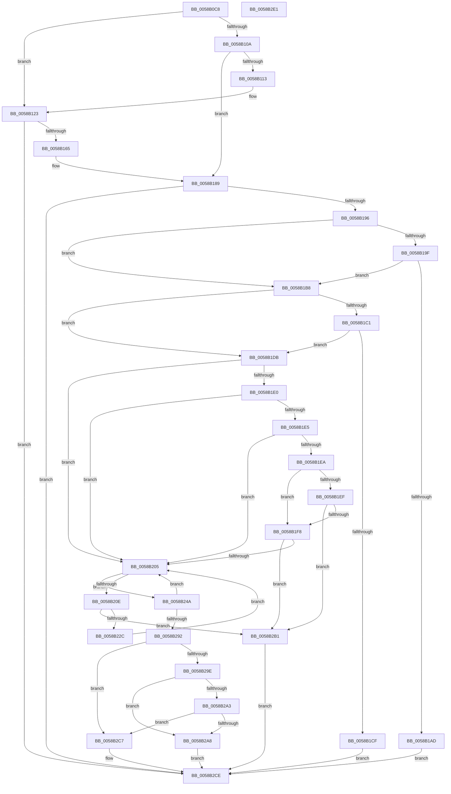

# HvlAddSecurePagesCallbackRoutine

- RVA: `0x0058B0C8`–`0x0058B2E2` (길이 `538` bytes)
- VA: `0x000000014058B0C8`
- 실행 섹션: `.text`
- PDB 이름 있음: `예`; PDB Function 태그: `아니요`
- unwind 정보 RVA: `0x000C6910`
- 디코드: `134`개 명령, `538/538` bytes 표시
- 미해석 바이트: `0` (있으면 어셈블리에 `.byte`로 보존)

> 이 문서는 커널 이미지의 기계어와 PDB 기호를 분석해 생성했습니다. 4번과 5번은 함수 원형과 자료형을 바이너리 사용 방식에서 추정한 C 해석이며 원본 소스 복구 결과는 아닙니다.

## 1. Dependencies

- 직접 호출 지점: **7**; 고유 호출 대상: **5**
- 직접 호출자로 확인된 함수: **2**
- RIP 상대 이미지 참조: **17**

### Outgoing calls
- `0x0058B0FD` → [IoIsPartialDumpRetry](../59/IoIsPartialDumpRetry_function_00592AA0.md) (function, `0x00592AA0`)
- `0x0058B11B` → [HvlpEndSecurePageListIteration](HvlpEndSecurePageListIteration_function_0058D610.md) (function, `0x0058D610`)
- `0x0058B158` → [HvlpStartSecurePageListIteration](HvlpStartSecurePageListIteration_function_0058D908.md) (function, `0x0058D908`)
- `0x0058B1A4` → [HvlpAddCrashdumpAreaPages](HvlpAddCrashdumpAreaPages_function_0058B914.md) (function, `0x0058B914`)
- `0x0058B1C6` → [HvlpAddCrashdumpAreaPages](HvlpAddCrashdumpAreaPages_function_0058B914.md) (function, `0x0058B914`)
- `0x0058B21F` → [VslGetSecurePageList](VslGetSecurePageList_function_0058E504.md) (function, `0x0058E504`)
- `0x0058B2B9` → [HvlpEndSecurePageListIteration](HvlpEndSecurePageListIteration_function_0058D610.md) (function, `0x0058D610`)

### Direct callers
- [HvlAddSecureHvPagesCallbackRoutine](HvlAddSecureHvPagesCallbackRoutine_function_0058B070.md) at `0x0058B0B6`
- [HvlAddSecureSkPagesCallbackRoutine](HvlAddSecureSkPagesCallbackRoutine_function_0058B2F0.md) at `0x0058B32D`

### Static image references
- `0x0058B10A` → RVA `0x00F8EDC3` (`.data`; read)
- `0x0058B13A` → RVA `0x00F8EDC0` (`.data`; read)
- `0x0058B14A` → RVA `0x00F8EDD0` (`.data`; read)
- `0x0058B151` → RVA `0x00F8EDE0` (`.data`; read)
- `0x0058B16A` → RVA `0x00F8EDE8` (`.data`; write)
- `0x0058B178` → RVA `0x00F8EDC3` (`.data`; write)
- `0x0058B17F` → RVA `0x00F8EDC0` (`.data`; write)
- `0x0058B196` → RVA `0x00F8EDC1` (`.data`; read)
- `0x0058B1AD` → RVA `0x00F8EDC1` (`.data`; write)
- `0x0058B1B8` → RVA `0x00F8EDC2` (`.data`; read)
- `0x0058B1CF` → RVA `0x00F8EDC2` (`.data`; write)
- `0x0058B22C` → RVA `0x00F8EDE8` (`.data`; read)
- `0x0058B237` → RVA `0x00F8EDE0` (`.data`; write)
- `0x0058B241` → RVA `0x00F8EDD8` (`.data`; write)
- `0x0058B24A` → RVA `0x00F8EDD8` (`.data`; read)
- `0x0058B27A` → RVA `0x00F8EDD8` (`.data`; read/write)
- `0x0058B282` → RVA `0x00F8EDE0` (`.data`; read/write)

## 2. Other-region calls and transfers

- 다른 실행 섹션으로 향하는 call: **0**
- 별도 외부 분기/꼬리 이동을 확인하지 못했습니다.

## 3. Assembly (complete function range)

```asm
0058B0C8  48 8B C4                        mov rax, rsp
0058B0CB  48 89 58 08                     mov qword ptr [rax + 8], rbx
0058B0CF  48 89 68 20                     mov qword ptr [rax + 0x20], rbp
0058B0D3  4C 89 40 18                     mov qword ptr [rax + 0x18], r8
0058B0D7  89 50 10                        mov dword ptr [rax + 0x10], edx
0058B0DA  56                              push rsi
0058B0DB  57                              push rdi
0058B0DC  41 56                           push r14
0058B0DE  48 83 EC 30                     sub rsp, 0x30
0058B0E2  45 33 F6                        xor r14d, r14d
0058B0E5  40 8A F1                        mov sil, cl
0058B0E8  4C 89 70 18                     mov qword ptr [rax + 0x18], r14
0058B0EC  40 80 CE 04                     or sil, 4
0058B0F0  4D 89 71 18                     mov qword ptr [r9 + 0x18], r14
0058B0F4  49 8B F9                        mov rdi, r9
0058B0F7  45 89 71 08                     mov dword ptr [r9 + 8], r14d
0058B0FB  8B D9                           mov ebx, ecx
0058B0FD  E8 9E 79 00 00                  call 0x140592aa0
0058B102  40 8A E8                        mov bpl, al
0058B105  4D 39 31                        cmp qword ptr [r9], r14
0058B108  74 19                           je 0x14058b123
0058B10A  40 38 35 B2 3C A0 00            cmp byte ptr [rip + 0xa03cb2], sil
0058B111  74 76                           je 0x14058b189
0058B113  33 D2                           xor edx, edx
0058B115  45 33 C0                        xor r8d, r8d
0058B118  8D 4A 01                        lea ecx, [rdx + 1]
0058B11B  E8 F0 24 00 00                  call 0x14058d610
0058B120  4C 89 37                        mov qword ptr [rdi], r14
0058B123  0F 57 C0                        xorps xmm0, xmm0
0058B126  40 0F B6 D6                     movzx edx, sil
0058B12A  45 33 C9                        xor r9d, r9d
0058B12D  48 8D 44 24 60                  lea rax, [rsp + 0x60]
0058B132  48 89 44 24 28                  mov qword ptr [rsp + 0x28], rax
0058B137  45 33 C0                        xor r8d, r8d
0058B13A  0F 11 05 7F 3C A0 00            movups xmmword ptr [rip + 0xa03c7f], xmm0
0058B141  44 89 74 24 20                  mov dword ptr [rsp + 0x20], r14d
0058B146  41 8D 49 01                     lea ecx, [r9 + 1]
0058B14A  0F 11 05 7F 3C A0 00            movups xmmword ptr [rip + 0xa03c7f], xmm0
0058B151  0F 11 05 88 3C A0 00            movups xmmword ptr [rip + 0xa03c88], xmm0
0058B158  E8 AB 27 00 00                  call 0x14058d908
0058B15D  85 C0                           test eax, eax
0058B15F  0F 88 69 01 00 00               js 0x14058b2ce
0058B165  48 8B 44 24 60                  mov rax, qword ptr [rsp + 0x60]
0058B16A  48 89 05 77 3C A0 00            mov qword ptr [rip + 0xa03c77], rax
0058B171  48 8D 05 48 3C A0 00            lea rax, [rip + 0xa03c48]
0058B178  40 88 35 44 3C A0 00            mov byte ptr [rip + 0xa03c44], sil
0058B17F  C6 05 3A 3C A0 00 01            mov byte ptr [rip + 0xa03c3a], 1
0058B186  48 89 07                        mov qword ptr [rdi], rax
0058B189  44 38 35 30 3C A0 00            cmp byte ptr [rip + 0xa03c30], r14b
0058B190  0F 84 38 01 00 00               je 0x14058b2ce
0058B196  44 38 35 24 3C A0 00            cmp byte ptr [rip + 0xa03c24], r14b
0058B19D  75 19                           jne 0x14058b1b8
0058B19F  B2 01                           mov dl, 1
0058B1A1  48 8B CF                        mov rcx, rdi
0058B1A4  E8 6B 07 00 00                  call 0x14058b914
0058B1A9  84 C0                           test al, al
0058B1AB  74 0B                           je 0x14058b1b8
0058B1AD  88 15 0E 3C A0 00               mov byte ptr [rip + 0xa03c0e], dl
0058B1B3  E9 16 01 00 00                  jmp 0x14058b2ce
0058B1B8  44 38 35 03 3C A0 00            cmp byte ptr [rip + 0xa03c03], r14b
0058B1BF  75 1A                           jne 0x14058b1db
0058B1C1  33 D2                           xor edx, edx
0058B1C3  48 8B CF                        mov rcx, rdi
0058B1C6  E8 49 07 00 00                  call 0x14058b914
0058B1CB  84 C0                           test al, al
0058B1CD  74 0C                           je 0x14058b1db
0058B1CF  C6 05 EC 3B A0 00 01            mov byte ptr [rip + 0xa03bec], 1
0058B1D6  E9 F3 00 00 00                  jmp 0x14058b2ce
0058B1DB  40 84 ED                        test bpl, bpl
0058B1DE  74 25                           je 0x14058b205
0058B1E0  83 FB 02                        cmp ebx, 2
0058B1E3  74 20                           je 0x14058b205
0058B1E5  83 FB 08                        cmp ebx, 8
0058B1E8  74 1B                           je 0x14058b205
0058B1EA  83 FB 01                        cmp ebx, 1
0058B1ED  74 09                           je 0x14058b1f8
0058B1EF  83 FB 10                        cmp ebx, 0x10
0058B1F2  0F 85 B9 00 00 00               jne 0x14058b2b1
0058B1F8  81 7F 0C 8B 01 00 00            cmp dword ptr [rdi + 0xc], 0x18b
0058B1FF  0F 85 AC 00 00 00               jne 0x14058b2b1
0058B205  44 39 35 D4 3B A0 00            cmp dword ptr [rip + 0xa03bd4], r14d
0058B20C  75 3C                           jne 0x14058b24a
0058B20E  4C 8D 4C 24 58                  lea r9, [rsp + 0x58]
0058B213  44 88 74 24 58                  mov byte ptr [rsp + 0x58], r14b
0058B218  45 33 C0                        xor r8d, r8d
0058B21B  33 D2                           xor edx, edx
0058B21D  33 C9                           xor ecx, ecx
0058B21F  E8 E0 32 00 00                  call 0x14058e504
0058B224  85 C0                           test eax, eax
0058B226  0F 88 85 00 00 00               js 0x14058b2b1
0058B22C  48 8B 0D B5 3B A0 00            mov rcx, qword ptr [rip + 0xa03bb5]
0058B233  0F B7 41 08                     movzx eax, word ptr [rcx + 8]
0058B237  89 05 A3 3B A0 00               mov dword ptr [rip + 0xa03ba3], eax
0058B23D  48 8D 41 10                     lea rax, [rcx + 0x10]
0058B241  48 89 05 90 3B A0 00            mov qword ptr [rip + 0xa03b90], rax
0058B248  EB BB                           jmp 0x14058b205
0058B24A  48 8B 05 87 3B A0 00            mov rax, qword ptr [rip + 0xa03b87]
0058B251  48 8B 08                        mov rcx, qword ptr [rax]
0058B254  48 C1 E9 28                     shr rcx, 0x28
0058B258  48 FF C1                        inc rcx
0058B25B  48 89 4F 18                     mov qword ptr [rdi + 0x18], rcx
0058B25F  48 8B 05 72 3B A0 00            mov rax, qword ptr [rip + 0xa03b72]
0058B266  48 8B 08                        mov rcx, qword ptr [rax]
0058B269  48 B8 FF FF FF FF FF 00 00 00   movabs rax, 0xffffffffff
0058B273  48 23 C8                        and rcx, rax
0058B276  48 89 4F 10                     mov qword ptr [rdi + 0x10], rcx
0058B27A  48 83 05 56 3B A0 00 08         add qword ptr [rip + 0xa03b56], 8
0058B282  FF 0D 58 3B A0 00               dec dword ptr [rip + 0xa03b58]
0058B288  4C 39 77 18                     cmp qword ptr [rdi + 0x18], r14
0058B28C  0F 84 73 FF FF FF               je 0x14058b205
0058B292  C7 47 08 02 00 00 80            mov dword ptr [rdi + 8], 0x80000002
0058B299  83 EB 01                        sub ebx, 1
0058B29C  74 29                           je 0x14058b2c7
0058B29E  83 EB 01                        sub ebx, 1
0058B2A1  74 05                           je 0x14058b2a8
0058B2A3  83 FB 06                        cmp ebx, 6
0058B2A6  75 1F                           jne 0x14058b2c7
0058B2A8  C7 47 08 22 00 00 80            mov dword ptr [rdi + 8], 0x80000022
0058B2AF  EB 1D                           jmp 0x14058b2ce
0058B2B1  33 D2                           xor edx, edx
0058B2B3  45 33 C0                        xor r8d, r8d
0058B2B6  8D 4A 01                        lea ecx, [rdx + 1]
0058B2B9  E8 52 23 00 00                  call 0x14058d610
0058B2BE  44 88 35 FB 3A A0 00            mov byte ptr [rip + 0xa03afb], r14b
0058B2C5  EB 07                           jmp 0x14058b2ce
0058B2C7  C7 47 08 12 00 00 80            mov dword ptr [rdi + 8], 0x80000012
0058B2CE  48 8B 5C 24 50                  mov rbx, qword ptr [rsp + 0x50]
0058B2D3  48 8B 6C 24 68                  mov rbp, qword ptr [rsp + 0x68]
0058B2D8  48 83 C4 30                     add rsp, 0x30
0058B2DC  41 5E                           pop r14
0058B2DE  5F                              pop rdi
0058B2DF  5E                              pop rsi
0058B2E0  C3                              ret
0058B2E1  CC                              int3
```

## 4. C-style interpretation (structured pseudocode)

```c
__int64 __fastcall HvlAddSecurePagesCallbackRoutine(int a1, int a2, __int64 a3, __int64 a4)
{
    __int64 result;
    __int64 v_r14;
    __int64 v_rbx;
    __int64 v_rsi;
    __int64 v_rsp;
    unsigned __int64 v_stack_m20;
    unsigned int v_stack_m28;
    unsigned __int64 v_stack_p10;
    unsigned __int64 v_stack_p18;
    unsigned __int64 v_stack_p20;
    unsigned __int64 v_stack_p8;

    *(unsigned __int64 *)(v_rsp + 8) = v_rbx;
    *(unsigned __int64 *)(v_rsp + 32) = v_rbp;
    *(unsigned __int64 *)(v_rsp + 24) = a3;
    *(unsigned int *)(v_rsp + 16) = a2;
    v_rsp = (v_rsp) - (48);
    v_r14 = 0;
    *(unsigned __int64 *)(v_rsp + 24) = 0;
    v_rsi = (unsigned __int8)(((unsigned __int8)(a1)) | (4));
    *(unsigned __int64 *)(a4 + 24) = 0;
    *(unsigned int *)(a4 + 8) = 0;
    result = IoIsPartialDumpRetry(a1, a2, a3, a4);
    if ((*(unsigned __int64 *)(a4)) == 0) goto loc_0058B123;
    if ((*(unsigned __int8 *)(v_rip + 10501298)) == ((unsigned __int8)(v_rsi))) goto loc_0058B189;
    a2 = 0;
    a3 = 0;
    result = HvlpEndSecurePageListIteration(a2 + 1, a2, a3, a4);
    *(unsigned __int64 *)(a4) = 0;
loc_0058B123:
    a4 = 0;
    v_stack_m20 = v_stack_p18;
    a3 = 0;
    *(unsigned __int64 *)(v_rip + 10501247) = v_xmm0;
    v_stack_m28 = 0;
    *(unsigned __int64 *)(v_rip + 10501247) = v_xmm0;
    *(unsigned __int64 *)(v_rip + 10501256) = v_xmm0;
    result = HvlpStartSecurePageListIteration(a4 + 1, (unsigned __int8)(v_rsi), a3, a4);
    if (sign_flag) goto loc_0058B2CE;
    *(unsigned __int64 *)(v_rip + 10501239) = v_stack_p18;
    *(unsigned __int8 *)(v_rip + 10501188) = (unsigned __int8)(v_rsi);
    *(unsigned __int8 *)(v_rip + 10501178) = 1;
    *(unsigned __int64 *)(a4) = v_rip + 10501192;
loc_0058B189:
    if ((*(unsigned __int8 *)(v_rip + 10501168)) == 0) goto loc_0058B2CE;
    if ((*(unsigned __int8 *)(v_rip + 10501156)) != 0) goto loc_0058B1B8;
    result = HvlpAddCrashdumpAreaPages(0, 1, a3, a4);
    if ((unsigned __int8)(result) == 0) goto loc_0058B1B8;
    *(unsigned __int8 *)(v_rip + 10501134) = 1;
    goto loc_0058B2CE;
loc_0058B1B8:
    if ((*(unsigned __int8 *)(v_rip + 10501123)) != 0) goto loc_0058B1DB;
    a2 = 0;
    result = HvlpAddCrashdumpAreaPages(0, a2, a3, a4);
    if ((unsigned __int8)(result) == 0) goto loc_0058B1DB;
    *(unsigned __int8 *)(v_rip + 10501100) = 1;
    goto loc_0058B2CE;
loc_0058B1DB:
    if ((unsigned __int8)((unsigned __int8)(result)) == 0) goto loc_0058B205;
    if (((unsigned int)((unsigned int)(a1))) == 2) goto loc_0058B205;
    if (((unsigned int)((unsigned int)(a1))) == 8) goto loc_0058B205;
    if (((unsigned int)((unsigned int)(a1))) == 1) goto loc_0058B1F8;
    if (((unsigned int)((unsigned int)(a1))) != 16) goto loc_0058B2B1;
loc_0058B1F8:
    if ((*(unsigned int *)(a4 + 12)) != 395) goto loc_0058B2B1;
loc_0058B205:
    if ((*(unsigned int *)(v_rip + 10501076)) != 0) goto loc_0058B24A;
    v_stack_p10 = 0;
    a3 = 0;
    a2 = 0;
    a1 = 0;
    result = VslGetSecurePageList(a1, a2, a3, v_stack_p10);
    if (sign_flag) goto loc_0058B2B1;
    *(unsigned int *)(v_rip + 10501027) = (unsigned int)(*(unsigned __int16 *)(*(unsigned __int64 *)(v_rip + 10501045) + 8));
    *(unsigned __int64 *)(v_rip + 10501008) = *(unsigned __int64 *)(v_rip + 10501045) + 16;
    goto loc_0058B205;
loc_0058B24A:
    a1 = (*(unsigned __int64 *)(*(unsigned __int64 *)(v_rip + 10500999))) >> (40);
    a1 = (a1) + 1;
    *(unsigned __int64 *)(a4 + 24) = a1;
    a1 = (*(unsigned __int64 *)(*(unsigned __int64 *)(v_rip + 10500978))) & (*(unsigned __int64 *)(v_rip + 10500978));
    *(unsigned __int64 *)(a4 + 16) = a1;
    if ((*(unsigned __int64 *)(a4 + 24)) == 0) goto loc_0058B205;
    *(unsigned int *)(a4 + 8) = 0x80000002ULL;
    v_rbx = (unsigned int)(((unsigned int)(a1)) - (1));
    if (condition_is_equal) goto loc_0058B2C7;
    v_rbx = (unsigned int)((v_rbx) - (1));
    if (condition_is_equal) goto loc_0058B2A8;
    if (((unsigned int)(v_rbx)) != 6) goto loc_0058B2C7;
loc_0058B2A8:
    *(unsigned int *)(a4 + 8) = 0x80000022ULL;
    goto loc_0058B2CE;
loc_0058B2B1:
    a2 = 0;
    a3 = 0;
    result = HvlpEndSecurePageListIteration(a2 + 1, a2, a3, v_stack_p10);
    *(unsigned __int8 *)(v_rip + 10500859) = 0;
    goto loc_0058B2CE;
loc_0058B2C7:
    *(unsigned int *)(a4 + 8) = 0x80000012ULL;
loc_0058B2CE:
    v_rsp = (v_rsp) + (48);
    return result;
}
```

## 5. (Beta) C Style

```c
int64_t HvlAddSecurePagesCallbackRoutine(int32_t Arg1, int32_t Arg2, int64_t Arg3, void *Arg4)
{
    uint8_t *arg4 = (uint8_t *)Arg4;

    int64_t result;
    int64_t local_r14;
    int64_t local_rbx;
    int64_t local_rsi;
    int64_t local_rsp;
    uint64_t v_stack_m20;
    uint32_t v_stack_m28;
    uint64_t v_stack_p10;
    uint64_t v_stack_p18;
    uint64_t v_stack_p20;
    uint64_t v_stack_p8;

    *(uint64_t *)(local_rsp + 0x8) = local_rbx;
    *(uint64_t *)(local_rsp + 0x20) = local_rbp;
    *(uint64_t *)(local_rsp + 0x18) = Arg3;
    *(uint32_t *)(local_rsp + 0x10) = Arg2;
    local_rsp = (local_rsp) - (48);
    local_r14 = 0;
    *(uint64_t *)(local_rsp + 0x18) = 0;
    local_rsi = (uint8_t)(((uint8_t)(Arg1)) | (4));
    *(uint64_t *)(arg4 + 0x18) = 0;
    *(uint32_t *)(arg4 + 0x8) = 0;
    result = IoIsPartialDumpRetry(Arg1, Arg2, Arg3, Arg4);
    if ((*(uint64_t *)(arg4)) == 0) goto loc_0058B123;
    if ((*(uint8_t *)(v_rip + 0xA03CB2)) == ((uint8_t)(local_rsi))) goto loc_0058B189;
    Arg2 = 0;
    Arg3 = 0;
    result = HvlpEndSecurePageListIteration(Arg2 + 1, Arg2, Arg3, Arg4);
    *(uint64_t *)(arg4) = 0;
loc_0058B123:
    Arg4 = 0;
    v_stack_m20 = v_stack_p18;
    Arg3 = 0;
    *(uint64_t *)(v_rip + 0xA03C7F) = v_xmm0;
    v_stack_m28 = 0;
    *(uint64_t *)(v_rip + 0xA03C7F) = v_xmm0;
    *(uint64_t *)(v_rip + 0xA03C88) = v_xmm0;
    result = HvlpStartSecurePageListIteration(Arg4 + 1, (uint8_t)(local_rsi), Arg3, Arg4);
    if (sign_flag) goto loc_0058B2CE;
    *(uint64_t *)(v_rip + 0xA03C77) = v_stack_p18;
    *(uint8_t *)(v_rip + 0xA03C44) = (uint8_t)(local_rsi);
    *(uint8_t *)(v_rip + 0xA03C3A) = 1;
    *(uint64_t *)(arg4) = v_rip + 10501192;
loc_0058B189:
    if ((*(uint8_t *)(v_rip + 0xA03C30)) == 0) goto loc_0058B2CE;
    if ((*(uint8_t *)(v_rip + 0xA03C24)) != 0) goto loc_0058B1B8;
    result = HvlpAddCrashdumpAreaPages(0, 1, Arg3, Arg4);
    if ((uint8_t)(result) == 0) goto loc_0058B1B8;
    *(uint8_t *)(v_rip + 0xA03C0E) = 1;
    goto loc_0058B2CE;
loc_0058B1B8:
    if ((*(uint8_t *)(v_rip + 0xA03C03)) != 0) goto loc_0058B1DB;
    Arg2 = 0;
    result = HvlpAddCrashdumpAreaPages(0, Arg2, Arg3, Arg4);
    if ((uint8_t)(result) == 0) goto loc_0058B1DB;
    *(uint8_t *)(v_rip + 0xA03BEC) = 1;
    goto loc_0058B2CE;
loc_0058B1DB:
    if ((uint8_t)((uint8_t)(result)) == 0) goto loc_0058B205;
    if (((uint32_t)((uint32_t)(Arg1))) == 2) goto loc_0058B205;
    if (((uint32_t)((uint32_t)(Arg1))) == 8) goto loc_0058B205;
    if (((uint32_t)((uint32_t)(Arg1))) == 1) goto loc_0058B1F8;
    if (((uint32_t)((uint32_t)(Arg1))) != 16) goto loc_0058B2B1;
loc_0058B1F8:
    if ((*(uint32_t *)(arg4 + 0xC)) != 395) goto loc_0058B2B1;
loc_0058B205:
    if ((*(uint32_t *)(v_rip + 0xA03BD4)) != 0) goto loc_0058B24A;
    v_stack_p10 = 0;
    Arg3 = 0;
    Arg2 = 0;
    Arg1 = 0;
    result = VslGetSecurePageList(Arg1, Arg2, Arg3, v_stack_p10);
    if (sign_flag) goto loc_0058B2B1;
    *(uint32_t *)(v_rip + 0xA03BA3) = (uint32_t)(*(uint16_t *)(*(uint64_t *)(v_rip + 0xA03BB5) + 0x8));
    *(uint64_t *)(v_rip + 0xA03B90) = *(uint64_t *)(v_rip + 0xA03BB5) + 16;
    goto loc_0058B205;
loc_0058B24A:
    Arg1 = (*(uint64_t *)(*(uint64_t *)(v_rip + 0xA03B87))) >> (40);
    Arg1 = (Arg1) + 1;
    *(uint64_t *)(arg4 + 0x18) = Arg1;
    Arg1 = (*(uint64_t *)(*(uint64_t *)(v_rip + 0xA03B72))) & (*(uint64_t *)(v_rip + 0xA03B72));
    *(uint64_t *)(arg4 + 0x10) = Arg1;
    if ((*(uint64_t *)(arg4 + 0x18)) == 0) goto loc_0058B205;
    *(uint32_t *)(arg4 + 0x8) = 0x80000002ULL;
    local_rbx = (uint32_t)(((uint32_t)(Arg1)) - (1));
    if (condition_is_equal) goto loc_0058B2C7;
    local_rbx = (uint32_t)((local_rbx) - (1));
    if (condition_is_equal) goto loc_0058B2A8;
    if (((uint32_t)(local_rbx)) != 6) goto loc_0058B2C7;
loc_0058B2A8:
    *(uint32_t *)(arg4 + 0x8) = 0x80000022ULL;
    goto loc_0058B2CE;
loc_0058B2B1:
    Arg2 = 0;
    Arg3 = 0;
    result = HvlpEndSecurePageListIteration(Arg2 + 1, Arg2, Arg3, v_stack_p10);
    *(uint8_t *)(v_rip + 0xA03AFB) = 0;
    goto loc_0058B2CE;
loc_0058B2C7:
    *(uint32_t *)(arg4 + 0x8) = 0x80000012ULL;
loc_0058B2CE:
    local_rsp = (local_rsp) + (48);
    return result;
}
```

### 관측된 메모리 오프셋

구조체 형식이 확인되지 않은 접근은 인자 기준의 오프셋으로만 기록했습니다.

| 기준 인자 | 오프셋 표현 | 폭 (bit) | 접근 |
|---|---:|---:|---|
| `Arg4` | `+ 0x0` | `64` | `W` |
| `Arg4` | `+ 0x8` | `32` | `W` |
| `Arg4` | `+ 0xC` | `32` | `R` |
| `Arg4` | `+ 0x10` | `64` | `W` |
| `Arg4` | `+ 0x18` | `64` | `R` |
| `Arg4` | `+ 0x18` | `64` | `W` |

## 6. Execution-region graph

[열기: 2D/3D 그래프와 함수 탐색 컨트롤 패널](../../../control-panel.html?section=text&rva=0x0058B0C8&view=graph)

- 2D 그래프는 위에서 아래로 흐르고, 3D 그래프는 빈 공간을 드래그해 회전합니다. Shift+드래그는 이동, 휠은 확대·축소, 함수 노드 선택은 대상 보고서 이동입니다.

### Static fallback


