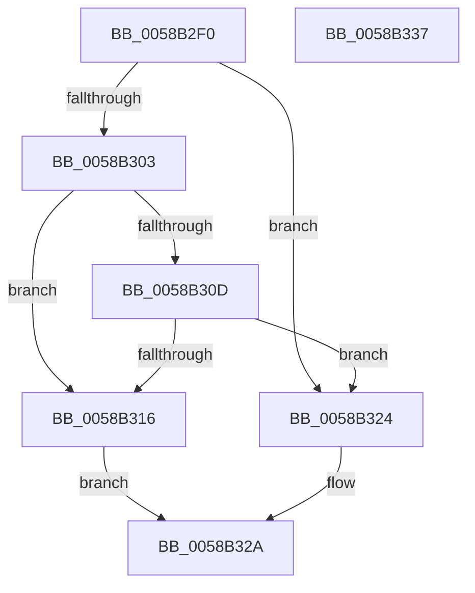

# HvlAddSecureSkPagesCallbackRoutine

- RVA: `0x0058B2F0`–`0x0058B338` (길이 `72` bytes)
- VA: `0x000000014058B2F0`
- 실행 섹션: `.text`
- PDB 이름 있음: `예`; PDB Function 태그: `아니요`
- unwind 정보 RVA: `0x0005D2F4`
- 디코드: `19`개 명령, `72/72` bytes 표시
- 미해석 바이트: `0` (있으면 어셈블리에 `.byte`로 보존)

> 이 문서는 커널 이미지의 기계어와 PDB 기호를 분석해 생성했습니다. 4번과 5번은 함수 원형과 자료형을 바이너리 사용 방식에서 추정한 C 해석이며 원본 소스 복구 결과는 아닙니다.

## 1. Dependencies

- 직접 호출 지점: **2**; 고유 호출 대상: **2**
- 직접 호출자로 확인된 함수: **0**
- RIP 상대 이미지 참조: **2**

### Outgoing calls
- `0x0058B30D` → [IoIsPartialDumpRetry](../59/IoIsPartialDumpRetry_function_00592AA0.md) (function, `0x00592AA0`)
- `0x0058B32D` → [HvlAddSecurePagesCallbackRoutine](HvlAddSecurePagesCallbackRoutine_function_0058B0C8.md) (function, `0x0058B0C8`)

### Direct callers
- 이 함수 시작 RVA로 연결되는 직접 call은 확인되지 않았습니다. 간접 호출은 완전히 역산할 수 없습니다.

### Static image references
- `0x0058B2F4` → RVA `0x00F8ECA8` (`.data`; read)
- `0x0058B316` → RVA `0x00F8ECAE` (`.data`; write)

## 2. Other-region calls and transfers

- 다른 실행 섹션으로 향하는 call: **0**
- 별도 외부 분기/꼬리 이동을 확인하지 못했습니다.

## 3. Assembly (complete function range)

```asm
0058B2F0  48 83 EC 38                     sub rsp, 0x38
0058B2F4  8B 05 AE 39 A0 00               mov eax, dword ptr [rip + 0xa039ae]
0058B2FA  B9 01 00 00 00                  mov ecx, 1
0058B2FF  84 C1                           test cl, al
0058B301  75 21                           jne 0x14058b324
0058B303  41 81 78 0C 8B 01 00 00         cmp dword ptr [r8 + 0xc], 0x18b
0058B30B  75 09                           jne 0x14058b316
0058B30D  E8 8E 77 00 00                  call 0x140592aa0
0058B312  84 C0                           test al, al
0058B314  74 0E                           je 0x14058b324
0058B316  C6 05 91 39 A0 00 00            mov byte ptr [rip + 0xa03991], 0
0058B31D  B9 10 00 00 00                  mov ecx, 0x10
0058B322  EB 06                           jmp 0x14058b32a
0058B324  88 0D 84 39 A0 00               mov byte ptr [rip + 0xa03984], cl
0058B32A  4D 8B C8                        mov r9, r8
0058B32D  E8 96 FD FF FF                  call 0x14058b0c8
0058B332  48 83 C4 38                     add rsp, 0x38
0058B336  C3                              ret
0058B337  CC                              int3
```

## 4. C-style interpretation (structured pseudocode)

```c
__int64 __fastcall HvlAddSecureSkPagesCallbackRoutine(__int64 a1, __int64 a2, __int64 a3)
{
    __int64 result;
    __int64 v_rsp;

    v_rsp = (v_rsp) - (56);
    if (((1) & ((unsigned __int8)((unsigned int)(*(unsigned int *)(v_rip + 10500526))))) != 0) goto loc_0058B324;
    if ((*(unsigned int *)(a3 + 12)) != 395) goto loc_0058B316;
    result = IoIsPartialDumpRetry(1, a2, a3, a4);
    if ((unsigned __int8)(result) == 0) goto loc_0058B324;
loc_0058B316:
    *(unsigned __int8 *)(v_rip + 10500497) = 0;
    goto loc_0058B32A;
loc_0058B324:
    *(unsigned __int8 *)(v_rip + 10500484) = 16;
loc_0058B32A:
    result = HvlAddSecurePagesCallbackRoutine(16, a2, a3, a3);
    v_rsp = (v_rsp) + (56);
    return result;
}
```

## 5. (Beta) C Style

```c
int64_t HvlAddSecureSkPagesCallbackRoutine(int64_t Arg1, int64_t Arg2, void *Arg3)
{
    uint8_t *arg3 = (uint8_t *)Arg3;

    int64_t result;
    int64_t local_rsp;

    local_rsp = (local_rsp) - (56);
    if (((1) & ((uint8_t)((uint32_t)(*(uint32_t *)(v_rip + 0xA039AE))))) != 0) goto loc_0058B324;
    if ((*(uint32_t *)(arg3 + 0xC)) != 395) goto loc_0058B316;
    result = IoIsPartialDumpRetry(1, Arg2, Arg3, a4);
    if ((uint8_t)(result) == 0) goto loc_0058B324;
loc_0058B316:
    *(uint8_t *)(v_rip + 0xA03991) = 0;
    goto loc_0058B32A;
loc_0058B324:
    *(uint8_t *)(v_rip + 0xA03984) = 16;
loc_0058B32A:
    result = HvlAddSecurePagesCallbackRoutine(16, Arg2, Arg3, Arg3);
    local_rsp = (local_rsp) + (56);
    return result;
}
```

### 관측된 메모리 오프셋

구조체 형식이 확인되지 않은 접근은 인자 기준의 오프셋으로만 기록했습니다.

| 기준 인자 | 오프셋 표현 | 폭 (bit) | 접근 |
|---|---:|---:|---|
| `Arg3` | `+ 0xC` | `32` | `R` |

## 6. Execution-region graph

[열기: 2D/3D 그래프와 함수 탐색 컨트롤 패널](../../../control-panel.html?section=text&rva=0x0058B2F0&view=graph)

- 2D 그래프는 위에서 아래로 흐르고, 3D 그래프는 빈 공간을 드래그해 회전합니다. Shift+드래그는 이동, 휠은 확대·축소, 함수 노드 선택은 대상 보고서 이동입니다.

### Static fallback


