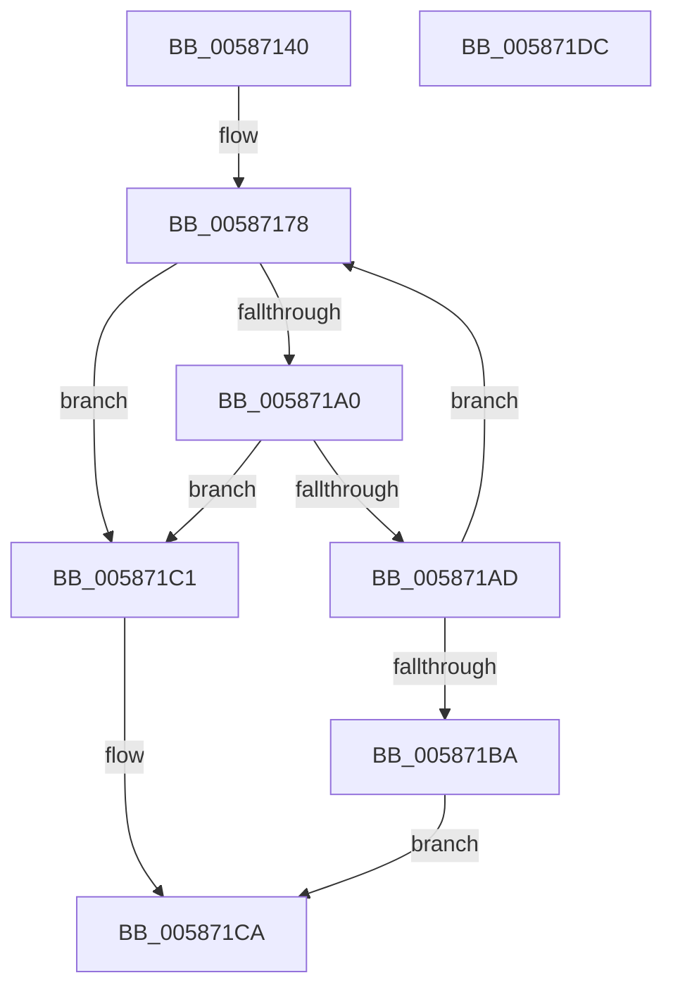

# HvlAttachPasidSpace

- RVA: `0x00587140`–`0x005871DD` (길이 `157` bytes)
- VA: `0x0000000140587140`
- 실행 섹션: `.text`
- PDB 이름 있음: `예`; PDB Function 태그: `아니요`
- unwind 정보 RVA: `0x000A02F8`
- 디코드: `38`개 명령, `157/157` bytes 표시
- 미해석 바이트: `0` (있으면 어셈블리에 `.byte`로 보존)

> 이 문서는 커널 이미지의 기계어와 PDB 기호를 분석해 생성했습니다. 4번과 5번은 함수 원형과 자료형을 바이너리 사용 방식에서 추정한 C 해석이며 원본 소스 복구 결과는 아닙니다.

## 1. Dependencies

- 직접 호출 지점: **5**; 고유 호출 대상: **5**
- 직접 호출자로 확인된 함수: **0**
- RIP 상대 이미지 참조: **2**

### Outgoing calls
- `0x0058718E` → [HvcallFastExtended](../31/HvcallFastExtended_function_003130E0.md) (function, `0x003130E0`)
- `0x005871A4` → [HvlpHvStatusIsInsufficientMemory](../30/HvlpHvStatusIsInsufficientMemory_function_00307BB0.md) (function, `0x00307BB0`)
- `0x005871B1` → [HvlpHandleInsufficientMemory](HvlpHandleInsufficientMemory_function_00584514.md) (function, `0x00584514`)
- `0x005871C5` → [HvlpHvToNtStatus](../30/HvlpHvToNtStatus_function_00307BD8.md) (function, `0x00307BD8`)
- `0x005871D2` → [_security_check_cookie](../6A/_security_check_cookie_function_006AC640.md) (function, `0x006AC640`)

### Direct callers
- 이 함수 시작 RVA로 연결되는 직접 call은 확인되지 않았습니다. 간접 호출은 완전히 역산할 수 없습니다.

### Static image references
- `0x00587144` → RVA `0x00E0A740` (`.data`; read)
- `0x00587196` → RVA `0x00FC6A90` (`ALMOSTRO`; read)

## 2. Other-region calls and transfers

- 다른 실행 섹션으로 향하는 call: **0**
- 별도 외부 분기/꼬리 이동을 확인하지 못했습니다.

## 3. Assembly (complete function range)

```asm
00587140  48 83 EC 78                     sub rsp, 0x78
00587144  48 8B 05 F5 35 88 00            mov rax, qword ptr [rip + 0x8835f5]
0058714B  48 33 C4                        xor rax, rsp
0058714E  48 89 44 24 60                  mov qword ptr [rsp + 0x60], rax
00587153  83 64 24 54 00                  and dword ptr [rsp + 0x54], 0
00587158  48 83 4C 24 40 FF               or qword ptr [rsp + 0x40], 0xffffffffffffffff
0058715E  48 C7 44 24 30 A2 00 00 00      mov qword ptr [rsp + 0x30], 0xa2
00587167  48 89 4C 24 48                  mov qword ptr [rsp + 0x48], rcx
0058716C  89 54 24 50                     mov dword ptr [rsp + 0x50], edx
00587170  C7 44 24 30 A2 00 01 00         mov dword ptr [rsp + 0x30], 0x100a2
00587178  48 8B 4C 24 30                  mov rcx, qword ptr [rsp + 0x30]
0058717D  48 8D 54 24 40                  lea rdx, [rsp + 0x40]
00587182  83 64 24 20 00                  and dword ptr [rsp + 0x20], 0
00587187  45 33 C9                        xor r9d, r9d
0058718A  45 8D 41 18                     lea r8d, [r9 + 0x18]
0058718E  E8 4D BF D8 FF                  call 0x1403130e0
00587193  4C 8B C0                        mov r8, rax
00587196  8B 05 F4 F8 A3 00               mov eax, dword ptr [rip + 0xa3f8f4]
0058719C  A8 02                           test al, 2
0058719E  74 21                           je 0x1405871c1
005871A0  41 0F B7 C8                     movzx ecx, r8w
005871A4  E8 07 0A D8 FF                  call 0x140307bb0
005871A9  84 C0                           test al, al
005871AB  74 14                           je 0x1405871c1
005871AD  41 0F B7 C8                     movzx ecx, r8w
005871B1  E8 5E D3 FF FF                  call 0x140584514
005871B6  85 C0                           test eax, eax
005871B8  79 BE                           jns 0x140587178
005871BA  B8 9A 00 00 C0                  mov eax, 0xc000009a
005871BF  EB 09                           jmp 0x1405871ca
005871C1  41 0F B7 C8                     movzx ecx, r8w
005871C5  E8 0E 0A D8 FF                  call 0x140307bd8
005871CA  48 8B 4C 24 60                  mov rcx, qword ptr [rsp + 0x60]
005871CF  48 33 CC                        xor rcx, rsp
005871D2  E8 69 54 12 00                  call 0x1406ac640
005871D7  48 83 C4 78                     add rsp, 0x78
005871DB  C3                              ret
005871DC  CC                              int3
```

## 4. C-style interpretation (structured pseudocode)

```c
__int64 __fastcall HvlAttachPasidSpace(__int64 a1, int a2, __int64 a3, int a4)
{
    __int64 result;
    __int64 v_rsp;
    unsigned __int64 v_stack_m18;
    unsigned int v_stack_m24;
    unsigned int v_stack_m28;
    unsigned __int64 v_stack_m30;
    unsigned __int64 v_stack_m38;
    unsigned __int64 v_stack_m48;
    unsigned int v_stack_m58;

    v_rsp = (v_rsp) - (120);
    result = (*(unsigned __int64 *)(v_rip + 8926709)) ^ (v_rsp);
    v_stack_m18 = result;
    v_stack_m48 = 162;
    v_stack_m30 = a1;
    v_stack_m28 = a2;
    v_stack_m48 = 0x100A2ULL;
loc_00587178:
    a4 = 0;
    result = HvcallFastExtended(v_stack_m48, v_stack_m38, a4 + 24, a4);
    if ((((unsigned __int8)((unsigned int)(*(unsigned int *)(v_rip + 10746100)))) & (2)) == 0) goto loc_005871C1;
    result = HvlpHvStatusIsInsufficientMemory((unsigned __int16)(result), v_stack_m38, result, a4);
    if ((unsigned __int8)(result) == 0) goto loc_005871C1;
    result = HvlpHandleInsufficientMemory((unsigned __int16)(result), v_stack_m38, result, a4);
    if (!sign_flag) goto loc_00587178;
    goto loc_005871CA;
loc_005871C1:
    result = HvlpHvToNtStatus((unsigned __int16)(result), v_stack_m38, result, a4);
loc_005871CA:
    a1 = (v_stack_m18) ^ (v_rsp);
    result = _security_check_cookie(a1, v_stack_m38, result, a4);
    v_rsp = (v_rsp) + (120);
    return result;
}
```

## 5. (Beta) C Style

```c
int64_t HvlAttachPasidSpace(int64_t Arg1, int32_t Arg2, int64_t Arg3, int32_t Arg4)
{
    int64_t result;
    int64_t local_rsp;
    uint64_t v_stack_m18;
    uint32_t v_stack_m24;
    uint32_t v_stack_m28;
    uint64_t v_stack_m30;
    uint64_t v_stack_m38;
    uint64_t v_stack_m48;
    uint32_t v_stack_m58;

    local_rsp = (local_rsp) - (120);
    result = (*(uint64_t *)(v_rip + 0x8835F5)) ^ (local_rsp);
    v_stack_m18 = result;
    v_stack_m48 = 162;
    v_stack_m30 = Arg1;
    v_stack_m28 = Arg2;
    v_stack_m48 = 0x100A2ULL;
loc_00587178:
    Arg4 = 0;
    result = HvcallFastExtended(v_stack_m48, v_stack_m38, Arg4 + 24, Arg4);
    if ((((uint8_t)((uint32_t)(*(uint32_t *)(v_rip + 0xA3F8F4)))) & (2)) == 0) goto loc_005871C1;
    result = HvlpHvStatusIsInsufficientMemory((uint16_t)(result), v_stack_m38, result, Arg4);
    if ((uint8_t)(result) == 0) goto loc_005871C1;
    result = HvlpHandleInsufficientMemory((uint16_t)(result), v_stack_m38, result, Arg4);
    if (!sign_flag) goto loc_00587178;
    goto loc_005871CA;
loc_005871C1:
    result = HvlpHvToNtStatus((uint16_t)(result), v_stack_m38, result, Arg4);
loc_005871CA:
    Arg1 = (v_stack_m18) ^ (local_rsp);
    result = _security_check_cookie(Arg1, v_stack_m38, result, Arg4);
    local_rsp = (local_rsp) + (120);
    return result;
}
```

## 6. Execution-region graph

[열기: 2D/3D 그래프와 함수 탐색 컨트롤 패널](../../../control-panel.html?section=text&rva=0x00587140&view=graph)

- 2D 그래프는 위에서 아래로 흐르고, 3D 그래프는 빈 공간을 드래그해 회전합니다. Shift+드래그는 이동, 휠은 확대·축소, 함수 노드 선택은 대상 보고서 이동입니다.

### Static fallback


