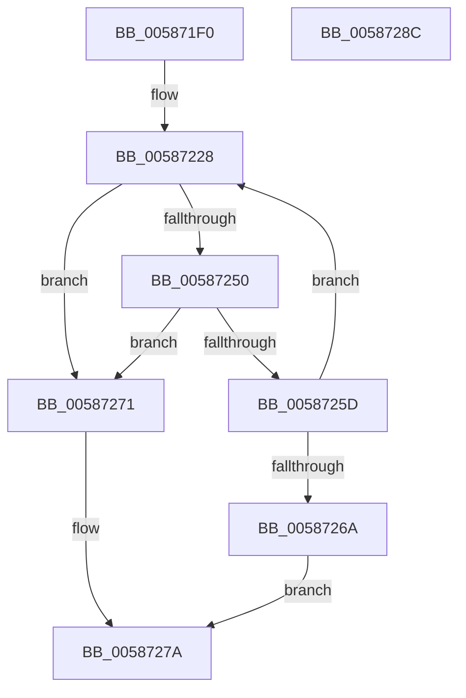

# HvlAttachPrQueue

- RVA: `0x005871F0`–`0x0058728D` (길이 `157` bytes)
- VA: `0x00000001405871F0`
- 실행 섹션: `.text`
- PDB 이름 있음: `예`; PDB Function 태그: `아니요`
- unwind 정보 RVA: `0x000A02F8`
- 디코드: `38`개 명령, `157/157` bytes 표시
- 미해석 바이트: `0` (있으면 어셈블리에 `.byte`로 보존)

> 이 문서는 커널 이미지의 기계어와 PDB 기호를 분석해 생성했습니다. 4번과 5번은 함수 원형과 자료형을 바이너리 사용 방식에서 추정한 C 해석이며 원본 소스 복구 결과는 아닙니다.

## 1. Dependencies

- 직접 호출 지점: **5**; 고유 호출 대상: **5**
- 직접 호출자로 확인된 함수: **0**
- RIP 상대 이미지 참조: **2**

### Outgoing calls
- `0x0058723E` → [HvcallFastExtended](../31/HvcallFastExtended_function_003130E0.md) (function, `0x003130E0`)
- `0x00587254` → [HvlpHvStatusIsInsufficientMemory](../30/HvlpHvStatusIsInsufficientMemory_function_00307BB0.md) (function, `0x00307BB0`)
- `0x00587261` → [HvlpHandleInsufficientMemory](HvlpHandleInsufficientMemory_function_00584514.md) (function, `0x00584514`)
- `0x00587275` → [HvlpHvToNtStatus](../30/HvlpHvToNtStatus_function_00307BD8.md) (function, `0x00307BD8`)
- `0x00587282` → [_security_check_cookie](../6A/_security_check_cookie_function_006AC640.md) (function, `0x006AC640`)

### Direct callers
- 이 함수 시작 RVA로 연결되는 직접 call은 확인되지 않았습니다. 간접 호출은 완전히 역산할 수 없습니다.

### Static image references
- `0x005871F4` → RVA `0x00E0A740` (`.data`; read)
- `0x00587246` → RVA `0x00FC6A90` (`ALMOSTRO`; read)

## 2. Other-region calls and transfers

- 다른 실행 섹션으로 향하는 call: **0**
- 별도 외부 분기/꼬리 이동을 확인하지 못했습니다.

## 3. Assembly (complete function range)

```asm
005871F0  48 83 EC 78                     sub rsp, 0x78
005871F4  48 8B 05 45 35 88 00            mov rax, qword ptr [rip + 0x883545]
005871FB  48 33 C4                        xor rax, rsp
005871FE  48 89 44 24 60                  mov qword ptr [rsp + 0x60], rax
00587203  83 64 24 54 00                  and dword ptr [rsp + 0x54], 0
00587208  48 83 4C 24 40 FF               or qword ptr [rsp + 0x40], 0xffffffffffffffff
0058720E  48 C7 44 24 30 0B 01 00 00      mov qword ptr [rsp + 0x30], 0x10b
00587217  48 89 4C 24 48                  mov qword ptr [rsp + 0x48], rcx
0058721C  89 54 24 50                     mov dword ptr [rsp + 0x50], edx
00587220  C7 44 24 30 0B 01 01 00         mov dword ptr [rsp + 0x30], 0x1010b
00587228  48 8B 4C 24 30                  mov rcx, qword ptr [rsp + 0x30]
0058722D  48 8D 54 24 40                  lea rdx, [rsp + 0x40]
00587232  83 64 24 20 00                  and dword ptr [rsp + 0x20], 0
00587237  45 33 C9                        xor r9d, r9d
0058723A  45 8D 41 18                     lea r8d, [r9 + 0x18]
0058723E  E8 9D BE D8 FF                  call 0x1403130e0
00587243  4C 8B C0                        mov r8, rax
00587246  8B 05 44 F8 A3 00               mov eax, dword ptr [rip + 0xa3f844]
0058724C  A8 02                           test al, 2
0058724E  74 21                           je 0x140587271
00587250  41 0F B7 C8                     movzx ecx, r8w
00587254  E8 57 09 D8 FF                  call 0x140307bb0
00587259  84 C0                           test al, al
0058725B  74 14                           je 0x140587271
0058725D  41 0F B7 C8                     movzx ecx, r8w
00587261  E8 AE D2 FF FF                  call 0x140584514
00587266  85 C0                           test eax, eax
00587268  79 BE                           jns 0x140587228
0058726A  B8 9A 00 00 C0                  mov eax, 0xc000009a
0058726F  EB 09                           jmp 0x14058727a
00587271  41 0F B7 C8                     movzx ecx, r8w
00587275  E8 5E 09 D8 FF                  call 0x140307bd8
0058727A  48 8B 4C 24 60                  mov rcx, qword ptr [rsp + 0x60]
0058727F  48 33 CC                        xor rcx, rsp
00587282  E8 B9 53 12 00                  call 0x1406ac640
00587287  48 83 C4 78                     add rsp, 0x78
0058728B  C3                              ret
0058728C  CC                              int3
```

## 4. C-style interpretation (structured pseudocode)

```c
__int64 __fastcall HvlAttachPrQueue(__int64 a1, int a2, __int64 a3, int a4)
{
    __int64 result;
    __int64 v_rsp;
    unsigned __int64 v_stack_m18;
    unsigned int v_stack_m24;
    unsigned int v_stack_m28;
    unsigned __int64 v_stack_m30;
    unsigned __int64 v_stack_m38;
    unsigned __int64 v_stack_m48;
    unsigned int v_stack_m58;

    v_rsp = (v_rsp) - (120);
    result = (*(unsigned __int64 *)(v_rip + 8926533)) ^ (v_rsp);
    v_stack_m18 = result;
    v_stack_m48 = 267;
    v_stack_m30 = a1;
    v_stack_m28 = a2;
    v_stack_m48 = 0x1010BULL;
loc_00587228:
    a4 = 0;
    result = HvcallFastExtended(v_stack_m48, v_stack_m38, a4 + 24, a4);
    if ((((unsigned __int8)((unsigned int)(*(unsigned int *)(v_rip + 10745924)))) & (2)) == 0) goto loc_00587271;
    result = HvlpHvStatusIsInsufficientMemory((unsigned __int16)(result), v_stack_m38, result, a4);
    if ((unsigned __int8)(result) == 0) goto loc_00587271;
    result = HvlpHandleInsufficientMemory((unsigned __int16)(result), v_stack_m38, result, a4);
    if (!sign_flag) goto loc_00587228;
    goto loc_0058727A;
loc_00587271:
    result = HvlpHvToNtStatus((unsigned __int16)(result), v_stack_m38, result, a4);
loc_0058727A:
    a1 = (v_stack_m18) ^ (v_rsp);
    result = _security_check_cookie(a1, v_stack_m38, result, a4);
    v_rsp = (v_rsp) + (120);
    return result;
}
```

## 5. (Beta) C Style

```c
int64_t HvlAttachPrQueue(int64_t Arg1, int32_t Arg2, int64_t Arg3, int32_t Arg4)
{
    int64_t result;
    int64_t local_rsp;
    uint64_t v_stack_m18;
    uint32_t v_stack_m24;
    uint32_t v_stack_m28;
    uint64_t v_stack_m30;
    uint64_t v_stack_m38;
    uint64_t v_stack_m48;
    uint32_t v_stack_m58;

    local_rsp = (local_rsp) - (120);
    result = (*(uint64_t *)(v_rip + 0x883545)) ^ (local_rsp);
    v_stack_m18 = result;
    v_stack_m48 = 267;
    v_stack_m30 = Arg1;
    v_stack_m28 = Arg2;
    v_stack_m48 = 0x1010BULL;
loc_00587228:
    Arg4 = 0;
    result = HvcallFastExtended(v_stack_m48, v_stack_m38, Arg4 + 24, Arg4);
    if ((((uint8_t)((uint32_t)(*(uint32_t *)(v_rip + 0xA3F844)))) & (2)) == 0) goto loc_00587271;
    result = HvlpHvStatusIsInsufficientMemory((uint16_t)(result), v_stack_m38, result, Arg4);
    if ((uint8_t)(result) == 0) goto loc_00587271;
    result = HvlpHandleInsufficientMemory((uint16_t)(result), v_stack_m38, result, Arg4);
    if (!sign_flag) goto loc_00587228;
    goto loc_0058727A;
loc_00587271:
    result = HvlpHvToNtStatus((uint16_t)(result), v_stack_m38, result, Arg4);
loc_0058727A:
    Arg1 = (v_stack_m18) ^ (local_rsp);
    result = _security_check_cookie(Arg1, v_stack_m38, result, Arg4);
    local_rsp = (local_rsp) + (120);
    return result;
}
```

## 6. Execution-region graph

[열기: 2D/3D 그래프와 함수 탐색 컨트롤 패널](../../../control-panel.html?section=text&rva=0x005871F0&view=graph)

- 2D 그래프는 위에서 아래로 흐르고, 3D 그래프는 빈 공간을 드래그해 회전합니다. Shift+드래그는 이동, 휠은 확대·축소, 함수 노드 선택은 대상 보고서 이동입니다.

### Static fallback


