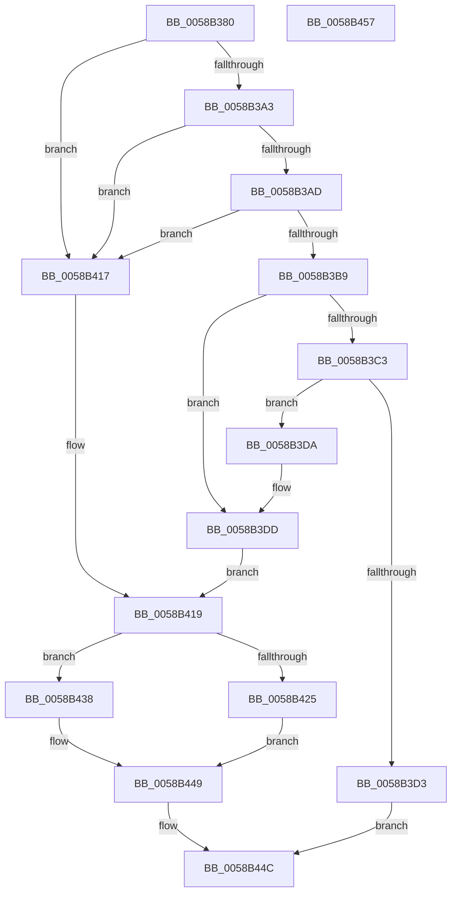

# HvlCalculateLivedumpSize

- RVA: `0x0058B380`–`0x0058B458` (길이 `216` bytes)
- VA: `0x000000014058B380`
- 실행 섹션: `.text`
- PDB 이름 있음: `예`; PDB Function 태그: `아니요`
- unwind 정보 RVA: `0x0005CAAC`
- 디코드: `58`개 명령, `216/216` bytes 표시
- 미해석 바이트: `0` (있으면 어셈블리에 `.byte`로 보존)

> 이 문서는 커널 이미지의 기계어와 PDB 기호를 분석해 생성했습니다. 4번과 5번은 함수 원형과 자료형을 바이너리 사용 방식에서 추정한 C 해석이며 원본 소스 복구 결과는 아닙니다.

## 1. Dependencies

- 직접 호출 지점: **1**; 고유 호출 대상: **1**
- 직접 호출자로 확인된 함수: **1**
- RIP 상대 이미지 참조: **5**

### Outgoing calls
- `0x0058B441` → [VslLiveDumpQuerySecondaryDataSize](VslLiveDumpQuerySecondaryDataSize_function_0058EB20.md) (function, `0x0058EB20`)

### Direct callers
- [IopLiveDumpEstimateMemoryPages](../59/IopLiveDumpEstimateMemoryPages_function_0059BA80.md) at `0x0059BB59`

### Static image references
- `0x0058B38A` → RVA `0x00FC6AD8` (`ALMOSTRO`; read)
- `0x0058B3A3` → RVA `0x00F8ED88` (`.data`; read)
- `0x0058B3AD` → RVA `0x00FC5398` (`ALMOSTRO`; read)
- `0x0058B41C` → RVA `0x00FC6A84` (`ALMOSTRO`; read)
- `0x0058B425` → RVA `0x00F8ED98` (`.data`; read)

## 2. Other-region calls and transfers

- 다른 실행 섹션으로 향하는 call: **0**
- 별도 외부 분기/꼬리 이동을 확인하지 못했습니다.

## 3. Assembly (complete function range)

```asm
0058B380  48 89 5C 24 08                  mov qword ptr [rsp + 8], rbx
0058B385  57                              push rdi
0058B386  48 83 EC 20                     sub rsp, 0x20
0058B38A  8B 05 48 B7 A3 00               mov eax, dword ptr [rip + 0xa3b748]
0058B390  49 8B D8                        mov rbx, r8
0058B393  4C 8B D2                        mov r10, rdx
0058B396  48 8B F9                        mov rdi, rcx
0058B399  41 BB BB 00 00 C0               mov r11d, 0xc00000bb
0058B39F  A8 02                           test al, 2
0058B3A1  74 74                           je 0x14058b417
0058B3A3  48 83 3D DD 39 A0 00 00         cmp qword ptr [rip + 0xa039dd], 0
0058B3AB  74 6A                           je 0x14058b417
0058B3AD  4C 8B 05 E4 9F A3 00            mov r8, qword ptr [rip + 0xa39fe4]
0058B3B4  4D 85 C0                        test r8, r8
0058B3B7  74 5E                           je 0x14058b417
0058B3B9  4D 8B 40 18                     mov r8, qword ptr [r8 + 0x18]
0058B3BD  40 F6 C7 02                     test dil, 2
0058B3C1  75 1A                           jne 0x14058b3dd
0058B3C3  48 8B 05 CE 9F A3 00            mov rax, qword ptr [rip + 0xa39fce]
0058B3CA  48 8B 48 58                     mov rcx, qword ptr [rax + 0x58]
0058B3CE  4C 3B C1                        cmp r8, rcx
0058B3D1  77 07                           ja 0x14058b3da
0058B3D3  B8 01 00 00 C0                  mov eax, 0xc0000001
0058B3D8  EB 72                           jmp 0x14058b44c
0058B3DA  4C 2B C1                        sub r8, rcx
0058B3DD  49 8D 90 FF 02 00 00            lea rdx, [r8 + 0x2ff]
0058B3E4  45 33 DB                        xor r11d, r11d
0058B3E7  48 C1 EA 09                     shr rdx, 9
0058B3EB  48 8D 8A FF 01 00 00            lea rcx, [rdx + 0x1ff]
0058B3F2  48 C1 E9 09                     shr rcx, 9
0058B3F6  48 8D 81 FF 01 00 00            lea rax, [rcx + 0x1ff]
0058B3FD  48 81 C1 01 01 00 00            add rcx, 0x101
0058B404  48 C1 E8 09                     shr rax, 9
0058B408  48 03 C2                        add rax, rdx
0058B40B  48 03 C8                        add rcx, rax
0058B40E  49 03 C8                        add rcx, r8
0058B411  48 C1 E1 0C                     shl rcx, 0xc
0058B415  EB 02                           jmp 0x14058b419
0058B417  33 C9                           xor ecx, ecx
0058B419  49 89 0A                        mov qword ptr [r10], rcx
0058B41C  80 3D 61 B6 A3 00 00            cmp byte ptr [rip + 0xa3b661], 0
0058B423  75 13                           jne 0x14058b438
0058B425  8B 05 6D 39 A0 00               mov eax, dword ptr [rip + 0xa0396d]
0058B42B  48 C1 E0 0C                     shl rax, 0xc
0058B42F  48 83 23 00                     and qword ptr [rbx], 0
0058B433  49 89 01                        mov qword ptr [r9], rax
0058B436  EB 11                           jmp 0x14058b449
0058B438  4D 8B C1                        mov r8, r9
0058B43B  48 8B D3                        mov rdx, rbx
0058B43E  48 8B CF                        mov rcx, rdi
0058B441  E8 DA 36 00 00                  call 0x14058eb20
0058B446  44 8B D8                        mov r11d, eax
0058B449  41 8B C3                        mov eax, r11d
0058B44C  48 8B 5C 24 30                  mov rbx, qword ptr [rsp + 0x30]
0058B451  48 83 C4 20                     add rsp, 0x20
0058B455  5F                              pop rdi
0058B456  C3                              ret
0058B457  CC                              int3
```

## 4. C-style interpretation (structured pseudocode)

```c
__int64 __fastcall HvlCalculateLivedumpSize(__int64 a1, __int64 a2, __int64 a3, __int64 a4)
{
    __int64 result;
    __int64 v_r11;
    __int64 v_rsp;
    unsigned __int64 v_stack_p8;

    v_stack_p8 = v_rbx;
    v_rsp = (v_rsp) - (32);
    if ((((unsigned __int8)((unsigned int)(*(unsigned int *)(v_rip + 10729288)))) & (2)) == 0) goto loc_0058B417;
    if ((*(unsigned __int64 *)(v_rip + 10500573)) == 0) goto loc_0058B417;
    if (*(unsigned __int64 *)(v_rip + 10723300) == 0) goto loc_0058B417;
    if ((((unsigned __int8)(a1)) & (2)) != 0) goto loc_0058B3DD;
    if ((*(unsigned __int64 *)(*(unsigned __int64 *)(v_rip + 10723300) + 24)) > (*(unsigned __int64 *)(*(unsigned __int64 *)(v_rip + 10723278) + 88))) goto loc_0058B3DA;
    goto loc_0058B44C;
loc_0058B3DA:
    a3 = (*(unsigned __int64 *)(*(unsigned __int64 *)(v_rip + 10723300) + 24)) - (*(unsigned __int64 *)(*(unsigned __int64 *)(v_rip + 10723278) + 88));
loc_0058B3DD:
    v_r11 = 0;
    a2 = (a3 + 767) >> (9);
    a1 = (a2 + 511) >> (9);
    a1 = (a1) + (257);
    result = (a1 + 511) >> (9);
    result = (result) + (a2);
    a1 = (a1) + (result);
    a1 = (a1) + (a3);
    a1 = (a1) << (12);
    goto loc_0058B419;
loc_0058B417:
    a1 = 0;
loc_0058B419:
    *(unsigned __int64 *)(a2) = 0;
    if ((*(unsigned __int8 *)(v_rip + 10729057)) != 0) goto loc_0058B438;
    result = ((unsigned int)(*(unsigned int *)(v_rip + 10500461))) << (12);
    *(unsigned __int64 *)(a4) = result;
    goto loc_0058B449;
loc_0058B438:
    result = VslLiveDumpQuerySecondaryDataSize(0, a3, a4, a4);
loc_0058B449:
loc_0058B44C:
    v_rsp = (v_rsp) + (32);
    return (unsigned int)((unsigned int)((unsigned int)((unsigned int)(result))));
}
```

## 5. (Beta) C Style

```c
int64_t HvlCalculateLivedumpSize(int64_t Arg1, void *Arg2, void *Arg3, void *Arg4)
{
    uint8_t *arg2 = (uint8_t *)Arg2;
    uint8_t *arg3 = (uint8_t *)Arg3;
    uint8_t *arg4 = (uint8_t *)Arg4;

    int64_t result;
    int64_t local_r11;
    int64_t local_rsp;
    uint64_t v_stack_p8;

    v_stack_p8 = local_rbx;
    local_rsp = (local_rsp) - (32);
    if ((((uint8_t)((uint32_t)(*(uint32_t *)(v_rip + 0xA3B748)))) & (2)) == 0) goto loc_0058B417;
    if ((*(uint64_t *)(v_rip + 0xA039DD)) == 0) goto loc_0058B417;
    if (*(uint64_t *)(v_rip + 0xA39FE4) == 0) goto loc_0058B417;
    if ((((uint8_t)(Arg1)) & (2)) != 0) goto loc_0058B3DD;
    if ((*(uint64_t *)(*(uint64_t *)(v_rip + 0xA39FE4) + 0x18)) > (*(uint64_t *)(*(uint64_t *)(v_rip + 0xA39FCE) + 0x58))) goto loc_0058B3DA;
    goto loc_0058B44C;
loc_0058B3DA:
    Arg3 = (*(uint64_t *)(*(uint64_t *)(v_rip + 0xA39FE4) + 0x18)) - (*(uint64_t *)(*(uint64_t *)(v_rip + 0xA39FCE) + 0x58));
loc_0058B3DD:
    local_r11 = 0;
    Arg2 = (Arg3 + 767) >> (9);
    Arg1 = (Arg2 + 511) >> (9);
    Arg1 = (Arg1) + (257);
    result = (Arg1 + 511) >> (9);
    result = (result) + (Arg2);
    Arg1 = (Arg1) + (result);
    Arg1 = (Arg1) + (Arg3);
    Arg1 = (Arg1) << (12);
    goto loc_0058B419;
loc_0058B417:
    Arg1 = 0;
loc_0058B419:
    *(uint64_t *)(arg2) = 0;
    if ((*(uint8_t *)(v_rip + 0xA3B661)) != 0) goto loc_0058B438;
    result = ((uint32_t)(*(uint32_t *)(v_rip + 0xA0396D))) << (12);
    *(uint64_t *)(arg4) = result;
    goto loc_0058B449;
loc_0058B438:
    result = VslLiveDumpQuerySecondaryDataSize(0, Arg3, Arg4, Arg4);
loc_0058B449:
loc_0058B44C:
    local_rsp = (local_rsp) + (32);
    return (uint32_t)((uint32_t)((uint32_t)((uint32_t)(result))));
}
```

### 관측된 메모리 오프셋

구조체 형식이 확인되지 않은 접근은 인자 기준의 오프셋으로만 기록했습니다.

| 기준 인자 | 오프셋 표현 | 폭 (bit) | 접근 |
|---|---:|---:|---|
| `Arg2` | `+ 0x0` | `64` | `W` |
| `Arg3` | `+ 0x0` | `64` | `R/W` |
| `Arg4` | `+ 0x0` | `64` | `W` |

## 6. Execution-region graph

[열기: 2D/3D 그래프와 함수 탐색 컨트롤 패널](../../../control-panel.html?section=text&rva=0x0058B380&view=graph)

- 2D 그래프는 위에서 아래로 흐르고, 3D 그래프는 빈 공간을 드래그해 회전합니다. Shift+드래그는 이동, 휠은 확대·축소, 함수 노드 선택은 대상 보고서 이동입니다.

### Static fallback


