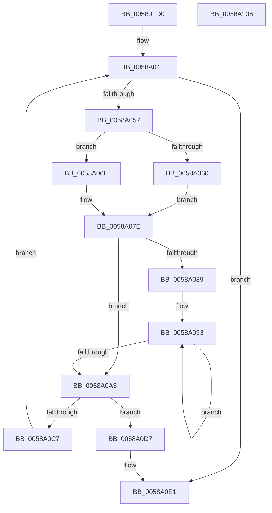

# HvlChangeIsolatedMemoryVisibility

- RVA: `0x00589FD0`–`0x0058A107` (길이 `311` bytes)
- VA: `0x0000000140589FD0`
- 실행 섹션: `.text`
- PDB 이름 있음: `예`; PDB Function 태그: `아니요`
- unwind 정보 RVA: `0x000C683C`
- 디코드: `95`개 명령, `311/311` bytes 표시
- 미해석 바이트: `0` (있으면 어셈블리에 `.byte`로 보존)

> 이 문서는 커널 이미지의 기계어와 PDB 기호를 분석해 생성했습니다. 4번과 5번은 함수 원형과 자료형을 바이너리 사용 방식에서 추정한 C 해석이며 원본 소스 복구 결과는 아닙니다.

## 1. Dependencies

- 직접 호출 지점: **4**; 고유 호출 대상: **4**
- 직접 호출자로 확인된 함수: **1**
- RIP 상대 이미지 참조: **0**

### Outgoing calls
- `0x0058A017` → [HvlpAcquireHypercallPage](../47/HvlpAcquireHypercallPage_function_00471410.md) (function, `0x00471410`)
- `0x0058A0B0` → [HvcallInitiateHypercall](../31/HvcallInitiateHypercall_function_00313630.md) (function, `0x00313630`)
- `0x0058A0DA` → [HvlpHvToNtStatus](../30/HvlpHvToNtStatus_function_00307BD8.md) (function, `0x00307BD8`)
- `0x0058A0E6` → [HvlpReleaseHypercallPage](../31/HvlpReleaseHypercallPage_function_00313480.md) (function, `0x00313480`)

### Direct callers
- [MiSwitchToPfns](../../init/C6/MiSwitchToPfns_function_00C62C90.md) at `0x00C62E37`

### Static image references
- 디코드된 RIP-relative 메모리 참조가 없습니다.

## 2. Other-region calls and transfers

- 다른 실행 섹션으로 향하는 call: **0**
- 별도 외부 분기/꼬리 이동을 확인하지 못했습니다.

## 3. Assembly (complete function range)

```asm
00589FD0  4C 8B DC                        mov r11, rsp
00589FD3  49 89 5B 08                     mov qword ptr [r11 + 8], rbx
00589FD7  49 89 6B 18                     mov qword ptr [r11 + 0x18], rbp
00589FDB  56                              push rsi
00589FDC  57                              push rdi
00589FDD  41 54                           push r12
00589FDF  41 56                           push r14
00589FE1  41 57                           push r15
00589FE3  48 83 EC 40                     sub rsp, 0x40
00589FE7  33 C0                           xor eax, eax
00589FE9  0F 57 C0                        xorps xmm0, xmm0
00589FEC  4D 8B F9                        mov r15, r9
00589FEF  41 8B D8                        mov ebx, r8d
00589FF2  48 8B F2                        mov rsi, rdx
00589FF5  48 8B E9                        mov rbp, rcx
00589FF8  0F 11 44 24 20                  movups xmmword ptr [rsp + 0x20], xmm0
00589FFD  49 89 43 C8                     mov qword ptr [r11 - 0x38], rax
0058A001  8D 50 01                        lea edx, [rax + 1]
0058A004  33 FF                           xor edi, edi
0058A006  89 44 24 38                     mov dword ptr [rsp + 0x38], eax
0058A00A  49 89 39                        mov qword ptr [r9], rdi
0058A00D  49 8D 4B B8                     lea rcx, [r11 - 0x48]
0058A011  45 33 C9                        xor r9d, r9d
0058A014  45 33 C0                        xor r8d, r8d
0058A017  E8 F4 73 EE FF                  call 0x140471410
0058A01C  4C 8B F0                        mov r14, rax
0058A01F  48 89 7C 24 78                  mov qword ptr [rsp + 0x78], rdi
0058A024  C7 44 24 78 DB 00 00 00         mov dword ptr [rsp + 0x78], 0xdb
0058A02C  41 BC FF 0F 00 00               mov r12d, 0xfff
0058A032  48 89 78 08                     mov qword ptr [rax + 8], rdi
0058A036  48 83 08 FF                     or qword ptr [rax], 0xffffffffffffffff
0058A03A  8B 40 08                        mov eax, dword ptr [rax + 8]
0058A03D  8B C8                           mov ecx, eax
0058A03F  33 CB                           xor ecx, ebx
0058A041  8B 5C 24 7C                     mov ebx, dword ptr [rsp + 0x7c]
0058A045  83 E1 03                        and ecx, 3
0058A048  33 C8                           xor ecx, eax
0058A04A  41 89 4E 08                     mov dword ptr [r14 + 8], ecx
0058A04E  48 85 F6                        test rsi, rsi
0058A051  0F 84 8A 00 00 00               je 0x14058a0e1
0058A057  48 81 FE FE 01 00 00            cmp rsi, 0x1fe
0058A05E  76 0E                           jbe 0x14058a06e
0058A060  81 E3 FE F1 FF FF               and ebx, 0xfffff1fe
0058A066  81 CB FE 01 00 00               or ebx, 0x1fe
0058A06C  EB 10                           jmp 0x14058a07e
0058A06E  8B C3                           mov eax, ebx
0058A070  8B CE                           mov ecx, esi
0058A072  41 23 CC                        and ecx, r12d
0058A075  25 00 F0 FF FF                  and eax, 0xfffff000
0058A07A  8B D9                           mov ebx, ecx
0058A07C  0B D8                           or ebx, eax
0058A07E  8B C3                           mov eax, ebx
0058A080  89 5C 24 7C                     mov dword ptr [rsp + 0x7c], ebx
0058A084  41 23 C4                        and eax, r12d
0058A087  76 1A                           jbe 0x14058a0a3
0058A089  48 8B CD                        mov rcx, rbp
0058A08C  44 8B C0                        mov r8d, eax
0058A08F  49 8D 56 10                     lea rdx, [r14 + 0x10]
0058A093  48 89 0A                        mov qword ptr [rdx], rcx
0058A096  48 FF C1                        inc rcx
0058A099  48 8D 52 08                     lea rdx, [rdx + 8]
0058A09D  49 83 E8 01                     sub r8, 1
0058A0A1  75 F0                           jne 0x14058a093
0058A0A3  48 8B 54 24 38                  mov rdx, qword ptr [rsp + 0x38]
0058A0A8  45 33 C0                        xor r8d, r8d
0058A0AB  48 8B 4C 24 78                  mov rcx, qword ptr [rsp + 0x78]
0058A0B0  E8 7B 95 D8 FF                  call 0x140313630
0058A0B5  48 8B C8                        mov rcx, rax
0058A0B8  48 C1 E9 20                     shr rcx, 0x20
0058A0BC  49 23 CC                        and rcx, r12
0058A0BF  49 01 0F                        add qword ptr [r15], rcx
0058A0C2  66 85 C0                        test ax, ax
0058A0C5  75 10                           jne 0x14058a0d7
0058A0C7  8B C3                           mov eax, ebx
0058A0C9  49 23 C4                        and rax, r12
0058A0CC  48 03 E8                        add rbp, rax
0058A0CF  48 2B F0                        sub rsi, rax
0058A0D2  E9 77 FF FF FF                  jmp 0x14058a04e
0058A0D7  0F B7 C8                        movzx ecx, ax
0058A0DA  E8 F9 DA D7 FF                  call 0x140307bd8
0058A0DF  8B F8                           mov edi, eax
0058A0E1  48 8D 4C 24 20                  lea rcx, [rsp + 0x20]
0058A0E6  E8 95 93 D8 FF                  call 0x140313480
0058A0EB  4C 8D 5C 24 40                  lea r11, [rsp + 0x40]
0058A0F0  8B C7                           mov eax, edi
0058A0F2  49 8B 5B 30                     mov rbx, qword ptr [r11 + 0x30]
0058A0F6  49 8B 6B 40                     mov rbp, qword ptr [r11 + 0x40]
0058A0FA  49 8B E3                        mov rsp, r11
0058A0FD  41 5F                           pop r15
0058A0FF  41 5E                           pop r14
0058A101  41 5C                           pop r12
0058A103  5F                              pop rdi
0058A104  5E                              pop rsi
0058A105  C3                              ret
0058A106  CC                              int3
```

## 4. C-style interpretation (structured pseudocode)

```c
__int64 __fastcall HvlChangeIsolatedMemoryVisibility(__int64 a1, __int64 a2, int a3, __int64 a4)
{
    __int64 result;
    __int64 v_rbp;
    __int64 v_rbx;
    __int64 v_rdi;
    __int64 v_rsi;
    __int64 v_rsp;
    unsigned __int64 v_stack_m28;
    unsigned int v_stack_m30;
    unsigned __int64 v_stack_m48;
    unsigned __int64 v_stack_p10;
    unsigned int v_stack_p14;

    *(unsigned __int64 *)(v_rsp + 8) = v_rbx;
    *(unsigned __int64 *)(v_rsp + 24) = v_rbp;
    v_rsp = (v_rsp) - (64);
    result = 0;
    v_stack_m48 = v_xmm0;
    *(unsigned __int64 *)(v_rsp - 56) = 0;
    v_rdi = 0;
    v_stack_m30 = 0;
    *(unsigned __int64 *)(a4) = 0;
    a4 = 0;
    a3 = 0;
    result = HvlpAcquireHypercallPage(v_rsp - 72, result + 1, a3, a4);
    v_stack_p10 = 0;
    v_stack_p10 = 219;
    *(unsigned __int64 *)(result + 8) = 0;
    a1 = (unsigned int)(((unsigned int)((unsigned int)((unsigned int)(*(unsigned int *)(result + 8))))) ^ ((unsigned int)((unsigned int)(a3))));
    a1 = (unsigned int)((a1) & (3));
    a1 = (unsigned int)((a1) ^ ((unsigned int)((unsigned int)(*(unsigned int *)(result + 8)))));
    *(unsigned int *)(result + 8) = (unsigned int)(a1);
loc_0058A04E:
    if (a2 == 0) goto loc_0058A0E1;
    if (a2 <= 510) goto loc_0058A06E;
    v_rbx = (unsigned int)(((unsigned int)(v_stack_p14)) & (0xFFFFF1FEULL));
    v_rbx = (unsigned int)((v_rbx) | (510));
    goto loc_0058A07E;
loc_0058A06E:
    a1 = (unsigned int)(((unsigned int)((unsigned int)(a2))) & ((unsigned int)((unsigned int)(0xFFFULL))));
    result = (unsigned int)(((unsigned int)((unsigned int)(v_rbx))) & (0xFFFFF000ULL));
    v_rbx = (unsigned int)(((unsigned int)((unsigned int)(a1))) | ((unsigned int)(result)));
loc_0058A07E:
    v_stack_p14 = (unsigned int)(v_rbx);
    result = (unsigned int)(((unsigned int)((unsigned int)(v_rbx))) & ((unsigned int)((unsigned int)(0xFFFULL))));
    if (condition_is_below_or_equal) goto loc_0058A0A3;
loc_0058A093:
    *(unsigned __int64 *)(result + 16) = a1;
    a1 = (a1) + 1;
    a3 = ((unsigned int)((unsigned int)(result))) - (1);
    if (condition_is_not_equal) goto loc_0058A093;
loc_0058A0A3:
    a3 = 0;
    result = HvcallInitiateHypercall(v_stack_p10, v_stack_m30, a3, a4);
    a1 = (result) >> (32);
    a1 = (a1) & ((unsigned int)(0xFFFULL));
    if ((unsigned __int16)(result) != 0) goto loc_0058A0D7;
    result = ((unsigned int)((unsigned int)(v_rbx))) & ((unsigned int)(0xFFFULL));
    v_rbp = (a1) + (result);
    v_rsi = (a2) - (result);
    goto loc_0058A04E;
loc_0058A0D7:
    result = HvlpHvToNtStatus((unsigned __int16)(result), v_stack_m30, a3, a4);
loc_0058A0E1:
    result = HvlpReleaseHypercallPage(v_stack_m48, v_stack_m30, a3, a4);
    return (unsigned int)((unsigned int)((unsigned int)((unsigned int)(result))));
}
```

## 5. (Beta) C Style

```c
int64_t HvlChangeIsolatedMemoryVisibility(int64_t Arg1, int64_t Arg2, int32_t Arg3, void *Arg4)
{
    uint8_t *arg4 = (uint8_t *)Arg4;

    int64_t result;
    int64_t local_rbp;
    int64_t local_rbx;
    int64_t local_rdi;
    int64_t local_rsi;
    int64_t local_rsp;
    uint64_t v_stack_m28;
    uint32_t v_stack_m30;
    uint64_t v_stack_m48;
    uint64_t v_stack_p10;
    uint32_t v_stack_p14;

    *(uint64_t *)(local_rsp + 0x8) = local_rbx;
    *(uint64_t *)(local_rsp + 0x18) = local_rbp;
    local_rsp = (local_rsp) - (64);
    result = 0;
    v_stack_m48 = v_xmm0;
    *(uint64_t *)(local_rsp - 0x38) = 0;
    local_rdi = 0;
    v_stack_m30 = 0;
    *(uint64_t *)(arg4) = 0;
    Arg4 = 0;
    Arg3 = 0;
    result = HvlpAcquireHypercallPage(local_rsp - 72, result + 1, Arg3, Arg4);
    v_stack_p10 = 0;
    v_stack_p10 = 219;
    *(uint64_t *)(result + 0x8) = 0;
    Arg1 = (uint32_t)(((uint32_t)((uint32_t)((uint32_t)(*(uint32_t *)(result + 0x8))))) ^ ((uint32_t)((uint32_t)(Arg3))));
    Arg1 = (uint32_t)((Arg1) & (3));
    Arg1 = (uint32_t)((Arg1) ^ ((uint32_t)((uint32_t)(*(uint32_t *)(result + 0x8)))));
    *(uint32_t *)(result + 0x8) = (uint32_t)(Arg1);
loc_0058A04E:
    if (Arg2 == 0) goto loc_0058A0E1;
    if (Arg2 <= 510) goto loc_0058A06E;
    local_rbx = (uint32_t)(((uint32_t)(v_stack_p14)) & (0xFFFFF1FEULL));
    local_rbx = (uint32_t)((local_rbx) | (510));
    goto loc_0058A07E;
loc_0058A06E:
    Arg1 = (uint32_t)(((uint32_t)((uint32_t)(Arg2))) & ((uint32_t)((uint32_t)(0xFFFULL))));
    result = (uint32_t)(((uint32_t)((uint32_t)(local_rbx))) & (0xFFFFF000ULL));
    local_rbx = (uint32_t)(((uint32_t)((uint32_t)(Arg1))) | ((uint32_t)(result)));
loc_0058A07E:
    v_stack_p14 = (uint32_t)(local_rbx);
    result = (uint32_t)(((uint32_t)((uint32_t)(local_rbx))) & ((uint32_t)((uint32_t)(0xFFFULL))));
    if (condition_is_below_or_equal) goto loc_0058A0A3;
loc_0058A093:
    *(uint64_t *)(result + 0x10) = Arg1;
    Arg1 = (Arg1) + 1;
    Arg3 = ((uint32_t)((uint32_t)(result))) - (1);
    if (condition_is_not_equal) goto loc_0058A093;
loc_0058A0A3:
    Arg3 = 0;
    result = HvcallInitiateHypercall(v_stack_p10, v_stack_m30, Arg3, Arg4);
    Arg1 = (result) >> (32);
    Arg1 = (Arg1) & ((uint32_t)(0xFFFULL));
    if ((uint16_t)(result) != 0) goto loc_0058A0D7;
    result = ((uint32_t)((uint32_t)(local_rbx))) & ((uint32_t)(0xFFFULL));
    local_rbp = (Arg1) + (result);
    local_rsi = (Arg2) - (result);
    goto loc_0058A04E;
loc_0058A0D7:
    result = HvlpHvToNtStatus((uint16_t)(result), v_stack_m30, Arg3, Arg4);
loc_0058A0E1:
    result = HvlpReleaseHypercallPage(v_stack_m48, v_stack_m30, Arg3, Arg4);
    return (uint32_t)((uint32_t)((uint32_t)((uint32_t)(result))));
}
```

### 관측된 메모리 오프셋

구조체 형식이 확인되지 않은 접근은 인자 기준의 오프셋으로만 기록했습니다.

| 기준 인자 | 오프셋 표현 | 폭 (bit) | 접근 |
|---|---:|---:|---|
| `Arg4` | `+ 0x0` | `64` | `R/W` |
| `Arg4` | `+ 0x0` | `64` | `W` |

## 6. Execution-region graph

[열기: 2D/3D 그래프와 함수 탐색 컨트롤 패널](../../../control-panel.html?section=text&rva=0x00589FD0&view=graph)

- 2D 그래프는 위에서 아래로 흐르고, 3D 그래프는 빈 공간을 드래그해 회전합니다. Shift+드래그는 이동, 휠은 확대·축소, 함수 노드 선택은 대상 보고서 이동입니다.

### Static fallback


