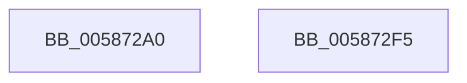

# HvlClearPrqStalled

- RVA: `0x005872A0`–`0x005872F6` (길이 `86` bytes)
- VA: `0x00000001405872A0`
- 실행 섹션: `.text`
- PDB 이름 있음: `예`; PDB Function 태그: `아니요`
- unwind 정보 RVA: `0x00063458`
- 디코드: `20`개 명령, `86/86` bytes 표시
- 미해석 바이트: `0` (있으면 어셈블리에 `.byte`로 보존)

> 이 문서는 커널 이미지의 기계어와 PDB 기호를 분석해 생성했습니다. 4번과 5번은 함수 원형과 자료형을 바이너리 사용 방식에서 추정한 C 해석이며 원본 소스 복구 결과는 아닙니다.

## 1. Dependencies

- 직접 호출 지점: **2**; 고유 호출 대상: **2**
- 직접 호출자로 확인된 함수: **0**
- RIP 상대 이미지 참조: **0**

### Outgoing calls
- `0x005872E3` → [HvcallFastExtended](../31/HvcallFastExtended_function_003130E0.md) (function, `0x003130E0`)
- `0x005872EB` → [HvlpHvToNtStatus](../30/HvlpHvToNtStatus_function_00307BD8.md) (function, `0x00307BD8`)

### Direct callers
- 이 함수 시작 RVA로 연결되는 직접 call은 확인되지 않았습니다. 간접 호출은 완전히 역산할 수 없습니다.

### Static image references
- 디코드된 RIP-relative 메모리 참조가 없습니다.

## 2. Other-region calls and transfers

- 다른 실행 섹션으로 향하는 call: **0**
- 별도 외부 분기/꼬리 이동을 확인하지 못했습니다.

## 3. Assembly (complete function range)

```asm
005872A0  48 83 EC 48                     sub rsp, 0x48
005872A4  83 64 24 34 00                  and dword ptr [rsp + 0x34], 0
005872A9  48 8D 54 24 30                  lea rdx, [rsp + 0x30]
005872AE  83 64 24 20 00                  and dword ptr [rsp + 0x20], 0
005872B3  B8 A9 00 00 00                  mov eax, 0xa9
005872B8  48 89 44 24 58                  mov qword ptr [rsp + 0x58], rax
005872BD  45 33 C9                        xor r9d, r9d
005872C0  89 44 24 58                     mov dword ptr [rsp + 0x58], eax
005872C4  48 8B 44 24 58                  mov rax, qword ptr [rsp + 0x58]
005872C9  48 89 44 24 58                  mov qword ptr [rsp + 0x58], rax
005872CE  89 4C 24 30                     mov dword ptr [rsp + 0x30], ecx
005872D2  45 8D 41 08                     lea r8d, [r9 + 8]
005872D6  C7 44 24 58 A9 00 01 00         mov dword ptr [rsp + 0x58], 0x100a9
005872DE  48 8B 4C 24 58                  mov rcx, qword ptr [rsp + 0x58]
005872E3  E8 F8 BD D8 FF                  call 0x1403130e0
005872E8  48 8B C8                        mov rcx, rax
005872EB  E8 E8 08 D8 FF                  call 0x140307bd8
005872F0  48 83 C4 48                     add rsp, 0x48
005872F4  C3                              ret
005872F5  CC                              int3
```

## 4. C-style interpretation (structured pseudocode)

```c
__int64 __fastcall HvlClearPrqStalled(int a1, __int64 a2, __int64 a3, int a4)
{
    __int64 result;
    __int64 v_rsp;
    unsigned int v_stack_m14;
    unsigned __int64 v_stack_m18;
    unsigned int v_stack_m28;
    unsigned __int64 v_stack_p10;

    v_rsp = (v_rsp) - (72);
    v_stack_p10 = 169;
    a4 = 0;
    v_stack_p10 = 169;
    v_stack_p10 = v_stack_p10;
    v_stack_m18 = a1;
    v_stack_p10 = 0x100A9ULL;
    result = HvcallFastExtended(v_stack_p10, v_stack_m18, a4 + 8, a4);
    result = HvlpHvToNtStatus(result, v_stack_m18, a4 + 8, a4);
    v_rsp = (v_rsp) + (72);
    return result;
}
```

## 5. (Beta) C Style

```c
int64_t HvlClearPrqStalled(int32_t Arg1, int64_t Arg2, int64_t Arg3, int32_t Arg4)
{
    int64_t result;
    int64_t local_rsp;
    uint32_t v_stack_m14;
    uint64_t v_stack_m18;
    uint32_t v_stack_m28;
    uint64_t v_stack_p10;

    local_rsp = (local_rsp) - (72);
    v_stack_p10 = 169;
    Arg4 = 0;
    v_stack_p10 = 169;
    v_stack_p10 = v_stack_p10;
    v_stack_m18 = Arg1;
    v_stack_p10 = 0x100A9ULL;
    result = HvcallFastExtended(v_stack_p10, v_stack_m18, Arg4 + 8, Arg4);
    result = HvlpHvToNtStatus(result, v_stack_m18, Arg4 + 8, Arg4);
    local_rsp = (local_rsp) + (72);
    return result;
}
```

## 6. Execution-region graph

[열기: 2D/3D 그래프와 함수 탐색 컨트롤 패널](../../../control-panel.html?section=text&rva=0x005872A0&view=graph)

- 2D 그래프는 위에서 아래로 흐르고, 3D 그래프는 빈 공간을 드래그해 회전합니다. Shift+드래그는 이동, 휠은 확대·축소, 함수 노드 선택은 대상 보고서 이동입니다.

### Static fallback


