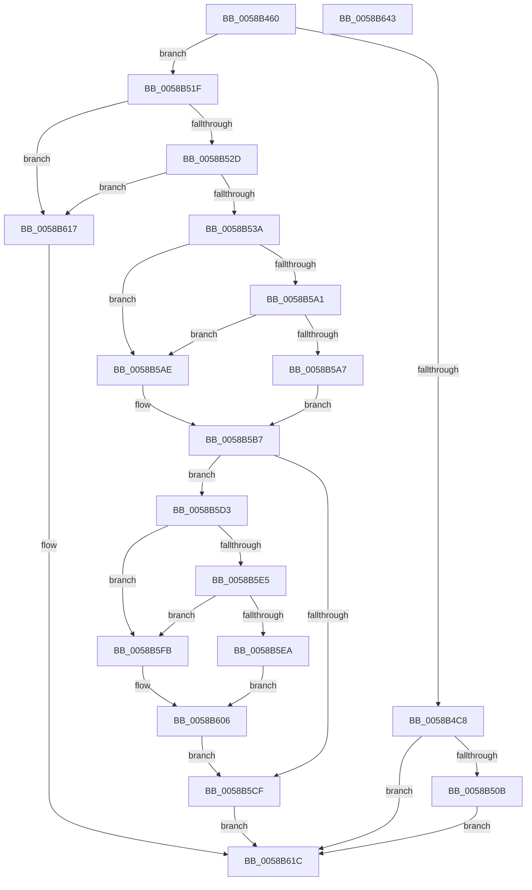

# HvlCollectLivedump

- RVA: `0x0058B460`–`0x0058B644` (길이 `484` bytes)
- VA: `0x000000014058B460`
- 실행 섹션: `.text`
- PDB 이름 있음: `예`; PDB Function 태그: `아니요`
- unwind 정보 RVA: `0x000C68E8`
- 디코드: `125`개 명령, `484/484` bytes 표시
- 미해석 바이트: `0` (있으면 어셈블리에 `.byte`로 보존)

> 이 문서는 커널 이미지의 기계어와 PDB 기호를 분석해 생성했습니다. 4번과 5번은 함수 원형과 자료형을 바이너리 사용 방식에서 추정한 C 해석이며 원본 소스 복구 결과는 아닙니다.

## 1. Dependencies

- 직접 호출 지점: **10**; 고유 호출 대상: **8**
- 직접 호출자로 확인된 함수: **1**
- RIP 상대 이미지 참조: **7**

### Outgoing calls
- `0x0058B4B7` → [HvlpSnapshotCrashArea](HvlpSnapshotCrashArea_function_0058C0B0.md) (function, `0x0058C0B0`)
- `0x0058B4D3` → [memset](../6C/memset_function_006C6C40.md) (function, `0x006C6C40`)
- `0x0058B4FE` → [VslpEnterIumSecureMode](../23/VslpEnterIumSecureMode_function_00235E50.md) (function, `0x00235E50`)
- `0x0058B54D` → [HvlpAcquireHypercallPage](../47/HvlpAcquireHypercallPage_function_00471410.md) (function, `0x00471410`)
- `0x0058B568` → [HvlpAcquireHypercallPage](../47/HvlpAcquireHypercallPage_function_00471410.md) (function, `0x00471410`)
- `0x0058B597` → [HvcallInitiateHypercall](../31/HvcallInitiateHypercall_function_00313630.md) (function, `0x00313630`)
- `0x0058B5BC` → [HvlpReleaseHypercallPage](../31/HvlpReleaseHypercallPage_function_00313480.md) (function, `0x00313480`)
- `0x0058B5C6` → [HvlpReleaseHypercallPage](../31/HvlpReleaseHypercallPage_function_00313480.md) (function, `0x00313480`)
- `0x0058B5F4` → [memcpy](../6C/memcpy_function_006C6840.md) (function, `0x006C6840`)
- `0x0058B623` → [_security_check_cookie](../6A/_security_check_cookie_function_006AC640.md) (function, `0x006AC640`)

### Direct callers
- [IopLiveDumpCollectPages](../59/IopLiveDumpCollectPages_function_0059B328.md) at `0x0059B5E6`

### Static image references
- `0x0058B47C` → RVA `0x00E0A740` (`.data`; read)
- `0x0058B4BF` → RVA `0x00FC6A84` (`ALMOSTRO`; read)
- `0x0058B50B` → RVA `0x00026918` (`.rdata`; read)
- `0x0058B51F` → RVA `0x00FC6AD8` (`ALMOSTRO`; read)
- `0x0058B52D` → RVA `0x00F8ED88` (`.data`; read)
- `0x0058B5D3` → RVA `0x00F8ED98` (`.data`; read)
- `0x0058B606` → RVA `0x00026908` (`.rdata`; read)

## 2. Other-region calls and transfers

- 다른 실행 섹션으로 향하는 call: **0**
- 별도 외부 분기/꼬리 이동을 확인하지 못했습니다.

## 3. Assembly (complete function range)

```asm
0058B460  48 89 5C 24 08                  mov qword ptr [rsp + 8], rbx
0058B465  55                              push rbp
0058B466  56                              push rsi
0058B467  57                              push rdi
0058B468  41 54                           push r12
0058B46A  41 55                           push r13
0058B46C  41 56                           push r14
0058B46E  41 57                           push r15
0058B470  48 8D 6C 24 C0                  lea rbp, [rsp - 0x40]
0058B475  48 81 EC 40 01 00 00            sub rsp, 0x140
0058B47C  48 8B 05 BD F2 87 00            mov rax, qword ptr [rip + 0x87f2bd]
0058B483  48 33 C4                        xor rax, rsp
0058B486  48 89 45 30                     mov qword ptr [rbp + 0x30], rax
0058B48A  33 C0                           xor eax, eax
0058B48C  0F 57 C0                        xorps xmm0, xmm0
0058B48F  0F 11 44 24 40                  movups xmmword ptr [rsp + 0x40], xmm0
0058B494  48 89 44 24 50                  mov qword ptr [rsp + 0x50], rax
0058B499  49 8B F9                        mov rdi, r9
0058B49C  89 44 24 58                     mov dword ptr [rsp + 0x58], eax
0058B4A0  4D 8B F0                        mov r14, r8
0058B4A3  0F 11 44 24 20                  movups xmmword ptr [rsp + 0x20], xmm0
0058B4A8  48 89 44 24 30                  mov qword ptr [rsp + 0x30], rax
0058B4AD  4C 8B E2                        mov r12, rdx
0058B4B0  89 44 24 38                     mov dword ptr [rsp + 0x38], eax
0058B4B4  48 8B F1                        mov rsi, rcx
0058B4B7  E8 F4 0B 00 00                  call 0x14058c0b0
0058B4BC  45 33 ED                        xor r13d, r13d
0058B4BF  44 38 2D BE B5 A3 00            cmp byte ptr [rip + 0xa3b5be], r13b
0058B4C6  74 57                           je 0x14058b51f
0058B4C8  33 D2                           xor edx, edx
0058B4CA  45 8D 45 68                     lea r8d, [r13 + 0x68]
0058B4CE  48 8D 4C 24 60                  lea rcx, [rsp + 0x60]
0058B4D3  E8 68 B7 13 00                  call 0x1406c6c40
0058B4D8  40 80 E6 02                     and sil, 2
0058B4DC  4C 8D 4C 24 60                  lea r9, [rsp + 0x60]
0058B4E1  40 F6 DE                        neg sil
0058B4E4  BA FD 00 00 00                  mov edx, 0xfd
0058B4E9  B1 02                           mov cl, 2
0058B4EB  48 1B C0                        sbb rax, rax
0058B4EE  45 33 C0                        xor r8d, r8d
0058B4F1  48 83 E0 EB                     and rax, 0xffffffffffffffeb
0058B4F5  48 83 C0 18                     add rax, 0x18
0058B4F9  48 89 44 24 68                  mov qword ptr [rsp + 0x68], rax
0058B4FE  E8 4D A9 CA FF                  call 0x140235e50
0058B503  85 C0                           test eax, eax
0058B505  0F 88 11 01 00 00               js 0x14058b61c
0058B50B  0F 10 05 06 B4 A9 FF            movups xmm0, xmmword ptr [rip - 0x564bfa]
0058B512  F3 0F 7F 47 10                  movdqu xmmword ptr [rdi + 0x10], xmm0
0058B517  4D 89 2E                        mov qword ptr [r14], r13
0058B51A  E9 FD 00 00 00                  jmp 0x14058b61c
0058B51F  8B 05 B3 B5 A3 00               mov eax, dword ptr [rip + 0xa3b5b3]
0058B525  A8 02                           test al, 2
0058B527  0F 84 EA 00 00 00               je 0x14058b617
0058B52D  4C 39 2D 54 38 A0 00            cmp qword ptr [rip + 0xa03854], r13
0058B534  0F 84 DD 00 00 00               je 0x14058b617
0058B53A  41 B9 20 00 00 00               mov r9d, 0x20
0058B540  4C 8D 45 F0                     lea r8, [rbp - 0x10]
0058B544  48 8D 4C 24 40                  lea rcx, [rsp + 0x40]
0058B549  41 8D 51 E1                     lea edx, [r9 - 0x1f]
0058B54D  E8 BE 5E EE FF                  call 0x140471410
0058B552  41 B9 10 00 00 00               mov r9d, 0x10
0058B558  4C 8D 45 D0                     lea r8, [rbp - 0x30]
0058B55C  48 8D 4C 24 20                  lea rcx, [rsp + 0x20]
0058B561  48 8B D8                        mov rbx, rax
0058B564  41 8D 51 F2                     lea edx, [r9 - 0xe]
0058B568  E8 A3 5E EE FF                  call 0x140471410
0058B56D  4C 8B 44 24 38                  mov r8, qword ptr [rsp + 0x38]
0058B572  B9 8E 00 00 00                  mov ecx, 0x8e
0058B577  48 8B 54 24 58                  mov rdx, qword ptr [rsp + 0x58]
0058B57C  4C 8B F8                        mov r15, rax
0058B57F  48 89 33                        mov qword ptr [rbx], rsi
0058B582  41 0F 10 04 24                  movups xmm0, xmmword ptr [r12]
0058B587  0F 11 43 08                     movups xmmword ptr [rbx + 8], xmm0
0058B58B  F2 41 0F 10 4C 24 10            movsd xmm1, qword ptr [r12 + 0x10]
0058B592  F2 0F 11 4B 18                  movsd qword ptr [rbx + 0x18], xmm1
0058B597  E8 94 80 D8 FF                  call 0x140313630
0058B59C  66 85 C0                        test ax, ax
0058B59F  74 0D                           je 0x14058b5ae
0058B5A1  66 83 F8 33                     cmp ax, 0x33
0058B5A5  74 07                           je 0x14058b5ae
0058B5A7  BE 01 00 00 C0                  mov esi, 0xc0000001
0058B5AC  EB 09                           jmp 0x14058b5b7
0058B5AE  49 8B 07                        mov rax, qword ptr [r15]
0058B5B1  41 8B F5                        mov esi, r13d
0058B5B4  49 89 06                        mov qword ptr [r14], rax
0058B5B7  48 8D 4C 24 20                  lea rcx, [rsp + 0x20]
0058B5BC  E8 BF 7E D8 FF                  call 0x140313480
0058B5C1  48 8D 4C 24 40                  lea rcx, [rsp + 0x40]
0058B5C6  E8 B5 7E D8 FF                  call 0x140313480
0058B5CB  85 F6                           test esi, esi
0058B5CD  79 04                           jns 0x14058b5d3
0058B5CF  8B C6                           mov eax, esi
0058B5D1  EB 49                           jmp 0x14058b61c
0058B5D3  8B 1D BF 37 A0 00               mov ebx, dword ptr [rip + 0xa037bf]
0058B5D9  48 8B 4F 20                     mov rcx, qword ptr [rdi + 0x20]
0058B5DD  C1 E3 0C                        shl ebx, 0xc
0058B5E0  48 3B 0F                        cmp rcx, qword ptr [rdi]
0058B5E3  75 16                           jne 0x14058b5fb
0058B5E5  39 5F 08                        cmp dword ptr [rdi + 8], ebx
0058B5E8  72 11                           jb 0x14058b5fb
0058B5EA  48 8B 15 97 37 A0 00            mov rdx, qword ptr [rip + 0xa03797]
0058B5F1  44 8B C3                        mov r8d, ebx
0058B5F4  E8 47 B2 13 00                  call 0x1406c6840
0058B5F9  EB 0B                           jmp 0x14058b606
0058B5FB  48 8B 05 86 37 A0 00            mov rax, qword ptr [rip + 0xa03786]
0058B602  48 89 47 20                     mov qword ptr [rdi + 0x20], rax
0058B606  0F 10 05 FB B2 A9 FF            movups xmm0, xmmword ptr [rip - 0x564d05]
0058B60D  89 5F 28                        mov dword ptr [rdi + 0x28], ebx
0058B610  F3 0F 7F 47 10                  movdqu xmmword ptr [rdi + 0x10], xmm0
0058B615  EB B8                           jmp 0x14058b5cf
0058B617  B8 BB 00 00 C0                  mov eax, 0xc00000bb
0058B61C  48 8B 4D 30                     mov rcx, qword ptr [rbp + 0x30]
0058B620  48 33 CC                        xor rcx, rsp
0058B623  E8 18 10 12 00                  call 0x1406ac640
0058B628  48 8B 9C 24 80 01 00 00         mov rbx, qword ptr [rsp + 0x180]
0058B630  48 81 C4 40 01 00 00            add rsp, 0x140
0058B637  41 5F                           pop r15
0058B639  41 5E                           pop r14
0058B63B  41 5D                           pop r13
0058B63D  41 5C                           pop r12
0058B63F  5F                              pop rdi
0058B640  5E                              pop rsi
0058B641  5D                              pop rbp
0058B642  C3                              ret
0058B643  CC                              int3
```

## 4. C-style interpretation (structured pseudocode)

```c
__int64 __fastcall HvlCollectLivedump(__int64 a1, __int64 a2, __int64 a3, __int64 a4)
{
    __int64 result;
    __int64 v_r13;
    __int64 v_rbx;
    __int64 v_rsi;
    __int64 v_rsp;
    unsigned __int64 v_stack_m110;
    unsigned __int64 v_stack_m118;
    unsigned int v_stack_m120;
    unsigned __int64 v_stack_m128;
    unsigned __int64 v_stack_m138;
    unsigned int v_stack_m140;
    unsigned __int64 v_stack_m148;
    unsigned __int64 v_stack_m158;
    unsigned __int64 v_stack_m48;
    unsigned __int64 v_stack_m78;
    unsigned __int64 v_stack_m88;
    unsigned __int64 v_stack_mA8;
    unsigned __int64 v_stack_p8;

    v_stack_p8 = v_rbx;
    v_rsp = (v_rsp) - (320);
    result = (*(unsigned __int64 *)(v_rip + 8909501)) ^ (v_rsp);
    v_stack_m48 = result;
    result = 0;
    v_stack_m138 = v_xmm0;
    v_stack_m128 = 0;
    v_stack_m120 = 0;
    v_stack_m158 = v_xmm0;
    v_stack_m148 = 0;
    v_stack_m140 = 0;
    result = HvlpSnapshotCrashArea(a1, a2, a3, a4);
    v_r13 = 0;
    if ((*(unsigned __int8 *)(v_rip + 10728894)) == 0) goto loc_0058B51F;
    a2 = 0;
    result = memset(v_stack_m118, a2, v_r13 + 104, a4);
    v_rsi = (unsigned __int8)((a1) & (2));
    v_rsi = (unsigned __int8)(-(v_rsi));
    a3 = 0;
    result = (result) & (-21);
    result = (result) + (24);
    v_stack_m110 = result;
    result = VslpEnterIumSecureMode(2, 253, a3, v_stack_m118);
    if (sign_flag) goto loc_0058B61C;
    *(unsigned __int64 *)(a4 + 16) = v_xmm0;
    *(unsigned __int64 *)(a3) = 0;
    goto loc_0058B61C;
loc_0058B51F:
    if ((((unsigned __int8)((unsigned int)(*(unsigned int *)(v_rip + 10728883)))) & (2)) == 0) goto loc_0058B617;
    if ((*(unsigned __int64 *)(v_rip + 10500180)) == 0) goto loc_0058B617;
    result = HvlpAcquireHypercallPage(v_stack_m138, 32 - 31, v_stack_m88, 32);
    result = HvlpAcquireHypercallPage(v_stack_m158, 16 - 14, v_stack_mA8, 16);
    *(unsigned __int64 *)(result) = v_rsi;
    *(unsigned __int64 *)(result + 8) = v_xmm0;
    *(unsigned __int64 *)(result + 24) = v_xmm1;
    result = HvcallInitiateHypercall(142, v_stack_m120, v_stack_m140, 16);
    if ((unsigned __int16)(result) == 0) goto loc_0058B5AE;
    if (((unsigned __int16)(result)) == 51) goto loc_0058B5AE;
    goto loc_0058B5B7;
loc_0058B5AE:
    *(unsigned __int64 *)(a3) = *(unsigned __int64 *)(result);
loc_0058B5B7:
    result = HvlpReleaseHypercallPage(v_stack_m158, v_stack_m120, v_stack_m140, 16);
    result = HvlpReleaseHypercallPage(v_stack_m138, v_stack_m120, v_stack_m140, 16);
    if (!sign_flag) goto loc_0058B5D3;
loc_0058B5CF:
    goto loc_0058B61C;
loc_0058B5D3:
    v_rbx = (unsigned int)(((unsigned int)(*(unsigned int *)(v_rip + 10500031))) << (12));
    if ((*(unsigned __int64 *)(a4 + 32)) != (*(unsigned __int64 *)(a4))) goto loc_0058B5FB;
    if ((*(unsigned int *)(a4 + 8)) < ((unsigned int)(v_rbx))) goto loc_0058B5FB;
    result = memcpy(*(unsigned __int64 *)(a4 + 32), *(unsigned __int64 *)(v_rip + 10499991), (unsigned int)((unsigned int)(v_rbx)), 16);
    goto loc_0058B606;
loc_0058B5FB:
    *(unsigned __int64 *)(a4 + 32) = *(unsigned __int64 *)(v_rip + 10499974);
loc_0058B606:
    *(unsigned int *)(a4 + 40) = (unsigned int)(v_rbx);
    *(unsigned __int64 *)(a4 + 16) = v_xmm0;
    goto loc_0058B5CF;
loc_0058B617:
loc_0058B61C:
    a1 = (v_stack_m48) ^ (v_rsp);
    result = _security_check_cookie(a1, *(unsigned __int64 *)(v_rip + 10499991), (unsigned int)((unsigned int)(v_rbx)), 16);
    v_rsp = (v_rsp) + (320);
    return result;
}
```

## 5. (Beta) C Style

```c
int64_t HvlCollectLivedump(int64_t Arg1, void *Arg2, void *Arg3, void *Arg4)
{
    uint8_t *arg2 = (uint8_t *)Arg2;
    uint8_t *arg3 = (uint8_t *)Arg3;
    uint8_t *arg4 = (uint8_t *)Arg4;

    int64_t result;
    int64_t local_r13;
    int64_t local_rbx;
    int64_t local_rsi;
    int64_t local_rsp;
    uint64_t v_stack_m110;
    uint64_t v_stack_m118;
    uint32_t v_stack_m120;
    uint64_t v_stack_m128;
    uint64_t v_stack_m138;
    uint32_t v_stack_m140;
    uint64_t v_stack_m148;
    uint64_t v_stack_m158;
    uint64_t v_stack_m48;
    uint64_t v_stack_m78;
    uint64_t v_stack_m88;
    uint64_t v_stack_mA8;
    uint64_t v_stack_p8;

    v_stack_p8 = local_rbx;
    local_rsp = (local_rsp) - (320);
    result = (*(uint64_t *)(v_rip + 0x87F2BD)) ^ (local_rsp);
    v_stack_m48 = result;
    result = 0;
    v_stack_m138 = v_xmm0;
    v_stack_m128 = 0;
    v_stack_m120 = 0;
    v_stack_m158 = v_xmm0;
    v_stack_m148 = 0;
    v_stack_m140 = 0;
    result = HvlpSnapshotCrashArea(Arg1, Arg2, Arg3, Arg4);
    local_r13 = 0;
    if ((*(uint8_t *)(v_rip + 0xA3B5BE)) == 0) goto loc_0058B51F;
    Arg2 = 0;
    result = memset(v_stack_m118, Arg2, local_r13 + 104, Arg4);
    local_rsi = (uint8_t)((Arg1) & (2));
    local_rsi = (uint8_t)(-(local_rsi));
    Arg3 = 0;
    result = (result) & (-21);
    result = (result) + (24);
    v_stack_m110 = result;
    result = VslpEnterIumSecureMode(2, 253, Arg3, v_stack_m118);
    if (sign_flag) goto loc_0058B61C;
    *(uint64_t *)(arg4 + 0x10) = v_xmm0;
    *(uint64_t *)(arg3) = 0;
    goto loc_0058B61C;
loc_0058B51F:
    if ((((uint8_t)((uint32_t)(*(uint32_t *)(v_rip + 0xA3B5B3)))) & (2)) == 0) goto loc_0058B617;
    if ((*(uint64_t *)(v_rip + 0xA03854)) == 0) goto loc_0058B617;
    result = HvlpAcquireHypercallPage(v_stack_m138, 32 - 31, v_stack_m88, 32);
    result = HvlpAcquireHypercallPage(v_stack_m158, 16 - 14, v_stack_mA8, 16);
    *(uint64_t *)(result) = local_rsi;
    *(uint64_t *)(result + 0x8) = v_xmm0;
    *(uint64_t *)(result + 0x18) = v_xmm1;
    result = HvcallInitiateHypercall(142, v_stack_m120, v_stack_m140, 16);
    if ((uint16_t)(result) == 0) goto loc_0058B5AE;
    if (((uint16_t)(result)) == 51) goto loc_0058B5AE;
    goto loc_0058B5B7;
loc_0058B5AE:
    *(uint64_t *)(arg3) = *(uint64_t *)(result);
loc_0058B5B7:
    result = HvlpReleaseHypercallPage(v_stack_m158, v_stack_m120, v_stack_m140, 16);
    result = HvlpReleaseHypercallPage(v_stack_m138, v_stack_m120, v_stack_m140, 16);
    if (!sign_flag) goto loc_0058B5D3;
loc_0058B5CF:
    goto loc_0058B61C;
loc_0058B5D3:
    local_rbx = (uint32_t)(((uint32_t)(*(uint32_t *)(v_rip + 0xA037BF))) << (12));
    if ((*(uint64_t *)(arg4 + 0x20)) != (*(uint64_t *)(arg4))) goto loc_0058B5FB;
    if ((*(uint32_t *)(arg4 + 0x8)) < ((uint32_t)(local_rbx))) goto loc_0058B5FB;
    result = memcpy(*(uint64_t *)(arg4 + 0x20), *(uint64_t *)(v_rip + 0xA03797), (uint32_t)((uint32_t)(local_rbx)), 16);
    goto loc_0058B606;
loc_0058B5FB:
    *(uint64_t *)(arg4 + 0x20) = *(uint64_t *)(v_rip + 0xA03786);
loc_0058B606:
    *(uint32_t *)(arg4 + 0x28) = (uint32_t)(local_rbx);
    *(uint64_t *)(arg4 + 0x10) = v_xmm0;
    goto loc_0058B5CF;
loc_0058B617:
loc_0058B61C:
    Arg1 = (v_stack_m48) ^ (local_rsp);
    result = _security_check_cookie(Arg1, *(uint64_t *)(v_rip + 0xA03797), (uint32_t)((uint32_t)(local_rbx)), 16);
    local_rsp = (local_rsp) + (320);
    return result;
}
```

### 관측된 메모리 오프셋

구조체 형식이 확인되지 않은 접근은 인자 기준의 오프셋으로만 기록했습니다.

| 기준 인자 | 오프셋 표현 | 폭 (bit) | 접근 |
|---|---:|---:|---|
| `Arg2` | `+ 0x0` | `128` | `R` |
| `Arg2` | `+ 0x10` | `64` | `R` |
| `Arg3` | `+ 0x0` | `64` | `W` |
| `Arg4` | `+ 0x0` | `64` | `R` |
| `Arg4` | `+ 0x8` | `32` | `R` |
| `Arg4` | `+ 0x10` | `128` | `W` |
| `Arg4` | `+ 0x20` | `64` | `R` |
| `Arg4` | `+ 0x20` | `64` | `W` |
| `Arg4` | `+ 0x28` | `32` | `W` |

## 6. Execution-region graph

[열기: 2D/3D 그래프와 함수 탐색 컨트롤 패널](../../../control-panel.html?section=text&rva=0x0058B460&view=graph)

- 2D 그래프는 위에서 아래로 흐르고, 3D 그래프는 빈 공간을 드래그해 회전합니다. Shift+드래그는 이동, 휠은 확대·축소, 함수 노드 선택은 대상 보고서 이동입니다.

### Static fallback


