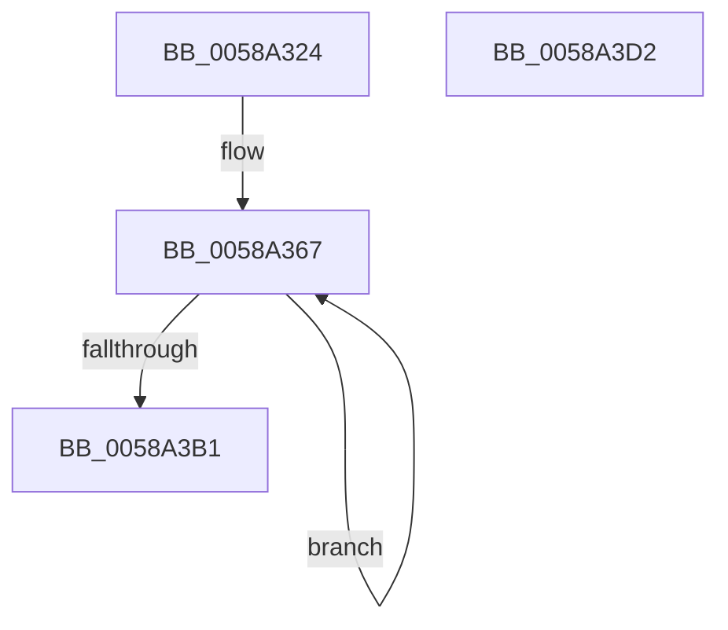

# HvlConfigureIdleStates

- RVA: `0x0058A324`–`0x0058A3D3` (길이 `175` bytes)
- VA: `0x000000014058A324`
- 실행 섹션: `.text`
- PDB 이름 있음: `예`; PDB Function 태그: `아니요`
- unwind 정보 RVA: `0x000BD438`
- 디코드: `45`개 명령, `175/175` bytes 표시
- 미해석 바이트: `0` (있으면 어셈블리에 `.byte`로 보존)

> 이 문서는 커널 이미지의 기계어와 PDB 기호를 분석해 생성했습니다. 4번과 5번은 함수 원형과 자료형을 바이너리 사용 방식에서 추정한 C 해석이며 원본 소스 복구 결과는 아닙니다.

## 1. Dependencies

- 직접 호출 지점: **2**; 고유 호출 대상: **2**
- 직접 호출자로 확인된 함수: **1**
- RIP 상대 이미지 참조: **0**

### Outgoing calls
- `0x0058A349` → [memset](../6C/memset_function_006C6C40.md) (function, `0x006C6C40`)
- `0x0058A3BC` → [HvlpSetPowerProperty](../4C/HvlpSetPowerProperty_function_004C9124.md) (function, `0x004C9124`)

### Direct callers
- [PpmIdleUpdateHvStates](../../page/77/PpmIdleUpdateHvStates_function_00770BF0.md) at `0x00770C26`

### Static image references
- 디코드된 RIP-relative 메모리 참조가 없습니다.

## 2. Other-region calls and transfers

- 다른 실행 섹션으로 향하는 call: **0**
- 별도 외부 분기/꼬리 이동을 확인하지 못했습니다.

## 3. Assembly (complete function range)

```asm
0058A324  48 89 5C 24 08                  mov qword ptr [rsp + 8], rbx
0058A329  57                              push rdi
0058A32A  48 81 EC 40 02 00 00            sub rsp, 0x240
0058A331  48 8B FA                        mov rdi, rdx
0058A334  8B D9                           mov ebx, ecx
0058A336  33 C0                           xor eax, eax
0058A338  48 8D 4C 24 20                  lea rcx, [rsp + 0x20]
0058A33D  33 D2                           xor edx, edx
0058A33F  89 44 24 24                     mov dword ptr [rsp + 0x24], eax
0058A343  41 B8 14 02 00 00               mov r8d, 0x214
0058A349  E8 F2 C8 13 00                  call 0x1406c6c40
0058A34E  B8 04 00 00 00                  mov eax, 4
0058A353  C7 44 24 20 07 00 00 00         mov dword ptr [rsp + 0x20], 7
0058A35B  89 5C 24 28                     mov dword ptr [rsp + 0x28], ebx
0058A35F  48 8D 4C 24 30                  lea rcx, [rsp + 0x30]
0058A364  8D 50 7C                        lea edx, [rax + 0x7c]
0058A367  0F 10 07                        movups xmm0, xmmword ptr [rdi]
0058A36A  0F 10 4F 10                     movups xmm1, xmmword ptr [rdi + 0x10]
0058A36E  0F 11 01                        movups xmmword ptr [rcx], xmm0
0058A371  0F 10 47 20                     movups xmm0, xmmword ptr [rdi + 0x20]
0058A375  0F 11 49 10                     movups xmmword ptr [rcx + 0x10], xmm1
0058A379  0F 10 4F 30                     movups xmm1, xmmword ptr [rdi + 0x30]
0058A37D  0F 11 41 20                     movups xmmword ptr [rcx + 0x20], xmm0
0058A381  0F 10 47 40                     movups xmm0, xmmword ptr [rdi + 0x40]
0058A385  0F 11 49 30                     movups xmmword ptr [rcx + 0x30], xmm1
0058A389  0F 10 4F 50                     movups xmm1, xmmword ptr [rdi + 0x50]
0058A38D  0F 11 41 40                     movups xmmword ptr [rcx + 0x40], xmm0
0058A391  0F 10 47 60                     movups xmm0, xmmword ptr [rdi + 0x60]
0058A395  0F 11 49 50                     movups xmmword ptr [rcx + 0x50], xmm1
0058A399  0F 10 4F 70                     movups xmm1, xmmword ptr [rdi + 0x70]
0058A39D  48 03 FA                        add rdi, rdx
0058A3A0  0F 11 41 60                     movups xmmword ptr [rcx + 0x60], xmm0
0058A3A4  48 03 CA                        add rcx, rdx
0058A3A7  0F 11 49 F0                     movups xmmword ptr [rcx - 0x10], xmm1
0058A3AB  48 83 E8 01                     sub rax, 1
0058A3AF  75 B6                           jne 0x14058a367
0058A3B1  48 8B 07                        mov rax, qword ptr [rdi]
0058A3B4  48 89 01                        mov qword ptr [rcx], rax
0058A3B7  48 8D 4C 24 20                  lea rcx, [rsp + 0x20]
0058A3BC  E8 63 ED F3 FF                  call 0x1404c9124
0058A3C1  48 8B 9C 24 50 02 00 00         mov rbx, qword ptr [rsp + 0x250]
0058A3C9  48 81 C4 40 02 00 00            add rsp, 0x240
0058A3D0  5F                              pop rdi
0058A3D1  C3                              ret
0058A3D2  CC                              int3
```

## 4. C-style interpretation (structured pseudocode)

```c
__int64 __fastcall HvlConfigureIdleStates(int a1, __int64 a2)
{
    __int64 result;
    __int64 v_rdi;
    __int64 v_rsp;
    unsigned __int64 v_stack_m218;
    unsigned int v_stack_m220;
    unsigned int v_stack_m224;
    unsigned __int64 v_stack_m228;
    unsigned __int64 v_stack_p8;

    v_stack_p8 = v_rbx;
    v_rsp = (v_rsp) - (576);
    result = 0;
    a2 = 0;
    v_stack_m224 = 0;
    result = memset(v_stack_m228, a2, 532, a4);
    v_stack_m228 = 7;
    v_stack_m220 = (unsigned int)((unsigned int)(a1));
loc_0058A367:
    *(unsigned __int64 *)(v_stack_m218) = v_xmm0;
    *(unsigned __int64 *)(v_stack_m218 + 16) = v_xmm1;
    *(unsigned __int64 *)(v_stack_m218 + 32) = v_xmm0;
    *(unsigned __int64 *)(v_stack_m218 + 48) = v_xmm1;
    *(unsigned __int64 *)(v_stack_m218 + 64) = v_xmm0;
    *(unsigned __int64 *)(v_stack_m218 + 80) = v_xmm1;
    v_rdi = (a2) + (4 + 124);
    *(unsigned __int64 *)(v_stack_m218 + 96) = v_xmm0;
    a1 = (v_stack_m218) + (4 + 124);
    *(unsigned __int64 *)(a1 - 16) = v_xmm1;
    result = (4) - (1);
    if (condition_is_not_equal) goto loc_0058A367;
    *(unsigned __int64 *)(a1) = *(unsigned __int64 *)(v_rdi);
    result = HvlpSetPowerProperty(v_stack_m228, 4 + 124, 532, a4);
    v_rsp = (v_rsp) + (576);
    return result;
}
```

## 5. (Beta) C Style

```c
int64_t HvlConfigureIdleStates(int32_t Arg1, void *Arg2)
{
    uint8_t *arg2 = (uint8_t *)Arg2;

    int64_t result;
    int64_t local_rdi;
    int64_t local_rsp;
    uint64_t v_stack_m218;
    uint32_t v_stack_m220;
    uint32_t v_stack_m224;
    uint64_t v_stack_m228;
    uint64_t v_stack_p8;

    v_stack_p8 = local_rbx;
    local_rsp = (local_rsp) - (576);
    result = 0;
    Arg2 = 0;
    v_stack_m224 = 0;
    result = memset(v_stack_m228, Arg2, 532, a4);
    v_stack_m228 = 7;
    v_stack_m220 = (uint32_t)((uint32_t)(Arg1));
loc_0058A367:
    *(uint64_t *)(v_stack_m218) = v_xmm0;
    *(uint64_t *)(v_stack_m218 + 0x10) = v_xmm1;
    *(uint64_t *)(v_stack_m218 + 0x20) = v_xmm0;
    *(uint64_t *)(v_stack_m218 + 0x30) = v_xmm1;
    *(uint64_t *)(v_stack_m218 + 0x40) = v_xmm0;
    *(uint64_t *)(v_stack_m218 + 0x50) = v_xmm1;
    local_rdi = (Arg2) + (4 + 124);
    *(uint64_t *)(v_stack_m218 + 0x60) = v_xmm0;
    Arg1 = (v_stack_m218) + (4 + 124);
    *(uint64_t *)(Arg1 - 0x10) = v_xmm1;
    result = (4) - (1);
    if (condition_is_not_equal) goto loc_0058A367;
    *(uint64_t *)(Arg1) = *(uint64_t *)(local_rdi);
    result = HvlpSetPowerProperty(v_stack_m228, 4 + 124, 532, a4);
    local_rsp = (local_rsp) + (576);
    return result;
}
```

### 관측된 메모리 오프셋

구조체 형식이 확인되지 않은 접근은 인자 기준의 오프셋으로만 기록했습니다.

| 기준 인자 | 오프셋 표현 | 폭 (bit) | 접근 |
|---|---:|---:|---|
| `Arg2` | `+ 0x0` | `64` | `R` |
| `Arg2` | `+ 0x0` | `128` | `R` |
| `Arg2` | `+ 0x10` | `128` | `R` |
| `Arg2` | `+ 0x20` | `128` | `R` |
| `Arg2` | `+ 0x30` | `128` | `R` |
| `Arg2` | `+ 0x40` | `128` | `R` |
| `Arg2` | `+ 0x50` | `128` | `R` |
| `Arg2` | `+ 0x60` | `128` | `R` |
| `Arg2` | `+ 0x70` | `128` | `R` |

## 6. Execution-region graph

[열기: 2D/3D 그래프와 함수 탐색 컨트롤 패널](../../../control-panel.html?section=text&rva=0x0058A324&view=graph)

- 2D 그래프는 위에서 아래로 흐르고, 3D 그래프는 빈 공간을 드래그해 회전합니다. Shift+드래그는 이동, 휠은 확대·축소, 함수 노드 선택은 대상 보고서 이동입니다.

### Static fallback


