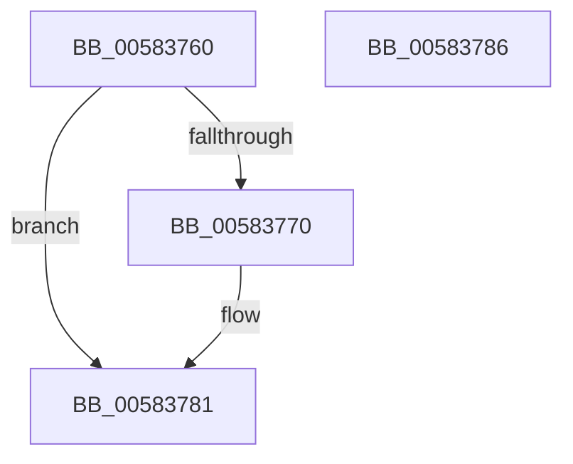

# HvlConfigureMemoryZeroingOnReset

- RVA: `0x00583760`–`0x00583787` (길이 `39` bytes)
- VA: `0x0000000140583760`
- 실행 섹션: `.text`
- PDB 이름 있음: `예`; PDB Function 태그: `아니요`
- unwind 정보 RVA: `0x0005C788`
- 디코드: `11`개 명령, `39/39` bytes 표시
- 미해석 바이트: `0` (있으면 어셈블리에 `.byte`로 보존)

> 이 문서는 커널 이미지의 기계어와 PDB 기호를 분석해 생성했습니다. 4번과 5번은 함수 원형과 자료형을 바이너리 사용 방식에서 추정한 C 해석이며 원본 소스 복구 결과는 아닙니다.

## 1. Dependencies

- 직접 호출 지점: **1**; 고유 호출 대상: **1**
- 직접 호출자로 확인된 함수: **4**
- RIP 상대 이미지 참조: **1**

### Outgoing calls
- `0x0058377C` → [HvlpSetRegister64](../4D/HvlpSetRegister64_function_004DDA70.md) (function, `0x004DDA70`)

### Direct callers
- [HvlPhase1Initialize](HvlPhase1Initialize_function_00583D80.md) at `0x00583E56`
- [PopHiberCheckResume](../../pagelk/B6/PopHiberCheckResume_function_00B6D840.md) at `0x00B6D978`
- [PopSaveHiberContext](../../pagelk/B6/PopSaveHiberContext_function_00B6F050.md) at `0x00B6FA73`
- [PopShutdownSystem](../../pagelk/B7/PopShutdownSystem_function_00B71784.md) at `0x00B717A3`

### Static image references
- `0x00583764` → RVA `0x00FC6A90` (`ALMOSTRO`; read)

## 2. Other-region calls and transfers

- 다른 실행 섹션으로 향하는 call: **0**
- 별도 외부 분기/꼬리 이동을 확인하지 못했습니다.

## 3. Assembly (complete function range)

```asm
00583760  48 83 EC 28                     sub rsp, 0x28
00583764  F7 05 22 33 A4 00 00 00 04 00   test dword ptr [rip + 0xa43322], 0x40000
0058376E  74 11                           je 0x140583781
00583770  33 D2                           xor edx, edx
00583772  84 C9                           test cl, cl
00583774  B9 70 02 00 00                  mov ecx, 0x270
00583779  0F 95 C2                        setne dl
0058377C  E8 EF A2 F5 FF                  call 0x1404dda70
00583781  48 83 C4 28                     add rsp, 0x28
00583785  C3                              ret
00583786  CC                              int3
```

## 4. C-style interpretation (structured pseudocode)

```c
__int64 __fastcall HvlConfigureMemoryZeroingOnReset(unsigned __int8 a1, int a2)
{
    __int64 result;
    __int64 v_rsp;

    v_rsp = (v_rsp) - (40);
    if (((*(unsigned int *)(v_rip + 10760994)) & (0x40000ULL)) != 0) {
        a2 = 0;
        a1 = 624;
        a2 = (a1 != 0) ? 1 : 0;
        result = HvlpSetRegister64(a1, a2, a3, a4);
    }
    v_rsp = (v_rsp) + (40);
    return result;
}
```

## 5. (Beta) C Style

```c
int64_t HvlConfigureMemoryZeroingOnReset(uint8_t Arg1, int32_t Arg2)
{
    int64_t result;
    int64_t local_rsp;

    local_rsp = (local_rsp) - (40);
    if (((*(uint32_t *)(v_rip + 0xA43322)) & (0x40000ULL)) != 0) {
        Arg2 = 0;
        Arg1 = 624;
        Arg2 = (Arg1 != 0) ? 1 : 0;
        result = HvlpSetRegister64(Arg1, Arg2, a3, a4);
    }
    local_rsp = (local_rsp) + (40);
    return result;
}
```

## 6. Execution-region graph

[열기: 2D/3D 그래프와 함수 탐색 컨트롤 패널](../../../control-panel.html?section=text&rva=0x00583760&view=graph)

- 2D 그래프는 위에서 아래로 흐르고, 3D 그래프는 빈 공간을 드래그해 회전합니다. Shift+드래그는 이동, 휠은 확대·축소, 함수 노드 선택은 대상 보고서 이동입니다.

### Static fallback


