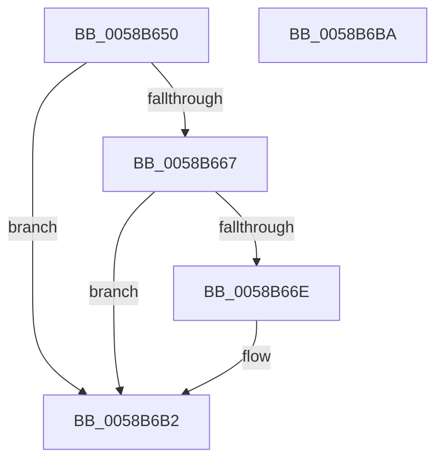

# HvlCrashdumpCallbackRoutine

- RVA: `0x0058B650`–`0x0058B6BB` (길이 `107` bytes)
- VA: `0x000000014058B650`
- 실행 섹션: `.text`
- PDB 이름 있음: `예`; PDB Function 태그: `아니요`
- unwind 정보 RVA: `0x00064C80`
- 디코드: `26`개 명령, `107/107` bytes 표시
- 미해석 바이트: `0` (있으면 어셈블리에 `.byte`로 보존)

> 이 문서는 커널 이미지의 기계어와 PDB 기호를 분석해 생성했습니다. 4번과 5번은 함수 원형과 자료형을 바이너리 사용 방식에서 추정한 C 해석이며 원본 소스 복구 결과는 아닙니다.

## 1. Dependencies

- 직접 호출 지점: **3**; 고유 호출 대상: **3**
- 직접 호출자로 확인된 함수: **0**
- RIP 상대 이미지 참조: **3**

### Outgoing calls
- `0x0058B656` → [HvlpSnapshotCrashArea](HvlpSnapshotCrashArea_function_0058C0B0.md) (function, `0x0058C0B0`)
- `0x0058B67A` → [guard_dispatch_icall](../6B/guard_dispatch_icall_function_006BAAD0.md) (function, `0x006BAAD0`)
- `0x0058B6AC` → [KeBugCheckEx](../4F/KeBugCheckEx_function_004FD660.md) (function, `0x004FD660`)

### Direct callers
- 이 함수 시작 RVA로 연결되는 직접 call은 확인되지 않았습니다. 간접 호출은 완전히 역산할 수 없습니다.

### Static image references
- `0x0058B65B` → RVA `0x00F8ED88` (`.data`; read)
- `0x0058B66E` → RVA `0x00E008F8` (`.data`; read)
- `0x0058B67F` → RVA `0x00E667E8` (`.data`; write)

## 2. Other-region calls and transfers

- 다른 실행 섹션으로 향하는 call: **0**
- 별도 외부 분기/꼬리 이동을 확인하지 못했습니다.

## 3. Assembly (complete function range)

```asm
0058B650  40 53                           push rbx
0058B652  48 83 EC 30                     sub rsp, 0x30
0058B656  E8 55 0A 00 00                  call 0x14058c0b0
0058B65B  48 8B 1D 26 37 A0 00            mov rbx, qword ptr [rip + 0xa03726]
0058B662  48 85 DB                        test rbx, rbx
0058B665  74 4B                           je 0x14058b6b2
0058B667  8B 43 04                        mov eax, dword ptr [rbx + 4]
0058B66A  A8 01                           test al, 1
0058B66C  74 44                           je 0x14058b6b2
0058B66E  48 8B 05 83 52 87 00            mov rax, qword ptr [rip + 0x875283]
0058B675  B9 01 00 00 00                  mov ecx, 1
0058B67A  E8 51 F4 12 00                  call 0x1406baad0
0058B67F  C6 05 62 B1 8D 00 01            mov byte ptr [rip + 0x8db162], 1
0058B686  B9 01 00 02 00                  mov ecx, 0x20001
0058B68B  48 8B 83 D0 00 00 00            mov rax, qword ptr [rbx + 0xd0]
0058B692  4C 8B 8B C8 00 00 00            mov r9, qword ptr [rbx + 0xc8]
0058B699  4C 8B 83 C0 00 00 00            mov r8, qword ptr [rbx + 0xc0]
0058B6A0  48 8B 93 B8 00 00 00            mov rdx, qword ptr [rbx + 0xb8]
0058B6A7  48 89 44 24 20                  mov qword ptr [rsp + 0x20], rax
0058B6AC  E8 AF 1F F7 FF                  call 0x1404fd660
0058B6B1  CC                              int3
0058B6B2  32 C0                           xor al, al
0058B6B4  48 83 C4 30                     add rsp, 0x30
0058B6B8  5B                              pop rbx
0058B6B9  C3                              ret
0058B6BA  CC                              int3
```

## 4. C-style interpretation (structured pseudocode)

```c
__int64 __fastcall HvlCrashdumpCallbackRoutine(void)
{
    __int64 result;
    __int64 v_rsp;
    unsigned __int64 v_stack_m18;

    v_rsp = (v_rsp) - (48);
    result = HvlpSnapshotCrashArea(a1, a2, a3, a4);
    if (*(unsigned __int64 *)(v_rip + 10499878) == 0) goto loc_0058B6B2;
    result = (unsigned int)(*(unsigned int *)(*(unsigned __int64 *)(v_rip + 10499878) + 4));
    if ((((unsigned __int8)((unsigned int)(*(unsigned int *)(*(unsigned __int64 *)(v_rip + 10499878) + 4)))) & (1)) != 0) {
        result = *(unsigned __int64 *)(v_rip + 8868483);
        a1 = 1;
        result = guard_dispatch_icall(a1, a2, a3, a4);
        *(unsigned __int8 *)(v_rip + 9285986) = 1;
        a1 = 0x20001ULL;
        result = *(unsigned __int64 *)(*(unsigned __int64 *)(v_rip + 10499878) + 208);
        a4 = *(unsigned __int64 *)(*(unsigned __int64 *)(v_rip + 10499878) + 200);
        a3 = *(unsigned __int64 *)(*(unsigned __int64 *)(v_rip + 10499878) + 192);
        a2 = *(unsigned __int64 *)(*(unsigned __int64 *)(v_rip + 10499878) + 184);
        v_stack_m18 = result;
        result = KeBugCheckEx(a1, a2, a3, a4);
    }
    result = 0;
    v_rsp = (v_rsp) + (48);
    return result;
}
```

## 5. (Beta) C Style

```c
void HvlCrashdumpCallbackRoutine(void)
{
    int64_t result;
    int64_t local_rsp;
    uint64_t v_stack_m18;

    local_rsp = (local_rsp) - (48);
    result = HvlpSnapshotCrashArea(a1, a2, a3, a4);
    if (*(uint64_t *)(v_rip + 0xA03726) == 0) goto loc_0058B6B2;
    result = (uint32_t)(*(uint32_t *)(*(uint64_t *)(v_rip + 0xA03726) + 0x4));
    if ((((uint8_t)((uint32_t)(*(uint32_t *)(*(uint64_t *)(v_rip + 0xA03726) + 0x4)))) & (1)) != 0) {
        result = *(uint64_t *)(v_rip + 0x875283);
        a1 = 1;
        result = guard_dispatch_icall(a1, a2, a3, a4);
        *(uint8_t *)(v_rip + 0x8DB162) = 1;
        a1 = 0x20001ULL;
        result = *(uint64_t *)(*(uint64_t *)(v_rip + 0xA03726) + 0xD0);
        a4 = *(uint64_t *)(*(uint64_t *)(v_rip + 0xA03726) + 0xC8);
        a3 = *(uint64_t *)(*(uint64_t *)(v_rip + 0xA03726) + 0xC0);
        a2 = *(uint64_t *)(*(uint64_t *)(v_rip + 0xA03726) + 0xB8);
        v_stack_m18 = result;
        result = KeBugCheckEx(a1, a2, a3, a4);
    }
    result = 0;
    local_rsp = (local_rsp) + (48);
    return result;
}
```

## 6. Execution-region graph

[열기: 2D/3D 그래프와 함수 탐색 컨트롤 패널](../../../control-panel.html?section=text&rva=0x0058B650&view=graph)

- 2D 그래프는 위에서 아래로 흐르고, 3D 그래프는 빈 공간을 드래그해 회전합니다. Shift+드래그는 이동, 휠은 확대·축소, 함수 노드 선택은 대상 보고서 이동입니다.

### Static fallback


