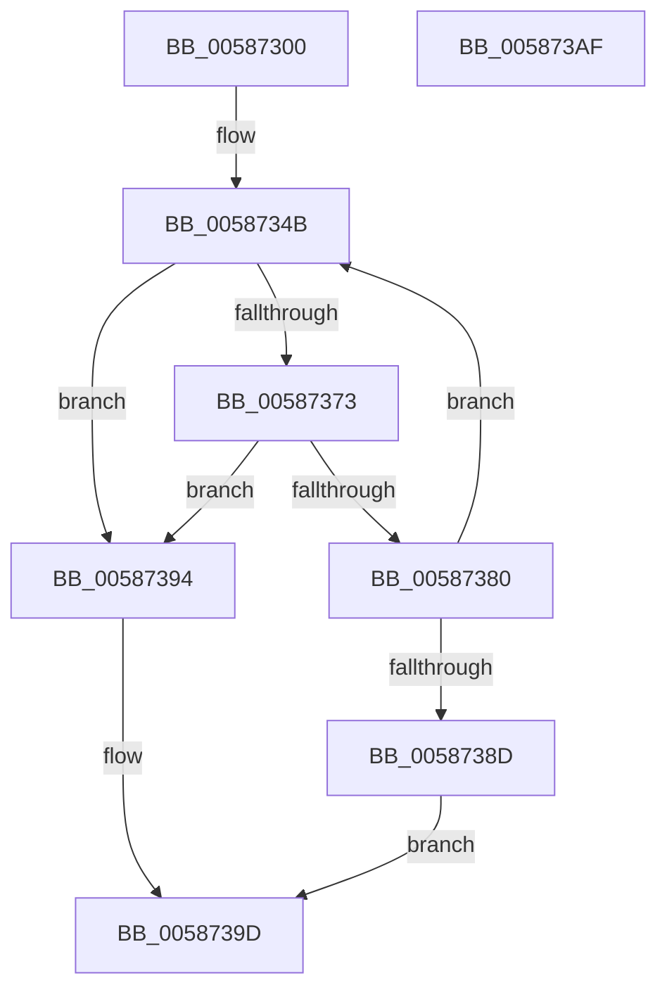

# HvlCreatePasidSpace

- RVA: `0x00587300`–`0x005873B0` (길이 `176` bytes)
- VA: `0x0000000140587300`
- 실행 섹션: `.text`
- PDB 이름 있음: `예`; PDB Function 태그: `아니요`
- unwind 정보 RVA: `0x000A02F8`
- 디코드: `43`개 명령, `176/176` bytes 표시
- 미해석 바이트: `0` (있으면 어셈블리에 `.byte`로 보존)

> 이 문서는 커널 이미지의 기계어와 PDB 기호를 분석해 생성했습니다. 4번과 5번은 함수 원형과 자료형을 바이너리 사용 방식에서 추정한 C 해석이며 원본 소스 복구 결과는 아닙니다.

## 1. Dependencies

- 직접 호출 지점: **5**; 고유 호출 대상: **5**
- 직접 호출자로 확인된 함수: **0**
- RIP 상대 이미지 참조: **2**

### Outgoing calls
- `0x00587361` → [HvcallFastExtended](../31/HvcallFastExtended_function_003130E0.md) (function, `0x003130E0`)
- `0x00587377` → [HvlpHvStatusIsInsufficientMemory](../30/HvlpHvStatusIsInsufficientMemory_function_00307BB0.md) (function, `0x00307BB0`)
- `0x00587384` → [HvlpHandleInsufficientMemory](HvlpHandleInsufficientMemory_function_00584514.md) (function, `0x00584514`)
- `0x00587398` → [HvlpHvToNtStatus](../30/HvlpHvToNtStatus_function_00307BD8.md) (function, `0x00307BD8`)
- `0x005873A5` → [_security_check_cookie](../6A/_security_check_cookie_function_006AC640.md) (function, `0x006AC640`)

### Direct callers
- 이 함수 시작 RVA로 연결되는 직접 call은 확인되지 않았습니다. 간접 호출은 완전히 역산할 수 없습니다.

### Static image references
- `0x00587304` → RVA `0x00E0A740` (`.data`; read)
- `0x00587369` → RVA `0x00FC6A90` (`ALMOSTRO`; read)

## 2. Other-region calls and transfers

- 다른 실행 섹션으로 향하는 call: **0**
- 별도 외부 분기/꼬리 이동을 확인하지 못했습니다.

## 3. Assembly (complete function range)

```asm
00587300  48 83 EC 78                     sub rsp, 0x78
00587304  48 8B 05 35 34 88 00            mov rax, qword ptr [rip + 0x883435]
0058730B  48 33 C4                        xor rax, rsp
0058730E  48 89 44 24 60                  mov qword ptr [rsp + 0x60], rax
00587313  48 83 64 24 58 00               and qword ptr [rsp + 0x58], 0
00587319  48 83 4C 24 40 FF               or qword ptr [rsp + 0x40], 0xffffffffffffffff
0058731F  89 4C 24 48                     mov dword ptr [rsp + 0x48], ecx
00587323  B9 77 02 00 00                  mov ecx, 0x277
00587328  89 54 24 4C                     mov dword ptr [rsp + 0x4c], edx
0058732C  0F 32                           rdmsr
0058732E  48 C1 E2 20                     shl rdx, 0x20
00587332  48 0B C2                        or rax, rdx
00587335  48 C7 44 24 30 9D 00 00 00      mov qword ptr [rsp + 0x30], 0x9d
0058733E  48 89 44 24 50                  mov qword ptr [rsp + 0x50], rax
00587343  C7 44 24 30 9D 00 01 00         mov dword ptr [rsp + 0x30], 0x1009d
0058734B  48 8B 4C 24 30                  mov rcx, qword ptr [rsp + 0x30]
00587350  48 8D 54 24 40                  lea rdx, [rsp + 0x40]
00587355  83 64 24 20 00                  and dword ptr [rsp + 0x20], 0
0058735A  45 33 C9                        xor r9d, r9d
0058735D  45 8D 41 20                     lea r8d, [r9 + 0x20]
00587361  E8 7A BD D8 FF                  call 0x1403130e0
00587366  4C 8B C0                        mov r8, rax
00587369  8B 05 21 F7 A3 00               mov eax, dword ptr [rip + 0xa3f721]
0058736F  A8 02                           test al, 2
00587371  74 21                           je 0x140587394
00587373  41 0F B7 C8                     movzx ecx, r8w
00587377  E8 34 08 D8 FF                  call 0x140307bb0
0058737C  84 C0                           test al, al
0058737E  74 14                           je 0x140587394
00587380  41 0F B7 C8                     movzx ecx, r8w
00587384  E8 8B D1 FF FF                  call 0x140584514
00587389  85 C0                           test eax, eax
0058738B  79 BE                           jns 0x14058734b
0058738D  B8 9A 00 00 C0                  mov eax, 0xc000009a
00587392  EB 09                           jmp 0x14058739d
00587394  41 0F B7 C8                     movzx ecx, r8w
00587398  E8 3B 08 D8 FF                  call 0x140307bd8
0058739D  48 8B 4C 24 60                  mov rcx, qword ptr [rsp + 0x60]
005873A2  48 33 CC                        xor rcx, rsp
005873A5  E8 96 52 12 00                  call 0x1406ac640
005873AA  48 83 C4 78                     add rsp, 0x78
005873AE  C3                              ret
005873AF  CC                              int3
```

## 4. C-style interpretation (structured pseudocode)

```c
__int64 __fastcall HvlCreatePasidSpace(int a1, __int64 a2, __int64 a3, int a4)
{
    __int64 result;
    __int64 v_rsp;
    unsigned __int64 v_stack_m18;
    unsigned __int64 v_stack_m20;
    unsigned __int64 v_stack_m28;
    unsigned int v_stack_m2C;
    unsigned int v_stack_m30;
    unsigned __int64 v_stack_m38;
    unsigned __int64 v_stack_m48;
    unsigned int v_stack_m58;

    v_rsp = (v_rsp) - (120);
    result = (*(unsigned __int64 *)(v_rip + 8926261)) ^ (v_rsp);
    v_stack_m18 = result;
    v_stack_m30 = a1;
    v_stack_m2C = (unsigned int)(a2);
    a2 = (a2) << (32);
    result = (result) | (a2);
    v_stack_m48 = 157;
    v_stack_m28 = result;
    v_stack_m48 = 0x1009DULL;
loc_0058734B:
    a4 = 0;
    result = HvcallFastExtended(v_stack_m48, v_stack_m38, a4 + 32, a4);
    if ((((unsigned __int8)((unsigned int)(*(unsigned int *)(v_rip + 10745633)))) & (2)) == 0) goto loc_00587394;
    result = HvlpHvStatusIsInsufficientMemory((unsigned __int16)(result), v_stack_m38, result, a4);
    if ((unsigned __int8)(result) == 0) goto loc_00587394;
    result = HvlpHandleInsufficientMemory((unsigned __int16)(result), v_stack_m38, result, a4);
    if (!sign_flag) goto loc_0058734B;
    goto loc_0058739D;
loc_00587394:
    result = HvlpHvToNtStatus((unsigned __int16)(result), v_stack_m38, result, a4);
loc_0058739D:
    a1 = (v_stack_m18) ^ (v_rsp);
    result = _security_check_cookie(a1, v_stack_m38, result, a4);
    v_rsp = (v_rsp) + (120);
    return result;
}
```

## 5. (Beta) C Style

```c
int64_t HvlCreatePasidSpace(int32_t Arg1, int64_t Arg2, int64_t Arg3, int32_t Arg4)
{
    int64_t result;
    int64_t local_rsp;
    uint64_t v_stack_m18;
    uint64_t v_stack_m20;
    uint64_t v_stack_m28;
    uint32_t v_stack_m2C;
    uint32_t v_stack_m30;
    uint64_t v_stack_m38;
    uint64_t v_stack_m48;
    uint32_t v_stack_m58;

    local_rsp = (local_rsp) - (120);
    result = (*(uint64_t *)(v_rip + 0x883435)) ^ (local_rsp);
    v_stack_m18 = result;
    v_stack_m30 = Arg1;
    v_stack_m2C = (uint32_t)(Arg2);
    Arg2 = (Arg2) << (32);
    result = (result) | (Arg2);
    v_stack_m48 = 157;
    v_stack_m28 = result;
    v_stack_m48 = 0x1009DULL;
loc_0058734B:
    Arg4 = 0;
    result = HvcallFastExtended(v_stack_m48, v_stack_m38, Arg4 + 32, Arg4);
    if ((((uint8_t)((uint32_t)(*(uint32_t *)(v_rip + 0xA3F721)))) & (2)) == 0) goto loc_00587394;
    result = HvlpHvStatusIsInsufficientMemory((uint16_t)(result), v_stack_m38, result, Arg4);
    if ((uint8_t)(result) == 0) goto loc_00587394;
    result = HvlpHandleInsufficientMemory((uint16_t)(result), v_stack_m38, result, Arg4);
    if (!sign_flag) goto loc_0058734B;
    goto loc_0058739D;
loc_00587394:
    result = HvlpHvToNtStatus((uint16_t)(result), v_stack_m38, result, Arg4);
loc_0058739D:
    Arg1 = (v_stack_m18) ^ (local_rsp);
    result = _security_check_cookie(Arg1, v_stack_m38, result, Arg4);
    local_rsp = (local_rsp) + (120);
    return result;
}
```

## 6. Execution-region graph

[열기: 2D/3D 그래프와 함수 탐색 컨트롤 패널](../../../control-panel.html?section=text&rva=0x00587300&view=graph)

- 2D 그래프는 위에서 아래로 흐르고, 3D 그래프는 빈 공간을 드래그해 회전합니다. Shift+드래그는 이동, 휠은 확대·축소, 함수 노드 선택은 대상 보고서 이동입니다.

### Static fallback


