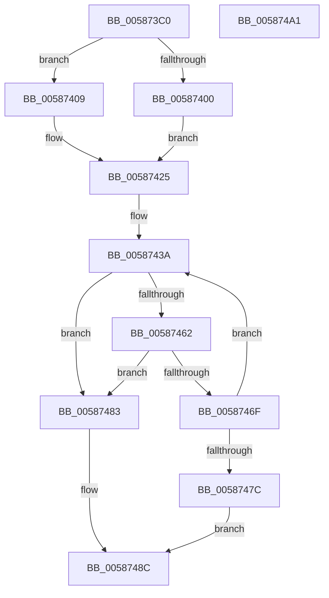

# HvlCreatePrQueue

- RVA: `0x005873C0`–`0x005874A2` (길이 `226` bytes)
- VA: `0x00000001405873C0`
- 실행 섹션: `.text`
- PDB 이름 있음: `예`; PDB Function 태그: `아니요`
- unwind 정보 RVA: `0x000C618C`
- 디코드: `53`개 명령, `226/226` bytes 표시
- 미해석 바이트: `0` (있으면 어셈블리에 `.byte`로 보존)

> 이 문서는 커널 이미지의 기계어와 PDB 기호를 분석해 생성했습니다. 4번과 5번은 함수 원형과 자료형을 바이너리 사용 방식에서 추정한 C 해석이며 원본 소스 복구 결과는 아닙니다.

## 1. Dependencies

- 직접 호출 지점: **5**; 고유 호출 대상: **5**
- 직접 호출자로 확인된 함수: **0**
- RIP 상대 이미지 참조: **4**

### Outgoing calls
- `0x00587450` → [HvcallFastExtended](../31/HvcallFastExtended_function_003130E0.md) (function, `0x003130E0`)
- `0x00587466` → [HvlpHvStatusIsInsufficientMemory](../30/HvlpHvStatusIsInsufficientMemory_function_00307BB0.md) (function, `0x00307BB0`)
- `0x00587473` → [HvlpHandleInsufficientMemory](HvlpHandleInsufficientMemory_function_00584514.md) (function, `0x00584514`)
- `0x00587487` → [HvlpHvToNtStatus](../30/HvlpHvToNtStatus_function_00307BD8.md) (function, `0x00307BD8`)
- `0x00587494` → [_security_check_cookie](../6A/_security_check_cookie_function_006AC640.md) (function, `0x006AC640`)

### Direct callers
- 이 함수 시작 RVA로 연결되는 직접 call은 확인되지 않았습니다. 간접 호출은 완전히 역산할 수 없습니다.

### Static image references
- `0x005873CA` → RVA `0x00E0A740` (`.data`; read)
- `0x005873E7` → RVA `0x00FC5007` (`ALMOSTRO`; read)
- `0x00587410` → RVA `0x00FCD260` (`ALMOSTRO`; read)
- `0x00587458` → RVA `0x00FC6A90` (`ALMOSTRO`; read)

## 2. Other-region calls and transfers

- 다른 실행 섹션으로 향하는 call: **0**
- 별도 외부 분기/꼬리 이동을 확인하지 못했습니다.

## 3. Assembly (complete function range)

```asm
005873C0  4C 8B DC                        mov r11, rsp
005873C3  48 81 EC 88 00 00 00            sub rsp, 0x88
005873CA  48 8B 05 6F 33 88 00            mov rax, qword ptr [rip + 0x88336f]
005873D1  48 33 C4                        xor rax, rsp
005873D4  48 89 44 24 70                  mov qword ptr [rsp + 0x70], rax
005873D9  49 83 63 D8 00                  and qword ptr [r11 - 0x28], 0
005873DE  49 83 4B B8 FF                  or qword ptr [r11 - 0x48], 0xffffffffffffffff
005873E3  49 C1 E8 0C                     shr r8, 0xc
005873E7  80 3D 19 DC A3 00 00            cmp byte ptr [rip + 0xa3dc19], 0
005873EE  89 4C 24 48                     mov dword ptr [rsp + 0x48], ecx
005873F2  89 54 24 4C                     mov dword ptr [rsp + 0x4c], edx
005873F6  4D 89 43 C8                     mov qword ptr [r11 - 0x38], r8
005873FA  45 89 4B D0                     mov dword ptr [r11 - 0x30], r9d
005873FE  74 09                           je 0x140587409
00587400  8B 8C 24 B0 00 00 00            mov ecx, dword ptr [rsp + 0xb0]
00587407  EB 1C                           jmp 0x140587425
00587409  8B 84 24 B0 00 00 00            mov eax, dword ptr [rsp + 0xb0]
00587410  48 8D 15 49 5E A4 00            lea rdx, [rip + 0xa45e49]
00587417  0F B6 0C 42                     movzx ecx, byte ptr [rdx + rax*2]
0058741B  0F B6 44 42 01                  movzx eax, byte ptr [rdx + rax*2 + 1]
00587420  C1 E1 06                        shl ecx, 6
00587423  0B C8                           or ecx, eax
00587425  48 C7 44 24 30 A7 00 00 00      mov qword ptr [rsp + 0x30], 0xa7
0058742E  C7 44 24 30 A7 00 01 00         mov dword ptr [rsp + 0x30], 0x100a7
00587436  89 4C 24 5C                     mov dword ptr [rsp + 0x5c], ecx
0058743A  48 8B 4C 24 30                  mov rcx, qword ptr [rsp + 0x30]
0058743F  48 8D 54 24 40                  lea rdx, [rsp + 0x40]
00587444  83 64 24 20 00                  and dword ptr [rsp + 0x20], 0
00587449  45 33 C9                        xor r9d, r9d
0058744C  45 8D 41 28                     lea r8d, [r9 + 0x28]
00587450  E8 8B BC D8 FF                  call 0x1403130e0
00587455  4C 8B C0                        mov r8, rax
00587458  8B 05 32 F6 A3 00               mov eax, dword ptr [rip + 0xa3f632]
0058745E  A8 02                           test al, 2
00587460  74 21                           je 0x140587483
00587462  41 0F B7 C8                     movzx ecx, r8w
00587466  E8 45 07 D8 FF                  call 0x140307bb0
0058746B  84 C0                           test al, al
0058746D  74 14                           je 0x140587483
0058746F  41 0F B7 C8                     movzx ecx, r8w
00587473  E8 9C D0 FF FF                  call 0x140584514
00587478  85 C0                           test eax, eax
0058747A  79 BE                           jns 0x14058743a
0058747C  B8 9A 00 00 C0                  mov eax, 0xc000009a
00587481  EB 09                           jmp 0x14058748c
00587483  41 0F B7 C8                     movzx ecx, r8w
00587487  E8 4C 07 D8 FF                  call 0x140307bd8
0058748C  48 8B 4C 24 70                  mov rcx, qword ptr [rsp + 0x70]
00587491  48 33 CC                        xor rcx, rsp
00587494  E8 A7 51 12 00                  call 0x1406ac640
00587499  48 81 C4 88 00 00 00            add rsp, 0x88
005874A0  C3                              ret
005874A1  CC                              int3
```

## 4. C-style interpretation (structured pseudocode)

```c
__int64 __fastcall HvlCreatePrQueue(int a1, int a2, __int64 a3, int a4, unsigned int a5)
{
    __int64 result;
    __int64 v_rsp;
    unsigned __int64 v_stack_m18;
    unsigned int v_stack_m2C;
    unsigned int v_stack_m3C;
    unsigned int v_stack_m40;
    unsigned __int64 v_stack_m48;
    unsigned __int64 v_stack_m58;
    unsigned int v_stack_m68;

    v_rsp = (v_rsp) - (136);
    result = (*(unsigned __int64 *)(v_rip + 8926063)) ^ (v_rsp);
    v_stack_m18 = result;
    a3 = (a3) >> (12);
    v_stack_m40 = a1;
    v_stack_m3C = a2;
    *(unsigned __int64 *)(v_rsp - 56) = a3;
    *(unsigned int *)(v_rsp - 48) = a4;
    if ((*(unsigned __int8 *)(v_rip + 10738713)) == 0) goto loc_00587409;
    goto loc_00587425;
loc_00587409:
    a1 = (unsigned int)((*(unsigned __int8 *)(v_rip + 10772041 + (unsigned int)(a5) * 2)) << (6));
    a1 = (unsigned int)((a1) | ((unsigned int)(*(unsigned __int8 *)(v_rip + 10772041 + (unsigned int)(a5) * 2 + 1))));
loc_00587425:
    v_stack_m58 = 167;
    v_stack_m58 = 0x100A7ULL;
    v_stack_m2C = a1;
loc_0058743A:
    a4 = 0;
    result = HvcallFastExtended(v_stack_m58, v_stack_m48, a4 + 40, a4);
    if ((((unsigned __int8)((unsigned int)(*(unsigned int *)(v_rip + 10745394)))) & (2)) == 0) goto loc_00587483;
    result = HvlpHvStatusIsInsufficientMemory((unsigned __int16)(result), v_stack_m48, result, a4);
    if ((unsigned __int8)(result) == 0) goto loc_00587483;
    result = HvlpHandleInsufficientMemory((unsigned __int16)(result), v_stack_m48, result, a4);
    if (!sign_flag) goto loc_0058743A;
    goto loc_0058748C;
loc_00587483:
    result = HvlpHvToNtStatus((unsigned __int16)(result), v_stack_m48, result, a4);
loc_0058748C:
    a1 = (v_stack_m18) ^ (v_rsp);
    result = _security_check_cookie(a1, v_stack_m48, result, a4);
    v_rsp = (v_rsp) + (136);
    return result;
}
```

## 5. (Beta) C Style

```c
int64_t HvlCreatePrQueue(int32_t Arg1, int32_t Arg2, int64_t Arg3, int32_t Arg4, uint32_t Arg5)
{
    int64_t result;
    int64_t local_rsp;
    uint64_t v_stack_m18;
    uint32_t v_stack_m2C;
    uint32_t v_stack_m3C;
    uint32_t v_stack_m40;
    uint64_t v_stack_m48;
    uint64_t v_stack_m58;
    uint32_t v_stack_m68;

    local_rsp = (local_rsp) - (136);
    result = (*(uint64_t *)(v_rip + 0x88336F)) ^ (local_rsp);
    v_stack_m18 = result;
    Arg3 = (Arg3) >> (12);
    v_stack_m40 = Arg1;
    v_stack_m3C = Arg2;
    *(uint64_t *)(local_rsp - 0x38) = Arg3;
    *(uint32_t *)(local_rsp - 0x30) = Arg4;
    if ((*(uint8_t *)(v_rip + 0xA3DC19)) == 0) goto loc_00587409;
    goto loc_00587425;
loc_00587409:
    Arg1 = (uint32_t)((*(uint8_t *)(v_rip + 0xA45E49 + (uint32_t)(Arg5) * 2)) << (6));
    Arg1 = (uint32_t)((Arg1) | ((uint32_t)(*(uint8_t *)(v_rip + 0xA45E49 + (uint32_t)(Arg5) * 2 + 0x1))));
loc_00587425:
    v_stack_m58 = 167;
    v_stack_m58 = 0x100A7ULL;
    v_stack_m2C = Arg1;
loc_0058743A:
    Arg4 = 0;
    result = HvcallFastExtended(v_stack_m58, v_stack_m48, Arg4 + 40, Arg4);
    if ((((uint8_t)((uint32_t)(*(uint32_t *)(v_rip + 0xA3F632)))) & (2)) == 0) goto loc_00587483;
    result = HvlpHvStatusIsInsufficientMemory((uint16_t)(result), v_stack_m48, result, Arg4);
    if ((uint8_t)(result) == 0) goto loc_00587483;
    result = HvlpHandleInsufficientMemory((uint16_t)(result), v_stack_m48, result, Arg4);
    if (!sign_flag) goto loc_0058743A;
    goto loc_0058748C;
loc_00587483:
    result = HvlpHvToNtStatus((uint16_t)(result), v_stack_m48, result, Arg4);
loc_0058748C:
    Arg1 = (v_stack_m18) ^ (local_rsp);
    result = _security_check_cookie(Arg1, v_stack_m48, result, Arg4);
    local_rsp = (local_rsp) + (136);
    return result;
}
```

## 6. Execution-region graph

[열기: 2D/3D 그래프와 함수 탐색 컨트롤 패널](../../../control-panel.html?section=text&rva=0x005873C0&view=graph)

- 2D 그래프는 위에서 아래로 흐르고, 3D 그래프는 빈 공간을 드래그해 회전합니다. Shift+드래그는 이동, 휠은 확대·축소, 함수 노드 선택은 대상 보고서 이동입니다.

### Static fallback


