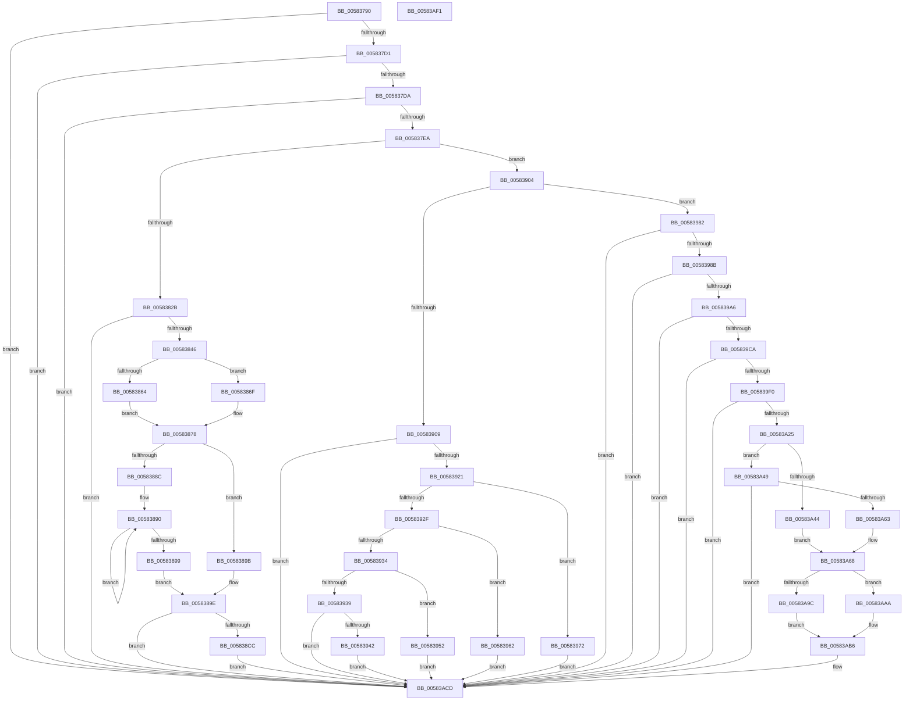

# HvlDebuggerSupportInitialize

- RVA: `0x00583790`–`0x00583AF2` (길이 `866` bytes)
- VA: `0x0000000140583790`
- 실행 섹션: `.text`
- PDB 이름 있음: `예`; PDB Function 태그: `아니요`
- unwind 정보 RVA: `0x000C64B4`
- 디코드: `197`개 명령, `866/866` bytes 표시
- 미해석 바이트: `0` (있으면 어셈블리에 `.byte`로 보존)

> 이 문서는 커널 이미지의 기계어와 PDB 기호를 분석해 생성했습니다. 4번과 5번은 함수 원형과 자료형을 바이너리 사용 방식에서 추정한 C 해석이며 원본 소스 복구 결과는 아닙니다.

## 1. Dependencies

- 직접 호출 지점: **23**; 고유 호출 대상: **8**
- 직접 호출자로 확인된 함수: **1**
- RIP 상대 이미지 참조: **16**

### Outgoing calls
- `0x005837F1` → [strstr](../4F/strstr_function_004FF680.md) (function, `0x004FF680`)
- `0x00583807` → [strstr](../4F/strstr_function_004FF680.md) (function, `0x004FF680`)
- `0x0058381D` → [strstr](../4F/strstr_function_004FF680.md) (function, `0x004FF680`)
- `0x00583835` → [strstr](../4F/strstr_function_004FF680.md) (function, `0x004FF680`)
- `0x00583853` → [memset](../6C/memset_function_006C6C40.md) (function, `0x006C6C40`)
- `0x00583882` → [strstr](../4F/strstr_function_004FF680.md) (function, `0x004FF680`)
- `0x005838BF` → [RtlAnsiStringToUnicodeString](../../page/90/RtlAnsiStringToUnicodeString_function_0090BEA0.md) (function, `0x0090BEA0`)
- `0x005838F0` → [guard_dispatch_icall](../6B/guard_dispatch_icall_function_006BAAD0.md) (function, `0x006BAAD0`)
- `0x005838FA` → [RtlFreeAnsiString](../../page/9C/RtlFreeAnsiString_function_009C0800.md) (function, `0x009C0800`)
- `0x00583913` → [strstr](../4F/strstr_function_004FF680.md) (function, `0x004FF680`)
- `0x00583925` → [atol](../4F/atol_function_004FF8D0.md) (function, `0x004FF8D0`)
- `0x00583995` → [strstr](../4F/strstr_function_004FF680.md) (function, `0x004FF680`)
- `0x005839AA` → [atol](../4F/atol_function_004FF8D0.md) (function, `0x004FF8D0`)
- `0x005839BC` → [strstr](../4F/strstr_function_004FF680.md) (function, `0x004FF680`)
- `0x005839D1` → [atol](../4F/atol_function_004FF8D0.md) (function, `0x004FF8D0`)
- `0x005839E2` → [strstr](../4F/strstr_function_004FF680.md) (function, `0x004FF680`)
- `0x005839F4` → [atol](../4F/atol_function_004FF8D0.md) (function, `0x004FF8D0`)
- `0x00583A14` → [strstr](../4F/strstr_function_004FF680.md) (function, `0x004FF680`)
- `0x00583A36` → [strncmp](../6C/strncmp_function_006C6720.md) (function, `0x006C6720`)
- `0x00583A5A` → [strncmp](../6C/strncmp_function_006C6720.md) (function, `0x006C6720`)
- `0x00583A75` → [memset](../6C/memset_function_006C6C40.md) (function, `0x006C6C40`)
- `0x00583AC8` → [guard_dispatch_icall](../6B/guard_dispatch_icall_function_006BAAD0.md) (function, `0x006BAAD0`)
- `0x00583AD4` → [_security_check_cookie](../6A/_security_check_cookie_function_006AC640.md) (function, `0x006AC640`)

### Direct callers
- [Phase1InitializationDiscard](../../init/C1/Phase1InitializationDiscard_function_00C1C728.md) at `0x00C1D7D3`

### Static image references
- `0x005837AA` → RVA `0x00E0A740` (`.data`; read)
- `0x005837B8` → RVA `0x00FC6AD8` (`ALMOSTRO`; read)
- `0x005837EA` → RVA `0x006C9750` (` ?? ::FNODOBFM::`string'`; read)
- `0x005837FD` → RVA `0x006C9770` (` ?? ::FNODOBFM::`string'`; read)
- `0x00583813` → RVA `0x006C9830` (` ?? ::FNODOBFM::`string'`; read)
- `0x0058382B` → RVA `0x006C9850` (` ?? ::FNODOBFM::`string'`; read)
- `0x00583878` → RVA `0x006C9810` (` ?? ::FNODOBFM::`string'`; read)
- `0x005838E4` → RVA `0x00E00960` (`.data`; read)
- `0x00583909` → RVA `0x006C9820` (` ?? ::FNODOBFM::`string'`; read)
- `0x00583942` → RVA `0x00E10318` (`.data`; write)
- `0x0058398B` → RVA `0x006C9880` (` ?? ::FNODOBFM::`string'`; read)
- `0x005839AF` → RVA `0x006C7810` (` ?? ::FNODOBFM::`string'`; read)
- `0x00583A00` → RVA `0x006C9890` (` ?? ::FNODOBFM::`string'`; read)
- `0x00583A2B` → RVA `0x006C9860` (` ?? ::FNODOBFM::`string'`; read)
- `0x00583A4F` → RVA `0x006C9870` (` ?? ::FNODOBFM::`string'`; read)
- `0x00583ABF` → RVA `0x00E00858` (`.data`; read)

## 2. Other-region calls and transfers

- 다른 실행 섹션으로 향하는 call: **2**
  - `0x005838BF` → [RtlAnsiStringToUnicodeString](../../page/90/RtlAnsiStringToUnicodeString_function_0090BEA0.md) (`.text` → `PAGE`)
  - `0x005838FA` → [RtlFreeAnsiString](../../page/9C/RtlFreeAnsiString_function_009C0800.md) (`.text` → `PAGE`)
- 별도 외부 분기/꼬리 이동을 확인하지 못했습니다.

## 3. Assembly (complete function range)

```asm
00583790  48 89 5C 24 10                  mov qword ptr [rsp + 0x10], rbx
00583795  48 89 74 24 18                  mov qword ptr [rsp + 0x18], rsi
0058379A  55                              push rbp
0058379B  57                              push rdi
0058379C  41 56                           push r14
0058379E  48 8D 6C 24 A0                  lea rbp, [rsp - 0x60]
005837A3  48 81 EC 60 01 00 00            sub rsp, 0x160
005837AA  48 8B 05 8F 6F 88 00            mov rax, qword ptr [rip + 0x886f8f]
005837B1  48 33 C4                        xor rax, rsp
005837B4  48 89 45 50                     mov qword ptr [rbp + 0x50], rax
005837B8  8B 05 1A 33 A4 00               mov eax, dword ptr [rip + 0xa4331a]
005837BE  0F 57 C0                        xorps xmm0, xmm0
005837C1  48 8B F9                        mov rdi, rcx
005837C4  0F 11 44 24 30                  movups xmmword ptr [rsp + 0x30], xmm0
005837C9  A8 08                           test al, 8
005837CB  0F 84 FC 02 00 00               je 0x140583acd
005837D1  48 85 C9                        test rcx, rcx
005837D4  0F 84 F3 02 00 00               je 0x140583acd
005837DA  48 8B 89 D8 00 00 00            mov rcx, qword ptr [rcx + 0xd8]
005837E1  48 85 C9                        test rcx, rcx
005837E4  0F 84 E3 02 00 00               je 0x140583acd
005837EA  48 8D 15 5F 5F 14 00            lea rdx, [rip + 0x145f5f]
005837F1  E8 8A BE F7 FF                  call 0x1404ff680
005837F6  48 8B 8F D8 00 00 00            mov rcx, qword ptr [rdi + 0xd8]
005837FD  48 8D 15 6C 5F 14 00            lea rdx, [rip + 0x145f6c]
00583804  48 8B F0                        mov rsi, rax
00583807  E8 74 BE F7 FF                  call 0x1404ff680
0058380C  48 8B 8F D8 00 00 00            mov rcx, qword ptr [rdi + 0xd8]
00583813  48 8D 15 16 60 14 00            lea rdx, [rip + 0x146016]
0058381A  48 8B D8                        mov rbx, rax
0058381D  E8 5E BE F7 FF                  call 0x1404ff680
00583822  48 85 C0                        test rax, rax
00583825  0F 84 D9 00 00 00               je 0x140583904
0058382B  48 8D 15 1E 60 14 00            lea rdx, [rip + 0x14601e]
00583832  48 8B C8                        mov rcx, rax
00583835  E8 46 BE F7 FF                  call 0x1404ff680
0058383A  48 8B D8                        mov rbx, rax
0058383D  48 85 C0                        test rax, rax
00583840  0F 84 87 02 00 00               je 0x140583acd
00583846  33 D2                           xor edx, edx
00583848  48 8D 4C 24 40                  lea rcx, [rsp + 0x40]
0058384D  41 B8 10 01 00 00               mov r8d, 0x110
00583853  E8 E8 33 14 00                  call 0x1406c6c40
00583858  C7 45 1C 01 00 00 00            mov dword ptr [rbp + 0x1c], 1
0058385F  48 85 F6                        test rsi, rsi
00583862  74 0B                           je 0x14058386f
00583864  B8 00 80 00 00                  mov eax, 0x8000
00583869  66 89 45 0C                     mov word ptr [rbp + 0xc], ax
0058386D  EB 09                           jmp 0x140583878
0058386F  BF 03 80 00 00                  mov edi, 0x8003
00583874  66 89 7D 0C                     mov word ptr [rbp + 0xc], di
00583878  48 8D 15 91 5F 14 00            lea rdx, [rip + 0x145f91]
0058387F  48 8B CB                        mov rcx, rbx
00583882  E8 F9 BD F7 FF                  call 0x1404ff680
00583887  48 85 C0                        test rax, rax
0058388A  75 0F                           jne 0x14058389b
0058388C  48 83 C8 FF                     or rax, 0xffffffffffffffff
00583890  48 FF C0                        inc rax
00583893  80 3C 03 00                     cmp byte ptr [rbx + rax], 0
00583897  75 F7                           jne 0x140583890
00583899  EB 03                           jmp 0x14058389e
0058389B  66 2B C3                        sub ax, bx
0058389E  83 64 24 24 00                  and dword ptr [rsp + 0x24], 0
005838A3  48 8D 54 24 20                  lea rdx, [rsp + 0x20]
005838A8  41 B0 01                        mov r8b, 1
005838AB  48 89 5C 24 28                  mov qword ptr [rsp + 0x28], rbx
005838B0  48 8D 4C 24 30                  lea rcx, [rsp + 0x30]
005838B5  66 89 44 24 20                  mov word ptr [rsp + 0x20], ax
005838BA  66 89 44 24 22                  mov word ptr [rsp + 0x22], ax
005838BF  E8 DC 85 38 00                  call 0x14090bea0
005838C4  85 C0                           test eax, eax
005838C6  0F 88 01 02 00 00               js 0x140583acd
005838CC  48 8B 44 24 38                  mov rax, qword ptr [rsp + 0x38]
005838D1  48 8D 54 24 40                  lea rdx, [rsp + 0x40]
005838D6  48 89 45 20                     mov qword ptr [rbp + 0x20], rax
005838DA  33 C9                           xor ecx, ecx
005838DC  0F B7 44 24 30                  movzx eax, word ptr [rsp + 0x30]
005838E1  89 45 28                        mov dword ptr [rbp + 0x28], eax
005838E4  48 8B 05 75 D0 87 00            mov rax, qword ptr [rip + 0x87d075]
005838EB  C6 44 24 53 01                  mov byte ptr [rsp + 0x53], 1
005838F0  E8 DB 71 13 00                  call 0x1406baad0
005838F5  48 8D 4C 24 30                  lea rcx, [rsp + 0x30]
005838FA  E8 01 CF 43 00                  call 0x1409c0800
005838FF  E9 C9 01 00 00                  jmp 0x140583acd
00583904  48 85 F6                        test rsi, rsi
00583907  74 79                           je 0x140583982
00583909  48 8D 15 10 5F 14 00            lea rdx, [rip + 0x145f10]
00583910  48 8B CE                        mov rcx, rsi
00583913  E8 68 BD F7 FF                  call 0x1404ff680
00583918  48 85 C0                        test rax, rax
0058391B  0F 84 AC 01 00 00               je 0x140583acd
00583921  48 8D 48 03                     lea rcx, [rax + 3]
00583925  E8 A6 BF F7 FF                  call 0x1404ff8d0
0058392A  83 E8 01                        sub eax, 1
0058392D  74 43                           je 0x140583972
0058392F  83 E8 01                        sub eax, 1
00583932  74 2E                           je 0x140583962
00583934  83 E8 01                        sub eax, 1
00583937  74 19                           je 0x140583952
00583939  83 F8 01                        cmp eax, 1
0058393C  0F 85 8B 01 00 00               jne 0x140583acd
00583942  48 C7 05 CB C9 88 00 E8 02 00 00  mov qword ptr [rip + 0x88c9cb], 0x2e8
0058394D  E9 7B 01 00 00                  jmp 0x140583acd
00583952  48 C7 05 BB C9 88 00 E8 03 00 00  mov qword ptr [rip + 0x88c9bb], 0x3e8
0058395D  E9 6B 01 00 00                  jmp 0x140583acd
00583962  48 C7 05 AB C9 88 00 F8 02 00 00  mov qword ptr [rip + 0x88c9ab], 0x2f8
0058396D  E9 5B 01 00 00                  jmp 0x140583acd
00583972  48 C7 05 9B C9 88 00 F8 03 00 00  mov qword ptr [rip + 0x88c99b], 0x3f8
0058397D  E9 4B 01 00 00                  jmp 0x140583acd
00583982  48 85 DB                        test rbx, rbx
00583985  0F 84 42 01 00 00               je 0x140583acd
0058398B  48 8D 15 EE 5E 14 00            lea rdx, [rip + 0x145eee]
00583992  48 8B CB                        mov rcx, rbx
00583995  E8 E6 BC F7 FF                  call 0x1404ff680
0058399A  48 8B D8                        mov rbx, rax
0058399D  48 85 C0                        test rax, rax
005839A0  0F 84 27 01 00 00               je 0x140583acd
005839A6  48 8D 48 01                     lea rcx, [rax + 1]
005839AA  E8 21 BF F7 FF                  call 0x1404ff8d0
005839AF  48 8D 15 5A 3E 14 00            lea rdx, [rip + 0x143e5a]
005839B6  48 8B CB                        mov rcx, rbx
005839B9  44 8B F0                        mov r14d, eax
005839BC  E8 BF BC F7 FF                  call 0x1404ff680
005839C1  48 85 C0                        test rax, rax
005839C4  0F 84 03 01 00 00               je 0x140583acd
005839CA  48 8D 58 01                     lea rbx, [rax + 1]
005839CE  48 8B CB                        mov rcx, rbx
005839D1  E8 FA BE F7 FF                  call 0x1404ff8d0
005839D6  48 8D 15 33 3E 14 00            lea rdx, [rip + 0x143e33]
005839DD  48 8B CB                        mov rcx, rbx
005839E0  8B F0                           mov esi, eax
005839E2  E8 99 BC F7 FF                  call 0x1404ff680
005839E7  48 85 C0                        test rax, rax
005839EA  0F 84 DD 00 00 00               je 0x140583acd
005839F0  48 8D 48 01                     lea rcx, [rax + 1]
005839F4  E8 D7 BE F7 FF                  call 0x1404ff8d0
005839F9  48 8B 8F D8 00 00 00            mov rcx, qword ptr [rdi + 0xd8]
00583A00  48 8D 15 89 5E 14 00            lea rdx, [rip + 0x145e89]
00583A07  8B D8                           mov ebx, eax
00583A09  83 E6 1F                        and esi, 0x1f
00583A0C  83 E3 07                        and ebx, 7
00583A0F  C1 E3 05                        shl ebx, 5
00583A12  0B DE                           or ebx, esi
00583A14  E8 67 BC F7 FF                  call 0x1404ff680
00583A19  48 8B F8                        mov rdi, rax
00583A1C  48 85 C0                        test rax, rax
00583A1F  0F 84 A8 00 00 00               je 0x140583acd
00583A25  41 B8 04 00 00 00               mov r8d, 4
00583A2B  48 8D 15 2E 5E 14 00            lea rdx, [rip + 0x145e2e]
00583A32  48 8D 48 12                     lea rcx, [rax + 0x12]
00583A36  E8 E5 2C 14 00                  call 0x1406c6720
00583A3B  BE 01 80 00 00                  mov esi, 0x8001
00583A40  85 C0                           test eax, eax
00583A42  75 05                           jne 0x140583a49
00583A44  0F B7 FE                        movzx edi, si
00583A47  EB 1F                           jmp 0x140583a68
00583A49  41 B8 03 00 00 00               mov r8d, 3
00583A4F  48 8D 15 1A 5E 14 00            lea rdx, [rip + 0x145e1a]
00583A56  48 8D 4F 12                     lea rcx, [rdi + 0x12]
00583A5A  E8 C1 2C 14 00                  call 0x1406c6720
00583A5F  85 C0                           test eax, eax
00583A61  75 6A                           jne 0x140583acd
00583A63  BF 03 80 00 00                  mov edi, 0x8003
00583A68  33 D2                           xor edx, edx
00583A6A  48 8D 4C 24 40                  lea rcx, [rsp + 0x40]
00583A6F  41 B8 10 01 00 00               mov r8d, 0x110
00583A75  E8 C6 31 14 00                  call 0x1406c6c40
00583A7A  83 4C 24 48 FF                  or dword ptr [rsp + 0x48], 0xffffffff
00583A7F  B8 FF FF 00 00                  mov eax, 0xffff
00583A84  66 89 44 24 4C                  mov word ptr [rsp + 0x4c], ax
00583A89  C6 44 24 53 01                  mov byte ptr [rsp + 0x53], 1
00583A8E  44 89 74 24 40                  mov dword ptr [rsp + 0x40], r14d
00583A93  89 5C 24 44                     mov dword ptr [rsp + 0x44], ebx
00583A97  66 3B FE                        cmp di, si
00583A9A  74 0E                           je 0x140583aaa
00583A9C  66 C7 44 24 4E 02 00            mov word ptr [rsp + 0x4e], 2
00583AA3  C6 44 24 50 FF                  mov byte ptr [rsp + 0x50], 0xff
00583AA8  EB 0C                           jmp 0x140583ab6
00583AAA  66 C7 44 24 4E 0C 00            mov word ptr [rsp + 0x4e], 0xc
00583AB1  C6 44 24 50 10                  mov byte ptr [rsp + 0x50], 0x10
00583AB6  83 65 00 00                     and dword ptr [rbp], 0
00583ABA  48 8D 54 24 40                  lea rdx, [rsp + 0x40]
00583ABF  48 8B 05 92 CD 87 00            mov rax, qword ptr [rip + 0x87cd92]
00583AC6  33 C9                           xor ecx, ecx
00583AC8  E8 03 70 13 00                  call 0x1406baad0
00583ACD  48 8B 4D 50                     mov rcx, qword ptr [rbp + 0x50]
00583AD1  48 33 CC                        xor rcx, rsp
00583AD4  E8 67 8B 12 00                  call 0x1406ac640
00583AD9  4C 8D 9C 24 60 01 00 00         lea r11, [rsp + 0x160]
00583AE1  49 8B 5B 28                     mov rbx, qword ptr [r11 + 0x28]
00583AE5  49 8B 73 30                     mov rsi, qword ptr [r11 + 0x30]
00583AE9  49 8B E3                        mov rsp, r11
00583AEC  41 5E                           pop r14
00583AEE  5F                              pop rdi
00583AEF  5D                              pop rbp
00583AF0  C3                              ret
00583AF1  CC                              int3
```

## 4. C-style interpretation (structured pseudocode)

```c
__int64 __fastcall HvlDebuggerSupportInitialize(__int64 a1)
{
    __int64 result;
    __int64 v_rbx;
    __int64 v_rsi;
    __int64 v_rsp;
    unsigned __int8 v_stack_m125;
    unsigned __int8 v_stack_m128;
    unsigned __int16 v_stack_m12A;
    unsigned __int16 v_stack_m12C;
    unsigned int v_stack_m130;
    unsigned int v_stack_m134;
    unsigned __int64 v_stack_m138;
    unsigned __int64 v_stack_m140;
    unsigned __int64 v_stack_m148;
    unsigned __int64 v_stack_m150;
    unsigned int v_stack_m154;
    unsigned __int16 v_stack_m156;
    unsigned __int64 v_stack_m158;
    unsigned __int64 v_stack_m18;
    unsigned __int64 v_stack_m28;
    unsigned int v_stack_m50;
    unsigned __int64 v_stack_m58;
    unsigned int v_stack_m5C;
    unsigned __int16 v_stack_m6C;
    unsigned __int64 v_stack_m78;
    unsigned __int64 v_stack_p10;
    unsigned __int64 v_stack_p18;

    v_stack_p10 = v_rbx;
    v_stack_p18 = v_rsi;
    v_rsp = (v_rsp) - (352);
    result = (*(unsigned __int64 *)(v_rip + 8941455)) ^ (v_rsp);
    v_stack_m28 = result;
    v_stack_m148 = v_xmm0;
    if ((((unsigned __int8)((unsigned int)(*(unsigned int *)(v_rip + 10760986)))) & (8)) == 0) goto loc_00583ACD;
    if (a1 == 0) goto loc_00583ACD;
    if (*(unsigned __int64 *)(a1 + 216) == 0) goto loc_00583ACD;
    result = strstr(*(unsigned __int64 *)(a1 + 216), v_rip + 1335135, a3, a4);
    result = strstr(*(unsigned __int64 *)(a1 + 216), v_rip + 1335148, a3, a4);
    result = strstr(*(unsigned __int64 *)(a1 + 216), v_rip + 1335318, a3, a4);
    if (result == 0) goto loc_00583904;
    result = strstr(result, v_rip + 1335326, a3, a4);
    if (result == 0) goto loc_00583ACD;
    a2 = 0;
    result = memset(v_stack_m138, a2, 272, a4);
    v_stack_m5C = 1;
    if (result == 0) goto loc_0058386F;
    v_stack_m6C = (unsigned __int16)((unsigned int)(0x8000ULL));
    goto loc_00583878;
loc_0058386F:
    v_stack_m6C = (unsigned __int16)((unsigned int)(0x8003ULL));
loc_00583878:
    result = strstr(result, v_rip + 1335185, 272, a4);
    if (result != 0) goto loc_0058389B;
    result = (result) | (-1);
loc_00583890:
    result = (result) + 1;
    if ((*(unsigned __int8 *)(result + result * 1)) != 0) goto loc_00583890;
    goto loc_0058389E;
loc_0058389B:
    result = (unsigned __int16)((result) - ((unsigned __int16)(result)));
loc_0058389E:
    v_stack_m150 = result;
    v_stack_m158 = (unsigned __int16)(result);
    v_stack_m156 = (unsigned __int16)(result);
    result = RtlAnsiStringToUnicodeString(v_stack_m148, v_stack_m158, 1, a4);
    if (sign_flag) goto loc_00583ACD;
    v_stack_m58 = v_stack_m140;
    a1 = 0;
    v_stack_m50 = (unsigned int)(v_stack_m148);
    v_stack_m125 = 1;
    result = guard_dispatch_icall(a1, v_stack_m138, 1, a4);
    result = RtlFreeAnsiString(v_stack_m148, v_stack_m138, 1, a4);
    goto loc_00583ACD;
loc_00583904:
    if (result == 0) goto loc_00583982;
    result = strstr(result, v_rip + 1335056, 1, a4);
    if (result == 0) goto loc_00583ACD;
    result = atol(result + 3, v_rip + 1335056, 1, a4);
    result = (unsigned int)((result) - (1));
    if (condition_is_equal) goto loc_00583972;
    result = (unsigned int)((result) - (1));
    if (condition_is_equal) goto loc_00583962;
    result = (unsigned int)((result) - (1));
    if (condition_is_equal) goto loc_00583952;
    if (((unsigned int)(result)) != 1) goto loc_00583ACD;
    *(unsigned __int64 *)(v_rip + 8964555) = 744;
    goto loc_00583ACD;
loc_00583952:
    *(unsigned __int64 *)(v_rip + 8964539) = 1000;
    goto loc_00583ACD;
loc_00583962:
    *(unsigned __int64 *)(v_rip + 8964523) = 760;
    goto loc_00583ACD;
loc_00583972:
    *(unsigned __int64 *)(v_rip + 8964507) = 0x3F8ULL;
    goto loc_00583ACD;
loc_00583982:
    if (result == 0) goto loc_00583ACD;
    result = strstr(result, v_rip + 1335022, 1, a4);
    if (result == 0) goto loc_00583ACD;
    result = atol(result + 1, v_rip + 1335022, 1, a4);
    result = strstr(result, v_rip + 1326682, 1, a4);
    if (result == 0) goto loc_00583ACD;
    result = atol(result + 1, v_rip + 1326682, 1, a4);
    result = strstr(result + 1, v_rip + 1326643, 1, a4);
    if (result == 0) goto loc_00583ACD;
    result = atol(result + 1, v_rip + 1326643, 1, a4);
    v_rsi = (unsigned int)(((unsigned int)((unsigned int)(result))) & (31));
    v_rbx = (unsigned int)(((unsigned int)((unsigned int)(result))) & (7));
    v_rbx = (unsigned int)((v_rbx) << (5));
    v_rbx = (unsigned int)((v_rbx) | ((unsigned int)(v_rsi)));
    result = strstr(*(unsigned __int64 *)((unsigned int)(0x8003ULL) + 216), v_rip + 1334921, 1, a4);
    if (result == 0) goto loc_00583ACD;
    result = strncmp(result + 18, v_rip + 1334830, 4, a4);
    if ((unsigned int)(result) != 0) goto loc_00583A49;
    goto loc_00583A68;
loc_00583A49:
    result = strncmp((unsigned __int16)((unsigned int)(0x8001ULL)) + 18, v_rip + 1334810, 3, a4);
    if ((unsigned int)(result) != 0) goto loc_00583ACD;
loc_00583A68:
    a2 = 0;
    result = memset(v_stack_m138, a2, 272, a4);
    v_stack_m12C = (unsigned __int16)((unsigned int)(0xFFFFULL));
    v_stack_m125 = 1;
    v_stack_m138 = (unsigned int)((unsigned int)((unsigned int)(result)));
    v_stack_m134 = (unsigned int)(v_rbx);
    if (((unsigned __int16)((unsigned int)(0x8003ULL))) == ((unsigned __int16)((unsigned int)(0x8001ULL)))) goto loc_00583AAA;
    v_stack_m12A = 2;
    v_stack_m128 = 255;
    goto loc_00583AB6;
loc_00583AAA:
    v_stack_m12A = 12;
    v_stack_m128 = 16;
loc_00583AB6:
    a1 = 0;
    result = guard_dispatch_icall(a1, v_stack_m138, 272, a4);
loc_00583ACD:
    a1 = (v_stack_m28) ^ (v_rsp);
    result = _security_check_cookie(a1, v_stack_m138, 272, a4);
    return result;
}
```

## 5. (Beta) C Style

```c
int64_t HvlDebuggerSupportInitialize(void *Arg1)
{
    uint8_t *arg1 = (uint8_t *)Arg1;

    int64_t result;
    int64_t local_rbx;
    int64_t local_rsi;
    int64_t local_rsp;
    uint8_t v_stack_m125;
    uint8_t v_stack_m128;
    uint16_t v_stack_m12A;
    uint16_t v_stack_m12C;
    uint32_t v_stack_m130;
    uint32_t v_stack_m134;
    uint64_t v_stack_m138;
    uint64_t v_stack_m140;
    uint64_t v_stack_m148;
    uint64_t v_stack_m150;
    uint32_t v_stack_m154;
    uint16_t v_stack_m156;
    uint64_t v_stack_m158;
    uint64_t v_stack_m18;
    uint64_t v_stack_m28;
    uint32_t v_stack_m50;
    uint64_t v_stack_m58;
    uint32_t v_stack_m5C;
    uint16_t v_stack_m6C;
    uint64_t v_stack_m78;
    uint64_t v_stack_p10;
    uint64_t v_stack_p18;

    v_stack_p10 = local_rbx;
    v_stack_p18 = local_rsi;
    local_rsp = (local_rsp) - (352);
    result = (*(uint64_t *)(v_rip + 0x886F8F)) ^ (local_rsp);
    v_stack_m28 = result;
    v_stack_m148 = v_xmm0;
    if ((((uint8_t)((uint32_t)(*(uint32_t *)(v_rip + 0xA4331A)))) & (8)) == 0) goto loc_00583ACD;
    if (Arg1 == NULL) goto loc_00583ACD;
    if (*(uint64_t *)(arg1 + 0xD8) == 0) goto loc_00583ACD;
    result = strstr(*(uint64_t *)(arg1 + 0xD8), v_rip + 1335135, a3, a4);
    result = strstr(*(uint64_t *)(arg1 + 0xD8), v_rip + 1335148, a3, a4);
    result = strstr(*(uint64_t *)(arg1 + 0xD8), v_rip + 1335318, a3, a4);
    if (result == 0) goto loc_00583904;
    result = strstr(result, v_rip + 1335326, a3, a4);
    if (result == 0) goto loc_00583ACD;
    a2 = 0;
    result = memset(v_stack_m138, a2, 272, a4);
    v_stack_m5C = 1;
    if (result == 0) goto loc_0058386F;
    v_stack_m6C = (uint16_t)((uint32_t)(0x8000ULL));
    goto loc_00583878;
loc_0058386F:
    v_stack_m6C = (uint16_t)((uint32_t)(0x8003ULL));
loc_00583878:
    result = strstr(result, v_rip + 1335185, 272, a4);
    if (result != 0) goto loc_0058389B;
    result = (result) | (-1);
loc_00583890:
    result = (result) + 1;
    if ((*(uint8_t *)(result + result * 1)) != 0) goto loc_00583890;
    goto loc_0058389E;
loc_0058389B:
    result = (uint16_t)((result) - ((uint16_t)(result)));
loc_0058389E:
    v_stack_m150 = result;
    v_stack_m158 = (uint16_t)(result);
    v_stack_m156 = (uint16_t)(result);
    result = RtlAnsiStringToUnicodeString(v_stack_m148, v_stack_m158, 1, a4);
    if (sign_flag) goto loc_00583ACD;
    v_stack_m58 = v_stack_m140;
    Arg1 = 0;
    v_stack_m50 = (uint32_t)(v_stack_m148);
    v_stack_m125 = 1;
    result = guard_dispatch_icall(Arg1, v_stack_m138, 1, a4);
    result = RtlFreeAnsiString(v_stack_m148, v_stack_m138, 1, a4);
    goto loc_00583ACD;
loc_00583904:
    if (result == 0) goto loc_00583982;
    result = strstr(result, v_rip + 1335056, 1, a4);
    if (result == 0) goto loc_00583ACD;
    result = atol(result + 3, v_rip + 1335056, 1, a4);
    result = (uint32_t)((result) - (1));
    if (condition_is_equal) goto loc_00583972;
    result = (uint32_t)((result) - (1));
    if (condition_is_equal) goto loc_00583962;
    result = (uint32_t)((result) - (1));
    if (condition_is_equal) goto loc_00583952;
    if (((uint32_t)(result)) != 1) goto loc_00583ACD;
    *(uint64_t *)(v_rip + 0x88C9CB) = 744;
    goto loc_00583ACD;
loc_00583952:
    *(uint64_t *)(v_rip + 0x88C9BB) = 1000;
    goto loc_00583ACD;
loc_00583962:
    *(uint64_t *)(v_rip + 0x88C9AB) = 760;
    goto loc_00583ACD;
loc_00583972:
    *(uint64_t *)(v_rip + 0x88C99B) = 0x3F8ULL;
    goto loc_00583ACD;
loc_00583982:
    if (result == 0) goto loc_00583ACD;
    result = strstr(result, v_rip + 1335022, 1, a4);
    if (result == 0) goto loc_00583ACD;
    result = atol(result + 1, v_rip + 1335022, 1, a4);
    result = strstr(result, v_rip + 1326682, 1, a4);
    if (result == 0) goto loc_00583ACD;
    result = atol(result + 1, v_rip + 1326682, 1, a4);
    result = strstr(result + 1, v_rip + 1326643, 1, a4);
    if (result == 0) goto loc_00583ACD;
    result = atol(result + 1, v_rip + 1326643, 1, a4);
    local_rsi = (uint32_t)(((uint32_t)((uint32_t)(result))) & (31));
    local_rbx = (uint32_t)(((uint32_t)((uint32_t)(result))) & (7));
    local_rbx = (uint32_t)((local_rbx) << (5));
    local_rbx = (uint32_t)((local_rbx) | ((uint32_t)(local_rsi)));
    result = strstr(*(uint64_t *)((uint32_t)(0x8003ULL) + 0xD8), v_rip + 1334921, 1, a4);
    if (result == 0) goto loc_00583ACD;
    result = strncmp(result + 18, v_rip + 1334830, 4, a4);
    if ((uint32_t)(result) != 0) goto loc_00583A49;
    goto loc_00583A68;
loc_00583A49:
    result = strncmp((uint16_t)((uint32_t)(0x8001ULL)) + 18, v_rip + 1334810, 3, a4);
    if ((uint32_t)(result) != 0) goto loc_00583ACD;
loc_00583A68:
    a2 = 0;
    result = memset(v_stack_m138, a2, 272, a4);
    v_stack_m12C = (uint16_t)((uint32_t)(0xFFFFULL));
    v_stack_m125 = 1;
    v_stack_m138 = (uint32_t)((uint32_t)((uint32_t)(result)));
    v_stack_m134 = (uint32_t)(local_rbx);
    if (((uint16_t)((uint32_t)(0x8003ULL))) == ((uint16_t)((uint32_t)(0x8001ULL)))) goto loc_00583AAA;
    v_stack_m12A = 2;
    v_stack_m128 = 255;
    goto loc_00583AB6;
loc_00583AAA:
    v_stack_m12A = 12;
    v_stack_m128 = 16;
loc_00583AB6:
    Arg1 = 0;
    result = guard_dispatch_icall(Arg1, v_stack_m138, 272, a4);
loc_00583ACD:
    Arg1 = (v_stack_m28) ^ (local_rsp);
    result = _security_check_cookie(Arg1, v_stack_m138, 272, a4);
    return result;
}
```

### 관측된 메모리 오프셋

구조체 형식이 확인되지 않은 접근은 인자 기준의 오프셋으로만 기록했습니다.

| 기준 인자 | 오프셋 표현 | 폭 (bit) | 접근 |
|---|---:|---:|---|
| `Arg1` | `+ 0xD8` | `64` | `R` |

## 6. Execution-region graph

[열기: 2D/3D 그래프와 함수 탐색 컨트롤 패널](../../../control-panel.html?section=text&rva=0x00583790&view=graph)

- 2D 그래프는 위에서 아래로 흐르고, 3D 그래프는 빈 공간을 드래그해 회전합니다. Shift+드래그는 이동, 휠은 확대·축소, 함수 노드 선택은 대상 보고서 이동입니다.

### Static fallback


