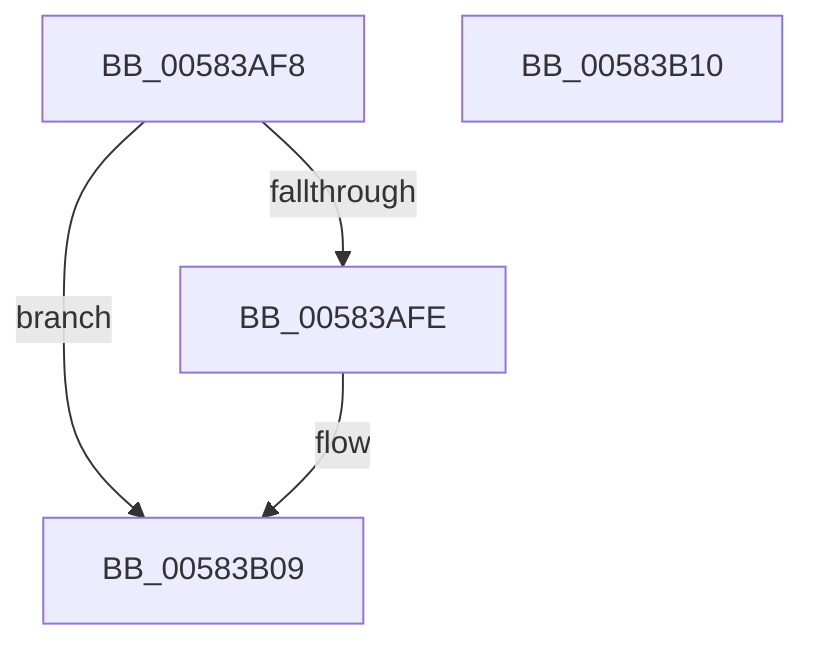

# HvlDisableEnlightenment

- RVA: `0x00583AF8`–`0x00583B11` (길이 `25` bytes)
- VA: `0x0000000140583AF8`
- 실행 섹션: `.text`
- PDB 이름 있음: `예`; PDB Function 태그: `아니요`
- unwind 정보 RVA: `0x000DB714`
- 디코드: `9`개 명령, `25/25` bytes 표시
- 미해석 바이트: `0` (있으면 어셈블리에 `.byte`로 보존)

> 이 문서는 커널 이미지의 기계어와 PDB 기호를 분석해 생성했습니다. 4번과 5번은 함수 원형과 자료형을 바이너리 사용 방식에서 추정한 C 해석이며 원본 소스 복구 결과는 아닙니다.

## 1. Dependencies

- 직접 호출 지점: **0**; 고유 호출 대상: **0**
- 직접 호출자로 확인된 함수: **1**
- RIP 상대 이미지 참조: **1**

### Outgoing calls
- 직접 디코드된 call 명령이 없습니다.

### Direct callers
- [PopSaveHiberContext](../../pagelk/B6/PopSaveHiberContext_function_00B6F050.md) at `0x00B6F2A6`

### Static image references
- `0x00583B09` → RVA `0x00FC6AB8` (`ALMOSTRO`; read/write)

## 2. Other-region calls and transfers

- 다른 실행 섹션으로 향하는 call: **0**
- 별도 외부 분기/꼬리 이동을 확인하지 못했습니다.

## 3. Assembly (complete function range)

```asm
00583AF8  33 C0                           xor eax, eax
00583AFA  85 C9                           test ecx, ecx
00583AFC  74 0B                           je 0x140583b09
00583AFE  83 F9 01                        cmp ecx, 1
00583B01  BA 00 20 00 00                  mov edx, 0x2000
00583B06  0F 44 C2                        cmove eax, edx
00583B09  21 05 A9 2F A4 00               and dword ptr [rip + 0xa42fa9], eax
00583B0F  C3                              ret
00583B10  CC                              int3
```

## 4. C-style interpretation (structured pseudocode)

```c
__int64 __fastcall HvlDisableEnlightenment(int a1)
{
    __int64 result;

    result = 0;
    if (a1 != 0) {
        a2 = 0x2000ULL;
        if (a1 == 1) { result = (unsigned int)(a2); }
    }
    return result;
}
```

## 5. (Beta) C Style

```c
int64_t HvlDisableEnlightenment(int32_t Arg1)
{
    int64_t result;

    result = 0;
    if (Arg1 != 0) {
        a2 = 0x2000ULL;
        if (Arg1 == 1) { result = (uint32_t)(a2); }
    }
    return result;
}
```

## 6. Execution-region graph

[열기: 2D/3D 그래프와 함수 탐색 컨트롤 패널](../../../control-panel.html?section=text&rva=0x00583AF8&view=graph)

- 2D 그래프는 위에서 아래로 흐르고, 3D 그래프는 빈 공간을 드래그해 회전합니다. Shift+드래그는 이동, 휠은 확대·축소, 함수 노드 선택은 대상 보고서 이동입니다.

### Static fallback


