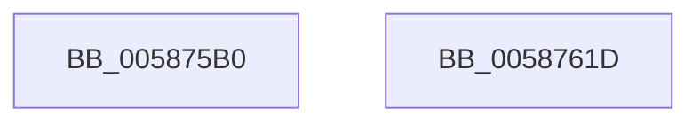

# HvlDisablePasid

- RVA: `0x005875B0`–`0x0058761E` (길이 `110` bytes)
- VA: `0x00000001405875B0`
- 실행 섹션: `.text`
- PDB 이름 있음: `예`; PDB Function 태그: `아니요`
- unwind 정보 RVA: `0x000A02F8`
- 디코드: `24`개 명령, `110/110` bytes 표시
- 미해석 바이트: `0` (있으면 어셈블리에 `.byte`로 보존)

> 이 문서는 커널 이미지의 기계어와 PDB 기호를 분석해 생성했습니다. 4번과 5번은 함수 원형과 자료형을 바이너리 사용 방식에서 추정한 C 해석이며 원본 소스 복구 결과는 아닙니다.

## 1. Dependencies

- 직접 호출 지점: **3**; 고유 호출 대상: **3**
- 직접 호출자로 확인된 함수: **0**
- RIP 상대 이미지 참조: **1**

### Outgoing calls
- `0x005875FE` → [HvcallFastExtended](../31/HvcallFastExtended_function_003130E0.md) (function, `0x003130E0`)
- `0x00587606` → [HvlpHvToNtStatus](../30/HvlpHvToNtStatus_function_00307BD8.md) (function, `0x00307BD8`)
- `0x00587613` → [_security_check_cookie](../6A/_security_check_cookie_function_006AC640.md) (function, `0x006AC640`)

### Direct callers
- 이 함수 시작 RVA로 연결되는 직접 call은 확인되지 않았습니다. 간접 호출은 완전히 역산할 수 없습니다.

### Static image references
- `0x005875B4` → RVA `0x00E0A740` (`.data`; read)

## 2. Other-region calls and transfers

- 다른 실행 섹션으로 향하는 call: **0**
- 별도 외부 분기/꼬리 이동을 확인하지 못했습니다.

## 3. Assembly (complete function range)

```asm
005875B0  48 83 EC 78                     sub rsp, 0x78
005875B4  48 8B 05 85 31 88 00            mov rax, qword ptr [rip + 0x883185]
005875BB  48 33 C4                        xor rax, rsp
005875BE  48 89 44 24 60                  mov qword ptr [rsp + 0x60], rax
005875C3  83 64 24 54 00                  and dword ptr [rsp + 0x54], 0
005875C8  45 33 C9                        xor r9d, r9d
005875CB  48 83 4C 24 40 FF               or qword ptr [rsp + 0x40], 0xffffffffffffffff
005875D1  83 64 24 20 00                  and dword ptr [rsp + 0x20], 0
005875D6  48 C7 44 24 30 A5 00 00 00      mov qword ptr [rsp + 0x30], 0xa5
005875DF  48 89 4C 24 48                  mov qword ptr [rsp + 0x48], rcx
005875E4  45 8D 41 18                     lea r8d, [r9 + 0x18]
005875E8  89 54 24 50                     mov dword ptr [rsp + 0x50], edx
005875EC  48 8D 54 24 40                  lea rdx, [rsp + 0x40]
005875F1  C7 44 24 30 A5 00 01 00         mov dword ptr [rsp + 0x30], 0x100a5
005875F9  48 8B 4C 24 30                  mov rcx, qword ptr [rsp + 0x30]
005875FE  E8 DD BA D8 FF                  call 0x1403130e0
00587603  48 8B C8                        mov rcx, rax
00587606  E8 CD 05 D8 FF                  call 0x140307bd8
0058760B  48 8B 4C 24 60                  mov rcx, qword ptr [rsp + 0x60]
00587610  48 33 CC                        xor rcx, rsp
00587613  E8 28 50 12 00                  call 0x1406ac640
00587618  48 83 C4 78                     add rsp, 0x78
0058761C  C3                              ret
0058761D  CC                              int3
```

## 4. C-style interpretation (structured pseudocode)

```c
__int64 __fastcall HvlDisablePasid(__int64 a1, int a2, __int64 a3, int a4)
{
    __int64 result;
    __int64 v_rsp;
    unsigned __int64 v_stack_m18;
    unsigned int v_stack_m24;
    unsigned int v_stack_m28;
    unsigned __int64 v_stack_m30;
    unsigned __int64 v_stack_m38;
    unsigned __int64 v_stack_m48;
    unsigned int v_stack_m58;

    v_rsp = (v_rsp) - (120);
    result = (*(unsigned __int64 *)(v_rip + 8925573)) ^ (v_rsp);
    v_stack_m18 = result;
    a4 = 0;
    v_stack_m48 = 165;
    v_stack_m30 = a1;
    v_stack_m28 = a2;
    v_stack_m48 = 0x100A5ULL;
    result = HvcallFastExtended(v_stack_m48, v_stack_m38, a4 + 24, a4);
    result = HvlpHvToNtStatus(result, v_stack_m38, a4 + 24, a4);
    a1 = (v_stack_m18) ^ (v_rsp);
    result = _security_check_cookie(a1, v_stack_m38, a4 + 24, a4);
    v_rsp = (v_rsp) + (120);
    return result;
}
```

## 5. (Beta) C Style

```c
int64_t HvlDisablePasid(int64_t Arg1, int32_t Arg2, int64_t Arg3, int32_t Arg4)
{
    int64_t result;
    int64_t local_rsp;
    uint64_t v_stack_m18;
    uint32_t v_stack_m24;
    uint32_t v_stack_m28;
    uint64_t v_stack_m30;
    uint64_t v_stack_m38;
    uint64_t v_stack_m48;
    uint32_t v_stack_m58;

    local_rsp = (local_rsp) - (120);
    result = (*(uint64_t *)(v_rip + 0x883185)) ^ (local_rsp);
    v_stack_m18 = result;
    Arg4 = 0;
    v_stack_m48 = 165;
    v_stack_m30 = Arg1;
    v_stack_m28 = Arg2;
    v_stack_m48 = 0x100A5ULL;
    result = HvcallFastExtended(v_stack_m48, v_stack_m38, Arg4 + 24, Arg4);
    result = HvlpHvToNtStatus(result, v_stack_m38, Arg4 + 24, Arg4);
    Arg1 = (v_stack_m18) ^ (local_rsp);
    result = _security_check_cookie(Arg1, v_stack_m38, Arg4 + 24, Arg4);
    local_rsp = (local_rsp) + (120);
    return result;
}
```

## 6. Execution-region graph

[열기: 2D/3D 그래프와 함수 탐색 컨트롤 패널](../../../control-panel.html?section=text&rva=0x005875B0&view=graph)

- 2D 그래프는 위에서 아래로 흐르고, 3D 그래프는 빈 공간을 드래그해 회전합니다. Shift+드래그는 이동, 휠은 확대·축소, 함수 노드 선택은 대상 보고서 이동입니다.

### Static fallback


