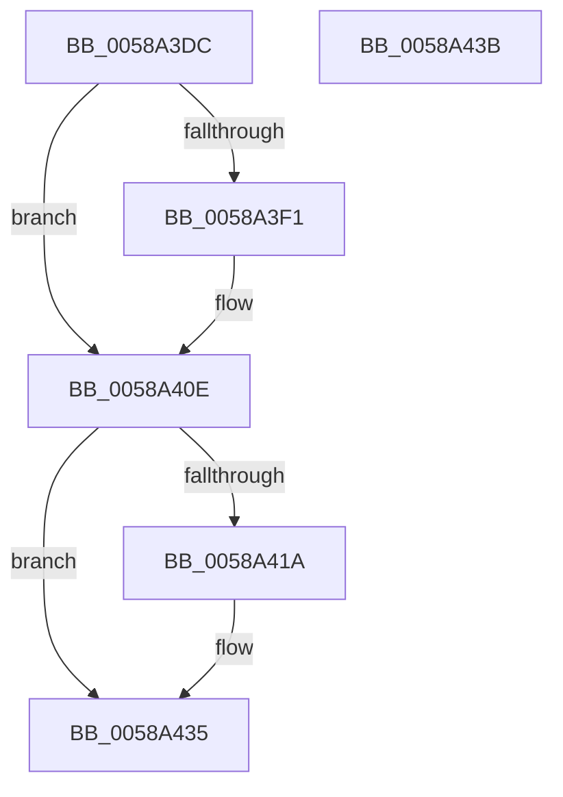

# HvlDiscardPagesFromHibernation

- RVA: `0x0058A3DC`–`0x0058A43C` (길이 `96` bytes)
- VA: `0x000000014058A3DC`
- 실행 섹션: `.text`
- PDB 이름 있음: `예`; PDB Function 태그: `아니요`
- unwind 정보 RVA: `0x00064C80`
- 디코드: `23`개 명령, `96/96` bytes 표시
- 미해석 바이트: `0` (있으면 어셈블리에 `.byte`로 보존)

> 이 문서는 커널 이미지의 기계어와 PDB 기호를 분석해 생성했습니다. 4번과 5번은 함수 원형과 자료형을 바이너리 사용 방식에서 추정한 C 해석이며 원본 소스 복구 결과는 아닙니다.

## 1. Dependencies

- 직접 호출 지점: **2**; 고유 호출 대상: **1**
- 직접 호출자로 확인된 함수: **2**
- RIP 상대 이미지 참조: **3**

### Outgoing calls
- `0x0058A409` → [PoSetHiberRange](../47/PoSetHiberRange_function_0047C580.md) (function, `0x0047C580`)
- `0x0058A430` → [PoSetHiberRange](../47/PoSetHiberRange_function_0047C580.md) (function, `0x0047C580`)

### Direct callers
- [HvlDiscardSecurePagesFromHibernation](HvlDiscardSecurePagesFromHibernation_function_0058A444.md) at `0x0058A501`
- [PopSaveHiberContext](../../pagelk/B6/PopSaveHiberContext_function_00B6F050.md) at `0x00B6F45D`

### Static image references
- `0x0058A3E2` → RVA `0x00F8EDF0` (`.data`; read)
- `0x0058A3F1` → RVA `0x00F8EDF8` (`.data`; read)
- `0x0058A40E` → RVA `0x00F8ECA0` (`.data`; read)

## 2. Other-region calls and transfers

- 다른 실행 섹션으로 향하는 call: **0**
- 별도 외부 분기/꼬리 이동을 확인하지 못했습니다.

## 3. Assembly (complete function range)

```asm
0058A3DC  40 53                           push rbx
0058A3DE  48 83 EC 30                     sub rsp, 0x30
0058A3E2  4C 8B 05 07 4A A0 00            mov r8, qword ptr [rip + 0xa04a07]
0058A3E9  48 8B D9                        mov rbx, rcx
0058A3EC  4D 85 C0                        test r8, r8
0058A3EF  74 1D                           je 0x14058a40e
0058A3F1  44 8B 0D 00 4A A0 00            mov r9d, dword ptr [rip + 0xa04a00]
0058A3F8  BA 00 80 00 00                  mov edx, 0x8000
0058A3FD  41 C1 E1 0C                     shl r9d, 0xc
0058A401  C7 44 24 20 48 76 6C 64         mov dword ptr [rsp + 0x20], 0x646c7648
0058A409  E8 72 21 EF FF                  call 0x14047c580
0058A40E  4C 8B 05 8B 48 A0 00            mov r8, qword ptr [rip + 0xa0488b]
0058A415  4D 85 C0                        test r8, r8
0058A418  74 1B                           je 0x14058a435
0058A41A  BA 00 80 00 00                  mov edx, 0x8000
0058A41F  C7 44 24 20 48 76 6C 64         mov dword ptr [rsp + 0x20], 0x646c7648
0058A427  41 B9 00 10 00 00               mov r9d, 0x1000
0058A42D  48 8B CB                        mov rcx, rbx
0058A430  E8 4B 21 EF FF                  call 0x14047c580
0058A435  48 83 C4 30                     add rsp, 0x30
0058A439  5B                              pop rbx
0058A43A  C3                              ret
0058A43B  CC                              int3
```

## 4. C-style interpretation (structured pseudocode)

```c
__int64 __fastcall HvlDiscardPagesFromHibernation(__int64 a1)
{
    __int64 result;
    __int64 v_rsp;
    unsigned int v_stack_m18;

    v_rsp = (v_rsp) - (48);
    if (*(unsigned __int64 *)(v_rip + 10504711) != 0) {
        a4 = *(unsigned int *)(v_rip + 10504704);
        a2 = 0x8000ULL;
        a4 = (unsigned int)((a4) << (12));
        v_stack_m18 = 0x646C7648ULL;
        result = PoSetHiberRange(a1, a2, *(unsigned __int64 *)(v_rip + 10504711), a4);
    }
    if (*(unsigned __int64 *)(v_rip + 10504331) != 0) {
        a2 = 0x8000ULL;
        v_stack_m18 = 0x646C7648ULL;
        a4 = 0x1000ULL;
        a1 = a1;
        result = PoSetHiberRange(a1, a2, *(unsigned __int64 *)(v_rip + 10504331), a4);
    }
    v_rsp = (v_rsp) + (48);
    return result;
}
```

## 5. (Beta) C Style

```c
int64_t HvlDiscardPagesFromHibernation(int64_t Arg1)
{
    int64_t result;
    int64_t local_rsp;
    uint32_t v_stack_m18;

    local_rsp = (local_rsp) - (48);
    if (*(uint64_t *)(v_rip + 0xA04A07) != 0) {
        a4 = *(uint32_t *)(v_rip + 0xA04A00);
        a2 = 0x8000ULL;
        a4 = (uint32_t)((a4) << (12));
        v_stack_m18 = 0x646C7648ULL;
        result = PoSetHiberRange(Arg1, a2, *(uint64_t *)(v_rip + 0xA04A07), a4);
    }
    if (*(uint64_t *)(v_rip + 0xA0488B) != 0) {
        a2 = 0x8000ULL;
        v_stack_m18 = 0x646C7648ULL;
        a4 = 0x1000ULL;
        Arg1 = Arg1;
        result = PoSetHiberRange(Arg1, a2, *(uint64_t *)(v_rip + 0xA0488B), a4);
    }
    local_rsp = (local_rsp) + (48);
    return result;
}
```

## 6. Execution-region graph

[열기: 2D/3D 그래프와 함수 탐색 컨트롤 패널](../../../control-panel.html?section=text&rva=0x0058A3DC&view=graph)

- 2D 그래프는 위에서 아래로 흐르고, 3D 그래프는 빈 공간을 드래그해 회전합니다. Shift+드래그는 이동, 휠은 확대·축소, 함수 노드 선택은 대상 보고서 이동입니다.

### Static fallback


