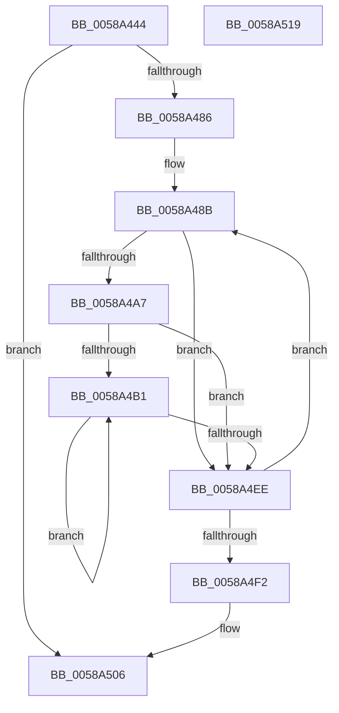

# HvlDiscardSecurePagesFromHibernation

- RVA: `0x0058A444`–`0x0058A51A` (길이 `214` bytes)
- VA: `0x000000014058A444`
- 실행 섹션: `.text`
- PDB 이름 있음: `예`; PDB Function 태그: `아니요`
- unwind 정보 RVA: `0x000BEE5C`
- 디코드: `64`개 명령, `214/214` bytes 표시
- 미해석 바이트: `0` (있으면 어셈블리에 `.byte`로 보존)

> 이 문서는 커널 이미지의 기계어와 PDB 기호를 분석해 생성했습니다. 4번과 5번은 함수 원형과 자료형을 바이너리 사용 방식에서 추정한 C 해석이며 원본 소스 복구 결과는 아닙니다.

## 1. Dependencies

- 직접 호출 지점: **5**; 고유 호출 대상: **5**
- 직접 호출자로 확인된 함수: **1**
- RIP 상대 이미지 참조: **0**

### Outgoing calls
- `0x0058A479` → [HvlpStartSecurePageListIteration](HvlpStartSecurePageListIteration_function_0058D908.md) (function, `0x0058D908`)
- `0x0058A49C` → [VslGetSecurePageList](VslGetSecurePageList_function_0058E504.md) (function, `0x0058E504`)
- `0x0058A4DF` → [PoSetHiberRange](../47/PoSetHiberRange_function_0047C580.md) (function, `0x0047C580`)
- `0x0058A4F9` → [HvlpEndSecurePageListIteration](HvlpEndSecurePageListIteration_function_0058D610.md) (function, `0x0058D610`)
- `0x0058A501` → [HvlDiscardPagesFromHibernation](HvlDiscardPagesFromHibernation_function_0058A3DC.md) (function, `0x0058A3DC`)

### Direct callers
- [PopSaveHiberContext](../../pagelk/B6/PopSaveHiberContext_function_00B6F050.md) at `0x00B6F456`

### Static image references
- 디코드된 RIP-relative 메모리 참조가 없습니다.

## 2. Other-region calls and transfers

- 다른 실행 섹션으로 향하는 call: **0**
- 별도 외부 분기/꼬리 이동을 확인하지 못했습니다.

## 3. Assembly (complete function range)

```asm
0058A444  4C 8B DC                        mov r11, rsp
0058A447  49 89 5B 08                     mov qword ptr [r11 + 8], rbx
0058A44B  49 89 6B 18                     mov qword ptr [r11 + 0x18], rbp
0058A44F  56                              push rsi
0058A450  57                              push rdi
0058A451  41 56                           push r14
0058A453  48 83 EC 30                     sub rsp, 0x30
0058A457  45 33 F6                        xor r14d, r14d
0058A45A  49 8D 43 10                     lea rax, [r11 + 0x10]
0058A45E  48 8B E9                        mov rbp, rcx
0058A461  49 89 43 E0                     mov qword ptr [r11 - 0x20], rax
0058A465  45 33 C9                        xor r9d, r9d
0058A468  4D 89 73 10                     mov qword ptr [r11 + 0x10], r14
0058A46C  45 33 C0                        xor r8d, r8d
0058A46F  45 89 73 D8                     mov dword ptr [r11 - 0x28], r14d
0058A473  41 8D 56 07                     lea edx, [r14 + 7]
0058A477  33 C9                           xor ecx, ecx
0058A479  E8 8A 34 00 00                  call 0x14058d908
0058A47E  85 C0                           test eax, eax
0058A480  0F 88 80 00 00 00               js 0x14058a506
0058A486  48 8B 7C 24 58                  mov rdi, qword ptr [rsp + 0x58]
0058A48B  4C 8D 4C 24 58                  lea r9, [rsp + 0x58]
0058A490  44 88 74 24 58                  mov byte ptr [rsp + 0x58], r14b
0058A495  45 33 C0                        xor r8d, r8d
0058A498  33 D2                           xor edx, edx
0058A49A  B1 01                           mov cl, 1
0058A49C  E8 63 40 00 00                  call 0x14058e504
0058A4A1  8B D8                           mov ebx, eax
0058A4A3  85 C0                           test eax, eax
0058A4A5  78 47                           js 0x14058a4ee
0058A4A7  41 8B F6                        mov esi, r14d
0058A4AA  66 44 3B 77 08                  cmp r14w, word ptr [rdi + 8]
0058A4AF  73 3D                           jae 0x14058a4ee
0058A4B1  8B CE                           mov ecx, esi
0058A4B3  48 B8 FF FF FF FF FF 00 00 00   movabs rax, 0xffffffffff
0058A4BD  BA 00 C0 00 00                  mov edx, 0xc000
0058A4C2  C7 44 24 20 48 76 6C 68         mov dword ptr [rsp + 0x20], 0x686c7648
0058A4CA  4C 8B 44 CF 10                  mov r8, qword ptr [rdi + rcx*8 + 0x10]
0058A4CF  48 8B CD                        mov rcx, rbp
0058A4D2  4D 8B C8                        mov r9, r8
0058A4D5  4C 23 C0                        and r8, rax
0058A4D8  49 C1 E9 28                     shr r9, 0x28
0058A4DC  49 FF C1                        inc r9
0058A4DF  E8 9C 20 EF FF                  call 0x14047c580
0058A4E4  0F B7 47 08                     movzx eax, word ptr [rdi + 8]
0058A4E8  FF C6                           inc esi
0058A4EA  3B F0                           cmp esi, eax
0058A4EC  72 C3                           jb 0x14058a4b1
0058A4EE  85 DB                           test ebx, ebx
0058A4F0  74 99                           je 0x14058a48b
0058A4F2  45 33 C0                        xor r8d, r8d
0058A4F5  33 D2                           xor edx, edx
0058A4F7  33 C9                           xor ecx, ecx
0058A4F9  E8 12 31 00 00                  call 0x14058d610
0058A4FE  48 8B CD                        mov rcx, rbp
0058A501  E8 D6 FE FF FF                  call 0x14058a3dc
0058A506  48 8B 5C 24 50                  mov rbx, qword ptr [rsp + 0x50]
0058A50B  48 8B 6C 24 60                  mov rbp, qword ptr [rsp + 0x60]
0058A510  48 83 C4 30                     add rsp, 0x30
0058A514  41 5E                           pop r14
0058A516  5F                              pop rdi
0058A517  5E                              pop rsi
0058A518  C3                              ret
0058A519  CC                              int3
```

## 4. C-style interpretation (structured pseudocode)

```c
__int64 __fastcall HvlDiscardSecurePagesFromHibernation(__int64 a1, __int64 a2, int a3, int a4)
{
    __int64 result;
    __int64 v_r14;
    __int64 v_rsi;
    __int64 v_rsp;
    unsigned int v_stack_m28;
    unsigned __int64 v_stack_p10;
    unsigned __int64 v_stack_p18;
    unsigned __int64 v_stack_p8;

    *(unsigned __int64 *)(v_rsp + 8) = v_rbx;
    *(unsigned __int64 *)(v_rsp + 24) = v_rbp;
    v_rsp = (v_rsp) - (48);
    v_r14 = 0;
    *(unsigned __int64 *)(v_rsp - 32) = v_rsp + 16;
    a4 = 0;
    *(unsigned __int64 *)(v_rsp + 16) = 0;
    a3 = 0;
    *(unsigned int *)(v_rsp - 40) = 0;
    a1 = 0;
    result = HvlpStartSecurePageListIteration(a1, v_r14 + 7, a3, a4);
    if (sign_flag) goto loc_0058A506;
loc_0058A48B:
    v_stack_p10 = 0;
    a3 = 0;
    a2 = 0;
    result = VslGetSecurePageList(1, a2, a3, v_stack_p10);
    if (sign_flag) goto loc_0058A4EE;
    if (0 >= (*(unsigned __int16 *)(v_stack_p10 + 8))) goto loc_0058A4EE;
loc_0058A4B1:
    v_stack_m28 = 0x686C7648ULL;
    a3 = (*(unsigned __int64 *)(v_stack_p10 + 0 * 8 + 16)) & (result);
    a4 = (*(unsigned __int64 *)(v_stack_p10 + 0 * 8 + 16)) >> (40);
    a4 = (a4) + 1;
    result = PoSetHiberRange(0, (unsigned int)(0xC000ULL), a3, a4);
    v_rsi = (unsigned int)((0) + 1);
    if (((unsigned int)(v_rsi)) < ((unsigned int)(*(unsigned __int16 *)(v_stack_p10 + 8)))) goto loc_0058A4B1;
loc_0058A4EE:
    if ((unsigned int)((unsigned int)((unsigned int)(result))) == 0) goto loc_0058A48B;
    a3 = 0;
    a2 = 0;
    a1 = 0;
    result = HvlpEndSecurePageListIteration(a1, a2, a3, a4);
    result = HvlDiscardPagesFromHibernation(0, a2, a3, a4);
loc_0058A506:
    v_rsp = (v_rsp) + (48);
    return result;
}
```

## 5. (Beta) C Style

```c
int64_t HvlDiscardSecurePagesFromHibernation(int64_t Arg1, int64_t Arg2, int32_t Arg3, int32_t Arg4)
{
    int64_t result;
    int64_t local_r14;
    int64_t local_rsi;
    int64_t local_rsp;
    uint32_t v_stack_m28;
    uint64_t v_stack_p10;
    uint64_t v_stack_p18;
    uint64_t v_stack_p8;

    *(uint64_t *)(local_rsp + 0x8) = local_rbx;
    *(uint64_t *)(local_rsp + 0x18) = local_rbp;
    local_rsp = (local_rsp) - (48);
    local_r14 = 0;
    *(uint64_t *)(local_rsp - 0x20) = local_rsp + 16;
    Arg4 = 0;
    *(uint64_t *)(local_rsp + 0x10) = 0;
    Arg3 = 0;
    *(uint32_t *)(local_rsp - 0x28) = 0;
    Arg1 = 0;
    result = HvlpStartSecurePageListIteration(Arg1, local_r14 + 7, Arg3, Arg4);
    if (sign_flag) goto loc_0058A506;
loc_0058A48B:
    v_stack_p10 = 0;
    Arg3 = 0;
    Arg2 = 0;
    result = VslGetSecurePageList(1, Arg2, Arg3, v_stack_p10);
    if (sign_flag) goto loc_0058A4EE;
    if (0 >= (*(uint16_t *)(v_stack_p10 + 0x8))) goto loc_0058A4EE;
loc_0058A4B1:
    v_stack_m28 = 0x686C7648ULL;
    Arg3 = (*(uint64_t *)(v_stack_p10 + 0x0 * 8 + 0x10)) & (result);
    Arg4 = (*(uint64_t *)(v_stack_p10 + 0x0 * 8 + 0x10)) >> (40);
    Arg4 = (Arg4) + 1;
    result = PoSetHiberRange(0, (uint32_t)(0xC000ULL), Arg3, Arg4);
    local_rsi = (uint32_t)((0) + 1);
    if (((uint32_t)(local_rsi)) < ((uint32_t)(*(uint16_t *)(v_stack_p10 + 0x8)))) goto loc_0058A4B1;
loc_0058A4EE:
    if ((uint32_t)((uint32_t)((uint32_t)(result))) == 0) goto loc_0058A48B;
    Arg3 = 0;
    Arg2 = 0;
    Arg1 = 0;
    result = HvlpEndSecurePageListIteration(Arg1, Arg2, Arg3, Arg4);
    result = HvlDiscardPagesFromHibernation(0, Arg2, Arg3, Arg4);
loc_0058A506:
    local_rsp = (local_rsp) + (48);
    return result;
}
```

## 6. Execution-region graph

[열기: 2D/3D 그래프와 함수 탐색 컨트롤 패널](../../../control-panel.html?section=text&rva=0x0058A444&view=graph)

- 2D 그래프는 위에서 아래로 흐르고, 3D 그래프는 빈 공간을 드래그해 회전합니다. Shift+드래그는 이동, 휠은 확대·축소, 함수 노드 선택은 대상 보고서 이동입니다.

### Static fallback


