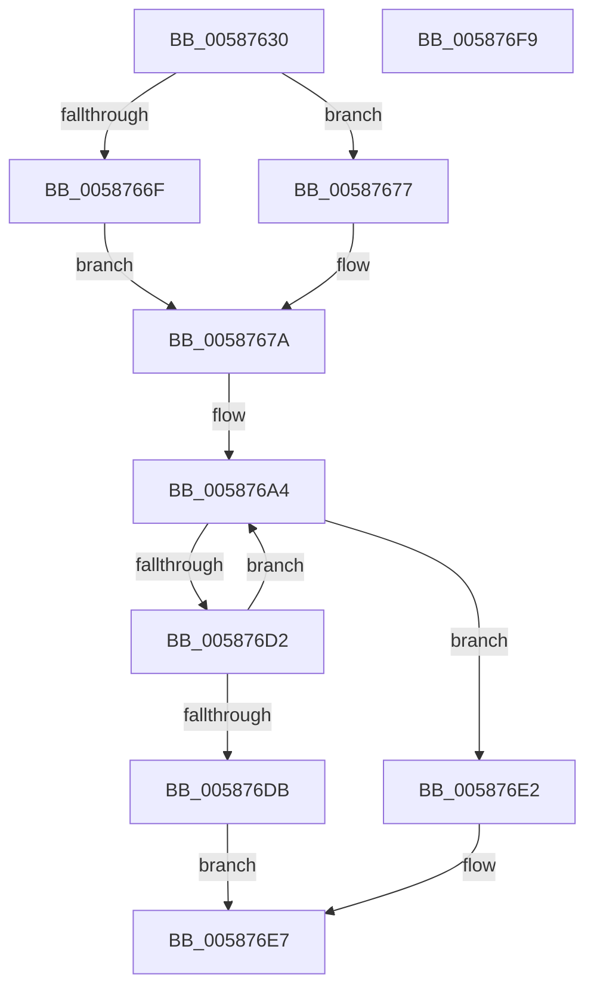

# HvlDmaAllocateDeviceDomain

- RVA: `0x00587630`–`0x005876FA` (길이 `202` bytes)
- VA: `0x0000000140587630`
- 실행 섹션: `.text`
- PDB 이름 있음: `예`; PDB Function 태그: `아니요`
- unwind 정보 RVA: `0x000A02F8`
- 디코드: `54`개 명령, `202/202` bytes 표시
- 미해석 바이트: `0` (있으면 어셈블리에 `.byte`로 보존)

> 이 문서는 커널 이미지의 기계어와 PDB 기호를 분석해 생성했습니다. 4번과 5번은 함수 원형과 자료형을 바이너리 사용 방식에서 추정한 C 해석이며 원본 소스 복구 결과는 아닙니다.

## 1. Dependencies

- 직접 호출 지점: **5**; 고유 호출 대상: **5**
- 직접 호출자로 확인된 함수: **0**
- RIP 상대 이미지 참조: **1**

### Outgoing calls
- `0x005876BA` → [HvcallFastExtended](../31/HvcallFastExtended_function_003130E0.md) (function, `0x003130E0`)
- `0x005876C5` → [HvlpHvStatusIsInsufficientMemory](../30/HvlpHvStatusIsInsufficientMemory_function_00307BB0.md) (function, `0x00307BB0`)
- `0x005876D2` → [HvlpHandleInsufficientMemory](HvlpHandleInsufficientMemory_function_00584514.md) (function, `0x00584514`)
- `0x005876E2` → [HvlpHvToNtStatus](../30/HvlpHvToNtStatus_function_00307BD8.md) (function, `0x00307BD8`)
- `0x005876EF` → [_security_check_cookie](../6A/_security_check_cookie_function_006AC640.md) (function, `0x006AC640`)

### Direct callers
- 이 함수 시작 RVA로 연결되는 직접 call은 확인되지 않았습니다. 간접 호출은 완전히 역산할 수 없습니다.

### Static image references
- `0x00587634` → RVA `0x00E0A740` (`.data`; read)

## 2. Other-region calls and transfers

- 다른 실행 섹션으로 향하는 call: **0**
- 별도 외부 분기/꼬리 이동을 확인하지 못했습니다.

## 3. Assembly (complete function range)

```asm
00587630  48 83 EC 78                     sub rsp, 0x78
00587634  48 8B 05 05 31 88 00            mov rax, qword ptr [rip + 0x883105]
0058763B  48 33 C4                        xor rax, rsp
0058763E  48 89 44 24 60                  mov qword ptr [rsp + 0x60], rax
00587643  48 83 64 24 48 00               and qword ptr [rsp + 0x48], 0
00587649  33 C0                           xor eax, eax
0058764B  48 21 44 24 58                  and qword ptr [rsp + 0x58], rax
00587650  48 8B D1                        mov rdx, rcx
00587653  48 83 4C 24 40 FF               or qword ptr [rsp + 0x40], 0xffffffffffffffff
00587659  48 C7 44 24 30 B1 00 00 00      mov qword ptr [rsp + 0x30], 0xb1
00587662  C7 44 24 30 B1 00 01 00         mov dword ptr [rsp + 0x30], 0x100b1
0058766A  38 41 04                        cmp byte ptr [rcx + 4], al
0058766D  74 08                           je 0x140587677
0058766F  83 E0 F1                        and eax, 0xfffffff1
00587672  83 C8 01                        or eax, 1
00587675  EB 03                           jmp 0x14058767a
00587677  83 E0 F0                        and eax, 0xfffffff0
0058767A  89 44 24 50                     mov dword ptr [rsp + 0x50], eax
0058767E  8B 01                           mov eax, dword ptr [rcx]
00587680  0F B6 49 08                     movzx ecx, byte ptr [rcx + 8]
00587684  03 C9                           add ecx, ecx
00587686  89 44 24 54                     mov dword ptr [rsp + 0x54], eax
0058768A  33 4C 24 58                     xor ecx, dword ptr [rsp + 0x58]
0058768E  0F B6 42 09                     movzx eax, byte ptr [rdx + 9]
00587692  83 E1 02                        and ecx, 2
00587695  33 4C 24 58                     xor ecx, dword ptr [rsp + 0x58]
00587699  33 C1                           xor eax, ecx
0058769B  83 E0 01                        and eax, 1
0058769E  33 C1                           xor eax, ecx
005876A0  89 44 24 58                     mov dword ptr [rsp + 0x58], eax
005876A4  48 8B 4C 24 30                  mov rcx, qword ptr [rsp + 0x30]
005876A9  48 8D 54 24 40                  lea rdx, [rsp + 0x40]
005876AE  83 64 24 20 00                  and dword ptr [rsp + 0x20], 0
005876B3  45 33 C9                        xor r9d, r9d
005876B6  45 8D 41 20                     lea r8d, [r9 + 0x20]
005876BA  E8 21 BA D8 FF                  call 0x1403130e0
005876BF  0F B7 C8                        movzx ecx, ax
005876C2  4C 8B C0                        mov r8, rax
005876C5  E8 E6 04 D8 FF                  call 0x140307bb0
005876CA  41 0F B7 C8                     movzx ecx, r8w
005876CE  84 C0                           test al, al
005876D0  74 10                           je 0x1405876e2
005876D2  E8 3D CE FF FF                  call 0x140584514
005876D7  85 C0                           test eax, eax
005876D9  79 C9                           jns 0x1405876a4
005876DB  B8 9A 00 00 C0                  mov eax, 0xc000009a
005876E0  EB 05                           jmp 0x1405876e7
005876E2  E8 F1 04 D8 FF                  call 0x140307bd8
005876E7  48 8B 4C 24 60                  mov rcx, qword ptr [rsp + 0x60]
005876EC  48 33 CC                        xor rcx, rsp
005876EF  E8 4C 4F 12 00                  call 0x1406ac640
005876F4  48 83 C4 78                     add rsp, 0x78
005876F8  C3                              ret
005876F9  CC                              int3
```

## 4. C-style interpretation (structured pseudocode)

```c
__int64 __fastcall HvlDmaAllocateDeviceDomain(__int64 a1, __int64 a2, __int64 a3, int a4)
{
    __int64 result;
    __int64 v_rsp;
    unsigned __int64 v_stack_m18;
    unsigned __int64 v_stack_m20;
    unsigned int v_stack_m24;
    unsigned int v_stack_m28;
    unsigned __int64 v_stack_m30;
    unsigned __int64 v_stack_m38;
    unsigned __int64 v_stack_m48;
    unsigned int v_stack_m58;

    v_rsp = (v_rsp) - (120);
    result = (*(unsigned __int64 *)(v_rip + 8925445)) ^ (v_rsp);
    v_stack_m18 = result;
    result = 0;
    v_stack_m48 = 177;
    v_stack_m48 = 0x100B1ULL;
    if ((*(unsigned __int8 *)(a1 + 4)) == 0) goto loc_00587677;
    result = (unsigned int)((result) & (0xFFFFFFF1ULL));
    result = (unsigned int)((result) | (1));
    goto loc_0058767A;
loc_00587677:
    result = (unsigned int)((result) & (0xFFFFFFF0ULL));
loc_0058767A:
    v_stack_m28 = (unsigned int)(result);
    a1 = (unsigned int)((*(unsigned __int8 *)(a1 + 8)) + ((unsigned int)(*(unsigned __int8 *)(a1 + 8))));
    v_stack_m24 = (unsigned int)((unsigned int)(*(unsigned int *)(a1)));
    a1 = (unsigned int)((a1) ^ (v_stack_m20));
    a1 = (unsigned int)((a1) & (2));
    a1 = (unsigned int)((a1) ^ (v_stack_m20));
    result = (unsigned int)((*(unsigned __int8 *)(a1 + 9)) ^ ((unsigned int)(a1)));
    result = (unsigned int)((result) & (1));
    result = (unsigned int)((result) ^ ((unsigned int)(a1)));
    v_stack_m20 = (unsigned int)(result);
loc_005876A4:
    a4 = 0;
    result = HvcallFastExtended(v_stack_m48, v_stack_m38, a4 + 32, a4);
    result = HvlpHvStatusIsInsufficientMemory((unsigned __int16)(result), v_stack_m38, result, a4);
    if ((unsigned __int8)(result) == 0) goto loc_005876E2;
    result = HvlpHandleInsufficientMemory((unsigned __int16)(result), v_stack_m38, result, a4);
    if (!sign_flag) goto loc_005876A4;
    goto loc_005876E7;
loc_005876E2:
    result = HvlpHvToNtStatus((unsigned __int16)(result), v_stack_m38, result, a4);
loc_005876E7:
    a1 = (v_stack_m18) ^ (v_rsp);
    result = _security_check_cookie(a1, v_stack_m38, result, a4);
    v_rsp = (v_rsp) + (120);
    return result;
}
```

## 5. (Beta) C Style

```c
int64_t HvlDmaAllocateDeviceDomain(void *Arg1, int64_t Arg2, int64_t Arg3, int32_t Arg4)
{
    uint8_t *arg1 = (uint8_t *)Arg1;

    int64_t result;
    int64_t local_rsp;
    uint64_t v_stack_m18;
    uint64_t v_stack_m20;
    uint32_t v_stack_m24;
    uint32_t v_stack_m28;
    uint64_t v_stack_m30;
    uint64_t v_stack_m38;
    uint64_t v_stack_m48;
    uint32_t v_stack_m58;

    local_rsp = (local_rsp) - (120);
    result = (*(uint64_t *)(v_rip + 0x883105)) ^ (local_rsp);
    v_stack_m18 = result;
    result = 0;
    v_stack_m48 = 177;
    v_stack_m48 = 0x100B1ULL;
    if ((*(uint8_t *)(arg1 + 0x4)) == 0) goto loc_00587677;
    result = (uint32_t)((result) & (0xFFFFFFF1ULL));
    result = (uint32_t)((result) | (1));
    goto loc_0058767A;
loc_00587677:
    result = (uint32_t)((result) & (0xFFFFFFF0ULL));
loc_0058767A:
    v_stack_m28 = (uint32_t)(result);
    Arg1 = (uint32_t)((*(uint8_t *)(arg1 + 0x8)) + ((uint32_t)(*(uint8_t *)(arg1 + 0x8))));
    v_stack_m24 = (uint32_t)((uint32_t)(*(uint32_t *)(arg1)));
    Arg1 = (uint32_t)((Arg1) ^ (v_stack_m20));
    Arg1 = (uint32_t)((Arg1) & (2));
    Arg1 = (uint32_t)((Arg1) ^ (v_stack_m20));
    result = (uint32_t)((*(uint8_t *)(arg1 + 0x9)) ^ ((uint32_t)(Arg1)));
    result = (uint32_t)((result) & (1));
    result = (uint32_t)((result) ^ ((uint32_t)(Arg1)));
    v_stack_m20 = (uint32_t)(result);
loc_005876A4:
    Arg4 = 0;
    result = HvcallFastExtended(v_stack_m48, v_stack_m38, Arg4 + 32, Arg4);
    result = HvlpHvStatusIsInsufficientMemory((uint16_t)(result), v_stack_m38, result, Arg4);
    if ((uint8_t)(result) == 0) goto loc_005876E2;
    result = HvlpHandleInsufficientMemory((uint16_t)(result), v_stack_m38, result, Arg4);
    if (!sign_flag) goto loc_005876A4;
    goto loc_005876E7;
loc_005876E2:
    result = HvlpHvToNtStatus((uint16_t)(result), v_stack_m38, result, Arg4);
loc_005876E7:
    Arg1 = (v_stack_m18) ^ (local_rsp);
    result = _security_check_cookie(Arg1, v_stack_m38, result, Arg4);
    local_rsp = (local_rsp) + (120);
    return result;
}
```

### 관측된 메모리 오프셋

구조체 형식이 확인되지 않은 접근은 인자 기준의 오프셋으로만 기록했습니다.

| 기준 인자 | 오프셋 표현 | 폭 (bit) | 접근 |
|---|---:|---:|---|
| `Arg1` | `+ 0x0` | `32` | `R` |
| `Arg1` | `+ 0x4` | `8` | `R` |
| `Arg1` | `+ 0x8` | `8` | `R` |
| `Arg1` | `+ 0x9` | `8` | `R` |

## 6. Execution-region graph

[열기: 2D/3D 그래프와 함수 탐색 컨트롤 패널](../../../control-panel.html?section=text&rva=0x00587630&view=graph)

- 2D 그래프는 위에서 아래로 흐르고, 3D 그래프는 빈 공간을 드래그해 회전합니다. Shift+드래그는 이동, 휠은 확대·축소, 함수 노드 선택은 대상 보고서 이동입니다.

### Static fallback


