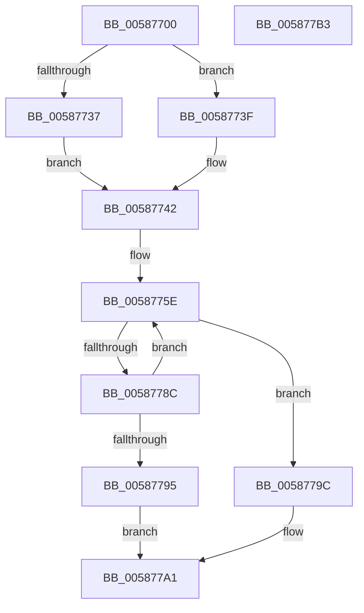

# HvlDmaAttachDeviceDomain

- RVA: `0x00587700`–`0x005877B4` (길이 `180` bytes)
- VA: `0x0000000140587700`
- 실행 섹션: `.text`
- PDB 이름 있음: `예`; PDB Function 태그: `아니요`
- unwind 정보 RVA: `0x000A02F8`
- 디코드: `45`개 명령, `180/180` bytes 표시
- 미해석 바이트: `0` (있으면 어셈블리에 `.byte`로 보존)

> 이 문서는 커널 이미지의 기계어와 PDB 기호를 분석해 생성했습니다. 4번과 5번은 함수 원형과 자료형을 바이너리 사용 방식에서 추정한 C 해석이며 원본 소스 복구 결과는 아닙니다.

## 1. Dependencies

- 직접 호출 지점: **5**; 고유 호출 대상: **5**
- 직접 호출자로 확인된 함수: **0**
- RIP 상대 이미지 참조: **1**

### Outgoing calls
- `0x00587774` → [HvcallFastExtended](../31/HvcallFastExtended_function_003130E0.md) (function, `0x003130E0`)
- `0x0058777F` → [HvlpHvStatusIsInsufficientMemory](../30/HvlpHvStatusIsInsufficientMemory_function_00307BB0.md) (function, `0x00307BB0`)
- `0x0058778C` → [HvlpHandleInsufficientMemory](HvlpHandleInsufficientMemory_function_00584514.md) (function, `0x00584514`)
- `0x0058779C` → [HvlpHvToNtStatus](../30/HvlpHvToNtStatus_function_00307BD8.md) (function, `0x00307BD8`)
- `0x005877A9` → [_security_check_cookie](../6A/_security_check_cookie_function_006AC640.md) (function, `0x006AC640`)

### Direct callers
- 이 함수 시작 RVA로 연결되는 직접 call은 확인되지 않았습니다. 간접 호출은 완전히 역산할 수 없습니다.

### Static image references
- `0x00587704` → RVA `0x00E0A740` (`.data`; read)

## 2. Other-region calls and transfers

- 다른 실행 섹션으로 향하는 call: **0**
- 별도 외부 분기/꼬리 이동을 확인하지 못했습니다.

## 3. Assembly (complete function range)

```asm
00587700  48 83 EC 78                     sub rsp, 0x78
00587704  48 8B 05 35 30 88 00            mov rax, qword ptr [rip + 0x883035]
0058770B  48 33 C4                        xor rax, rsp
0058770E  48 89 44 24 60                  mov qword ptr [rsp + 0x60], rax
00587713  48 83 64 24 48 00               and qword ptr [rsp + 0x48], 0
00587719  33 C0                           xor eax, eax
0058771B  48 83 4C 24 40 FF               or qword ptr [rsp + 0x40], 0xffffffffffffffff
00587721  48 C7 44 24 30 B2 00 00 00      mov qword ptr [rsp + 0x30], 0xb2
0058772A  C7 44 24 30 B2 00 01 00         mov dword ptr [rsp + 0x30], 0x100b2
00587732  38 42 04                        cmp byte ptr [rdx + 4], al
00587735  74 08                           je 0x14058773f
00587737  83 E0 F1                        and eax, 0xfffffff1
0058773A  83 C8 01                        or eax, 1
0058773D  EB 03                           jmp 0x140587742
0058773F  83 E0 F0                        and eax, 0xfffffff0
00587742  89 44 24 50                     mov dword ptr [rsp + 0x50], eax
00587746  8B 02                           mov eax, dword ptr [rdx]
00587748  89 44 24 54                     mov dword ptr [rsp + 0x54], eax
0058774C  48 B8 FF FF FF FF FF FF FF 3F   movabs rax, 0x3fffffffffffffff
00587756  48 23 C8                        and rcx, rax
00587759  48 89 4C 24 58                  mov qword ptr [rsp + 0x58], rcx
0058775E  48 8B 4C 24 30                  mov rcx, qword ptr [rsp + 0x30]
00587763  48 8D 54 24 40                  lea rdx, [rsp + 0x40]
00587768  83 64 24 20 00                  and dword ptr [rsp + 0x20], 0
0058776D  45 33 C9                        xor r9d, r9d
00587770  45 8D 41 20                     lea r8d, [r9 + 0x20]
00587774  E8 67 B9 D8 FF                  call 0x1403130e0
00587779  0F B7 C8                        movzx ecx, ax
0058777C  4C 8B C0                        mov r8, rax
0058777F  E8 2C 04 D8 FF                  call 0x140307bb0
00587784  41 0F B7 C8                     movzx ecx, r8w
00587788  84 C0                           test al, al
0058778A  74 10                           je 0x14058779c
0058778C  E8 83 CD FF FF                  call 0x140584514
00587791  85 C0                           test eax, eax
00587793  79 C9                           jns 0x14058775e
00587795  B8 9A 00 00 C0                  mov eax, 0xc000009a
0058779A  EB 05                           jmp 0x1405877a1
0058779C  E8 37 04 D8 FF                  call 0x140307bd8
005877A1  48 8B 4C 24 60                  mov rcx, qword ptr [rsp + 0x60]
005877A6  48 33 CC                        xor rcx, rsp
005877A9  E8 92 4E 12 00                  call 0x1406ac640
005877AE  48 83 C4 78                     add rsp, 0x78
005877B2  C3                              ret
005877B3  CC                              int3
```

## 4. C-style interpretation (structured pseudocode)

```c
__int64 __fastcall HvlDmaAttachDeviceDomain(__int64 a1, __int64 a2, __int64 a3, int a4)
{
    __int64 result;
    __int64 v_rsp;
    unsigned __int64 v_stack_m18;
    unsigned __int64 v_stack_m20;
    unsigned int v_stack_m24;
    unsigned int v_stack_m28;
    unsigned __int64 v_stack_m30;
    unsigned __int64 v_stack_m38;
    unsigned __int64 v_stack_m48;
    unsigned int v_stack_m58;

    v_rsp = (v_rsp) - (120);
    result = (*(unsigned __int64 *)(v_rip + 8925237)) ^ (v_rsp);
    v_stack_m18 = result;
    result = 0;
    v_stack_m48 = 178;
    v_stack_m48 = 0x100B2ULL;
    if ((*(unsigned __int8 *)(a2 + 4)) == 0) goto loc_0058773F;
    result = (unsigned int)((result) & (0xFFFFFFF1ULL));
    result = (unsigned int)((result) | (1));
    goto loc_00587742;
loc_0058773F:
    result = (unsigned int)((result) & (0xFFFFFFF0ULL));
loc_00587742:
    v_stack_m28 = (unsigned int)(result);
    v_stack_m24 = (unsigned int)((unsigned int)(*(unsigned int *)(a2)));
    a1 = (a1) & ((unsigned int)(*(unsigned int *)(a2)));
    v_stack_m20 = a1;
loc_0058775E:
    a4 = 0;
    result = HvcallFastExtended(v_stack_m48, v_stack_m38, a4 + 32, a4);
    result = HvlpHvStatusIsInsufficientMemory((unsigned __int16)(result), v_stack_m38, result, a4);
    if ((unsigned __int8)(result) == 0) goto loc_0058779C;
    result = HvlpHandleInsufficientMemory((unsigned __int16)(result), v_stack_m38, result, a4);
    if (!sign_flag) goto loc_0058775E;
    goto loc_005877A1;
loc_0058779C:
    result = HvlpHvToNtStatus((unsigned __int16)(result), v_stack_m38, result, a4);
loc_005877A1:
    a1 = (v_stack_m18) ^ (v_rsp);
    result = _security_check_cookie(a1, v_stack_m38, result, a4);
    v_rsp = (v_rsp) + (120);
    return result;
}
```

## 5. (Beta) C Style

```c
int64_t HvlDmaAttachDeviceDomain(int64_t Arg1, void *Arg2, int64_t Arg3, int32_t Arg4)
{
    uint8_t *arg2 = (uint8_t *)Arg2;

    int64_t result;
    int64_t local_rsp;
    uint64_t v_stack_m18;
    uint64_t v_stack_m20;
    uint32_t v_stack_m24;
    uint32_t v_stack_m28;
    uint64_t v_stack_m30;
    uint64_t v_stack_m38;
    uint64_t v_stack_m48;
    uint32_t v_stack_m58;

    local_rsp = (local_rsp) - (120);
    result = (*(uint64_t *)(v_rip + 0x883035)) ^ (local_rsp);
    v_stack_m18 = result;
    result = 0;
    v_stack_m48 = 178;
    v_stack_m48 = 0x100B2ULL;
    if ((*(uint8_t *)(arg2 + 0x4)) == 0) goto loc_0058773F;
    result = (uint32_t)((result) & (0xFFFFFFF1ULL));
    result = (uint32_t)((result) | (1));
    goto loc_00587742;
loc_0058773F:
    result = (uint32_t)((result) & (0xFFFFFFF0ULL));
loc_00587742:
    v_stack_m28 = (uint32_t)(result);
    v_stack_m24 = (uint32_t)((uint32_t)(*(uint32_t *)(arg2)));
    Arg1 = (Arg1) & ((uint32_t)(*(uint32_t *)(arg2)));
    v_stack_m20 = Arg1;
loc_0058775E:
    Arg4 = 0;
    result = HvcallFastExtended(v_stack_m48, v_stack_m38, Arg4 + 32, Arg4);
    result = HvlpHvStatusIsInsufficientMemory((uint16_t)(result), v_stack_m38, result, Arg4);
    if ((uint8_t)(result) == 0) goto loc_0058779C;
    result = HvlpHandleInsufficientMemory((uint16_t)(result), v_stack_m38, result, Arg4);
    if (!sign_flag) goto loc_0058775E;
    goto loc_005877A1;
loc_0058779C:
    result = HvlpHvToNtStatus((uint16_t)(result), v_stack_m38, result, Arg4);
loc_005877A1:
    Arg1 = (v_stack_m18) ^ (local_rsp);
    result = _security_check_cookie(Arg1, v_stack_m38, result, Arg4);
    local_rsp = (local_rsp) + (120);
    return result;
}
```

### 관측된 메모리 오프셋

구조체 형식이 확인되지 않은 접근은 인자 기준의 오프셋으로만 기록했습니다.

| 기준 인자 | 오프셋 표현 | 폭 (bit) | 접근 |
|---|---:|---:|---|
| `Arg2` | `+ 0x0` | `32` | `R` |
| `Arg2` | `+ 0x4` | `8` | `R` |

## 6. Execution-region graph

[열기: 2D/3D 그래프와 함수 탐색 컨트롤 패널](../../../control-panel.html?section=text&rva=0x00587700&view=graph)

- 2D 그래프는 위에서 아래로 흐르고, 3D 그래프는 빈 공간을 드래그해 회전합니다. Shift+드래그는 이동, 휠은 확대·축소, 함수 노드 선택은 대상 보고서 이동입니다.

### Static fallback


