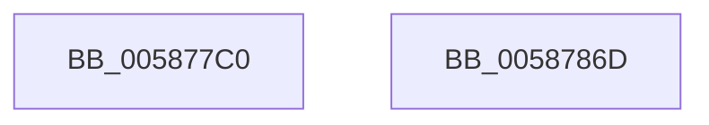

# HvlDmaConfigureDeviceDomain

- RVA: `0x005877C0`–`0x0058786E` (길이 `174` bytes)
- VA: `0x00000001405877C0`
- 실행 섹션: `.text`
- PDB 이름 있음: `예`; PDB Function 태그: `아니요`
- unwind 정보 RVA: `0x000C618C`
- 디코드: `43`개 명령, `174/174` bytes 표시
- 미해석 바이트: `0` (있으면 어셈블리에 `.byte`로 보존)

> 이 문서는 커널 이미지의 기계어와 PDB 기호를 분석해 생성했습니다. 4번과 5번은 함수 원형과 자료형을 바이너리 사용 방식에서 추정한 C 해석이며 원본 소스 복구 결과는 아닙니다.

## 1. Dependencies

- 직접 호출 지점: **3**; 고유 호출 대상: **3**
- 직접 호출자로 확인된 함수: **0**
- RIP 상대 이미지 참조: **1**

### Outgoing calls
- `0x0058784B` → [HvcallFastExtended](../31/HvcallFastExtended_function_003130E0.md) (function, `0x003130E0`)
- `0x00587853` → [HvlpHvToNtStatus](../30/HvlpHvToNtStatus_function_00307BD8.md) (function, `0x00307BD8`)
- `0x00587860` → [_security_check_cookie](../6A/_security_check_cookie_function_006AC640.md) (function, `0x006AC640`)

### Direct callers
- 이 함수 시작 RVA로 연결되는 직접 call은 확인되지 않았습니다. 간접 호출은 완전히 역산할 수 없습니다.

### Static image references
- `0x005877CA` → RVA `0x00E0A740` (`.data`; read)

## 2. Other-region calls and transfers

- 다른 실행 섹션으로 향하는 call: **0**
- 별도 외부 분기/꼬리 이동을 확인하지 못했습니다.

## 3. Assembly (complete function range)

```asm
005877C0  4C 8B DC                        mov r11, rsp
005877C3  48 81 EC 88 00 00 00            sub rsp, 0x88
005877CA  48 8B 05 6F 2F 88 00            mov rax, qword ptr [rip + 0x882f6f]
005877D1  48 33 C4                        xor rax, rsp
005877D4  48 89 44 24 70                  mov qword ptr [rsp + 0x70], rax
005877D9  49 83 4B B8 FF                  or qword ptr [r11 - 0x48], 0xffffffffffffffff
005877DE  45 33 C0                        xor r8d, r8d
005877E1  41 8B C0                        mov eax, r8d
005877E4  4D 89 43 C0                     mov qword ptr [r11 - 0x40], r8
005877E8  83 E0 F1                        and eax, 0xfffffff1
005877EB  48 C7 44 24 30 CE 00 00 00      mov qword ptr [rsp + 0x30], 0xce
005877F4  83 C8 01                        or eax, 1
005877F7  45 89 43 98                     mov dword ptr [r11 - 0x68], r8d
005877FB  89 44 24 50                     mov dword ptr [rsp + 0x50], eax
005877FF  45 33 C9                        xor r9d, r9d
00587802  8B 01                           mov eax, dword ptr [rcx]
00587804  0F B6 4A 10                     movzx ecx, byte ptr [rdx + 0x10]
00587808  89 44 24 54                     mov dword ptr [rsp + 0x54], eax
0058780C  48 8B 42 08                     mov rax, qword ptr [rdx + 8]
00587810  49 89 43 D8                     mov qword ptr [r11 - 0x28], rax
00587814  0F B6 42 11                     movzx eax, byte ptr [rdx + 0x11]
00587818  48 03 C0                        add rax, rax
0058781B  C7 44 24 30 CE 00 01 00         mov dword ptr [rsp + 0x30], 0x100ce
00587823  48 8B D0                        mov rdx, rax
00587826  48 33 D1                        xor rdx, rcx
00587829  49 33 C8                        xor rcx, r8
0058782C  48 83 E2 FD                     and rdx, 0xfffffffffffffffd
00587830  45 8D 41 28                     lea r8d, [r9 + 0x28]
00587834  48 83 E1 FC                     and rcx, 0xfffffffffffffffc
00587838  48 33 D1                        xor rdx, rcx
0058783B  48 8B 4C 24 30                  mov rcx, qword ptr [rsp + 0x30]
00587840  48 33 D0                        xor rdx, rax
00587843  49 89 53 D0                     mov qword ptr [r11 - 0x30], rdx
00587847  49 8D 53 B8                     lea rdx, [r11 - 0x48]
0058784B  E8 90 B8 D8 FF                  call 0x1403130e0
00587850  48 8B C8                        mov rcx, rax
00587853  E8 80 03 D8 FF                  call 0x140307bd8
00587858  48 8B 4C 24 70                  mov rcx, qword ptr [rsp + 0x70]
0058785D  48 33 CC                        xor rcx, rsp
00587860  E8 DB 4D 12 00                  call 0x1406ac640
00587865  48 81 C4 88 00 00 00            add rsp, 0x88
0058786C  C3                              ret
0058786D  CC                              int3
```

## 4. C-style interpretation (structured pseudocode)

```c
__int64 __fastcall HvlDmaConfigureDeviceDomain(__int64 a1, __int64 a2, int a3, int a4)
{
    __int64 result;
    __int64 v_rsp;
    unsigned __int64 v_stack_m18;
    unsigned int v_stack_m34;
    unsigned int v_stack_m38;
    unsigned __int64 v_stack_m58;

    v_rsp = (v_rsp) - (136);
    result = (*(unsigned __int64 *)(v_rip + 8925039)) ^ (v_rsp);
    v_stack_m18 = result;
    a3 = 0;
    *(unsigned __int64 *)(v_rsp - 64) = 0;
    result = (unsigned int)((0) & (0xFFFFFFF1ULL));
    v_stack_m58 = 206;
    result = (unsigned int)((result) | (1));
    *(unsigned int *)(v_rsp - 104) = 0;
    v_stack_m38 = (unsigned int)(result);
    a4 = 0;
    v_stack_m34 = (unsigned int)((unsigned int)(*(unsigned int *)(a1)));
    *(unsigned __int64 *)(v_rsp - 40) = *(unsigned __int64 *)(a2 + 8);
    result = (*(unsigned __int8 *)(a2 + 17)) + (*(unsigned __int8 *)(a2 + 17));
    v_stack_m58 = 0x100CEULL;
    a2 = (result) ^ (*(unsigned __int8 *)(a2 + 16));
    a1 = (*(unsigned __int8 *)(a2 + 16)) ^ (0);
    a2 = (a2) & (-3);
    a1 = (a1) & (-4);
    a2 = (a2) ^ (a1);
    a2 = (a2) ^ (result);
    *(unsigned __int64 *)(v_rsp - 48) = a2;
    result = HvcallFastExtended(v_stack_m58, v_rsp - 72, a4 + 40, a4);
    result = HvlpHvToNtStatus(result, v_rsp - 72, a4 + 40, a4);
    a1 = (v_stack_m18) ^ (v_rsp);
    result = _security_check_cookie(a1, v_rsp - 72, a4 + 40, a4);
    v_rsp = (v_rsp) + (136);
    return result;
}
```

## 5. (Beta) C Style

```c
int64_t HvlDmaConfigureDeviceDomain(void *Arg1, void *Arg2, int32_t Arg3, int32_t Arg4)
{
    uint8_t *arg1 = (uint8_t *)Arg1;
    uint8_t *arg2 = (uint8_t *)Arg2;

    int64_t result;
    int64_t local_rsp;
    uint64_t v_stack_m18;
    uint32_t v_stack_m34;
    uint32_t v_stack_m38;
    uint64_t v_stack_m58;

    local_rsp = (local_rsp) - (136);
    result = (*(uint64_t *)(v_rip + 0x882F6F)) ^ (local_rsp);
    v_stack_m18 = result;
    Arg3 = 0;
    *(uint64_t *)(local_rsp - 0x40) = 0;
    result = (uint32_t)((0) & (0xFFFFFFF1ULL));
    v_stack_m58 = 206;
    result = (uint32_t)((result) | (1));
    *(uint32_t *)(local_rsp - 0x68) = 0;
    v_stack_m38 = (uint32_t)(result);
    Arg4 = 0;
    v_stack_m34 = (uint32_t)((uint32_t)(*(uint32_t *)(arg1)));
    *(uint64_t *)(local_rsp - 0x28) = *(uint64_t *)(arg2 + 0x8);
    result = (*(uint8_t *)(arg2 + 0x11)) + (*(uint8_t *)(arg2 + 0x11));
    v_stack_m58 = 0x100CEULL;
    Arg2 = (result) ^ (*(uint8_t *)(arg2 + 0x10));
    Arg1 = (*(uint8_t *)(arg2 + 0x10)) ^ (0);
    Arg2 = (Arg2) & (-3);
    Arg1 = (Arg1) & (-4);
    Arg2 = (Arg2) ^ (Arg1);
    Arg2 = (Arg2) ^ (result);
    *(void **)(local_rsp - 0x30) = Arg2;
    result = HvcallFastExtended(v_stack_m58, local_rsp - 72, Arg4 + 40, Arg4);
    result = HvlpHvToNtStatus(result, local_rsp - 72, Arg4 + 40, Arg4);
    Arg1 = (v_stack_m18) ^ (local_rsp);
    result = _security_check_cookie(Arg1, local_rsp - 72, Arg4 + 40, Arg4);
    local_rsp = (local_rsp) + (136);
    return result;
}
```

### 관측된 메모리 오프셋

구조체 형식이 확인되지 않은 접근은 인자 기준의 오프셋으로만 기록했습니다.

| 기준 인자 | 오프셋 표현 | 폭 (bit) | 접근 |
|---|---:|---:|---|
| `Arg1` | `+ 0x0` | `32` | `R` |
| `Arg2` | `+ 0x8` | `64` | `R` |
| `Arg2` | `+ 0x10` | `8` | `R` |
| `Arg2` | `+ 0x11` | `8` | `R` |

## 6. Execution-region graph

[열기: 2D/3D 그래프와 함수 탐색 컨트롤 패널](../../../control-panel.html?section=text&rva=0x005877C0&view=graph)

- 2D 그래프는 위에서 아래로 흐르고, 3D 그래프는 빈 공간을 드래그해 회전합니다. Shift+드래그는 이동, 휠은 확대·축소, 함수 노드 선택은 대상 보고서 이동입니다.

### Static fallback


