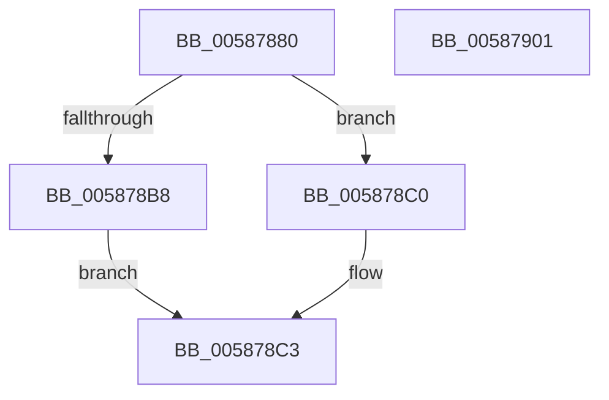

# HvlDmaDeleteDeviceDomain

- RVA: `0x00587880`–`0x00587902` (길이 `130` bytes)
- VA: `0x0000000140587880`
- 실행 섹션: `.text`
- PDB 이름 있음: `예`; PDB Function 태그: `아니요`
- unwind 정보 RVA: `0x000A02F8`
- 디코드: `33`개 명령, `130/130` bytes 표시
- 미해석 바이트: `0` (있으면 어셈블리에 `.byte`로 보존)

> 이 문서는 커널 이미지의 기계어와 PDB 기호를 분석해 생성했습니다. 4번과 5번은 함수 원형과 자료형을 바이너리 사용 방식에서 추정한 C 해석이며 원본 소스 복구 결과는 아닙니다.

## 1. Dependencies

- 직접 호출 지점: **3**; 고유 호출 대상: **3**
- 직접 호출자로 확인된 함수: **0**
- RIP 상대 이미지 참조: **1**

### Outgoing calls
- `0x005878E2` → [HvcallFastExtended](../31/HvcallFastExtended_function_003130E0.md) (function, `0x003130E0`)
- `0x005878EA` → [HvlpHvToNtStatus](../30/HvlpHvToNtStatus_function_00307BD8.md) (function, `0x00307BD8`)
- `0x005878F7` → [_security_check_cookie](../6A/_security_check_cookie_function_006AC640.md) (function, `0x006AC640`)

### Direct callers
- 이 함수 시작 RVA로 연결되는 직접 call은 확인되지 않았습니다. 간접 호출은 완전히 역산할 수 없습니다.

### Static image references
- `0x00587884` → RVA `0x00E0A740` (`.data`; read)

## 2. Other-region calls and transfers

- 다른 실행 섹션으로 향하는 call: **0**
- 별도 외부 분기/꼬리 이동을 확인하지 못했습니다.

## 3. Assembly (complete function range)

```asm
00587880  48 83 EC 78                     sub rsp, 0x78
00587884  48 8B 05 B5 2E 88 00            mov rax, qword ptr [rip + 0x882eb5]
0058788B  48 33 C4                        xor rax, rsp
0058788E  48 89 44 24 60                  mov qword ptr [rsp + 0x60], rax
00587893  48 83 4C 24 40 FF               or qword ptr [rsp + 0x40], 0xffffffffffffffff
00587899  33 D2                           xor edx, edx
0058789B  8B C2                           mov eax, edx
0058789D  48 C7 44 24 30 C5 00 00 00      mov qword ptr [rsp + 0x30], 0xc5
005878A6  C7 44 24 30 C5 00 01 00         mov dword ptr [rsp + 0x30], 0x100c5
005878AE  48 89 54 24 48                  mov qword ptr [rsp + 0x48], rdx
005878B3  38 51 04                        cmp byte ptr [rcx + 4], dl
005878B6  74 08                           je 0x1405878c0
005878B8  83 E0 F1                        and eax, 0xfffffff1
005878BB  83 C8 01                        or eax, 1
005878BE  EB 03                           jmp 0x1405878c3
005878C0  83 E0 F0                        and eax, 0xfffffff0
005878C3  45 33 C9                        xor r9d, r9d
005878C6  89 44 24 50                     mov dword ptr [rsp + 0x50], eax
005878CA  8B 01                           mov eax, dword ptr [rcx]
005878CC  48 8B 4C 24 30                  mov rcx, qword ptr [rsp + 0x30]
005878D1  89 54 24 20                     mov dword ptr [rsp + 0x20], edx
005878D5  48 8D 54 24 40                  lea rdx, [rsp + 0x40]
005878DA  45 8D 41 18                     lea r8d, [r9 + 0x18]
005878DE  89 44 24 54                     mov dword ptr [rsp + 0x54], eax
005878E2  E8 F9 B7 D8 FF                  call 0x1403130e0
005878E7  48 8B C8                        mov rcx, rax
005878EA  E8 E9 02 D8 FF                  call 0x140307bd8
005878EF  48 8B 4C 24 60                  mov rcx, qword ptr [rsp + 0x60]
005878F4  48 33 CC                        xor rcx, rsp
005878F7  E8 44 4D 12 00                  call 0x1406ac640
005878FC  48 83 C4 78                     add rsp, 0x78
00587900  C3                              ret
00587901  CC                              int3
```

## 4. C-style interpretation (structured pseudocode)

```c
__int64 __fastcall HvlDmaDeleteDeviceDomain(__int64 a1, int a2, __int64 a3, int a4)
{
    __int64 result;
    __int64 v_rsp;
    unsigned __int64 v_stack_m18;
    unsigned int v_stack_m24;
    unsigned int v_stack_m28;
    unsigned __int64 v_stack_m30;
    unsigned __int64 v_stack_m38;
    unsigned __int64 v_stack_m48;
    unsigned int v_stack_m58;

    v_rsp = (v_rsp) - (120);
    result = (*(unsigned __int64 *)(v_rip + 8924853)) ^ (v_rsp);
    v_stack_m18 = result;
    a2 = 0;
    v_stack_m48 = 197;
    v_stack_m48 = 0x100C5ULL;
    v_stack_m30 = 0;
    if ((*(unsigned __int8 *)(a1 + 4)) == 0) goto loc_005878C0;
    result = (unsigned int)((0) & (0xFFFFFFF1ULL));
    result = (unsigned int)((result) | (1));
    goto loc_005878C3;
loc_005878C0:
    result = (unsigned int)((result) & (0xFFFFFFF0ULL));
loc_005878C3:
    a4 = 0;
    v_stack_m28 = (unsigned int)(result);
    v_stack_m58 = 0;
    v_stack_m24 = (unsigned int)((unsigned int)(*(unsigned int *)(a1)));
    result = HvcallFastExtended(v_stack_m48, v_stack_m38, a4 + 24, a4);
    result = HvlpHvToNtStatus(result, v_stack_m38, a4 + 24, a4);
    a1 = (v_stack_m18) ^ (v_rsp);
    result = _security_check_cookie(a1, v_stack_m38, a4 + 24, a4);
    v_rsp = (v_rsp) + (120);
    return result;
}
```

## 5. (Beta) C Style

```c
int64_t HvlDmaDeleteDeviceDomain(void *Arg1, int32_t Arg2, int64_t Arg3, int32_t Arg4)
{
    uint8_t *arg1 = (uint8_t *)Arg1;

    int64_t result;
    int64_t local_rsp;
    uint64_t v_stack_m18;
    uint32_t v_stack_m24;
    uint32_t v_stack_m28;
    uint64_t v_stack_m30;
    uint64_t v_stack_m38;
    uint64_t v_stack_m48;
    uint32_t v_stack_m58;

    local_rsp = (local_rsp) - (120);
    result = (*(uint64_t *)(v_rip + 0x882EB5)) ^ (local_rsp);
    v_stack_m18 = result;
    Arg2 = 0;
    v_stack_m48 = 197;
    v_stack_m48 = 0x100C5ULL;
    v_stack_m30 = 0;
    if ((*(uint8_t *)(arg1 + 0x4)) == 0) goto loc_005878C0;
    result = (uint32_t)((0) & (0xFFFFFFF1ULL));
    result = (uint32_t)((result) | (1));
    goto loc_005878C3;
loc_005878C0:
    result = (uint32_t)((result) & (0xFFFFFFF0ULL));
loc_005878C3:
    Arg4 = 0;
    v_stack_m28 = (uint32_t)(result);
    v_stack_m58 = 0;
    v_stack_m24 = (uint32_t)((uint32_t)(*(uint32_t *)(arg1)));
    result = HvcallFastExtended(v_stack_m48, v_stack_m38, Arg4 + 24, Arg4);
    result = HvlpHvToNtStatus(result, v_stack_m38, Arg4 + 24, Arg4);
    Arg1 = (v_stack_m18) ^ (local_rsp);
    result = _security_check_cookie(Arg1, v_stack_m38, Arg4 + 24, Arg4);
    local_rsp = (local_rsp) + (120);
    return result;
}
```

### 관측된 메모리 오프셋

구조체 형식이 확인되지 않은 접근은 인자 기준의 오프셋으로만 기록했습니다.

| 기준 인자 | 오프셋 표현 | 폭 (bit) | 접근 |
|---|---:|---:|---|
| `Arg1` | `+ 0x0` | `32` | `R` |
| `Arg1` | `+ 0x4` | `8` | `R` |

## 6. Execution-region graph

[열기: 2D/3D 그래프와 함수 탐색 컨트롤 패널](../../../control-panel.html?section=text&rva=0x00587880&view=graph)

- 2D 그래프는 위에서 아래로 흐르고, 3D 그래프는 빈 공간을 드래그해 회전합니다. Shift+드래그는 이동, 휠은 확대·축소, 함수 노드 선택은 대상 보고서 이동입니다.

### Static fallback


