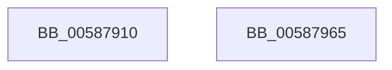

# HvlDmaDetachDeviceDomain

- RVA: `0x00587910`–`0x00587966` (길이 `86` bytes)
- VA: `0x0000000140587910`
- 실행 섹션: `.text`
- PDB 이름 있음: `예`; PDB Function 태그: `아니요`
- unwind 정보 RVA: `0x00063458`
- 디코드: `18`개 명령, `86/86` bytes 표시
- 미해석 바이트: `0` (있으면 어셈블리에 `.byte`로 보존)

> 이 문서는 커널 이미지의 기계어와 PDB 기호를 분석해 생성했습니다. 4번과 5번은 함수 원형과 자료형을 바이너리 사용 방식에서 추정한 C 해석이며 원본 소스 복구 결과는 아닙니다.

## 1. Dependencies

- 직접 호출 지점: **2**; 고유 호출 대상: **2**
- 직접 호출자로 확인된 함수: **0**
- RIP 상대 이미지 참조: **0**

### Outgoing calls
- `0x00587953` → [HvcallFastExtended](../31/HvcallFastExtended_function_003130E0.md) (function, `0x003130E0`)
- `0x0058795B` → [HvlpHvToNtStatus](../30/HvlpHvToNtStatus_function_00307BD8.md) (function, `0x00307BD8`)

### Direct callers
- 이 함수 시작 RVA로 연결되는 직접 call은 확인되지 않았습니다. 간접 호출은 완전히 역산할 수 없습니다.

### Static image references
- 디코드된 RIP-relative 메모리 참조가 없습니다.

## 2. Other-region calls and transfers

- 다른 실행 섹션으로 향하는 call: **0**
- 별도 외부 분기/꼬리 이동을 확인하지 못했습니다.

## 3. Assembly (complete function range)

```asm
00587910  48 83 EC 48                     sub rsp, 0x48
00587914  48 83 4C 24 30 FF               or qword ptr [rsp + 0x30], 0xffffffffffffffff
0058791A  48 8D 54 24 30                  lea rdx, [rsp + 0x30]
0058791F  83 64 24 20 00                  and dword ptr [rsp + 0x20], 0
00587924  48 B8 FF FF FF FF FF FF FF 3F   movabs rax, 0x3fffffffffffffff
0058792E  48 23 C8                        and rcx, rax
00587931  48 C7 44 24 50 C4 00 00 00      mov qword ptr [rsp + 0x50], 0xc4
0058793A  45 33 C9                        xor r9d, r9d
0058793D  48 89 4C 24 38                  mov qword ptr [rsp + 0x38], rcx
00587942  C7 44 24 50 C4 00 01 00         mov dword ptr [rsp + 0x50], 0x100c4
0058794A  48 8B 4C 24 50                  mov rcx, qword ptr [rsp + 0x50]
0058794F  45 8D 41 10                     lea r8d, [r9 + 0x10]
00587953  E8 88 B7 D8 FF                  call 0x1403130e0
00587958  48 8B C8                        mov rcx, rax
0058795B  E8 78 02 D8 FF                  call 0x140307bd8
00587960  48 83 C4 48                     add rsp, 0x48
00587964  C3                              ret
00587965  CC                              int3
```

## 4. C-style interpretation (structured pseudocode)

```c
__int64 __fastcall HvlDmaDetachDeviceDomain(__int64 a1, __int64 a2, __int64 a3, int a4)
{
    __int64 result;
    __int64 v_rsp;
    unsigned __int64 v_stack_m10;
    unsigned __int64 v_stack_m18;
    unsigned int v_stack_m28;
    unsigned __int64 v_stack_p8;

    v_rsp = (v_rsp) - (72);
    a1 = (a1) & (result);
    v_stack_p8 = 196;
    a4 = 0;
    v_stack_m10 = a1;
    v_stack_p8 = 0x100C4ULL;
    result = HvcallFastExtended(v_stack_p8, v_stack_m18, a4 + 16, a4);
    result = HvlpHvToNtStatus(result, v_stack_m18, a4 + 16, a4);
    v_rsp = (v_rsp) + (72);
    return result;
}
```

## 5. (Beta) C Style

```c
int64_t HvlDmaDetachDeviceDomain(int64_t Arg1, int64_t Arg2, int64_t Arg3, int32_t Arg4)
{
    int64_t result;
    int64_t local_rsp;
    uint64_t v_stack_m10;
    uint64_t v_stack_m18;
    uint32_t v_stack_m28;
    uint64_t v_stack_p8;

    local_rsp = (local_rsp) - (72);
    Arg1 = (Arg1) & (result);
    v_stack_p8 = 196;
    Arg4 = 0;
    v_stack_m10 = Arg1;
    v_stack_p8 = 0x100C4ULL;
    result = HvcallFastExtended(v_stack_p8, v_stack_m18, Arg4 + 16, Arg4);
    result = HvlpHvToNtStatus(result, v_stack_m18, Arg4 + 16, Arg4);
    local_rsp = (local_rsp) + (72);
    return result;
}
```

## 6. Execution-region graph

[열기: 2D/3D 그래프와 함수 탐색 컨트롤 패널](../../../control-panel.html?section=text&rva=0x00587910&view=graph)

- 2D 그래프는 위에서 아래로 흐르고, 3D 그래프는 빈 공간을 드래그해 회전합니다. Shift+드래그는 이동, 휠은 확대·축소, 함수 노드 선택은 대상 보고서 이동입니다.

### Static fallback


