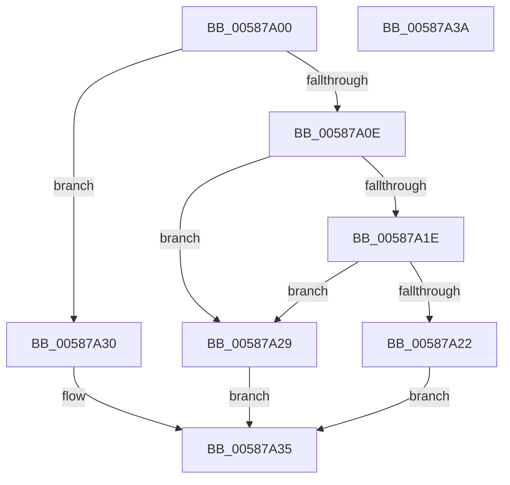

# HvlDmaFlushDeviceDomainVaList

- RVA: `0x00587A00`–`0x00587A3B` (길이 `59` bytes)
- VA: `0x0000000140587A00`
- 실행 섹션: `.text`
- PDB 이름 있음: `예`; PDB Function 태그: `아니요`
- unwind 정보 RVA: `0x0005C788`
- 디코드: `18`개 명령, `59/59` bytes 표시
- 미해석 바이트: `0` (있으면 어셈블리에 `.byte`로 보존)

> 이 문서는 커널 이미지의 기계어와 PDB 기호를 분석해 생성했습니다. 4번과 5번은 함수 원형과 자료형을 바이너리 사용 방식에서 추정한 C 해석이며 원본 소스 복구 결과는 아닙니다.

## 1. Dependencies

- 직접 호출 지점: **3**; 고유 호출 대상: **3**
- 직접 호출자로 확인된 함수: **0**
- RIP 상대 이미지 참조: **1**

### Outgoing calls
- `0x00587A22` → [HvlpDmaFastFlushDeviceDomainVaList](HvlpDmaFastFlushDeviceDomainVaList_function_00589BE0.md) (function, `0x00589BE0`)
- `0x00587A29` → [HvlpDmaSlowFlushDeviceDomainVaList](HvlpDmaSlowFlushDeviceDomainVaList_function_00589CC0.md) (function, `0x00589CC0`)
- `0x00587A30` → [HvlDmaFlushDeviceDomain](HvlDmaFlushDeviceDomain_function_00587970.md) (function, `0x00587970`)

### Direct callers
- 이 함수 시작 RVA로 연결되는 직접 call은 확인되지 않았습니다. 간접 호출은 완전히 역산할 수 없습니다.

### Static image references
- `0x00587A0E` → RVA `0x00FC6AB8` (`ALMOSTRO`; read)

## 2. Other-region calls and transfers

- 다른 실행 섹션으로 향하는 call: **0**
- 별도 외부 분기/꼬리 이동을 확인하지 못했습니다.

## 3. Assembly (complete function range)

```asm
00587A00  48 83 EC 28                     sub rsp, 0x28
00587A04  8D 42 FF                        lea eax, [rdx - 1]
00587A07  3D FB 01 00 00                  cmp eax, 0x1fb
00587A0C  77 22                           ja 0x140587a30
00587A0E  8B 05 A4 F0 A3 00               mov eax, dword ptr [rip + 0xa3f0a4]
00587A14  25 80 00 00 00                  and eax, 0x80
00587A19  83 FA 0A                        cmp edx, 0xa
00587A1C  77 0B                           ja 0x140587a29
00587A1E  85 C0                           test eax, eax
00587A20  74 07                           je 0x140587a29
00587A22  E8 B9 21 00 00                  call 0x140589be0
00587A27  EB 0C                           jmp 0x140587a35
00587A29  E8 92 22 00 00                  call 0x140589cc0
00587A2E  EB 05                           jmp 0x140587a35
00587A30  E8 3B FF FF FF                  call 0x140587970
00587A35  48 83 C4 28                     add rsp, 0x28
00587A39  C3                              ret
00587A3A  CC                              int3
```

## 4. C-style interpretation (structured pseudocode)

```c
__int64 __fastcall HvlDmaFlushDeviceDomainVaList(__int64 a1, __int64 a2)
{
    __int64 result;
    __int64 v_rsp;

    v_rsp = (v_rsp) - (40);
    if (((unsigned int)(a2 - 1)) > 507) goto loc_00587A30;
    result = (unsigned int)(((unsigned int)(*(unsigned int *)(v_rip + 10743972))) & (128));
    if (((unsigned int)(a2)) > 10) goto loc_00587A29;
    if ((unsigned int)(result) == 0) goto loc_00587A29;
    result = HvlpDmaFastFlushDeviceDomainVaList(a1, a2, a3, a4);
    goto loc_00587A35;
loc_00587A29:
    result = HvlpDmaSlowFlushDeviceDomainVaList(a1, a2, a3, a4);
    goto loc_00587A35;
loc_00587A30:
    result = HvlDmaFlushDeviceDomain(a1, a2, a3, a4);
loc_00587A35:
    v_rsp = (v_rsp) + (40);
    return result;
}
```

## 5. (Beta) C Style

```c
int64_t HvlDmaFlushDeviceDomainVaList(int64_t Arg1, void *Arg2)
{
    uint8_t *arg2 = (uint8_t *)Arg2;

    int64_t result;
    int64_t local_rsp;

    local_rsp = (local_rsp) - (40);
    if (((uint32_t)(Arg2 - 1)) > 507) goto loc_00587A30;
    result = (uint32_t)(((uint32_t)(*(uint32_t *)(v_rip + 0xA3F0A4))) & (128));
    if (((uint32_t)(Arg2)) > 10) goto loc_00587A29;
    if ((uint32_t)(result) == 0) goto loc_00587A29;
    result = HvlpDmaFastFlushDeviceDomainVaList(Arg1, Arg2, a3, a4);
    goto loc_00587A35;
loc_00587A29:
    result = HvlpDmaSlowFlushDeviceDomainVaList(Arg1, Arg2, a3, a4);
    goto loc_00587A35;
loc_00587A30:
    result = HvlDmaFlushDeviceDomain(Arg1, Arg2, a3, a4);
loc_00587A35:
    local_rsp = (local_rsp) + (40);
    return result;
}
```

### 관측된 메모리 오프셋

구조체 형식이 확인되지 않은 접근은 인자 기준의 오프셋으로만 기록했습니다.

| 기준 인자 | 오프셋 표현 | 폭 (bit) | 접근 |
|---|---:|---:|---|
| `Arg2` | `- 0x1` | `32` | `R` |

## 6. Execution-region graph

[열기: 2D/3D 그래프와 함수 탐색 컨트롤 패널](../../../control-panel.html?section=text&rva=0x00587A00&view=graph)

- 2D 그래프는 위에서 아래로 흐르고, 3D 그래프는 빈 공간을 드래그해 회전합니다. Shift+드래그는 이동, 휠은 확대·축소, 함수 노드 선택은 대상 보고서 이동입니다.

### Static fallback


