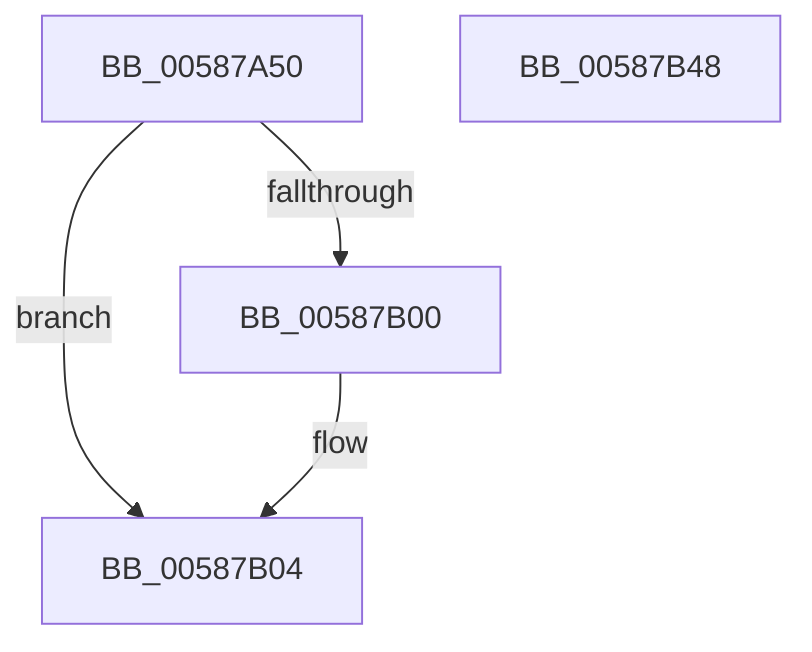

# HvlDmaGetDmaGuardEnabled

- RVA: `0x00587A50`–`0x00587B49` (길이 `249` bytes)
- VA: `0x0000000140587A50`
- 실행 섹션: `.text`
- PDB 이름 있음: `예`; PDB Function 태그: `아니요`
- unwind 정보 RVA: `0x000C672C`
- 디코드: `60`개 명령, `249/249` bytes 표시
- 미해석 바이트: `0` (있으면 어셈블리에 `.byte`로 보존)

> 이 문서는 커널 이미지의 기계어와 PDB 기호를 분석해 생성했습니다. 4번과 5번은 함수 원형과 자료형을 바이너리 사용 방식에서 추정한 C 해석이며 원본 소스 복구 결과는 아닙니다.

## 1. Dependencies

- 직접 호출 지점: **7**; 고유 호출 대상: **5**
- 직접 호출자로 확인된 함수: **0**
- RIP 상대 이미지 참조: **1**

### Outgoing calls
- `0x00587AB4` → [HvlpAcquireHypercallPage](../47/HvlpAcquireHypercallPage_function_00471410.md) (function, `0x00471410`)
- `0x00587AD0` → [HvlpAcquireHypercallPage](../47/HvlpAcquireHypercallPage_function_00471410.md) (function, `0x00471410`)
- `0x00587AF3` → [HvcallInitiateHypercall](../31/HvcallInitiateHypercall_function_00313630.md) (function, `0x00313630`)
- `0x00587B09` → [HvlpReleaseHypercallPage](../31/HvlpReleaseHypercallPage_function_00313480.md) (function, `0x00313480`)
- `0x00587B13` → [HvlpReleaseHypercallPage](../31/HvlpReleaseHypercallPage_function_00313480.md) (function, `0x00313480`)
- `0x00587B1B` → [HvlpHvToNtStatus](../30/HvlpHvToNtStatus_function_00307BD8.md) (function, `0x00307BD8`)
- `0x00587B2A` → [_security_check_cookie](../6A/_security_check_cookie_function_006AC640.md) (function, `0x006AC640`)

### Direct callers
- 이 함수 시작 RVA로 연결되는 직접 call은 확인되지 않았습니다. 간접 호출은 완전히 역산할 수 없습니다.

### Static image references
- `0x00587A6E` → RVA `0x00E0A740` (`.data`; read)

## 2. Other-region calls and transfers

- 다른 실행 섹션으로 향하는 call: **0**
- 별도 외부 분기/꼬리 이동을 확인하지 못했습니다.

## 3. Assembly (complete function range)

```asm
00587A50  48 8B C4                        mov rax, rsp
00587A53  48 89 58 10                     mov qword ptr [rax + 0x10], rbx
00587A57  48 89 70 18                     mov qword ptr [rax + 0x18], rsi
00587A5B  48 89 78 20                     mov qword ptr [rax + 0x20], rdi
00587A5F  55                              push rbp
00587A60  48 8D A8 58 F8 FF FF            lea rbp, [rax - 0x7a8]
00587A67  48 81 EC A0 08 00 00            sub rsp, 0x8a0
00587A6E  48 8B 05 CB 2C 88 00            mov rax, qword ptr [rip + 0x882ccb]
00587A75  48 33 C4                        xor rax, rsp
00587A78  48 89 85 90 07 00 00            mov qword ptr [rbp + 0x790], rax
00587A7F  33 C0                           xor eax, eax
00587A81  4C 8D 44 24 60                  lea r8, [rsp + 0x60]
00587A86  0F 57 C0                        xorps xmm0, xmm0
00587A89  48 89 44 24 50                  mov qword ptr [rsp + 0x50], rax
00587A8E  48 8B F9                        mov rdi, rcx
00587A91  89 44 24 58                     mov dword ptr [rsp + 0x58], eax
00587A95  48 8D 4C 24 40                  lea rcx, [rsp + 0x40]
00587A9A  48 89 44 24 30                  mov qword ptr [rsp + 0x30], rax
00587A9F  44 8D 48 10                     lea r9d, [rax + 0x10]
00587AA3  89 44 24 38                     mov dword ptr [rsp + 0x38], eax
00587AA7  8D 50 01                        lea edx, [rax + 1]
00587AAA  0F 11 44 24 40                  movups xmmword ptr [rsp + 0x40], xmm0
00587AAF  0F 11 44 24 20                  movups xmmword ptr [rsp + 0x20], xmm0
00587AB4  E8 57 99 EE FF                  call 0x140471410
00587AB9  41 B9 08 04 00 00               mov r9d, 0x408
00587ABF  4C 8D 45 80                     lea r8, [rbp - 0x80]
00587AC3  BA 02 00 00 00                  mov edx, 2
00587AC8  48 8D 4C 24 20                  lea rcx, [rsp + 0x20]
00587ACD  48 8B D8                        mov rbx, rax
00587AD0  E8 3B 99 EE FF                  call 0x140471410
00587AD5  4C 8B 44 24 38                  mov r8, qword ptr [rsp + 0x38]
00587ADA  0F 57 C0                        xorps xmm0, xmm0
00587ADD  48 8B 54 24 58                  mov rdx, qword ptr [rsp + 0x58]
00587AE2  B9 7B 00 00 00                  mov ecx, 0x7b
00587AE7  0F 11 03                        movups xmmword ptr [rbx], xmm0
00587AEA  C7 03 14 00 00 00               mov dword ptr [rbx], 0x14
00587AF0  48 8B F0                        mov rsi, rax
00587AF3  E8 38 BB D8 FF                  call 0x140313630
00587AF8  48 8B D8                        mov rbx, rax
00587AFB  66 85 C0                        test ax, ax
00587AFE  75 04                           jne 0x140587b04
00587B00  8A 06                           mov al, byte ptr [rsi]
00587B02  88 07                           mov byte ptr [rdi], al
00587B04  48 8D 4C 24 20                  lea rcx, [rsp + 0x20]
00587B09  E8 72 B9 D8 FF                  call 0x140313480
00587B0E  48 8D 4C 24 40                  lea rcx, [rsp + 0x40]
00587B13  E8 68 B9 D8 FF                  call 0x140313480
00587B18  0F B7 CB                        movzx ecx, bx
00587B1B  E8 B8 00 D8 FF                  call 0x140307bd8
00587B20  48 8B 8D 90 07 00 00            mov rcx, qword ptr [rbp + 0x790]
00587B27  48 33 CC                        xor rcx, rsp
00587B2A  E8 11 4B 12 00                  call 0x1406ac640
00587B2F  4C 8D 9C 24 A0 08 00 00         lea r11, [rsp + 0x8a0]
00587B37  49 8B 5B 18                     mov rbx, qword ptr [r11 + 0x18]
00587B3B  49 8B 73 20                     mov rsi, qword ptr [r11 + 0x20]
00587B3F  49 8B 7B 28                     mov rdi, qword ptr [r11 + 0x28]
00587B43  49 8B E3                        mov rsp, r11
00587B46  5D                              pop rbp
00587B47  C3                              ret
00587B48  CC                              int3
```

## 4. C-style interpretation (structured pseudocode)

```c
__int64 __fastcall HvlDmaGetDmaGuardEnabled(__int64 a1)
{
    __int64 result;
    __int64 v_rsp;
    unsigned __int64 v_stack_m8;
    unsigned __int64 v_stack_m848;
    unsigned int v_stack_m850;
    unsigned __int64 v_stack_m858;
    unsigned __int64 v_stack_m868;
    unsigned int v_stack_m870;
    unsigned __int64 v_stack_m878;
    unsigned __int64 v_stack_m888;

    *(unsigned __int64 *)(v_rsp + 16) = v_rbx;
    *(unsigned __int64 *)(v_rsp + 24) = v_rsi;
    *(unsigned __int64 *)(v_rsp + 32) = v_rdi;
    v_rsp = (v_rsp) - (0x8A0ULL);
    result = (*(unsigned __int64 *)(v_rip + 8924363)) ^ (v_rsp);
    *(unsigned __int64 *)(v_rsp - 1960 + 1936) = result;
    result = 0;
    v_stack_m858 = 0;
    v_stack_m850 = 0;
    v_stack_m878 = 0;
    v_stack_m870 = 0;
    v_stack_m868 = v_xmm0;
    v_stack_m888 = v_xmm0;
    result = HvlpAcquireHypercallPage(v_stack_m868, result + 1, v_stack_m848, result + 16);
    result = HvlpAcquireHypercallPage(v_stack_m888, 2, v_rsp - 1960 - 128, (unsigned int)(0x408ULL));
    *(unsigned __int64 *)(result) = v_xmm0;
    *(unsigned int *)(result) = 20;
    result = HvcallInitiateHypercall(123, v_stack_m850, v_stack_m870, (unsigned int)(0x408ULL));
    if ((unsigned __int16)(result) == 0) {
        result = *(unsigned __int8 *)(result);
        *(unsigned __int8 *)(a1) = (unsigned __int8)(result);
    }
    result = HvlpReleaseHypercallPage(v_stack_m888, v_stack_m850, v_stack_m870, (unsigned int)(0x408ULL));
    result = HvlpReleaseHypercallPage(v_stack_m868, v_stack_m850, v_stack_m870, (unsigned int)(0x408ULL));
    result = HvlpHvToNtStatus((unsigned __int16)(result), v_stack_m850, v_stack_m870, (unsigned int)(0x408ULL));
    a1 = (*(unsigned __int64 *)(v_rsp - 1960 + 1936)) ^ (v_rsp);
    result = _security_check_cookie(a1, v_stack_m850, v_stack_m870, (unsigned int)(0x408ULL));
    return result;
}
```

## 5. (Beta) C Style

```c
int64_t HvlDmaGetDmaGuardEnabled(void *Arg1)
{
    uint8_t *arg1 = (uint8_t *)Arg1;

    int64_t result;
    int64_t local_rsp;
    uint64_t v_stack_m8;
    uint64_t v_stack_m848;
    uint32_t v_stack_m850;
    uint64_t v_stack_m858;
    uint64_t v_stack_m868;
    uint32_t v_stack_m870;
    uint64_t v_stack_m878;
    uint64_t v_stack_m888;

    *(uint64_t *)(local_rsp + 0x10) = local_rbx;
    *(uint64_t *)(local_rsp + 0x18) = local_rsi;
    *(uint64_t *)(local_rsp + 0x20) = local_rdi;
    local_rsp = (local_rsp) - (0x8A0ULL);
    result = (*(uint64_t *)(v_rip + 0x882CCB)) ^ (local_rsp);
    *(uint64_t *)(local_rsp - 0x7A8 + 0x790) = result;
    result = 0;
    v_stack_m858 = 0;
    v_stack_m850 = 0;
    v_stack_m878 = 0;
    v_stack_m870 = 0;
    v_stack_m868 = v_xmm0;
    v_stack_m888 = v_xmm0;
    result = HvlpAcquireHypercallPage(v_stack_m868, result + 1, v_stack_m848, result + 16);
    result = HvlpAcquireHypercallPage(v_stack_m888, 2, local_rsp - 1960 - 128, (uint32_t)(0x408ULL));
    *(uint64_t *)(result) = v_xmm0;
    *(uint32_t *)(result) = 20;
    result = HvcallInitiateHypercall(123, v_stack_m850, v_stack_m870, (uint32_t)(0x408ULL));
    if ((uint16_t)(result) == 0) {
        result = *(uint8_t *)(result);
        *(uint8_t *)(arg1) = (uint8_t)(result);
    }
    result = HvlpReleaseHypercallPage(v_stack_m888, v_stack_m850, v_stack_m870, (uint32_t)(0x408ULL));
    result = HvlpReleaseHypercallPage(v_stack_m868, v_stack_m850, v_stack_m870, (uint32_t)(0x408ULL));
    result = HvlpHvToNtStatus((uint16_t)(result), v_stack_m850, v_stack_m870, (uint32_t)(0x408ULL));
    Arg1 = (*(uint64_t *)(local_rsp - 0x7A8 + 0x790)) ^ (local_rsp);
    result = _security_check_cookie(Arg1, v_stack_m850, v_stack_m870, (uint32_t)(0x408ULL));
    return result;
}
```

### 관측된 메모리 오프셋

구조체 형식이 확인되지 않은 접근은 인자 기준의 오프셋으로만 기록했습니다.

| 기준 인자 | 오프셋 표현 | 폭 (bit) | 접근 |
|---|---:|---:|---|
| `Arg1` | `+ 0x0` | `8` | `W` |

## 6. Execution-region graph

[열기: 2D/3D 그래프와 함수 탐색 컨트롤 패널](../../../control-panel.html?section=text&rva=0x00587A50&view=graph)

- 2D 그래프는 위에서 아래로 흐르고, 3D 그래프는 빈 공간을 드래그해 회전합니다. Shift+드래그는 이동, 휠은 확대·축소, 함수 노드 선택은 대상 보고서 이동입니다.

### Static fallback


