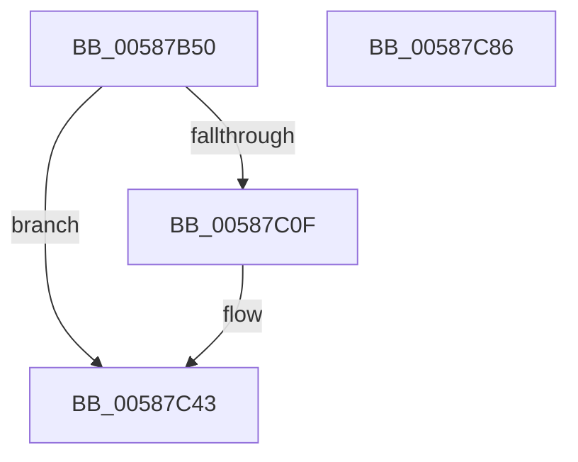

# HvlDmaGetHybridPassthroughReservedRegions

- RVA: `0x00587B50`–`0x00587C87` (길이 `311` bytes)
- VA: `0x0000000140587B50`
- 실행 섹션: `.text`
- PDB 이름 있음: `예`; PDB Function 태그: `아니요`
- unwind 정보 RVA: `0x000C6708`
- 디코드: `75`개 명령, `311/311` bytes 표시
- 미해석 바이트: `0` (있으면 어셈블리에 `.byte`로 보존)

> 이 문서는 커널 이미지의 기계어와 PDB 기호를 분석해 생성했습니다. 4번과 5번은 함수 원형과 자료형을 바이너리 사용 방식에서 추정한 C 해석이며 원본 소스 복구 결과는 아닙니다.

## 1. Dependencies

- 직접 호출 지점: **7**; 고유 호출 대상: **5**
- 직접 호출자로 확인된 함수: **0**
- RIP 상대 이미지 참조: **2**

### Outgoing calls
- `0x00587BB3` → [HvlpAcquireHypercallPage](../47/HvlpAcquireHypercallPage_function_00471410.md) (function, `0x00471410`)
- `0x00587BCF` → [HvlpAcquireHypercallPage](../47/HvlpAcquireHypercallPage_function_00471410.md) (function, `0x00471410`)
- `0x00587C02` → [HvcallInitiateHypercall](../31/HvcallInitiateHypercall_function_00313630.md) (function, `0x00313630`)
- `0x00587C48` → [HvlpReleaseHypercallPage](../31/HvlpReleaseHypercallPage_function_00313480.md) (function, `0x00313480`)
- `0x00587C52` → [HvlpReleaseHypercallPage](../31/HvlpReleaseHypercallPage_function_00313480.md) (function, `0x00313480`)
- `0x00587C5A` → [HvlpHvToNtStatus](../30/HvlpHvToNtStatus_function_00307BD8.md) (function, `0x00307BD8`)
- `0x00587C69` → [_security_check_cookie](../6A/_security_check_cookie_function_006AC640.md) (function, `0x006AC640`)

### Direct callers
- 이 함수 시작 RVA로 연결되는 직접 call은 확인되지 않았습니다. 간접 호출은 완전히 역산할 수 없습니다.

### Static image references
- `0x00587B6D` → RVA `0x00E0A740` (`.data`; read)
- `0x00587BE2` → RVA `0x00FC6F80` (`ALMOSTRO`; read)

## 2. Other-region calls and transfers

- 다른 실행 섹션으로 향하는 call: **0**
- 별도 외부 분기/꼬리 이동을 확인하지 못했습니다.

## 3. Assembly (complete function range)

```asm
00587B50  48 89 5C 24 10                  mov qword ptr [rsp + 0x10], rbx
00587B55  48 89 74 24 18                  mov qword ptr [rsp + 0x18], rsi
00587B5A  55                              push rbp
00587B5B  57                              push rdi
00587B5C  41 56                           push r14
00587B5E  48 8D AC 24 90 E0 FF FF         lea rbp, [rsp - 0x1f70]
00587B66  48 81 EC 70 20 00 00            sub rsp, 0x2070
00587B6D  48 8B 05 CC 2B 88 00            mov rax, qword ptr [rip + 0x882bcc]
00587B74  48 33 C4                        xor rax, rsp
00587B77  48 89 85 60 1F 00 00            mov qword ptr [rbp + 0x1f60], rax
00587B7E  33 C0                           xor eax, eax
00587B80  4C 8D 44 24 60                  lea r8, [rsp + 0x60]
00587B85  0F 57 C0                        xorps xmm0, xmm0
00587B88  48 89 44 24 50                  mov qword ptr [rsp + 0x50], rax
00587B8D  48 8B F1                        mov rsi, rcx
00587B90  89 44 24 58                     mov dword ptr [rsp + 0x58], eax
00587B94  48 8D 4C 24 40                  lea rcx, [rsp + 0x40]
00587B99  48 89 44 24 30                  mov qword ptr [rsp + 0x30], rax
00587B9E  44 8D 48 18                     lea r9d, [rax + 0x18]
00587BA2  89 44 24 38                     mov dword ptr [rsp + 0x38], eax
00587BA6  8D 50 01                        lea edx, [rax + 1]
00587BA9  0F 11 44 24 40                  movups xmmword ptr [rsp + 0x40], xmm0
00587BAE  0F 11 44 24 20                  movups xmmword ptr [rsp + 0x20], xmm0
00587BB3  E8 58 98 EE FF                  call 0x140471410
00587BB8  41 B9 E8 0F 00 00               mov r9d, 0xfe8
00587BBE  4C 8D 45 90                     lea r8, [rbp - 0x70]
00587BC2  BA 02 00 00 00                  mov edx, 2
00587BC7  48 8D 4C 24 20                  lea rcx, [rsp + 0x20]
00587BCC  48 8B D8                        mov rbx, rax
00587BCF  E8 3C 98 EE FF                  call 0x140471410
00587BD4  45 33 F6                        xor r14d, r14d
00587BD7  48 8B F8                        mov rdi, rax
00587BDA  4C 89 73 0C                     mov qword ptr [rbx + 0xc], r14
00587BDE  44 89 73 14                     mov dword ptr [rbx + 0x14], r14d
00587BE2  48 8B 0D 97 F3 A3 00            mov rcx, qword ptr [rip + 0xa3f397]
00587BE9  4C 8B 44 24 38                  mov r8, qword ptr [rsp + 0x38]
00587BEE  48 8B 54 24 58                  mov rdx, qword ptr [rsp + 0x58]
00587BF3  48 89 0B                        mov qword ptr [rbx], rcx
00587BF6  B9 01 01 00 00                  mov ecx, 0x101
00587BFB  C7 43 08 00 00 09 00            mov dword ptr [rbx + 8], 0x90000
00587C02  E8 29 BA D8 FF                  call 0x140313630
00587C07  48 8B D8                        mov rbx, rax
00587C0A  66 85 C0                        test ax, ax
00587C0D  75 34                           jne 0x140587c43
00587C0F  48 8B 07                        mov rax, qword ptr [rdi]
00587C12  48 89 06                        mov qword ptr [rsi], rax
00587C15  48 8D 46 18                     lea rax, [rsi + 0x18]
00587C19  0F 10 47 08                     movups xmm0, xmmword ptr [rdi + 8]
00587C1D  0F 11 00                        movups xmmword ptr [rax], xmm0
00587C20  0F 10 4F 18                     movups xmm1, xmmword ptr [rdi + 0x18]
00587C24  0F 11 48 10                     movups xmmword ptr [rax + 0x10], xmm1
00587C28  0F 10 47 28                     movups xmm0, xmmword ptr [rdi + 0x28]
00587C2C  0F 11 40 20                     movups xmmword ptr [rax + 0x20], xmm0
00587C30  0F 10 4F 38                     movups xmm1, xmmword ptr [rdi + 0x38]
00587C34  0F 11 48 30                     movups xmmword ptr [rax + 0x30], xmm1
00587C38  C7 46 08 00 02 00 00            mov dword ptr [rsi + 8], 0x200
00587C3F  48 89 46 10                     mov qword ptr [rsi + 0x10], rax
00587C43  48 8D 4C 24 20                  lea rcx, [rsp + 0x20]
00587C48  E8 33 B8 D8 FF                  call 0x140313480
00587C4D  48 8D 4C 24 40                  lea rcx, [rsp + 0x40]
00587C52  E8 29 B8 D8 FF                  call 0x140313480
00587C57  0F B7 CB                        movzx ecx, bx
00587C5A  E8 79 FF D7 FF                  call 0x140307bd8
00587C5F  48 8B 8D 60 1F 00 00            mov rcx, qword ptr [rbp + 0x1f60]
00587C66  48 33 CC                        xor rcx, rsp
00587C69  E8 D2 49 12 00                  call 0x1406ac640
00587C6E  4C 8D 9C 24 70 20 00 00         lea r11, [rsp + 0x2070]
00587C76  49 8B 5B 28                     mov rbx, qword ptr [r11 + 0x28]
00587C7A  49 8B 73 30                     mov rsi, qword ptr [r11 + 0x30]
00587C7E  49 8B E3                        mov rsp, r11
00587C81  41 5E                           pop r14
00587C83  5F                              pop rdi
00587C84  5D                              pop rbp
00587C85  C3                              ret
00587C86  CC                              int3
```

## 4. C-style interpretation (structured pseudocode)

```c
__int64 __fastcall HvlDmaGetHybridPassthroughReservedRegions(__int64 a1)
{
    __int64 result;
    __int64 v_r14;
    __int64 v_rsp;
    unsigned __int64 v_stack_m18;
    unsigned __int64 v_stack_m1F88;
    unsigned __int64 v_stack_m1FF8;
    unsigned __int64 v_stack_m2028;
    unsigned int v_stack_m2030;
    unsigned __int64 v_stack_m2038;
    unsigned __int64 v_stack_m2048;
    unsigned int v_stack_m2050;
    unsigned __int64 v_stack_m2058;
    unsigned __int64 v_stack_m2068;
    unsigned __int64 v_stack_m28;
    unsigned __int64 v_stack_p10;
    unsigned __int64 v_stack_p18;

    v_stack_p10 = v_rbx;
    v_stack_p18 = v_rsi;
    v_rsp = (v_rsp) - (0x2070ULL);
    result = (*(unsigned __int64 *)(v_rip + 8924108)) ^ (v_rsp);
    v_stack_m28 = result;
    result = 0;
    v_stack_m2038 = 0;
    v_stack_m2030 = 0;
    v_stack_m2058 = 0;
    v_stack_m2050 = 0;
    v_stack_m2048 = v_xmm0;
    v_stack_m2068 = v_xmm0;
    result = HvlpAcquireHypercallPage(v_stack_m2048, result + 1, v_stack_m2028, result + 24);
    result = HvlpAcquireHypercallPage(v_stack_m2068, 2, v_stack_m1FF8, (unsigned int)(0xFE8ULL));
    v_r14 = 0;
    *(unsigned __int64 *)(result + 12) = 0;
    *(unsigned int *)(result + 20) = 0;
    *(unsigned __int64 *)(result) = *(unsigned __int64 *)(v_rip + 10744727);
    *(unsigned int *)(result + 8) = 0x90000ULL;
    result = HvcallInitiateHypercall(257, v_stack_m2030, v_stack_m2050, (unsigned int)(0xFE8ULL));
    if ((unsigned __int16)(result) == 0) {
        result = *(unsigned __int64 *)(result);
        *(unsigned __int64 *)(a1) = result;
        result = a1 + 24;
        *(unsigned __int64 *)(result) = v_xmm0;
        *(unsigned __int64 *)(result + 16) = v_xmm1;
        *(unsigned __int64 *)(result + 32) = v_xmm0;
        *(unsigned __int64 *)(result + 48) = v_xmm1;
        *(unsigned int *)(a1 + 8) = 512;
        *(unsigned __int64 *)(a1 + 16) = result;
    }
    result = HvlpReleaseHypercallPage(v_stack_m2068, v_stack_m2030, v_stack_m2050, (unsigned int)(0xFE8ULL));
    result = HvlpReleaseHypercallPage(v_stack_m2048, v_stack_m2030, v_stack_m2050, (unsigned int)(0xFE8ULL));
    result = HvlpHvToNtStatus((unsigned __int16)(result), v_stack_m2030, v_stack_m2050, (unsigned int)(0xFE8ULL));
    a1 = (v_stack_m28) ^ (v_rsp);
    result = _security_check_cookie(a1, v_stack_m2030, v_stack_m2050, (unsigned int)(0xFE8ULL));
    return result;
}
```

## 5. (Beta) C Style

```c
int64_t HvlDmaGetHybridPassthroughReservedRegions(void *Arg1)
{
    uint8_t *arg1 = (uint8_t *)Arg1;

    int64_t result;
    int64_t local_r14;
    int64_t local_rsp;
    uint64_t v_stack_m18;
    uint64_t v_stack_m1F88;
    uint64_t v_stack_m1FF8;
    uint64_t v_stack_m2028;
    uint32_t v_stack_m2030;
    uint64_t v_stack_m2038;
    uint64_t v_stack_m2048;
    uint32_t v_stack_m2050;
    uint64_t v_stack_m2058;
    uint64_t v_stack_m2068;
    uint64_t v_stack_m28;
    uint64_t v_stack_p10;
    uint64_t v_stack_p18;

    v_stack_p10 = local_rbx;
    v_stack_p18 = local_rsi;
    local_rsp = (local_rsp) - (0x2070ULL);
    result = (*(uint64_t *)(v_rip + 0x882BCC)) ^ (local_rsp);
    v_stack_m28 = result;
    result = 0;
    v_stack_m2038 = 0;
    v_stack_m2030 = 0;
    v_stack_m2058 = 0;
    v_stack_m2050 = 0;
    v_stack_m2048 = v_xmm0;
    v_stack_m2068 = v_xmm0;
    result = HvlpAcquireHypercallPage(v_stack_m2048, result + 1, v_stack_m2028, result + 24);
    result = HvlpAcquireHypercallPage(v_stack_m2068, 2, v_stack_m1FF8, (uint32_t)(0xFE8ULL));
    local_r14 = 0;
    *(uint64_t *)(result + 0xC) = 0;
    *(uint32_t *)(result + 0x14) = 0;
    *(uint64_t *)(result) = *(uint64_t *)(v_rip + 0xA3F397);
    *(uint32_t *)(result + 0x8) = 0x90000ULL;
    result = HvcallInitiateHypercall(257, v_stack_m2030, v_stack_m2050, (uint32_t)(0xFE8ULL));
    if ((uint16_t)(result) == 0) {
        result = *(uint64_t *)(result);
        *(uint64_t *)(arg1) = result;
        result = Arg1 + 24;
        *(uint64_t *)(result) = v_xmm0;
        *(uint64_t *)(result + 0x10) = v_xmm1;
        *(uint64_t *)(result + 0x20) = v_xmm0;
        *(uint64_t *)(result + 0x30) = v_xmm1;
        *(uint32_t *)(arg1 + 0x8) = 512;
        *(uint64_t *)(arg1 + 0x10) = result;
    }
    result = HvlpReleaseHypercallPage(v_stack_m2068, v_stack_m2030, v_stack_m2050, (uint32_t)(0xFE8ULL));
    result = HvlpReleaseHypercallPage(v_stack_m2048, v_stack_m2030, v_stack_m2050, (uint32_t)(0xFE8ULL));
    result = HvlpHvToNtStatus((uint16_t)(result), v_stack_m2030, v_stack_m2050, (uint32_t)(0xFE8ULL));
    Arg1 = (v_stack_m28) ^ (local_rsp);
    result = _security_check_cookie(Arg1, v_stack_m2030, v_stack_m2050, (uint32_t)(0xFE8ULL));
    return result;
}
```

### 관측된 메모리 오프셋

구조체 형식이 확인되지 않은 접근은 인자 기준의 오프셋으로만 기록했습니다.

| 기준 인자 | 오프셋 표현 | 폭 (bit) | 접근 |
|---|---:|---:|---|
| `Arg1` | `+ 0x0` | `64` | `W` |
| `Arg1` | `+ 0x0` | `128` | `R` |
| `Arg1` | `+ 0x8` | `32` | `W` |
| `Arg1` | `+ 0x10` | `64` | `W` |
| `Arg1` | `+ 0x10` | `128` | `R` |
| `Arg1` | `+ 0x18` | `64` | `R` |
| `Arg1` | `+ 0x20` | `128` | `R` |
| `Arg1` | `+ 0x30` | `128` | `R` |

## 6. Execution-region graph

[열기: 2D/3D 그래프와 함수 탐색 컨트롤 패널](../../../control-panel.html?section=text&rva=0x00587B50&view=graph)

- 2D 그래프는 위에서 아래로 흐르고, 3D 그래프는 빈 공간을 드래그해 회전합니다. Shift+드래그는 이동, 휠은 확대·축소, 함수 노드 선택은 대상 보고서 이동입니다.

### Static fallback


