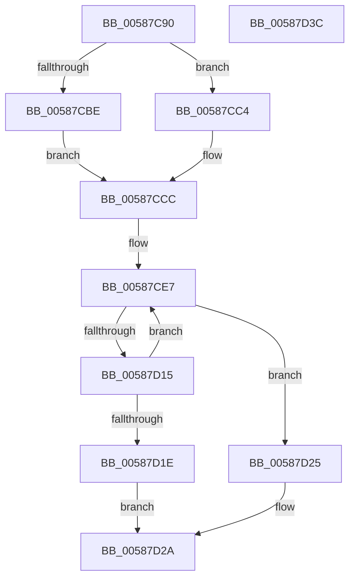

# HvlDmaReserveDeviceDomainAttachment

- RVA: `0x00587C90`–`0x00587D3D` (길이 `173` bytes)
- VA: `0x0000000140587C90`
- 실행 섹션: `.text`
- PDB 이름 있음: `예`; PDB Function 태그: `아니요`
- unwind 정보 RVA: `0x000A02F8`
- 디코드: `43`개 명령, `173/173` bytes 표시
- 미해석 바이트: `0` (있으면 어셈블리에 `.byte`로 보존)

> 이 문서는 커널 이미지의 기계어와 PDB 기호를 분석해 생성했습니다. 4번과 5번은 함수 원형과 자료형을 바이너리 사용 방식에서 추정한 C 해석이며 원본 소스 복구 결과는 아닙니다.

## 1. Dependencies

- 직접 호출 지점: **5**; 고유 호출 대상: **5**
- 직접 호출자로 확인된 함수: **0**
- RIP 상대 이미지 참조: **1**

### Outgoing calls
- `0x00587CFD` → [HvcallFastExtended](../31/HvcallFastExtended_function_003130E0.md) (function, `0x003130E0`)
- `0x00587D08` → [HvlpHvStatusIsInsufficientMemory](../30/HvlpHvStatusIsInsufficientMemory_function_00307BB0.md) (function, `0x00307BB0`)
- `0x00587D15` → [HvlpHandleInsufficientMemory](HvlpHandleInsufficientMemory_function_00584514.md) (function, `0x00584514`)
- `0x00587D25` → [HvlpHvToNtStatus](../30/HvlpHvToNtStatus_function_00307BD8.md) (function, `0x00307BD8`)
- `0x00587D32` → [_security_check_cookie](../6A/_security_check_cookie_function_006AC640.md) (function, `0x006AC640`)

### Direct callers
- 이 함수 시작 RVA로 연결되는 직접 call은 확인되지 않았습니다. 간접 호출은 완전히 역산할 수 없습니다.

### Static image references
- `0x00587C94` → RVA `0x00E0A740` (`.data`; read)

## 2. Other-region calls and transfers

- 다른 실행 섹션으로 향하는 call: **0**
- 별도 외부 분기/꼬리 이동을 확인하지 못했습니다.

## 3. Assembly (complete function range)

```asm
00587C90  48 83 EC 78                     sub rsp, 0x78
00587C94  48 8B 05 A5 2A 88 00            mov rax, qword ptr [rip + 0x882aa5]
00587C9B  48 33 C4                        xor rax, rsp
00587C9E  48 89 44 24 60                  mov qword ptr [rsp + 0x60], rax
00587CA3  48 83 64 24 48 00               and qword ptr [rsp + 0x48], 0
00587CA9  45 33 C0                        xor r8d, r8d
00587CAC  48 83 4C 24 40 FF               or qword ptr [rsp + 0x40], 0xffffffffffffffff
00587CB2  8B 02                           mov eax, dword ptr [rdx]
00587CB4  89 44 24 54                     mov dword ptr [rsp + 0x54], eax
00587CB8  44 38 42 04                     cmp byte ptr [rdx + 4], r8b
00587CBC  75 06                           jne 0x140587cc4
00587CBE  41 83 E0 F0                     and r8d, 0xfffffff0
00587CC2  EB 08                           jmp 0x140587ccc
00587CC4  41 83 E0 F1                     and r8d, 0xfffffff1
00587CC8  41 83 C8 01                     or r8d, 1
00587CCC  48 C7 44 24 30 0D 01 00 00      mov qword ptr [rsp + 0x30], 0x10d
00587CD5  C7 44 24 30 0D 01 01 00         mov dword ptr [rsp + 0x30], 0x1010d
00587CDD  44 89 44 24 50                  mov dword ptr [rsp + 0x50], r8d
00587CE2  48 89 4C 24 58                  mov qword ptr [rsp + 0x58], rcx
00587CE7  48 8B 4C 24 30                  mov rcx, qword ptr [rsp + 0x30]
00587CEC  48 8D 54 24 40                  lea rdx, [rsp + 0x40]
00587CF1  83 64 24 20 00                  and dword ptr [rsp + 0x20], 0
00587CF6  45 33 C9                        xor r9d, r9d
00587CF9  45 8D 41 20                     lea r8d, [r9 + 0x20]
00587CFD  E8 DE B3 D8 FF                  call 0x1403130e0
00587D02  0F B7 C8                        movzx ecx, ax
00587D05  4C 8B C0                        mov r8, rax
00587D08  E8 A3 FE D7 FF                  call 0x140307bb0
00587D0D  41 0F B7 C8                     movzx ecx, r8w
00587D11  84 C0                           test al, al
00587D13  74 10                           je 0x140587d25
00587D15  E8 FA C7 FF FF                  call 0x140584514
00587D1A  85 C0                           test eax, eax
00587D1C  79 C9                           jns 0x140587ce7
00587D1E  B8 9A 00 00 C0                  mov eax, 0xc000009a
00587D23  EB 05                           jmp 0x140587d2a
00587D25  E8 AE FE D7 FF                  call 0x140307bd8
00587D2A  48 8B 4C 24 60                  mov rcx, qword ptr [rsp + 0x60]
00587D2F  48 33 CC                        xor rcx, rsp
00587D32  E8 09 49 12 00                  call 0x1406ac640
00587D37  48 83 C4 78                     add rsp, 0x78
00587D3B  C3                              ret
00587D3C  CC                              int3
```

## 4. C-style interpretation (structured pseudocode)

```c
__int64 __fastcall HvlDmaReserveDeviceDomainAttachment(__int64 a1, __int64 a2, int a3, int a4)
{
    __int64 result;
    __int64 v_rsp;
    unsigned __int64 v_stack_m18;
    unsigned __int64 v_stack_m20;
    unsigned int v_stack_m24;
    unsigned int v_stack_m28;
    unsigned __int64 v_stack_m30;
    unsigned __int64 v_stack_m38;
    unsigned __int64 v_stack_m48;
    unsigned int v_stack_m58;

    v_rsp = (v_rsp) - (120);
    result = (*(unsigned __int64 *)(v_rip + 8923813)) ^ (v_rsp);
    v_stack_m18 = result;
    a3 = 0;
    v_stack_m24 = (unsigned int)((unsigned int)(*(unsigned int *)(a2)));
    if ((*(unsigned __int8 *)(a2 + 4)) != 0) goto loc_00587CC4;
    a3 = (unsigned int)((a3) & (0xFFFFFFF0ULL));
    goto loc_00587CCC;
loc_00587CC4:
    a3 = (unsigned int)((a3) & (0xFFFFFFF1ULL));
    a3 = (unsigned int)((a3) | (1));
loc_00587CCC:
    v_stack_m48 = 269;
    v_stack_m48 = 0x1010DULL;
    v_stack_m28 = a3;
    v_stack_m20 = a1;
loc_00587CE7:
    a4 = 0;
    result = HvcallFastExtended(v_stack_m48, v_stack_m38, a4 + 32, a4);
    result = HvlpHvStatusIsInsufficientMemory((unsigned __int16)(result), v_stack_m38, result, a4);
    if ((unsigned __int8)(result) == 0) goto loc_00587D25;
    result = HvlpHandleInsufficientMemory((unsigned __int16)(result), v_stack_m38, result, a4);
    if (!sign_flag) goto loc_00587CE7;
    goto loc_00587D2A;
loc_00587D25:
    result = HvlpHvToNtStatus((unsigned __int16)(result), v_stack_m38, result, a4);
loc_00587D2A:
    a1 = (v_stack_m18) ^ (v_rsp);
    result = _security_check_cookie(a1, v_stack_m38, result, a4);
    v_rsp = (v_rsp) + (120);
    return result;
}
```

## 5. (Beta) C Style

```c
int64_t HvlDmaReserveDeviceDomainAttachment(int64_t Arg1, void *Arg2, int32_t Arg3, int32_t Arg4)
{
    uint8_t *arg2 = (uint8_t *)Arg2;

    int64_t result;
    int64_t local_rsp;
    uint64_t v_stack_m18;
    uint64_t v_stack_m20;
    uint32_t v_stack_m24;
    uint32_t v_stack_m28;
    uint64_t v_stack_m30;
    uint64_t v_stack_m38;
    uint64_t v_stack_m48;
    uint32_t v_stack_m58;

    local_rsp = (local_rsp) - (120);
    result = (*(uint64_t *)(v_rip + 0x882AA5)) ^ (local_rsp);
    v_stack_m18 = result;
    Arg3 = 0;
    v_stack_m24 = (uint32_t)((uint32_t)(*(uint32_t *)(arg2)));
    if ((*(uint8_t *)(arg2 + 0x4)) != 0) goto loc_00587CC4;
    Arg3 = (uint32_t)((Arg3) & (0xFFFFFFF0ULL));
    goto loc_00587CCC;
loc_00587CC4:
    Arg3 = (uint32_t)((Arg3) & (0xFFFFFFF1ULL));
    Arg3 = (uint32_t)((Arg3) | (1));
loc_00587CCC:
    v_stack_m48 = 269;
    v_stack_m48 = 0x1010DULL;
    v_stack_m28 = Arg3;
    v_stack_m20 = Arg1;
loc_00587CE7:
    Arg4 = 0;
    result = HvcallFastExtended(v_stack_m48, v_stack_m38, Arg4 + 32, Arg4);
    result = HvlpHvStatusIsInsufficientMemory((uint16_t)(result), v_stack_m38, result, Arg4);
    if ((uint8_t)(result) == 0) goto loc_00587D25;
    result = HvlpHandleInsufficientMemory((uint16_t)(result), v_stack_m38, result, Arg4);
    if (!sign_flag) goto loc_00587CE7;
    goto loc_00587D2A;
loc_00587D25:
    result = HvlpHvToNtStatus((uint16_t)(result), v_stack_m38, result, Arg4);
loc_00587D2A:
    Arg1 = (v_stack_m18) ^ (local_rsp);
    result = _security_check_cookie(Arg1, v_stack_m38, result, Arg4);
    local_rsp = (local_rsp) + (120);
    return result;
}
```

### 관측된 메모리 오프셋

구조체 형식이 확인되지 않은 접근은 인자 기준의 오프셋으로만 기록했습니다.

| 기준 인자 | 오프셋 표현 | 폭 (bit) | 접근 |
|---|---:|---:|---|
| `Arg2` | `+ 0x0` | `32` | `R` |
| `Arg2` | `+ 0x4` | `8` | `R` |

## 6. Execution-region graph

[열기: 2D/3D 그래프와 함수 탐색 컨트롤 패널](../../../control-panel.html?section=text&rva=0x00587C90&view=graph)

- 2D 그래프는 위에서 아래로 흐르고, 3D 그래프는 빈 공간을 드래그해 회전합니다. Shift+드래그는 이동, 휠은 확대·축소, 함수 노드 선택은 대상 보고서 이동입니다.

### Static fallback


